# Homeowner

**A housework advisor that decides who does what today, from how everyone in the Home actually feels.**

Homeowner is a phone app (an installable PWA, in Brazilian Portuguese and US English) for people who look after their own Home and share the housework. Each morning every Resident says how much Energy they have. The app then proposes a Day Plan that gives each person Tasks that fit their Energy, never breaks a Restriction, puts the most urgent work first and rolls the rest over to another day.

It is also an experiment in building software with a team of AI agents: almost every ticket on this repository was planned, refined, built and reviewed by Claude agents working through GitHub labels, with a human steering and merging.

## The idea

Chore apps track what needs doing. That is rarely the hard part. The hard part is the daily negotiation over who does it, especially when one person in the Home has much less Energy than the other on most days. The person with less Energy feels guilty and overwhelmed; the one with more quietly carries the load.

Homeowner takes that negotiation off the table:

- **Advise, never command.** The app proposes a plan. Only a Task a Resident explicitly commits to counts as a promise.
- **Rest is never punished.** A Drained day gets no Tasks and simply pauses your Streak. Only a broken commitment breaks it.
- **Never past the limit.** No plan puts a Resident over their Energy or gives them work they told the app they cannot do (bending, heavy lifting, heights, strong chemicals).
- **Explain every decision** in plain language, so the plan feels fair instead of bossy.
- **Fair over time.** Preferences are honoured where possible, essential work still comes first, and the load evens out across the week.

The daily plan can be drafted by an LLM, but a deterministic referee written in Go checks every proposal against the rules and falls back to a rule-based planner whenever the model is slow, wrong or switched off ([ADR 0004](docs/adr/0004-ai-allocates-behind-a-deterministic-referee.md)). The model only sees opaque ids and numbers, never names or health-related details.

The domain language (Home, Resident, Chore, Task, Energy, Check-in, Day Plan, Streak and friends) is defined in [GLOSSARY.md](GLOSSARY.md), and the product's principles in [PRODUCT.md](PRODUCT.md).

## Screenshots

Most Residents use the app in Brazilian Portuguese, so it is designed pt-BR first.

| Today | Check-in | Chores | Home | Me |
|---|---|---|---|---|
| 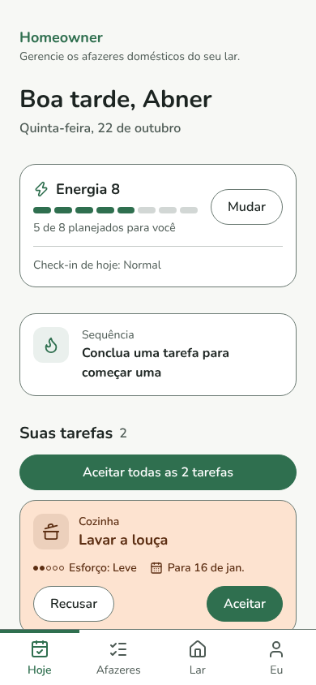 | 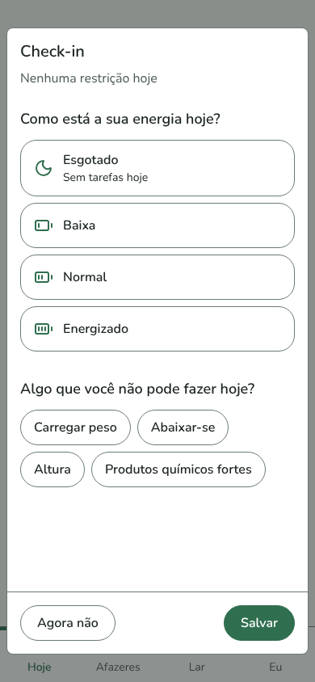 | 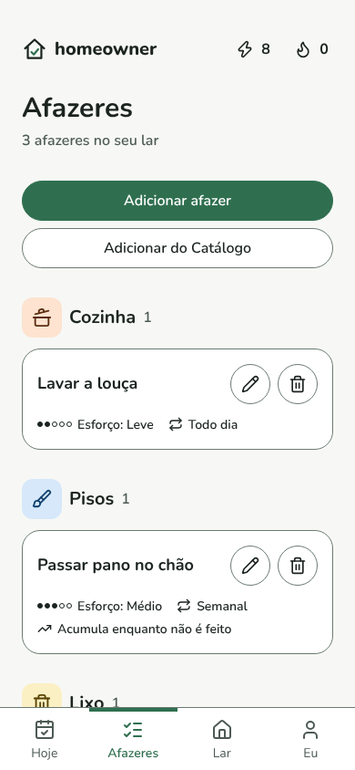 | 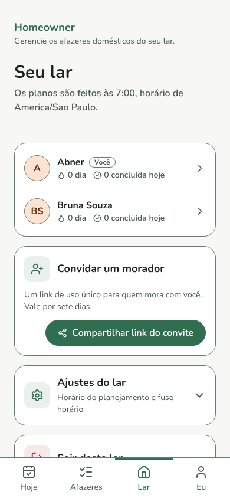 | 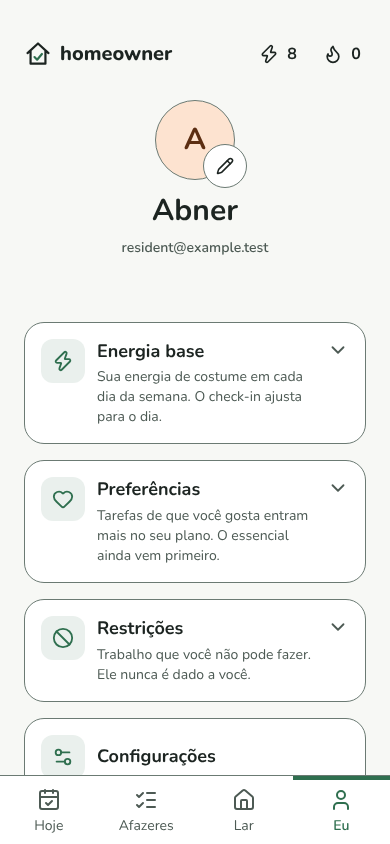 |

<details>
<summary>The same screens in English</summary>

| Today | Check-in | Chores | Home | Me |
|---|---|---|---|---|
| 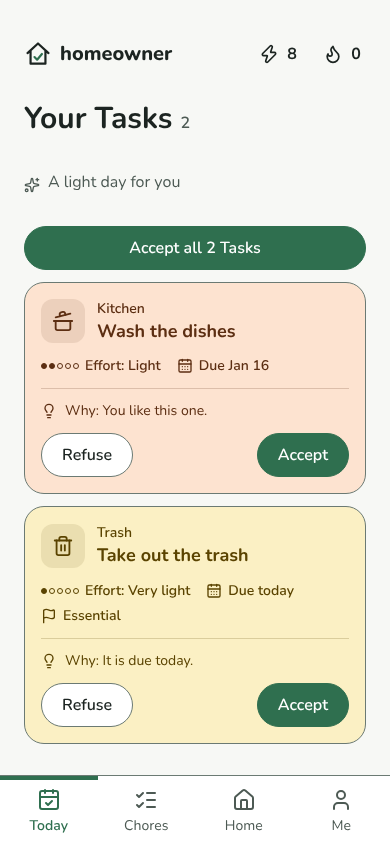 | 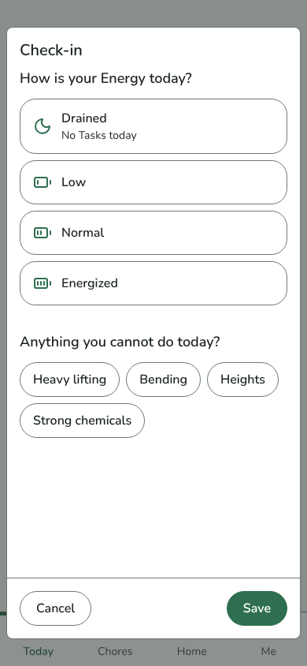 | 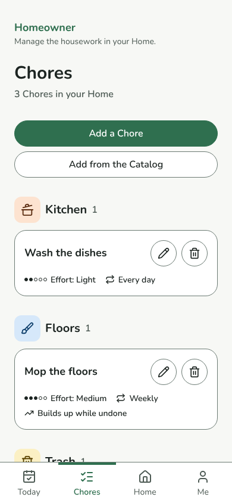 | 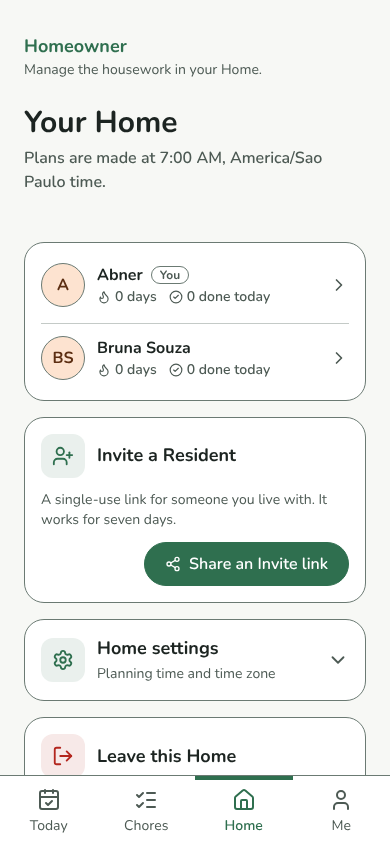 | 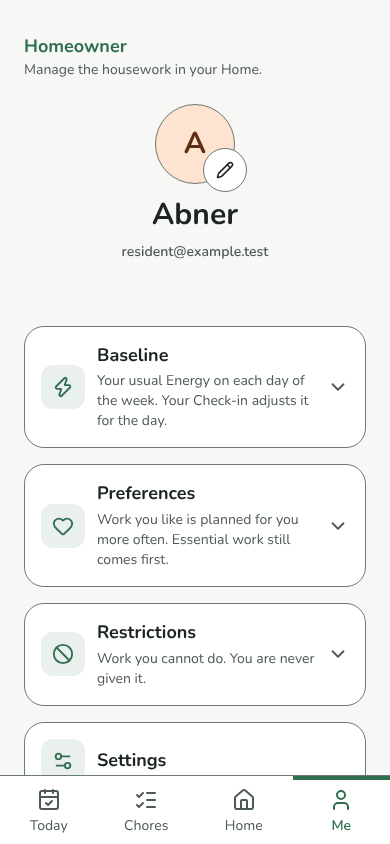 |

</details>

<sub>Captured from the app with the end-to-end test fakes (sample data, no real accounts).</sub>

## A day in Homeowner

1. **Check in.** Open the app and pick Drained, Low, Normal or Energized, plus anything you cannot do today. Your weekly Baseline is adjusted for the day.
2. **Get your Day Plan.** At the Home's Allocation time the plan is made for everyone, and a push notification nudges you. You can also ask to be planned right away.
3. **Commit.** Accept or refuse your Tasks, or take one nobody could fit. Accepted Tasks are your promise for the day.
4. **Mark it done.** Finishing what you committed to keeps your Streak going. Whatever nobody could take rolls over, most urgent first.

## How it is built

| Part | What it is |
|---|---|
| `web/` | React 19 PWA (Vite, TypeScript, Tailwind v4, Radix, TanStack Query), light and dark themes, offline-capable |
| `backend/` | Go API and the scheduled Allocation job, Postgres with goose migrations |
| `infra/` | Terraform for AWS: Lambda behind API Gateway, EventBridge, S3 and CloudFront, Cognito, plus a Neon Postgres branch per environment |

Staging deploys on every merge to `main`; production deploys when `main` is promoted to the `production` branch. The whole thing is designed to run for under $20 a month ([ADR 0002](docs/adr/0002-mirror-the-work-stack.md)).

The as-built architecture, with diagrams, is in [docs/architecture/](docs/architecture/README.md), and every decision is an ADR in [docs/adr/](docs/adr/).

## The agentic pipeline

Homeowner is built by a small team of Claude agents, each with its own role and prompt in [`.claude/agents/`](.claude/agents/):

| Role | Owns |
|---|---|
| Product manager | What gets built: user stories, acceptance criteria, tickets |
| Software architect | How the system is shaped: design overviews, ADRs, the architecture docs |
| Senior engineer | Technical refinement of each ticket before it is built |
| Backend engineer | Go, migrations, Terraform |
| Frontend engineer | The React PWA |

They all post from the same GitHub account, so every comment starts with the role speaking, like `**Senior Engineer:**`.

Work moves through GitHub labels. Each stage is a workflow in [`.github/workflows/`](.github/workflows/), and a human acts at only three points: requesting a feature, saying "build this", and merging.

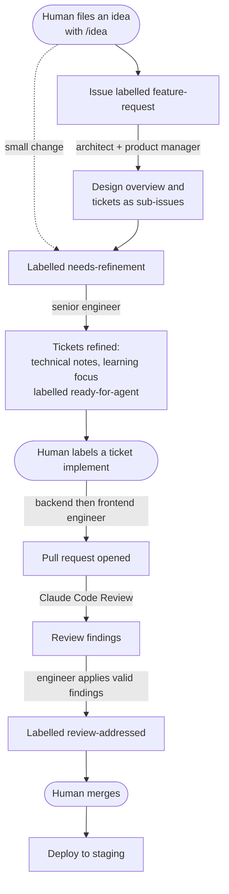

1. **Plan** (`agent-plan-feature.yml`). An issue labelled `feature-request` gets a design overview from the architect, and the product manager breaks it into tickets with acceptance criteria. The request becomes an epic.
2. **Refine** (`agent-refine.yml`). Labelling `needs-refinement` makes the senior engineer write each ticket's technical notes and label it `ready-for-agent`. A change small enough for one pull request skips planning and starts here.
3. **Implement** (`agent-implement.yml`). A human labels a ticket `implement`. The engineers check every "Blocked by" issue is closed, build backend first so the frontend works against a real API, check each acceptance criterion against a test or line of code, and open a pull request.
4. **Review and fix** (`claude-code-review.yml`, `agent-review-fix.yml`). Claude reviews every pull request; the engineer applies the valid findings and labels it `review-addressed`. After two rounds with findings still open, it asks for a human with `needs-human`.
5. **Merge and deploy.** A human merges and staging deploys.

Around those stages, deterministic workflows keep things moving: CI for the Go tests, typecheck, end-to-end tests and Terraform checks; a `ui-screenshots` check that every UI pull request shows the change in pt-BR and English; an agent that resolves merge conflicts after `main` moves; a notification when a pull request is ready to merge; and a sync that moves each issue across the project board.

The maintainer is also using Homeowner to learn Go, AWS and system design. Besides labelling a ticket `implement`, they can build it locally with Claude using `/ticket <n>` ([skill](.claude/skills/ticket/SKILL.md)), which writes the code while teaching each concept the ticket's "Learning focus" names. The agents' standing instructions live in [CLAUDE.md](CLAUDE.md).

## Run everything locally

From a fresh clone to signing in, getting a day plan and receiving reminders.

### Prerequisites

- Docker (Compose v2)
- Go 1.26 (`backend/go.mod`), for generating keys and running tests
- Node 22 (`web/.nvmrc`)
- AWS CLI with credentials for an AWS account. Sign-in is Amazon Cognito and
  there is no local emulator, so you need a real user pool. It is free (first
  50,000 monthly active users).

### 1. Get a Cognito user pool

You need the pool's **region**, its **id** (`<region>_XXXX`) and the web
**client id**.

**With access to staging** (the maintainer), reuse the staging pool:

```sh
cd infra/staging
terraform init -backend-config="bucket=homeowner-tfstate-<account id>" -backend-config="region=<region>"
terraform output -raw cognito_region
terraform output -raw cognito_client_id
terraform output -raw cognito_password_policy
aws cognito-idp list-user-pools --max-results 10   # the pool id (not a staging output)
```

If you don't have Terraform set up, `aws cognito-idp list-user-pool-clients --user-pool-id <pool id>`
gives the client id.

**Without access to staging**, create your own pool with the same settings as
`infra/modules/auth`:

```sh
POOL_ID=$(aws cognito-idp create-user-pool --pool-name homeowner-local \
  --username-attributes email --auto-verified-attributes email \
  --policies 'PasswordPolicy={MinimumLength=10,RequireUppercase=true,RequireLowercase=true,RequireNumbers=true,RequireSymbols=false}' \
  --account-recovery-setting 'RecoveryMechanisms=[{Name=verified_email,Priority=1}]' \
  --query UserPool.Id --output text)
aws cognito-idp create-user-pool-client --user-pool-id "$POOL_ID" \
  --client-name homeowner-local-web --no-generate-secret \
  --explicit-auth-flows ALLOW_USER_PASSWORD_AUTH ALLOW_REFRESH_TOKEN_AUTH \
  --prevent-user-existence-errors ENABLED \
  --query UserPoolClient.ClientId --output text
echo "$POOL_ID"   # the region is the part before the underscore
```

Cognito's default sender emails the confirmation code (about 50 emails a day;
check spam).

### 2. Generate Web Push keys

```sh
cd backend
go run ./cmd/api vapid   # prints VAPID_PUBLIC_KEY=... and VAPID_PRIVATE_KEY=...
```

Push is optional. Without keys, the app works, `/push/*` answers 503 and the
reminders controls say push is not configured.

### 3. Configure the API: root `.env`

`cp .env.example .env` and fill in:

```sh
COGNITO_ISSUER=https://cognito-idp.<region>.amazonaws.com/<pool id>
COGNITO_CLIENT_ID=<client id>
VAPID_PUBLIC_KEY=<from step 2>
VAPID_PRIVATE_KEY=<from step 2>
VAPID_SUBJECT=mailto:you@example.com
```

Compose reads this file and passes the values to the API. The file is
git-ignored. Never commit the private key.

### 4. Configure the web: `web/.env.local`

`cp web/.env.example web/.env.local` and fill in:

```sh
VITE_API_BASE_URL=http://localhost:8080
VITE_COGNITO_REGION=<region>
VITE_COGNITO_CLIENT_ID=<client id>
VITE_PASSWORD_POLICY=<the pool's rules as one-line JSON; the example's default matches infra/modules/auth>
```

The app refuses to start if any of these is missing. Vite reads them only at
startup, so restart `npm run dev` after a change.

### 5. Start it

```sh
docker compose up -d --build   # Postgres and the API at localhost:8080, migrated on start
cd web
npm ci
npm run dev                    # http://localhost:5173
```

Check the API logs with `docker compose logs api`. A `sign-in disabled` or
`push disabled` warning means step 3 is incomplete. Rebuild with
`docker compose up -d --build` after backend changes.

### 6. Use it

- **Sign up** at http://localhost:5173 with a real email, enter the code, then
  sign in and go through onboarding.
- **Day plans**: "get my tasks right away" plans you on the spot. The
  Allocation job, which runs every 15 minutes in staging, plans every Home whose
  Allocation time has arrived and sends the push nudges. Nothing schedules it
  locally, so run one tick by hand:
  ```sh
  docker compose run --rm api allocate
  ```
- **Reminders** need the VAPID keys and a browser that allows notifications.
  `localhost` counts as a secure context, so push works in Chrome and Firefox
  without HTTPS. The service worker only exists in a production build, so test
  push with `npm run build && npm run preview` (http://localhost:4173). Add
  that origin to `CORS_ALLOWED_ORIGINS` in `docker-compose.yml` first.

### 7. Admin app (optional)

The maintainer's admin app lives in `admin/` and runs on port 5174 against the
Compose API. It needs a super admin in the pool your `.env` points to (see the
next section).

```sh
cd admin
cp .env.example .env.local     # fill in VITE_COGNITO_REGION and VITE_COGNITO_CLIENT_ID (same as web/.env.local)
npm ci
npm run dev                    # http://localhost:5174
```

Note `admin/` calls the API URL `VITE_API_URL`, where the PWA calls it
`VITE_API_BASE_URL`. Variables are explained in
[docs/development.md](docs/development.md#admin).

## The super admin role

The API's `/admin/` routes are for the maintainer only ([ADR 0017](docs/adr/0017-operate-through-a-separate-admin-app-per-environment.md)).
Terraform creates a `super-admin` group in each environment's Cognito pool; who
belongs to it is a manual step, per environment (find the pool id with
`aws cognito-idp list-user-pools --max-results 10`, or `terraform output user_pool_id`
of `module.auth`):

```sh
# Grant
aws cognito-idp admin-add-user-to-group --user-pool-id <pool id> --username <email or sub> --group-name super-admin
# Revoke
aws cognito-idp admin-remove-user-from-group --user-pool-id <pool id> --username <email or sub> --group-name super-admin
```

Revoking takes effect when the person's ID token next refreshes, up to 60
minutes. More in [docs/development.md](docs/development.md#the-super-admin-role).

## Development reference

Tests, migrations, builds and every configuration variable for the backend and the web app are in [docs/development.md](docs/development.md).
