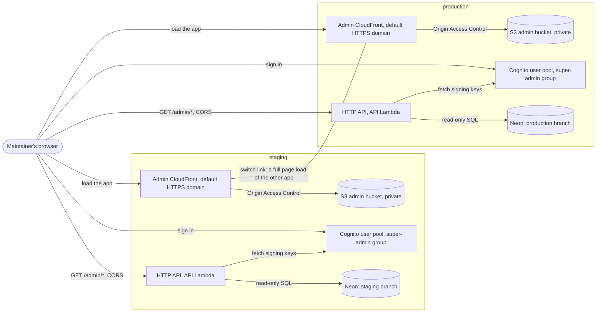
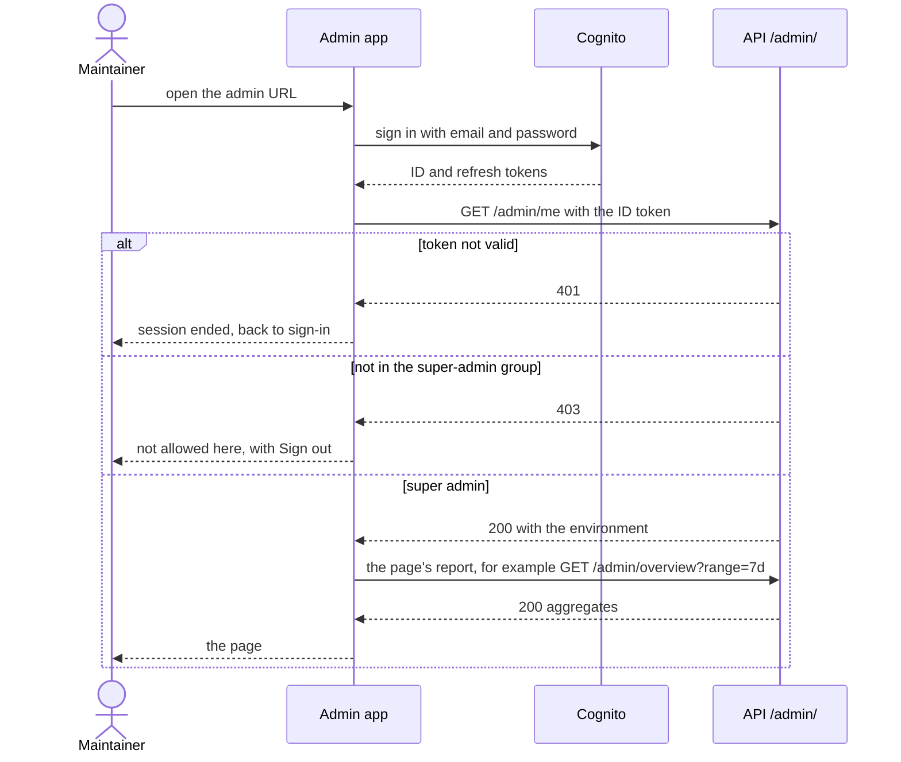

# The admin dashboard

Related: [ADR 0017](../adr/0017-operate-through-a-separate-admin-app-per-environment.md), [ADR 0013](../adr/0013-own-server-state-with-tanstack-query-over-one-axios-client.md), [ADR 0004](../adr/0004-ai-allocates-behind-a-deterministic-referee.md). Terms: **Allocation**, **Day Plan**, **Home**, **Check-in** in [CONTEXT.md](../../CONTEXT.md).

The admin dashboard is how the maintainer sees whether Homeowner is working: how many Homes are planned each day, how the LLM behaves and what it costs, and where the daily pipeline loses Homes. It is built. It has two halves: a small React app in `admin/`, and a read-only set of `/admin/` routes in the Go API (the `admin` package, see [The Go backend](backend.md#packages)).

## What the app is

`admin/` is a separate Vite and React app, not part of the PWA ([ADR 0017](../adr/0017-operate-through-a-separate-admin-app-per-environment.md)):

- **Desktop-first and English only.** It has no localization, no service worker, no manifest and no push. It shares only the design tokens (`web/src/tokens.css`) with the PWA.
- **Same sign-in as the PWA.** It signs in against the same Cognito user pool and app client, calling Cognito's public API with `fetch`. Its tokens live in this origin's `localStorage` under `admin.session`, so staging and production never share a session.
- **One Axios client and TanStack Query** (`src/api/client.ts`), like the PWA ([ADR 0013](../adr/0013-own-server-state-with-tanstack-query-over-one-axios-client.md)): it adds the ID token, refreshes it shortly before it expires, and on a 401 refreshes and retries once.
- **Layout.** `src/app/` holds the shell, the gate and the one page table (`pages.tsx`, read by both the nav and the routes). `src/environment/` holds the badge, the switch and the mismatch banner. `src/shared/` holds the `?range=` hook, the range control and `BarTable`: semantic tables with CSS bars, no chart library. `src/domains/<name>/` holds one page each (`overview`, `ai`, `flow`) and its query.
- **Checked on pull requests** by `admin-typecheck.yml` (typecheck, Vitest, build).

| Page | Path | Calls |
|---|---|---|
| Overview | `/` | `GET /admin/overview` |
| AI usage | `/ai` | `GET /admin/ai` |
| Flow | `/flow` | `GET /admin/flow` |

Every page keeps its range in the URL (`?range=7d` or `?range=30d`; anything else becomes `7d`), so a reload, a shared link and the environment switch keep it.

## How it is built and deployed

There is one admin app **per environment**. Each one is built with its own settings and served from its own bucket, so a staging build can only ever talk to the staging API.

Settings are read at build time from `VITE_*` variables (`src/config.ts`). A missing or malformed value fails the build and names the variable:

| Variable | Meaning |
|---|---|
| `VITE_ENVIRONMENT` | `local`, `staging` or `production`. Drives the badge. |
| `VITE_API_URL` | The API's base URL. |
| `VITE_COGNITO_REGION`, `VITE_COGNITO_CLIENT_ID` | The pool's region and the PWA's app client id. Public identifiers, not secrets. |
| `VITE_ADMIN_URLS` | Optional JSON from environment name to admin origin, for the switch. Empty is valid. |

The deploy is the reusable workflow `deploy-admin.yml`, called as the `admin` job by `deploy-staging.yml` and by `deploy-production.yml`. It runs after the `api` job (`needs: api`), alongside the `web` job, and receives from the `api` job's Terraform outputs the API URL, the Cognito ids, and `admin_url`, `admin_bucket_name` and `admin_distribution_id`. It uses the caller's own deploy role, so the staging run cannot touch production. The job:

1. Builds `VITE_ADMIN_URLS` from the repository variables `ADMIN_URL_STAGING` and `ADMIN_URL_PRODUCTION`, with this environment's own URL taken from Terraform. A variable not set yet is left out, and the switch then says "not configured".
2. Runs `npm run build`, then uploads hashed `assets/` as immutable, other files for an hour, and `index.html` last with `no-cache`.
3. Deletes stale objects except `assets/`, so a tab on the previous version can still load its old files.
4. Invalidates CloudFront and waits.
5. Smoke tests: the root and a deep link (`/ai`) return the app, the API answers CORS for the admin origin, and `GET /admin/me` without a token answers 401.

Locally the app runs with `npm run dev` on port 5174 (strict, because Compose's `CORS_ALLOWED_ORIGINS` allows only that port); see `docs/development.md`.

The two environments share nothing: each page talks only to its own API and its own Cognito pool. The only line between them is not a request; it is the switch link the maintainer follows, which loads the other environment's app from scratch.

## Who may see it

The admin bundle is public static code. Access control is the API, never the app:

- Every `/admin/` route sits behind `requireSuperAdmin`: no token or a bad one is `401`; a valid token whose `cognito:groups` claim lacks `super-admin` is `403`.
- The `super-admin` group is created by Terraform in each environment's pool (`infra/modules/auth`). **Membership is granted by hand** with the AWS CLI, once per environment, so no code or config names a person; see "The super admin role" in `docs/development.md`. A grant shows after the next sign-in; a revoke takes effect when the ID token next refreshes, up to 60 minutes.
- There is no IP allow-list or basic auth on the distribution, on purpose. CORS only tells browsers which origins may read responses; it is not access control.

`Gate` (`src/app/Gate.tsx`) mounts the pages only after `GET /admin/me` answers 200, so a non-admin does not see a screen of failing requests. It is a convenience; the server's 403 is the control.

## The environment badge, the cross-check and the switch

Acting on production while thinking it is staging is the mistake this app is designed against.

- **Badge.** The header on every page, sign-in and the not-allowed screen included, shows the build's environment as a text badge (`PRODUCTION`, `STAGING`, `LOCAL`). Production is the danger colour; colour is never the only cue.
- **Server cross-check.** `GET /admin/me` returns the API's `ENVIRONMENT` setting. When it differs from `VITE_ENVIRONMENT`, a persistent alert says "This build says X but the API says Y". The app stays usable so the maintainer can see what is wrong.
- **Switch.** A plain link to the other environment's admin, keeping the path and query (`/ai?range=30d` stays `/ai?range=30d`). Staging offers production and production offers staging; local offers whichever the map lists. With no URL configured it shows "`<Environment> URL not configured`" instead of a broken link.

## The routes

All four are `GET`, super admin only, read-only, and return aggregates and opaque counts: no email, name, user id or Chore title (a test walks the response keys). The response shapes are the Go types in [`backend/internal/admin/dto.go`](../../backend/internal/admin/dto.go); [backend](backend.md#routes) lists every field.

| Route | Query | Returns |
|---|---|---|
| `/admin/me` | none | `{"environment"}`: which deployment answered (`local`, `staging` or `production`). |
| `/admin/overview` | `range=7d` or `30d`, required | Totals of Users, Homes, Residents and Chores; active Homes and Residents in the range; per-day runs, rejected runs, fallbacks, Check-ins, Completions, Refuses, Takes, accepted Swaps and push outcomes. |
| `/admin/ai` | `range`, as above | Per-day and per-service (allocator, explainer) LLM call outcomes, latency, tokens and estimated cost; the month-to-date estimate against the configured spend limit; the daily cap; who planned the runs and who wrote the explanations; the top violation kinds and fallback reasons. |
| `/admin/flow` | `range`, as above | The daily pipeline as thirteen funnel steps of range totals, from Homes due through runs, LLM calls, explanations and Day Plan ready pushes. Counts only; the page divides. |

A missing or unknown `range` is `400 {"error":"invalid range"}`; there is no default on the server. Every report runs in one `READ ONLY` transaction with a 5 second statement timeout, so it cannot write and a slow query cannot hold one of the Lambda's two database connections for long.

## Approximate metrics

Some numbers are approximations by design. This is the wording from the DTO comments, which is what the code means:

- **The day window and Home-local dates.** A range is the last 7 or 30 UTC dates ending today. Dates are the stored Home-local date where a table has one (`plan_date`, `checkin_date`, `completed_on`, `committed_on`, `local_date`), otherwise UTC. A Home east of UTC can be a day ahead: its rows are not clamped into the last day, they are outside the window until UTC reaches that date, and then appear on their own day.
- **Homes due.** There is no stored source: the job computes it in memory and a Home whose planning failed leaves no row. So it is defined as the Homes that existed at the end of each day of the range (`homes.created_at` on or before the day, in UTC), summed over the days: a count of Home-days. The gap between Homes due and runs is "not planned": a failed planning, an unknown timezone, or a Home created after its Allocation time that day. The UTC day approximates the Home-local day, so a Home created near midnight can count one day early or late.
- **Refuses are a lower bound.** Refuses and Takes are current state, not an event log: a refused Task that someone later Takes leaves the pool, so Refuses is a lower bound. A replanned day (staging only) is deleted and recreated, so it counts once.
- **Delivered means accepted by the push service**, not shown on a phone. `unknown` is a null outcome: a row from before the column, a crash, or a send dropped by the tick's deadline.
- **Estimated cost.** Every cost is an estimate (`costIsEstimate: true`); the Anthropic Console is the source of truth. Money is integer micro-USD, priced from the table in `backend/internal/llmalloc/pricing.go`. Calls with no estimated cost (an unknown model, or no usage reported, as after a timeout) are counted in `uncostedCalls` and add nothing, so the cost is a lower bound. The month-to-date figure is the UTC calendar month, whatever the range. The limit beside it is `LLM_MONTHLY_SPEND_LIMIT_USD`, shown only: the Anthropic Console enforces it, and the value must be kept equal to the Console's by hand.
- **Explanations "written", not "shown".** The LLM share counts stored LLM texts; a stored text whose fingerprint later mismatches is shown as the template but still counts. Assignments change after planning (Take, Swap), so the template count is approximate.

## Where the data comes from

The admin routes only read tables the rest of the system writes. Two were added for them:

- `llm_call_events` (migrations `0022` and `0023`): one row per allocator or explainer attempt, written best effort by the Allocation job after the planning transaction commits. See [Daily Allocation](allocation.md) and [Data model](data-model.md).
- `nudges.outcome` (migration `0021`): what the push service answered for each nudge.

Planned: pruning old `llm_call_events` rows (about 2 per Home per day) is deferred.
