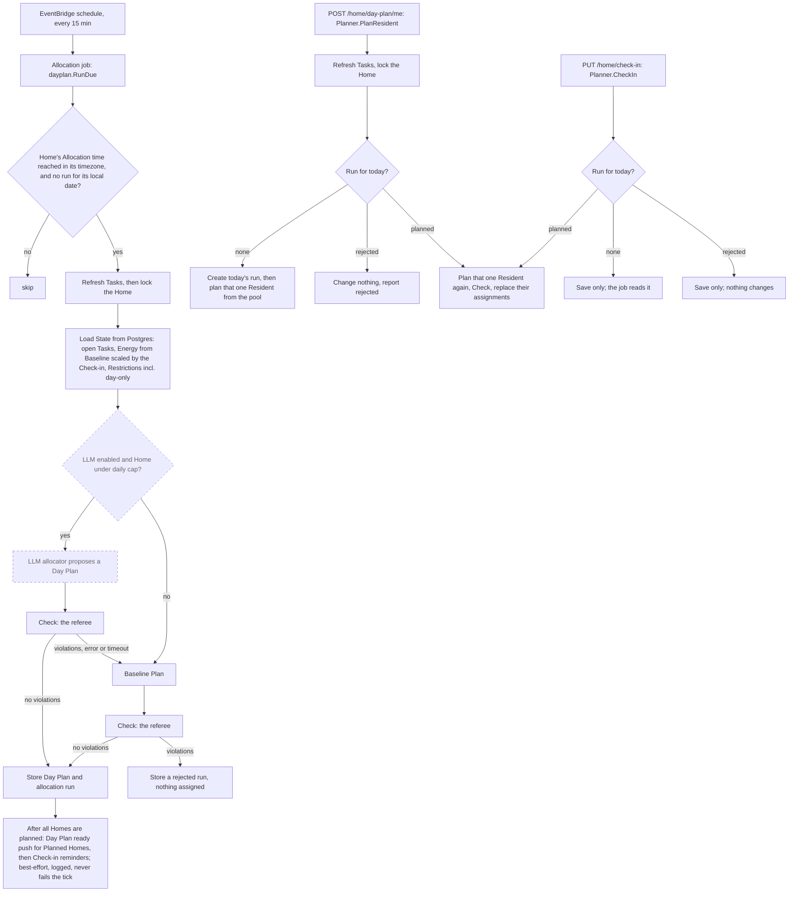

# Daily Allocation

Related: [ADR 0004](../adr/0004-ai-allocates-behind-a-deterministic-referee.md), [ADR 0001](../adr/0001-chores-come-due-in-flexible-windows.md), [ADR 0005](../adr/0005-ship-a-react-pwa-not-a-native-app.md). Terms: **Allocation**, **Day Plan**, **Task**, **Energy**, **Check-in**, **Baseline**, **Restriction**, **Committed** in [CONTEXT.md](../../CONTEXT.md).

## What is built

The pure module `backend/internal/allocation`, and the scheduled job around it: `backend/internal/dayplan` builds the state from the database, runs the baseline allocator, referees it with `Check`, and stores the Day Plan and the run record. The LLM allocator, the Check-in and Commit are planned.

The module is deep: a small interface hiding the rules.

```go
type Allocator interface { Plan(State) (Result, error) }
func Check(DayPlan, State) []Violation
```

- `State`: today's date, the Residents (with today's Energy and Restrictions) and the open Tasks. The caller supplies "today", so the package never reads a clock.
- `Plan` (the **baseline allocator**, type `Baseline`): deterministic. It sorts open Tasks by hard deadline today, then Importance, then lateness, then Task ID, and gives each to a fitting Resident. Unplaced Tasks stay in the pool with a reason such as `no_energy_left` or `restricted_for_all`.
- `Check` (the **referee**): returns every violation, not just the first: over Energy, broken Restriction (Demand or Chore level), unknown or duplicate Task, unknown Resident, and a Task given on a weekday its Chore forbids.

Reasons are data, not prose, so a later feature can turn them into an explanation.

The open Tasks come from the `tasks` table, kept current by `tasks.Store.Refresh` (see [Backend](backend.md)); the daily job calls it before it builds `State`. Tasks only open on a Chore's allowed weekdays, but a Task can stay open past its window, so `allocation.Task` carries `AllowedWeekdays` (empty means any day): `Plan` leaves an overdue Task in the pool with the reason `weekday_not_allowed` on a day its Chore forbids, and `Check` reports `weekday_not_allowed` for a plan that gives it. Both use one helper, `weekdayAllowed`, like `breaksRestriction`, so the allocator and the referee cannot disagree.

Not yet in the module: two-person Task rules, Preference weights and turn-taking.

## The job (built)

`dayplan.Planner` is the one orchestrator; the job, a Check-in and "get my tasks right away" call it.

- **Which Homes**: every 15 minutes, the Homes whose local wall-clock time is at or past their Allocation time and that have no run for their local date. A Home is planned once per local day; a rejected run takes the day too. Editing the Allocation time after the day's run changes nothing until tomorrow; a timezone change mid-day can change the local date, so a Home could be planned twice in 24 hours (accepted). A Home created after today's Allocation time is planned at the next tick.
- **Energy**: the Resident's Baseline points for the weekday of the Home's local date, scaled by their Check-in for that date when they made one (`dayplan.energyOn`, using the pure `checkin.Scale`): Drained 0, Low 50%, Normal 100%, Energized 130% of the Baseline. Energy is whole points and the result **rounds down** (integer `base*50/100`, `base*130/100`), so base 5 gives Low 2 and Energized 6, base 3 gives 1 and 3, base 1 gives 0 and 1: a Check-in never promises more than the percentage. An unset day is a Baseline of 0, so every level gives 0: a Check-in cannot invent Energy (the PWA hints to set a Baseline). With no Check-in the Baseline is used, and a Check-in only counts on its own local date. The run's `reasons` store each Resident's Energy.
- **Restrictions** reach `State` at both levels: the User's general Demand Restrictions and the Resident's specific Chore Restrictions, so `Check` reports the right level. A Check-in's day-only Restrictions are appended to the general Demand Restrictions, without repeating one, so `Check` reports them at the Demand level; they are never stored as lasting Restrictions and are gone the next day.
- **A Check-in after the plan** (the common case, since the plan is made once at the Allocation time): `Planner.CheckIn` re-plans that one Resident inside today's run. In one transaction, holding the same Home lock as `PlanHome`, it saves the Check-in and, if the run is `planned`, builds a `State` with only that Resident and, as Tasks, every open Task not given to someone else today (their own previous Tasks, the pool, Tasks added after the plan). The allocator proposes, `Check` referees, then their `day_plan_assignments` rows are replaced and the run's `reasons` rewritten by `reasons.replan`, which shares `reasons.add` with the full plan so the stored shape has one writer (their Energy, their assigned entries, the pool; a Task already in the pool keeps its reason, a newly released one gets the new plan's). The run row, its allocator and everyone else's assignments are untouched, so one person's mood does not reshuffle the others. A proposal that errors or breaks a rule rolls everything back, the Check-in included, and the request fails: an unchecked plan is never stored. Drained gives Energy 0, so their Tasks return to the pool as `no_energy_left`. A Check-in can be changed (the `PUT` is idempotent and re-plans again). Exceptions: with no run yet the Check-in is only saved and the job reads it; after a `rejected` run it is saved and nothing else changes, since the day is taken and nothing is assigned. A Resident who joined after the plan has no Energy entry; their first Check-in plans them from the pool, and one who never checks in stays unplanned today. When Commit (#15) lands, a re-plan must never drop a Committed Task.
- **Get my tasks right away** (end of onboarding): `Planner.PlanResident` plans one Resident now, from what is still in today's pool, by the same path as a Check-in re-plan without the Check-in (`replanRun`, shared). It refreshes the Tasks first, outside the transaction (a Home made minutes ago has Chores but no Tasks, and a Check-in does not refresh), then locks the Home and looks for the day's run. `planned`: their own assignments are replaced from every open Task not given to someone else; nobody else's rows, the run row and its allocator change (a Resident who presses it again may get a different plan if the pool changed, and when Commit lands their Committed Tasks must stay). `rejected`: nothing changes and the answer says so. **No run yet** (a new Home before its Allocation time): today's run is created in the same transaction (`planned`, the Planner's allocator, `reasons` holding only this Resident's Energy, assignments and the pool). **Consequence, a product decision to confirm**: the job then sees a run for the date and skips the Home, so Residents who did not choose "right away" get no automatic plan until tomorrow's Allocation (they can still Check in, which plans them from the pool, or use the same button). Harmless for a one-Resident Home, a real gap for several. A proposal that errors or breaks a rule rolls everything back, a new run included, and the request fails. Energy 0 (an unset weekday, or a Drained Check-in) is a valid empty plan, with the pool keeping `no_energy_left`. It takes the same Home lock as the job, so a tick and a press at the same moment make one run and no duplicate rows.
- **Yesterday's unfinished Tasks**: a Task stays open until a Completion exists, so nothing is moved or reset. Planning uses every open Task, overdue ones included, and a Day Plan is keyed by date, so yesterday's assignments are never read as today's. Today's pool is the open Tasks not assigned in today's run. How a Committed but undone Task is treated is for the Commit ticket.
- **Never an unchecked plan**: a proposal that errors or fails `Check` is recorded as a `rejected` run with its violations, nothing is assigned, and it is logged. Until the LLM allocator exists there is no fallback to fall back to.
- **Push nudges (built, best effort)**: the same tick also sends two pushes, through `internal/nudge`, which `dayplan` reaches only through its small `Nudger` interface (set with `dayplan.WithNudger`; none means push is off and the tick only plans). `RunDue` runs in this order: (1) plan every due Home as above and remember the ids whose outcome was `Planned`; (2) send **Day Plan ready** to every Resident of those Homes, to every device (not for `AlreadyPlanned`, not for `Rejected`: nothing was assigned); (3) send **Check-in reminders**. Planning always finishes before any push is attempted.
  - **Reminder rule**: a Home is in its window when its local minutes are at or after its Allocation time minus 60 minutes and before the Allocation time, and it has no run for its local date. "At or after", never "equal", so a late tick still works; with the 15-minute tick the reminder arrives 60 to 45 minutes before. The moment is clamped to local midnight, so an Allocation time before 01:00 is reminded from 00:00 (less than an hour before) instead of on the previous date. Wall-clock arithmetic in the Home's zone, like `DueHomes`: a daylight-saving change can shift it by an hour on two days a year. Recipients are the Residents of the Home with no Check-in for the Home's local date (`checkinstore.LoadMany`; Drained counts as checked in), sent to every subscription of their User (`push.Store.ListByUsers`, one query per tick; a Resident with no device is skipped silently, and is not claimed so a later subscription in the window still gets the reminder).
  - **At most once**: the ledger table `nudges` (primary key Resident, kind, local date) is claimed with `INSERT ... ON CONFLICT DO NOTHING` before sending, and only claimed rows are sent. A crash between claim and send loses one nudge instead of duplicating it, and a failed send is not retried (ADR 0005: the app asks for the Check-in when it opens anyway).
  - **Failures never affect Allocation**: send errors (including `ErrGone`, after the subscription is deleted), ledger and subscription query errors are logged with Home and Resident ids and swallowed; the nudge phase has a recover, a 5 second timeout per send and one 30 second deadline shared by both nudge calls (the Lambda has 60). The `Summary`, the status of `POST /events` and the exit of `api allocate` are the same whether pushes work or not. Known gap, accepted: if the Lambda dies after the plan commits but before the push, the next tick sees `AlreadyPlanned` and the "Day Plan ready" push is lost; there is no sweep for planned-but-not-notified Homes.
  - **Payload**: `push.Payload` gains an optional `kind` (`checkin_reminder`, `day_plan_ready`) and still carries an English `title` and `body` and `url` `/`; the backend has no per-User locale (ADR 0006), so the service worker words the two kinds for the device language. No names or Task titles cross the push provider.
  - **Deviation from ADR 0008**: the ADR speaks of "a new function" for the push nudge. The nudge runs in the existing Allocation Lambda instead: a second function would repeat `DueHomes` and the timezone logic, and both messages hang off the same Allocation time. Isolation comes from the ordering and the error handling above. The Lambda therefore carries the VAPID environment ([infrastructure](infrastructure.md)).
- **The record**: `allocation_runs` stores the allocator name, the outcome and the reasons (per-Task assignment reasons, the pool with reasons, each Resident's Energy), because Energy and Restrictions change and the reasons cannot be recomputed. Residents read the plan with `GET /home/day-plan`.

## The flow



Dashed boxes are planned; solid boxes are built (the reminder step in the last box also runs for Homes in their reminder window that were not planned this tick). Today the LLM question is always "no": `Q` is planned, and the baseline allocator is the only one, checked before it is stored. (In the planned LLM flow, a failed LLM proposal falls back to the baseline plan, which is checked the same way.)

The rule that matters: the model may propose, but only a plan that passes `Check` is used. On any failure the baseline takes over, so the app never depends on the model behaving. A Resident who did not check in is planned from their Baseline Energy ([ADR 0005](../adr/0005-ship-a-react-pwa-not-a-native-app.md)).

Only the Resident can **Commit** to a Task; the Day Plan is a proposal.
