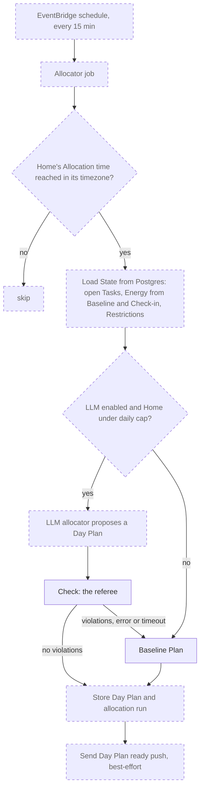

# Daily Allocation

Related: [ADR 0004](../adr/0004-ai-allocates-behind-a-deterministic-referee.md), [ADR 0001](../adr/0001-chores-come-due-in-flexible-windows.md), [ADR 0005](../adr/0005-ship-a-react-pwa-not-a-native-app.md). Terms: **Allocation**, **Day Plan**, **Task**, **Energy**, **Check-in**, **Baseline**, **Restriction**, **Committed** in [CONTEXT.md](../../CONTEXT.md).

## What is built

Only the pure module `backend/internal/allocation`. The scheduled job, database loading, the LLM allocator and storing the result are planned.

The module is deep: a small interface hiding the rules.

```go
type Allocator interface { Plan(State) (Result, error) }
func Check(DayPlan, State) []Violation
```

- `State`: today's date, the Residents (with today's Energy and Restrictions) and the open Tasks. The caller supplies "today", so the package never reads a clock.
- `Plan` (the **baseline allocator**, type `Baseline`): deterministic. It sorts open Tasks by hard deadline today, then Importance, then lateness, then Task ID, and gives each to a fitting Resident. Unplaced Tasks stay in the pool with a reason such as `no_energy_left` or `restricted_for_all`.
- `Check` (the **referee**): returns every violation, not just the first: over Energy, broken Restriction (Demand or Chore level), unknown or duplicate Task, unknown Resident.

Reasons are data, not prose, so a later feature can turn them into an explanation.

The open Tasks come from the `tasks` table, kept current by `tasks.Store.Refresh` (see [Backend](backend.md)); the daily job must call it before it builds `State`. Tasks only open on a Chore's allowed weekdays, but `allocation.Task` carries no allowed weekdays yet, so an overdue Task stays in the pool on a disallowed day until #13 adds them.

Not yet in the module: two-person Task rules, weekday limits, Preference weights and turn-taking.

## The flow



Dashed boxes are planned; solid boxes (`Check`, baseline `Plan`) are built.

The rule that matters: the model may propose, but only a plan that passes `Check` is used. On any failure the baseline takes over, so the app never depends on the model behaving. A Resident who did not check in is planned from their Baseline Energy ([ADR 0005](../adr/0005-ship-a-react-pwa-not-a-native-app.md)).

Only the Resident can **Commit** to a Task; the Day Plan is a proposal.
