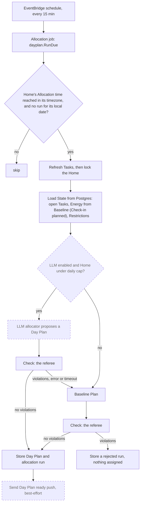

# Daily Allocation

Related: [ADR 0004](../adr/0004-ai-allocates-behind-a-deterministic-referee.md), [ADR 0001](../adr/0001-chores-come-due-in-flexible-windows.md), [ADR 0005](../adr/0005-ship-a-react-pwa-not-a-native-app.md). Terms: **Allocation**, **Day Plan**, **Task**, **Energy**, **Check-in**, **Baseline**, **Restriction**, **Committed** in [CONTEXT.md](../../CONTEXT.md).

## What is built

The pure module `backend/internal/allocation`, and the scheduled job around it: `backend/internal/dayplan` builds the state from the database, runs the baseline allocator, referees it with `Check`, and stores the Day Plan and the run record. The LLM allocator, the Check-in and Commit are planned.

The module is deep: a small interface hiding the rules.

```go
type Allocator interface { Plan(State) (Result, error) }
func Check(DayPlan, State) []Violation
```

- `State`: today's date, the Residents (with today's Energy and Restrictions) and the open Tasks. The caller supplies "today", so the package never reads a clock.
- `Plan` (the **baseline allocator**, type `Baseline`): deterministic. It sorts open Tasks by hard deadline today, then Importance, then lateness, then Task ID, and gives each to a fitting Resident. Unplaced Tasks stay in the pool with a reason such as `no_energy_left` or `restricted_for_all`.
- `Check` (the **referee**): returns every violation, not just the first: over Energy, broken Restriction (Demand or Chore level), unknown or duplicate Task, unknown Resident, and a Task given on a weekday its Chore forbids.

Reasons are data, not prose, so a later feature can turn them into an explanation.

The open Tasks come from the `tasks` table, kept current by `tasks.Store.Refresh` (see [Backend](backend.md)); the daily job calls it before it builds `State`. Tasks only open on a Chore's allowed weekdays, but a Task can stay open past its window, so `allocation.Task` carries `AllowedWeekdays` (empty means any day): `Plan` leaves an overdue Task in the pool with the reason `weekday_not_allowed` on a day its Chore forbids, and `Check` reports `weekday_not_allowed` for a plan that gives it. Both use one helper, `weekdayAllowed`, like `breaksRestriction`, so the allocator and the referee cannot disagree.

Not yet in the module: two-person Task rules, Preference weights and turn-taking.

## The job (built)

`dayplan.Planner` is the one orchestrator; the job, and later a Check-in or a new Home's first plan, call it.

- **Which Homes**: every 15 minutes, the Homes whose local wall-clock time is at or past their Allocation time and that have no run for their local date. A Home is planned once per local day; a rejected run takes the day too. Editing the Allocation time after the day's run changes nothing until tomorrow; a timezone change mid-day can change the local date, so a Home could be planned twice in 24 hours (accepted). A Home created after today's Allocation time is planned at the next tick.
- **Energy**: the Resident's Baseline points for the weekday of the Home's local date; an unset day is 0, so that Resident gets nothing (the PWA hints to set a Baseline). Check-in scaling is not built; it goes in `dayplan.energyOn`.
- **Restrictions** reach `State` at both levels: the User's general Demand Restrictions and the Resident's specific Chore Restrictions, so `Check` reports the right level.
- **Yesterday's unfinished Tasks**: a Task stays open until a Completion exists, so nothing is moved or reset. Planning uses every open Task, overdue ones included, and a Day Plan is keyed by date, so yesterday's assignments are never read as today's. Today's pool is the open Tasks not assigned in today's run. How a Committed but undone Task is treated is for the Commit ticket.
- **Never an unchecked plan**: a proposal that errors or fails `Check` is recorded as a `rejected` run with its violations, nothing is assigned, and it is logged. Until the LLM allocator exists there is no fallback to fall back to.
- **The record**: `allocation_runs` stores the allocator name, the outcome and the reasons (per-Task assignment reasons, the pool with reasons, each Resident's Energy), because Energy and Restrictions change and the reasons cannot be recomputed. Residents read the plan with `GET /home/day-plan`.

## The flow



Dashed boxes are planned; solid boxes are built. Today the LLM question is always "no": `Q` is planned, and the baseline allocator is the only one, checked before it is stored. (In the planned LLM flow, a failed LLM proposal falls back to the baseline plan, which is checked the same way.)

The rule that matters: the model may propose, but only a plan that passes `Check` is used. On any failure the baseline takes over, so the app never depends on the model behaving. A Resident who did not check in is planned from their Baseline Energy ([ADR 0005](../adr/0005-ship-a-react-pwa-not-a-native-app.md)).

Only the Resident can **Commit** to a Task; the Day Plan is a proposal.
