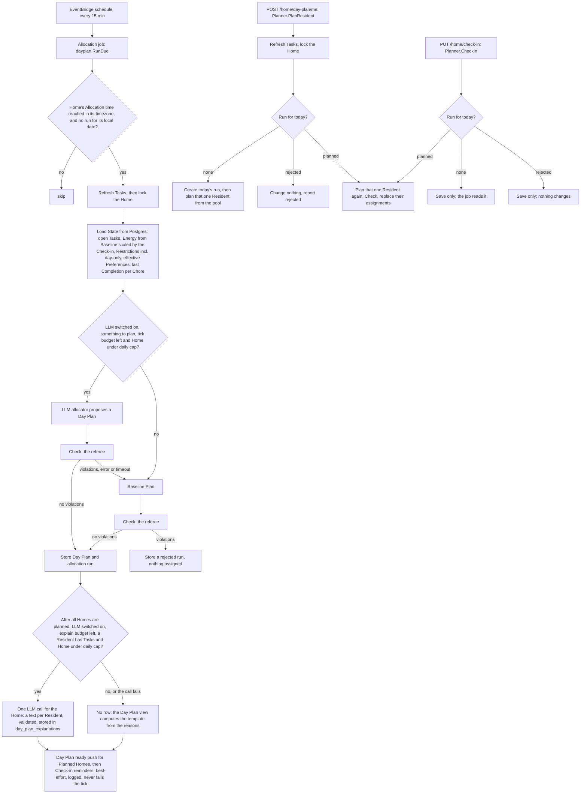

# Daily Allocation

Related: [ADR 0004](../adr/0004-ai-allocates-behind-a-deterministic-referee.md), [ADR 0001](../adr/0001-chores-come-due-in-flexible-windows.md), [ADR 0005](../adr/0005-ship-a-react-pwa-not-a-native-app.md). Terms: **Allocation**, **Day Plan**, **Task**, **Energy**, **Check-in**, **Baseline**, **Restriction**, **Committed** in [CONTEXT.md](../../CONTEXT.md).

## What is built

The pure module `backend/internal/allocation`, and the scheduled job around it: `backend/internal/dayplan` builds the state from the database, asks the LLM allocator first when it is switched on, falls back to the baseline allocator, referees every proposal with `Check`, and stores the Day Plan and the run record.

The module is deep: a small interface hiding the rules.

```go
type Allocator interface { Plan(State) (Result, error) }
func Check(DayPlan, State) []Violation
```

- `State`: today's date, the Residents (with today's Energy, Restrictions, Preferences and last Completion of each Chore) and the open Tasks. The caller supplies "today", so the package never reads a clock.
- `Plan` (the **baseline allocator**, type `Baseline`): deterministic. It sorts open Tasks by hard deadline today, then Importance, then lateness, then Task ID, and gives each to the best fitting Resident (see "Preferences and turn-taking" below). Unplaced Tasks stay in the pool with a reason such as `no_energy_left` or `restricted_for_all`. A **two-person Task** (`People` of two or more) goes to the **two distinct** best fitting Residents (same ranking); each is not restricted for it, has at least its Effort left, and **pays the full Effort**. It appears as two `Assignment`s with the same TaskID and reason. If fewer than two Residents fit it stays in the pool as `two_person_deferred` (also when the Home has one Resident); if every Resident is restricted for it, as `restricted_for_all`; `weekday_not_allowed` still comes first. `peopleNeeded` (1, or 2) is the one helper both `Plan` and `Check` use.
- `Check` (the **referee**): returns every violation, not just the first: over Energy, broken Restriction (Demand or Chore level), unknown or duplicate Task, unknown Resident, a Task given on a weekday its Chore forbids, and a wrong number of Residents. `duplicate_task` means a one-person Task given more than once (to one Resident twice or to two Residents), or a two-person Task that has its two Residents plus a repeated assignment. `wrong_resident_count` is a two-person Task in the plan whose number of distinct named Residents (known or not) is not two: one Resident, the same Resident twice, or three. A Task absent from the plan is pool, never a violation. Energy, Restrictions and weekday are checked once per (Task, Resident) pair, so either partner's Energy or Restriction can be the violation.

Reasons are data, not prose, so the explanation feature (see "Day Plan explanations" below) can turn them into text.

The open Tasks come from the `tasks` table, kept current by `tasks.Store.Refresh` (see [Backend](backend.md)); the daily job calls it before it builds `State`. Tasks only open on a Chore's allowed weekdays, but a Task can stay open past its window, so `allocation.Task` carries `AllowedWeekdays` (empty means any day): `Plan` leaves an overdue Task in the pool with the reason `weekday_not_allowed` on a day its Chore forbids, and `Check` reports `weekday_not_allowed` for a plan that gives it. Both use one helper, `weekdayAllowed`, like `breaksRestriction`, so the allocator and the referee cannot disagree.

**Preferences and turn-taking (built)**: each `Resident` carries two plain maps, both keyed by Chore ID and only ever read by key (never ranged over, so output stays deterministic). `Preferences` is the effective Preference (`Like`, `Dislike`; absent is neutral, the zero value) and `LastDone` is the `Date` of the Resident's most recent Completion of the Chore (absent means never done, deliberately not a zero `Date`, which is 1970-01-01). They are soft rules (ADR 0004): `Check` ignores them, and `Plan` uses them only to choose among Residents who already pass the hard rules, so an Essential Chore disliked by everyone is still assigned and Preference can never outrank Importance, because the Task order does not change. Among the Residents who fit a Task, `compareCandidates` ranks them:

1. Preference of the Chore: like, then neutral, then dislike.
2. Only when both dislike it: the Resident who did the Chore longest ago first, never done before any date. Non-dislikers skip this key, so Energy spreading is unchanged for them.
3. More Energy left.
4. Lower Resident ID.

A two-person Task takes the first two of the same ranking. With no Preferences and no history this is exactly the old order (Energy left, then ID). Turn-taking counts Completions only, so a Resident who is given a disliked Chore and never does it stays first in line.

**Reasons for the choice**: one reason per Task (a two-person Task repeats it for both partners). `decidingReason` (in `allocation/preference.go`) compares each chosen Resident with each passed-over candidate, using the same comparison as the sort, and looks for the first pair where a Preference or turn-taking put the chosen one ahead and the order by Energy alone would have put the other first. Its reason is `liked` (the chosen Resident likes the Chore, the other does not), `spared_dislike` (the other dislikes it, the chosen one does not) or `turn_taking` (both dislike it and the chosen one did it longer ago). If no pair qualifies, Energy or the Resident ID decided and the reason is the urgency one (`deadline_today`, `importance`, `lateness`, `fits_energy`). `Preference` is ordered numerically (`Like` -1, `Neutral` 0, `Dislike` 1; lower is better), so the sort and the reason read the same values. A plan for one Resident (a Check-in re-plan, "get my tasks right away") has one candidate per Task, so it shows the urgency reason.

At the edge, `dayplan.loadState` fills the two maps: `Preferences` through `choresettings.Resolve` for every Chore of the Home (a specific Preference, neutral included, beats the general one for the Category), keeping only non-neutral results; `LastDone` from `completion_residents` joined to `completions`, `tasks` and `chores`, `max(completed_on)` per Resident and Chore for the Home with `completed_on <= today`. It is the last Completion of the Chore, not of the Task, and a two-person Completion counts for both partners. No new table or column.

## The job (built)

`dayplan.Planner` is the one orchestrator; the job, a Check-in and "get my tasks right away" call it.

- **Which Homes**: every 15 minutes, the Homes whose local wall-clock time is at or past their Allocation time and that have no run for their local date. A Home is planned once per local day; a rejected run takes the day too. Editing the Allocation time after the day's run changes nothing until tomorrow; a timezone change mid-day can change the local date, so a Home could be planned twice in 24 hours (accepted). A Home created after today's Allocation time is planned at the next tick.
- **Energy**: the Resident's Baseline points for the weekday of the Home's local date, scaled by their Check-in for that date when they made one (`dayplan.energyOn`, using the pure `checkin.Scale`): Drained 0, Low 50%, Normal 100%, Energized 130% of the Baseline. Energy is whole points and the result **rounds down** (integer `base*50/100`, `base*130/100`), so base 5 gives Low 2 and Energized 6, base 3 gives 1 and 3, base 1 gives 0 and 1: a Check-in never promises more than the percentage. An unset day is a Baseline of 0, so every level gives 0: a Check-in cannot invent Energy (the PWA hints to set a Baseline). With no Check-in the Baseline is used, and a Check-in only counts on its own local date. The run's `reasons` store each Resident's Energy.
- **Restrictions** reach `State` at both levels: the User's general Demand Restrictions and the Resident's specific Chore Restrictions, so `Check` reports the right level. A Check-in's day-only Restrictions are appended to the general Demand Restrictions, without repeating one, so `Check` reports them at the Demand level; they are never stored as lasting Restrictions and are gone the next day.
- **A Check-in after the plan** (the common case, since the plan is made once at the Allocation time): `Planner.CheckIn` re-plans that one Resident inside today's run. In one transaction, holding the same Home lock as `PlanHome`, it saves the Check-in and, if the run is `planned`, builds a `State` with only that Resident and, as Tasks, every open Task not given to someone else today (their own Proposed Tasks, the pool, Tasks added after the plan), minus the Tasks they Committed to and the ones refused today (see "The Day Plan lifecycle" below), with their Energy net of what they Committed to. The allocator proposes, `Check` referees, then their Proposed `day_plan_assignments` rows (not the Committed ones) are replaced and the run's `reasons` rewritten by `reasons.replan`, which shares `reasons.add` with the full plan so the stored shape has one writer (their Energy, their assigned entries, the pool; a Task already in the pool keeps its reason, a newly released one gets the new plan's). The run row, its allocator and everyone else's assignments are untouched, so one person's mood does not reshuffle the others. A proposal that errors or breaks a rule rolls everything back, the Check-in included, and the request fails: an unchecked plan is never stored. Drained gives Energy 0, so their Tasks return to the pool as `no_energy_left`. **Two-person Tasks in a re-plan**: a one-Resident re-plan never places one (only the daily Allocation does) and never leaves one half. A two-person Task the Resident holds is kept for both partners when either partner Committed to it today (its Effort comes off the caller's Energy, floor 0, like their own Commitments) or when the caller can still afford it and is not restricted for it; otherwise both rows are deleted together and it goes to the pool as `no_energy_left`. So a Drained Check-in still returns uncommitted two-person Tasks to the pool, for both partners. A Check-in can be changed (the `PUT` is idempotent and re-plans again). Exceptions: with no run yet the Check-in is only saved and the job reads it; after a `rejected` run it is saved and nothing else changes, since the day is taken and nothing is assigned. A Resident who joined after the plan has no Energy entry; their first Check-in plans them from the pool, and one who never checks in stays unplanned today. When Commit (#15) lands, a re-plan must never drop a Committed Task.
- **Get my tasks right away** (end of onboarding): `Planner.PlanResident` plans one Resident now, from what is still in today's pool, by the same path as a Check-in re-plan without the Check-in (`replanRun`, shared). It refreshes the Tasks first, outside the transaction (a Home made minutes ago has Chores but no Tasks, and a Check-in does not refresh), then locks the Home and looks for the day's run. `planned`: their own assignments are replaced from every open Task not given to someone else; nobody else's rows, the run row and its allocator change (a Resident who presses it again may get a different plan if the pool changed; their Committed Tasks stay and their Energy is net of them, as in a Check-in re-plan). `rejected`: nothing changes and the answer says so. **No run yet** (a new Home before its Allocation time): today's run is created in the same transaction (`planned`, the Planner's allocator, `reasons` holding only this Resident's Energy, assignments and the pool). **Consequence, a product decision to confirm**: the job then sees a run for the date and skips the Home, so Residents who did not choose "right away" get no automatic plan until tomorrow's Allocation (they can still Check in, which plans them from the pool, or use the same button). Harmless for a one-Resident Home, a real gap for several. A proposal that errors or breaks a rule rolls everything back, a new run included, and the request fails. Energy 0 (an unset weekday, or a Drained Check-in) is a valid empty plan, with the pool keeping `no_energy_left`. It takes the same Home lock as the job, so a tick and a press at the same moment make one run and no duplicate rows.
- **Yesterday's unfinished Tasks**: a Task stays open until a Completion exists, so nothing is moved or reset. Planning uses every open Task, overdue ones included, and a Day Plan is keyed by date, so yesterday's assignments are never read as today's. Today's pool is the open Tasks not assigned in today's run. A Commitment is dated (`task_residents.committed_on`), so a Task Committed yesterday and not done is back in today's pool and is not Committed today; the old row stays as history for the Streak.
- **The Day Plan lifecycle (built)**: a Task today is in exactly one state. **Pool**: not in today's run's assignments. **Proposed**: assigned to a Resident by the run, with no Commitment dated today. **Committed**: Proposed plus a `task_residents` row dated today. **Done**: `tasks.status = 'done'` with a `completions` row. A **Refused** Task is a pool Task whose `reasons.pool` entry says `refused`. The Resident acts on their own Tasks only (no request names a Resident), each action in one transaction under the same Home lock as the job and the re-plans (`dayplan.Planner`):
  - **Accept** and **accept all** insert the caller's `task_residents` rows (`ON CONFLICT DO NOTHING`, so a second accept changes nothing). **Refuse** deletes the assignment, with no penalty, and records `refused` in the run's pool; it is refused once the Task is Committed (`already_committed`). A two-person Task can be refused only while **neither** partner Committed to it today (a Commitment is history and only its Resident can make it), and then it frees **both** partners' rows and is recorded as `refused` once. **Take** gives a pool Task to the caller, Committed, with assignment reason `taken`; the referee (`allocation.Check` on a plan of only that Task) decides, going over Energy is allowed because the Resident chose it, a Restriction or a weekday the Chore does not allow is not (`restricted`), and a two-person Task is never taken from the pool (`two_person_task`): only the Allocation hands it out, to both partners at once. **Complete** needs the caller to hold the Task today (Proposed or Committed); it inserts the `completions` row (time from the clock, `completed_on` the Home's date) and one `completion_residents` row for **every Resident the run gave the Task to**, and marks the Task done. Either partner of a two-person Task completes it for both, even if the other never accepted, so the Completion feeds both Residents' Streaks; the other partner then gets `already_done`. If a partner's row is gone (the Resident left the Home), Complete lists whoever remains. The build-up Effort reset needs no code: the schedule derives the next Task's Effort from its new window. The Streak (`internal/streak`, computed on read) judges each Home-local day once it is past: a Committed Task with no Completion dated that day breaks it unless the Resident checked in Drained that day, a day with a Completion and nothing undone grows it, anything else pauses it, and a Completion on a later day does not repair an earlier day; refusing or ignoring creates no Commitment, so it never breaks it, and today is never judged a break.
  - **Swap** (`dayplan/swap.go`): the caller offers one of their Tasks for the Task another Resident holds today (`OfferSwap`; the recipient is derived from the requested Task, nothing names a Resident). Both Tasks must be open and for one person (`two_person_task`: a Swap of a two-person Task is always refused, its partner would hold it twice), the offered one the caller's (`not_yours`), the requested one another Resident's (`not_held_by_other`). The referee decides for both sides, as for Take (`acting.mayDo`): each would hold the Task they receive, over Energy allowed, a Restriction or a weekday not allowed is `restricted`. A Resident who checked in Drained today cannot receive a Task (`recipient_drained`). Only the recipient accepts (`AcceptSwap`) or declines (`DeclineSwap`); only the offerer cancels (`CancelSwap`); anyone else gets `swap_not_found`. Accepting re-runs the checks, then in one transaction moves both `day_plan_assignments` rows (reason `swapped`, `reasons.swap`), deletes the two Tasks' `task_residents` rows for today and inserts the new holders', so both new holders are Committed and neither keeps a Commitment on what they gave away (the Streak does not break for a Task handed away with consent), marks the offer accepted and cancels other pending offers that mention either Task. An offer is live only while each Task is still with the Resident it assumed and neither is done; otherwise it is hidden from the Day Plan and accepting it is `swap_stale`. An offer belongs to its local date and is ignored the next day. A Check-in re-plan never drops a swapped Task, since it is Committed.
  - **The five re-plan rules**, so a Check-in or "get my tasks right away" (by any Resident) never undoes a choice: (1) a re-plan replaces only the caller's Proposed rows; (2) the Tasks the caller Committed to, and every refused Task, are not candidates; (3) the caller's Energy in the re-plan is their Energy net of the Effort they Committed to (floor 0), while the run still stores the full figure; (4) `reasons.replan` keeps the `refused` pool entries of Tasks absent from the new result, otherwise they would come back as `added_after_plan`; (5) a Drained Check-in leaves Committed Tasks in place. A refused Task is candidate again at the next Allocation. Tasks that appear after the Allocation can still be assigned by a Check-in or "right away" re-plan (`added_after_plan`); only refused Tasks are held back.
- **The LLM allocator (built, off unless switched on)**: `backend/internal/llmalloc`, plugged into the Planner with `dayplan.WithLLM` only for the daily `PlanHome` (a Check-in or "right away" re-plan always uses the baseline: it runs in the API Lambda with a 25 second timeout). Before its planning transaction, so the slow call holds neither the Home lock nor a connection, `PlanHome` reads the State and, when there is an open Task and a Resident with Energy, reserves one of the Home's daily LLM calls (`llm_calls`, 3 by default, reserved on the pool before the call so a rolled-back planning cannot hand it back) and asks the model under a 15 second timeout and a 20 second budget shared by the whole tick. Then, under the Home lock, `Check` referees the proposal against the State loaded there, so a Check-in made during the call is respected. A checked plan is stored with `allocator = 'llm'`. Otherwise the baseline plans, `Check` referees it as before, and the run records why in `fallback_reason`: `llm_error`, `llm_timeout` (the call's deadline or the tick's spent budget, which skips the call without spending the cap), `llm_invalid_response`, `llm_rejected_by_checker` (its violations kept in `reasons.llmViolations` for the evals) or `llm_daily_cap_reached`. With nothing to plan, or the LLM switched off, the baseline plans with no `fallback_reason`. Preferences stay soft, so an LLM plan that ignores one is valid, and a valid but empty plan is accepted: judging its quality is for the evals. The model sees opaque ids, numbers and fixed vocabulary only, never names, Chore titles or user text, which keeps personal and health-related data (Energy, Restrictions) identifiable only inside our database and closes prompt injection through Chore names.
- **Never an unchecked plan**: a baseline proposal that errors or fails `Check`, after the LLM's plan was not used or not asked for, is recorded as a `rejected` run with its violations (and the `fallback_reason`, if any), nothing is assigned, and it is logged.
- **Day Plan explanations (built)**: each Resident sees a short plain-language account of their Day Plan, built from the reasons the allocator recorded, in the Day Plan view as `explanation: { source: "llm" | "template", text: { "en-US", "pt-BR" } }`. It is non-null whenever the day is `planned` and null before the plan and for a `rejected` run, and a Resident only ever receives their own. Two parts, so that **every Day Plan has an explanation by construction**:
  - **The template is computed at read time** by the pure package `backend/internal/explain` (`Template(Facts) Texts`, stdlib only, with a purity test like `allocation`'s). `dayplan.Store.Today` builds the caller's `Facts` from the stored run and assignments (Energy, each assigned Task's reason, Category, Effort, Importance and people, and the reason of every pool Task, `added_after_plan` for one the run did not see) and renders one sentence per reason in both locales, because the backend does not know a Resident's language (ADR 0006 defers `users.locale`; revisit when it lands). Nothing is stored for a template, so an LLM failure, a missed step, a crash after the commit or a later re-plan can never leave a plan without one. An unknown reason reads as a generic sentence, never blank text, and a drift test fails when a new `allocation` or `dayplan` reason has no sentence. Restrictions appear only through the pool reasons `restricted_for_all` and `weekday_not_allowed`: the allocator records no per-Resident Restriction reason.
  - **The LLM text is written after planning and stored.** After every due Home is planned and before the pushes, `RunDue` calls `explainHomes` for the Homes whose outcome was `Planned`, on its own `ExplainBudget` (15 seconds): a spent budget skips the remaining Homes without reserving a slot, and the whole step recovers from a panic, so it never fails the tick. For each Home `explainHome` reads the plan, asks for nothing when no Resident has a Task, reserves one slot of the **same per-Home daily cap** as the allocator (`reserveLLMCall` on the pool before the call, outside any transaction, so a failed call still counts; the allocator runs earlier in the tick, so explanations never starve planning; the happy path is 2 of the default 3) and makes **one call for the whole Home**, with one structured entry per Resident who has Tasks (`llmalloc.Explainer`, through the same `Client` as the allocator). Each text must pass `explain.Valid` (non-empty, at most 400 characters per locale, no control characters, markup or links); an unknown or repeated Resident id or an invalid text drops only that entry, a whole-answer error drops all of them, and a dropped Resident reads back as the template. The model gets ids, numbers, reason ids and the Category vocabulary only: no names, Chore titles or free text, same rule as the allocator. Accepted texts go in `day_plan_explanations` with `ON CONFLICT DO NOTHING`. Failures are logged (`explain_llm_error`, `explain_llm_timeout`, `explain_llm_invalid_response`, `explain_llm_daily_cap_reached`, `explain_budget_spent`, with the Home id and a count), never stored, and the prompt and the key are not logged.
  - **Staleness by fingerprint.** The stored row keeps `explain.Fingerprint`: a hash of the Resident's sorted `(task_id, reason)` assignment pairs and their Energy when the text was written. `Today` recomputes it from the caller's current assignments and shows the stored text only when it matches; after a Check-in re-plan, "right away", Refuse, Take or Swap changes their rows it no longer does, and the view falls back to the template of the live reasons, while another Resident's text is untouched. The fingerprint reads the assignment rows, not the open Tasks, so completing a Task does not make the text stale. Fresh LLM text after a re-plan is out of scope (re-plans run in the API Lambda and the cap is for the daily run). A crash between the plan commit and this step loses that day's LLM text for good (the run exists, so the Home is never re-planned); the template covers it. With the LLM switched off no call is made and every Resident gets the template.
  - **Caveats.** Model prose is advisory: only `explain.Valid` and a "facts only" prompt guard it, there is no checker for the sentences, so it may flatter or word a reason loosely. The plan was refereed before, and the per-task reason labels on each card stay the ground truth.
- **Push nudges (built, best effort)**: the same tick also sends two pushes, through `internal/nudge`, which `dayplan` reaches only through its small `Nudger` interface (set with `dayplan.WithNudger`; none means push is off and the tick only plans). `RunDue` runs in this order: (1) plan every due Home as above and remember the ids whose outcome was `Planned`; (2) explain those Homes' Day Plans (see "Day Plan explanations" below; skipped when the LLM is off); (3) send **Day Plan ready** to every Resident of those Homes, to every device (not for `AlreadyPlanned`, not for `Rejected`: nothing was assigned); (4) send **Check-in reminders**. Planning always finishes before any push is attempted, and the explanations have a budget of their own so they cannot eat the nudge deadline.
  - **Reminder rule**: a Home is in its window when its local minutes are at or after its Allocation time minus 60 minutes and before the Allocation time, and it has no run for its local date. "At or after", never "equal", so a late tick still works; with the 15-minute tick the reminder arrives 60 to 45 minutes before. The moment is clamped to local midnight, so an Allocation time before 01:00 is reminded from 00:00 (less than an hour before) instead of on the previous date. Wall-clock arithmetic in the Home's zone, like `DueHomes`: a daylight-saving change can shift it by an hour on two days a year. Recipients are the Residents of the Home with no Check-in for the Home's local date (`checkin.LoadMany`; Drained counts as checked in), sent to every subscription of their User (`push.Store.ListByUsers`, one query per tick; a Resident with no device is skipped silently, and is not claimed so a later subscription in the window still gets the reminder).
  - **At most once**: the ledger table `nudges` (primary key Resident, kind, local date) is claimed with `INSERT ... ON CONFLICT DO NOTHING` before sending, and only claimed rows are sent. A crash between claim and send loses one nudge instead of duplicating it, and a failed send is not retried (ADR 0005: the app asks for the Check-in when it opens anyway).
  - **Failures never affect Allocation**: send errors (including `ErrGone`, after the subscription is deleted), ledger and subscription query errors are logged with Home and Resident ids and swallowed; the nudge phase has a recover, a 5 second timeout per send and one 30 second deadline shared by both nudge calls (the Lambda has 90: 20 seconds of allocator calls, 15 of explanation calls and 30 of nudges are 65 in the worst case). The `Summary`, the status of `POST /events` and the exit of `api allocate` are the same whether pushes work or not. Known gap, accepted: if the Lambda dies after the plan commits but before the push, the next tick sees `AlreadyPlanned` and the "Day Plan ready" push is lost; there is no sweep for planned-but-not-notified Homes.
  - **Payload**: `push.Payload` gains an optional `kind` (`checkin_reminder`, `day_plan_ready`) and still carries an English `title` and `body` and `url` `/`; the backend has no per-User locale (ADR 0006), so the service worker words the two kinds for the device language. No names or Task titles cross the push provider.
  - **Deviation from ADR 0008**: the ADR speaks of "a new function" for the push nudge. The nudge runs in the existing Allocation Lambda instead: a second function would repeat `DueHomes` and the timezone logic, and both messages hang off the same Allocation time. Isolation comes from the ordering and the error handling above. The Lambda therefore carries the VAPID environment ([infrastructure](infrastructure.md)).
- **The record**: `allocation_runs` stores the allocator that produced the stored plan (`llm` or `baseline`; `baseline` with a `fallback_reason` means the LLM was tried and not used), the outcome and the reasons (per-Task assignment reasons, the pool with reasons, each Resident's Energy), because Energy and Restrictions change and the reasons cannot be recomputed. Residents read the plan with `GET /home/day-plan`, which shows the allocator but not the fallback reason, and the caller's own explanation. A Check-in or "right away" re-plan uses the baseline and leaves the run's allocator as it was, so a run can say `llm` while one Resident's Tasks came from a baseline re-plan.

## Evals (built, manual)

`backend/internal/evals` and its command `backend/cmd/evals` compare the LLM allocator with the baseline offline, at the Allocation seam: no Postgres, no `dayplan.Planner`, no HTTP. Per synthetic day (`internal/evals/testdata/days/*.json`, ids and numbers only, loaded strictly through a DTO because `allocation.State` carries no JSON tags) it calls `Baseline{}.Plan` once and `llmalloc.Allocator.Propose` `-runs` times (the independent model calls run through a pool of `-concurrency` workers, 4 by default, each writing its own result slot so the output order is fixed), then judges each result with `allocation.Check`. The raw proposal is measured: the production fallback is not wired in, so a violation is counted and an error or invalid answer is counted separately as "no plan". The table has a `baseline` and an `llm` column: violations (mean and worst per plan, by kind), coverage (Tasks and Effort placed, so an empty plan cannot look perfect), fairness (spread and Gini of each Resident's assigned Effort divided by Energy, Energy 0 skipped, a two-person Task counted for both partners) and Preference fit (liked, neutral and disliked assignments and a +1/0/-1 mean; soft, never a violation). A metric with nothing to divide prints `n/a`.

Run it by hand: `cd backend && ANTHROPIC_API_KEY=... go run ./cmd/evals [-dir path] [-runs 3] [-model name] [-timeout 15s] [-concurrency 4] [-baseline-only] [-v] [-yes]`. It never runs in CI: `go vet` and `go test` compile the packages and run their fake-client unit tests, but neither executes a `main`; the command calls the model only when `ANTHROPIC_API_KEY` is set (otherwise the baseline column only), refuses more than 100 calls without `-yes`, and exits 0 whatever the numbers say. The model defaults to `LLM_MODEL`, then the production default. A test proves `cmd/api` does not depend on `evals`, so none of it ships in the Lambda image. Real-model numbers are indicative, not a gate; production measures its fallback rate from `allocation_runs.fallback_reason`.

## The flow



Dashed boxes are planned; solid boxes are built (the reminder step in the last box also runs for Homes in their reminder window that were not planned this tick). A failed LLM proposal (an error, a timeout, an invalid answer or a violation) falls back to the baseline plan, which is checked the same way, and the run records why.

The rule that matters: the model may propose, but only a plan that passes `Check` is used. On any failure the baseline takes over, so the app never depends on the model behaving. A Resident who did not check in is planned from their Baseline Energy ([ADR 0005](../adr/0005-ship-a-react-pwa-not-a-native-app.md)).

Only the Resident can **Commit** to a Task; the Day Plan is a proposal.
