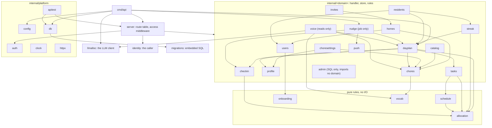
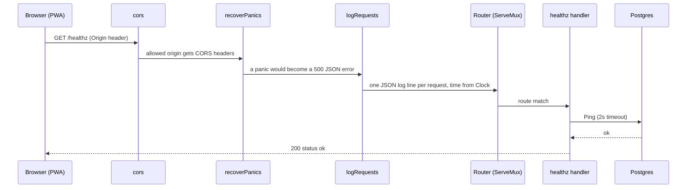
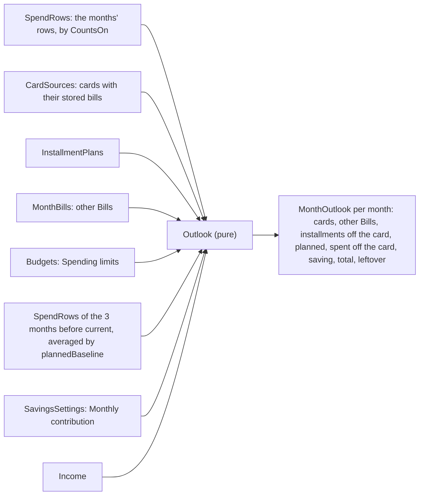
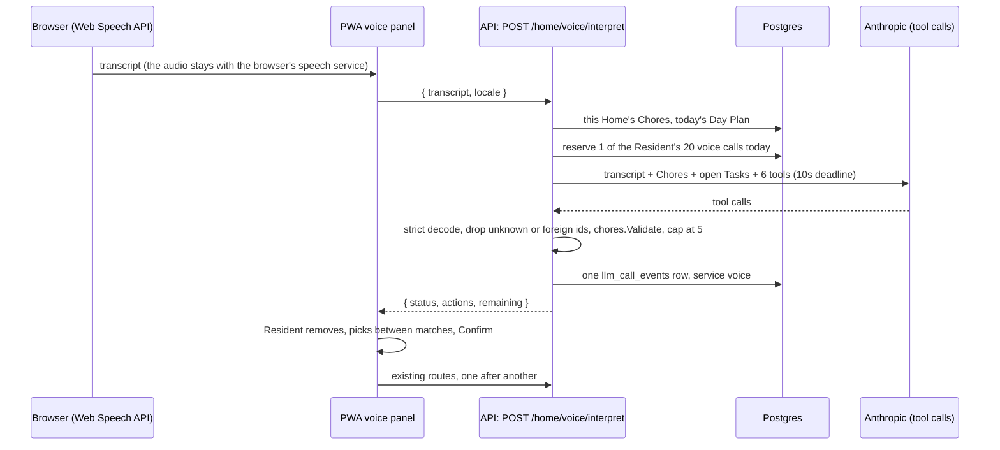
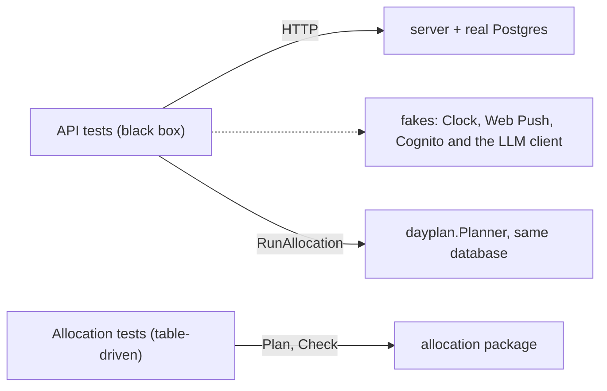

# The Go backend

Related: [ADR 0004](../adr/0004-ai-allocates-behind-a-deterministic-referee.md), [ADR 0002](../adr/0002-mirror-the-work-stack.md). Terms: **Allocation**, **Day Plan** in [GLOSSARY.md](../../GLOSSARY.md).

The backend is one Go module in `backend/`. In Go, code under `internal/` can only be imported from inside this module, and each folder is a *package*. `cmd/<name>/` holds a program's `main` function, an *entry point*.

## Entry points

| Entry point | Status | What it does |
|---|---|---|
| `cmd/api` | Built | `api` or `api serve` runs the HTTP server; `api migrate` applies database migrations and exits; `api vapid` prints a new VAPID key pair (a one-off human step, needs no database). |
| `api allocate` | Built | Runs the Allocation job once and exits: plans every Home whose Allocation time has arrived, then sends the push nudges when VAPID keys are set (for local runs and manual catch-up). |
| `cmd/evals` | Built | `go run ./cmd/evals` runs the manual allocator evals (baseline against the LLM allocator on synthetic days) and prints a comparison table; a separate binary, never in the API image and never run by `go test` or CI. See "Evals" in [Daily Allocation](allocation.md). |
| `api finance-events` | Built | The finance Lambda: serves only `POST /events` (the hourly scheduled event; any other body is `400`) and `GET /healthz`, and runs `finance.Syncer.Run`, then `finance.Reminders.Run` when the VAPID keys are set. Same image, a different command (ADR 0008). It connects to the database only when `FINANCE_ENCRYPTION_KEY` is set; without it the event is answered `200` and `finance sync disabled` is logged. See "The Transaction sync" below. |
| `api events` | Built | The Allocation job's Lambda: serves only `POST /events` (the scheduled tick that Lambda Web Adapter forwards) and `GET /healthz`. Same image as the API, a different command; see [ADR 0008](../adr/0008-scheduled-jobs-run-as-a-second-lambda-from-the-api-image.md). |

## Packages

The code is organised by domain ([ADR 0011](../adr/0011-split-each-domain-into-layer-folders.md)). Each domain package owns its data, its rules and its HTTP routes, and names its files by layer, so the same file name means the same job everywhere:

| File | Layer |
|---|---|
| `<package>.go` | The package doc, the domain model types and the sentinel errors (when the package has more than one file). |
| `handler.go` (`handler_<topic>.go` when one is not enough) | The HTTP controller: a `Handler` built with `NewHandler`, one method per route, which decodes the request, calls the domain and maps its errors to status codes. |
| `dto.go` | The named request and response shapes on the wire. Small inline body structs stay in the handler. |
| `store.go` | The repository: the only file that talks to Postgres. |
| any other file | The service: the domain's rules, for example `validate.go`, `resolve.go`, `schedule.go`, `commit.go`. |
| `handler_test.go` | The black-box API tests of that domain's routes, through the real server (`apitest`). |

Folders:

- `internal/<domain>/`: `users`, `homes`, `invites`, `chores`, `choresettings`, `catalog`, `profile`, `tasks`, `dayplan`, `checkin`, `streak`, `residents`, `push`, `photos`, `voice` (voice commands, see [Voice commands](#voice-commands) below), `finance` (the allowlisted Finances routes), `pluggy` (the Pluggy client, no routes), `admin` (the read-only operator API), plus the pure rule packages `allocation`, `schedule`, `onboarding` and the shared ids in `vocab`.
- `internal/identity/`: who is calling. The server's middleware puts the signed-in User and their Membership in the request context; handlers read them with `identity.CurrentUser` and `identity.CurrentMembership`, so no domain imports another just to know its caller. `users.User`, `homes.Home` and `homes.Membership` are aliases of its types.
- `internal/platform/`: code that knows no domain. `auth` (token verification), `clock`, `config`, `db`, `httpx` (`WriteJSON`, `WriteError`, `InternalError`, `DecodeBody`), the test harness `apitest` (it counts the SQL statements the API runs, `App.QueriesFor`, through a `pgx.QueryTracer` that `db.Connect` accepts as a pool-config option) and `puritytest`, the shared check behind every `purity_test.go`.
- `internal/server/`: the composition root. `server.go` builds every domain `Handler` and lists every route in one table; `auth.go` holds `requireUser` and `requireResident`; `boot.go` serves `GET /boot`, the home screen's launch reads in one response (below); `cors.go` and `http.go` the outer middleware.

Every domain handler also imports `identity`, `platform/httpx` and, where it needs the time, `platform/clock`; those arrows are left out. `allocation` imports nothing from the project and does no I/O (`purity_test.go` enforces that). `schedule` and `tasks` import it only for its `Date` type; `dayplan` is the only package that calls `Plan` and `Check`. The purity tests of `allocation`, `schedule` and `onboarding` cover the whole package; `catalog` exempts its `handler.go` and `checkin` its `store.go`, so the rule files stay pure next to their edge.

| Package | Role |
|---|---|
| `server` | Builds one `http.Handler` (`server.New(Deps)`): it constructs each domain's `Handler` and maps every route to one of their methods behind `requireUser` or `requireResident`. `Deps` holds everything outside the system that tests fake: database pool, clock, logger, CORS origins, the Web Push `Sender` and the public VAPID key, the token `Verifier` (nil means auth is off), the photo `ObjectStore` with `PhotosBaseURL` (nil means photos are off), and `Voice`, the `llmalloc.Client` behind voice commands, with `VoiceModel` (nil means voice is off; `cmd/api` sets an `llmalloc.NewAnthropic` client when `VOICE_ENABLED` is true). |
| `platform/config` | Reads `DATABASE_URL`, `MIGRATE_DATABASE_URL`, `PORT`, `MIGRATE_ON_START`, `DB_MAX_CONNS`, `CORS_ALLOWED_ORIGINS`, the optional pair `COGNITO_ISSUER` and `COGNITO_CLIENT_ID` (public identifiers, so plain environment variables; one without the other is an error, the issuer must be https, neither means auth is off), and the optional set `VAPID_PUBLIC_KEY`, `VAPID_PRIVATE_KEY`, `VAPID_SUBJECT` (one key without the other is an error; neither means push is off). `VAPID_PRIVATE_KEY` is resolved from SSM through `VAPID_PRIVATE_KEY_SSM_PARAM`, like the database URLs. The LLM allocator settings: `LLM_ALLOCATOR_ENABLED` (default false; true needs `ANTHROPIC_API_KEY`, resolved from SSM through `ANTHROPIC_API_KEY_SSM_PARAM`), `LLM_MODEL` (default `claude-haiku-5-5`), `LLM_DAILY_CAP_PER_HOME` (default 3) and `LLM_TIMEOUT_SECONDS` (default 15), `VOICE_ENABLED` (default false; true turns on `POST /home/voice/interpret` and, like the allocator, needs `ANTHROPIC_API_KEY` or the API does not start; voice uses `LLM_MODEL` but not the allocator's daily cap or timeout) and the optional `LLM_MONTHLY_SPEND_LIMIT_USD` (a positive decimal of dollars with at most 6 decimals, stored as micro-USD in an `int64` as `LLMMonthlySpendLimitMicros`; unset is 0, shown as `null`). The limit is display-only: Terraform sets it on the API and on the job from one local, `GET /admin/ai` shows it against the month's estimated cost, and no code enforces it (the Anthropic Console does). Errors name the variable, never the key. The optional pair `PHOTOS_BUCKET` and `PHOTOS_BASE_URL` (one without the other is a startup error; the base URL must be https and is stored without a trailing slash; neither means the photo routes answer 503; `PhotosEnabled()`). `REPLAN_ENABLED` (default false) lets the Allocation function accept the replan event; only the staging Allocation function sets it. `FINANCE_ALLOWLIST` is the comma-separated emails that may use Finances (trimmed; `finance.NewAllowlist` lowercases; the placeholder `none` is skipped so it allows nobody, and an entry without an `@` is kept but logged as a warning); resolved from SSM through `FINANCE_ALLOWLIST_SSM_PARAM`, which stops the process if the parameter is missing or empty, so Terraform always creates it. `PLUGGY_BASE_URL` is where the Pluggy adapter calls (trimmed, no trailing slash, default `https://api.pluggy.ai`; it must be an http(s) URL or the API does not start). `ENVIRONMENT` names the deployment: `local`, `staging` or `production` (trimmed; unset or empty is `local`, anything else is a startup error). Terraform sets it on each API and Compose sets `local`; `GET /admin/me` returns it so the admin app can check it is talking to the environment it was built for. |
| `photos` | A User's photo. `ObjectStore` is the private-bucket seam (`PresignPut`, `Head`, `ReadPrefix`, `Copy`, `Delete`), nil in `server.Deps.Photos` when photos are off. `S3` is the real adapter over `aws-sdk-go-v2/service/s3`: `PresignPut` signs a PUT with `ContentType` and `ContentLength` set (both signed headers, so the upload binds the type and exact size) for 5 minutes with the API role's own credentials, so that role needs `s3:PutObject`; `Head` returns size, type and ETag and maps only S3's 404 to `ErrNotFound` (the API role holds `s3:ListBucket`, so a missing key answers 404); any other error, a 403 included, is wrapped and the handler answers 500; `ReadPrefix` is a ranged GET of 16 bytes; `Copy` is `CopyObject` with `MetadataDirective: REPLACE`, the content type, `Cache-Control: public, max-age=86400, immutable` and `CopySourceIfMatch` set to the ETag `Head` returned, so an object replaced after the checks answers 412, which is `ErrChanged` and a `400 invalid_object` from Confirm. `Fake` is the in-memory store for tests (`Upload` simulates the browser's PUT, `Objects`, `Presigned`, `FailDelete`). `keys.go` holds the pure rules: `NewPendingKey(userID)` is `pending/<userID>/<22 chars of 128 random bits>`, `NewAvatarKey(ext)` is `avatars/<fresh id>.<webp or jpg>` (a fresh id, so a pending key and a public URL never link), `OwnsPendingKey` is a strict regex that includes the caller's id (how a User can only confirm a key issued to them, with no table), `Sniff` reads the magic bytes (JPEG `FF D8 FF`; WebP `RIFF` at 0-3 and `WEBP` at 8-11) and `URLBuilder` turns a stored key into `PHOTOS_BASE_URL/<id>.<ext>`, returning nil for a nil key or an empty base (`server.New` passes an empty base when `Deps.Photos` is nil). `Handler` serves the three routes behind `RequireConfigured` (`503 {"error":"photos not configured"}`). Confirm checks, in order, key ownership (`invalid_key`), existence (`not_found`), size and type (`invalid_object`) and magic bytes against the stored type (`not_an_image`), each a `400` that changes nothing; then copies to the avatar key, stores it and, only after that commit, deletes the pending object and the previous photo, best effort (a failure is logged at warn with the key and never fails the request). Magic bytes prove the type, not that the image decodes. |
| `push` | `Sender` interface (one `Send` per subscription, returning `ErrGone` when the push service answers 404 or 410), `WebPushSender` (real, on `webpush-go`, VAPID, 24h TTL, 10s HTTP timeout; it strips a leading `mailto:` from `VAPID_SUBJECT` because webpush-go adds one, and includes the push service's response body in non-2xx errors), `Payload` (`title`, `body`, `url` and an optional `kind`, `checkin_reminder`, `day_plan_ready`, `bill_due_today`, `bill_due_soon` or `bill_overdue`, that the service worker words for the device language; the English text is always sent too), `Store` (the `push_subscriptions` table: upsert, get, `ListByUsers` (all devices of a set of Users in one query), delete, and `Deliver`, which drops a subscription the push service rejected), and `Fake` for tests. |
| `platform/auth` | `Verifier` interface: a raw bearer token in, `Claims{Subject, Email}` out, or an error wrapping `ErrInvalidToken`. `Cognito` is the real one: RS256 only, signature from the pool's JWKS (fetched lazily on the first authenticated request, cached in memory for an hour, one refetch at most a minute for an unknown key id, old keys kept if a refresh fails, fail closed when none are known), `iss` equal to the issuer, `aud` equal to the app client, `token_use` equal to `id`, `exp` required, `email_verified` true, subject and email present. Time comes from the injected `Clock`. `Fake` mints tokens for tests and never touches the network. |
| `users` | `Store.FindOrCreate(sub, email, now)`: the single upsert behind the first-request-creates-the-User rule; it also returns `display_name` and `photo_key`, so every request's `identity.User` carries them. `Store.SetDisplayName` is one `UPDATE` that stores `NULLIF(name, '')`, so "" clears. `name.go` holds the pure rule `NormalizeName` (trim, "" when blank, 40 code points, no control or bidi characters), which answers `ErrNameTooLong` or `ErrNameInvalid`; `identity.ShownName` (display name, else the email before the last `@`) is shared with `homes`. `dto.go` holds `MeResponse`, whose `photoUrl` comes from the photo URL builder `Handler` is given. `Store.SetPhotoKey` and `ClearPhotoKey` are each one `UPDATE ... FROM (SELECT ... FOR UPDATE)` that returns the previous key, so two simultaneous confirms each get the right key to delete; `photos` uses them through its `Keys` interface (`users` never imports `photos`). |
| `onboarding` | The ordered step ids (`install`, `reminders`, `baseline`, `restrictions`, `preferences`, `home`, then `done`), `Valid` (what a client may `PUT`), `Next` (the step after the stored one) and `Before` (the stored values a step may move forward from). Stdlib only; `purity_test.go` enforces it. `users.Store.AdvanceOnboarding` applies the monotonic rule as one conditional `UPDATE`, and `homes.Store.Create` stores `done` in its transaction. |
| `homes` | `Membership{ResidentID, Home}` is a User's place in a Home: their own `residents` row and the plain `Home`. `Store.Create(userID, timezone, allocationTime, now, inHome)` inserts the Home and the first Resident in one transaction (and runs the optional `inHome` callback on it, which `POST /home` uses to add the reviewed Chores without `homes` importing `chores`) and maps the unique violation on `residents.user_id` to `ErrAlreadyResident`; `ForUser` returns the caller's `Membership` or `ErrNoHome`; `UpdateSettings` replaces the timezone and Allocation time. `LeaveTx(tx, residentID, homeID)` is the one place a Resident leaves a Home: inside the caller's transaction it locks the Home row (`FOR UPDATE`, so two last Residents leaving at once are serialised), deletes the `residents` row (the cascade clears their specific Preferences and Restrictions) and deletes the Home if nobody is left (the cascade clears its Chores, Tasks and Invites). Accepting an Invite uses it, and `Store.Leave(residentID, homeID)` wraps it in its own transaction for `DELETE /home/residents/me`. |
| `invites` | An Invite is a single-use link, valid while `now < expires_at` (`Validity`, seven days; at the exact instant it is expired). The token is 32 random bytes, base64url, shown once; only its SHA-256 is stored, and a token that is not canonical base64url of 32 bytes is `ErrNotFound` before the database is asked. `check` (pure) is the validity rule and `newToken`/`hashToken` are pure too. `Store.Create` caps a Home at `MaxOpenPerHome` (10) unused, unexpired Invites (`ErrTooManyOpen`), serialised by a `FOR NO KEY UPDATE` lock on the Home row. `Lookup` never writes. `Accept` is one transaction: claim the Invite with `UPDATE ... WHERE used_at IS NULL AND expires_at > now RETURNING home_id` (the single-use guard; on zero rows a read decides `ErrNotFound`, `ErrUsed` or `ErrExpired`), then if the User lives in the same Home `ErrAlreadyHere`, in another Home without `confirmLeave` `ErrWouldLeaveHome`, with it `homes.LeaveTx`, then insert the `residents` row (a unique violation is `homes.ErrAlreadyResident`). Any error rolls the claim back, so a failed join never burns the Invite. Imports `homes`, never the reverse. No HTTP types. |
| `profile` | `Store` for the User's profile: `Load`, `SetBaseline` (set some days, clear others, one transaction), `SetPreference` (neutral deletes the row), `AddRestriction`, `RemoveRestriction`. Writes are idempotent. `MaxBaseline` (20) is the named upper bound of a Baseline. |
| `chores` | `Validate(Input)` is pure: it trims the name, de-duplicates and sorts Demands and weekdays, and returns a stable code per invalid field, all at once (`Input` is decoded straight from the JSON body; numbers arrive as `any`, so a string or 2.5 is a field code, not a bad request; the first code recorded for a field wins). `Store` has `List`, `Create`, `Update`, `Delete`; every query that takes an id also filters on `home_id`, and a miss is `ErrNotFound`, and the handlers answer 404 for an id that fails `ValidID` without asking the Store. Imports `vocab` for Categories, Demands and Importances. `Chore` carries the JSON tags and is written to the response as is. |
| `catalog` | The fixed Catalog of common Chores and the rules that turn questionnaire answers into proposed Chores; Go code, no table, no migration. Pure (stdlib and `chores.Fields` only; `purity_test.go` enforces it). `Entries()` returns copies of the Catalog table in display order; each entry carries its own rule (how many Chores the answers call for, and an optional adjustment of Effort, interval or weekdays), so adding an entry is one place. An entry has a stable `ID` (for example `clean_bathroom`), `chores.Fields` with an English fallback name, and `PerRoom`. `Answers` is decoded like `chores.Input` (counts and weekdays as `any`); `ValidateAnswers` returns codes (`invalid`, `out_of_range`, `unknown`) keyed `rooms.bathrooms`, `outdoor.gardens`, `collection.trash`, `habits.cooking`, all at once; a missing section means none (cooking defaults to `sometimes`). `Propose(Answers)` is deterministic and follows Catalog order: a per-room entry yields one `Proposal` per room (`Instance` 1-based, `nil` when there is one), pets add `pets` Chores, a collection stream with days adds one weekly essential Chore limited to those weekdays, and habits change the Chores (a dishwasher swaps washing the dishes for loading it, no washing machine drops the laundry Chores, cooking `daily` makes the kitchen Chore heavier and more frequent). Outdoor areas are counts like rooms (`outdoor` is `{balconies, yards, gardens}`, kept apart from `rooms` so they never trigger the floor Chores), and every outdoor entry is `PerRoom`, so it is proposed once per area of its type (`sweep_yard` once per yard plus garden). Bounds: 0 to 10 rooms per type (kitchens 0 to 3), 0 to 10 areas per outdoor type and `MaxProposals` 125, which a test proves the largest answers (122) stay under. The API never renders a localised name; the PWA names a Chore from `catalogId` and `instance`. |
| `choresettings` | A Resident's Preference and Restriction on one specific Chore. `Resolve(Chore, General, Specific)` is pure and holds the rule: a specific Preference (neutral included) beats the general one for the Chore's Category, else neutral (source `specific`, `general` or `default`); Restrictions only add, so the reasons are the Chore's Demands that are in the User's general Restrictions plus the specific Restriction, listed apart. `Store` has `SetPreference`, `ClearPreference`, `AddRestriction`, `RemoveRestriction` (idempotent; the two sets prove in the same statement that the Chore is in the Resident's Home, the two deletes ask only when they removed nothing; `ErrNotFound` otherwise, the same for a missing Chore) and `Effective(homeID)`, which reads the Home's Chores, Residents, all their general profiles (`profile.LoadMany`, one `ANY($1)` query per profile table) and the specific rows in one read-only repeatable-read transaction, a fixed number of queries however many Residents there are. It has no HTTP types, so the Allocation job can reuse it; `allocation` is untouched. |
| `schedule` | `Decide(Chore, latest *Task, today)` is pure (stdlib and `allocation.Date` only; `purity_test.go` enforces it) and returns one decision: `Open` a Task with a window and Effort, `SetEffort` on the open Task, or `Nothing`. Rules (ADR 0001): a recurring Chore has windows of N consecutive days, the first starting on the day it was created in the Home's zone; `WindowStart` and `WindowEnd` are inclusive dates. With allowed weekdays, the window starts on the first allowed day on or after the scheduled start and N is rounded up to whole weeks, so a Task only opens on an allowed day. A one-off Chore gets one Task, ever (a day, or a week when weekdays are limited). A window is missed when today is past `WindowEnd` and the Task is still open; the same Task stays open and keeps its window. Missed windows are derived (`floor((today - WindowStart) / length)`), never counted, so repeated or skipped runs agree; a recurring build-up Chore's current Effort is `min(5, base + missed)`, other Chores stay at base (`buildsUp` is ignored on a one-off). After a Task is done, the next window of a recurring Chore starts N days after `closed_on` at base Effort (an assumption until a Completion ticket defines it). |
| `tasks` | `RefreshIn(ctx, tx, homeID, date, loc, now)` brings a Home's Tasks up to date inside the caller's transaction, for the date and zone the caller already worked out: it sets `statement_timeout` to 5s with `SET LOCAL`, locks each Chore row `FOR UPDATE`, loads its latest Task, applies `schedule.Decide` and writes, then puts back the value it read first with `set_config('statement_timeout', ..., true)`, so the rest of the caller's transaction keeps its own setting, the session's or a `SET LOCAL` of its own (`SET LOCAL` lasts until the transaction ends). The Chore row locks are held until the caller commits, so a concurrent `GET /home/tasks` waits for a Day Plan run, which is short. `Store.Refresh(homeID, now)` is the pool wrapper for callers outside a run (`GET /home/tasks`): it opens a transaction, converts `now` to a date in the Home's IANA zone (an unloadable zone is an error, never UTC), calls `RefreshIn` and commits. Idempotent and safe in parallel; the partial unique index on open Tasks is the final guard and the insert is `ON CONFLICT DO NOTHING`. `Store.ListOpen(homeID)` returns the open pool, never nil. `dayplan` calls `RefreshIn` from its one transaction opener before it builds `allocation.State`. |
| `checkin` | The Check-in rule, pure (`checkin.go`, stdlib only; `purity_test.go` enforces it for every file but `store.go`). `Level` (`drained`, `low`, `normal`, `energized`) with `Valid`, and `Scale(base, Level)`: 0, 50%, 100%, 130% of the Baseline in whole points, rounded down (integer arithmetic), 0 for a base of 0 or an unknown level. Table-tested for every level and every base 0 to `profile.MaxBaseline`. Demand validation stays in `vocab.IsDemand`. |
| `checkin` (store) | `store.go` stores Check-ins (`checkins`, `checkin_demand_restrictions`). `New(level, demands)` is the one validating, de-duplicating constructor of a `CheckIn` (`ErrInvalidLevel`, `ErrUnknownDemand`); the handler and `Save` trust it, and the SQL `ON CONFLICT DO NOTHING` stays as a safety net. `Save(tx, residentID, date, CheckIn, now)` upserts on `(resident_id, checkin_date)` and replaces the day Restrictions; `LoadMany(q, residentIDs, date)` reads each Resident's Check-in in the caller's snapshot (a Resident with none is absent); `Store.Get` is the single read for the route. Day Restrictions are never written to the lasting `user_demand_restrictions`. |
| `streak` | The Streak rule, pure (`streak.go`, stdlib and `allocation.Date` only; `purity_test.go` enforces it for every file but `handler.go` and `store.go`). `Day` holds a Resident's facts for one Home-local date (`Completions`, `Undone`, `Drained`); `Judge(Day)` returns `Grow`, `Pause` or `Break`, by precedence: a Completion grows, otherwise an undone Commitment on a non-Drained day breaks, otherwise pause ([ADR 0014](../adr/0014-a-day-with-any-completion-keeps-the-streak.md)); `Current(days, today)` walks the final days back from yesterday (grow adds one, pause carries on, break stops) and adds today only when it already grows, returning the number and `todayGrew`. Today is passed in, never read. Table-tested with explicit dates; the fake-clock tests are at the API seam. The rules are in [Daily Allocation](allocation.md). |
| `residents` | `GET /home/residents` and `GET /home/residents/{id}`. The detail read: `handler.go` `Get` rejects a malformed id with `chores.ValidID` before any store call, then `Store.Find` (one query, scoped to the caller's Home), `streak.CurrentFor` for that one id (the same call as the list and `GET /home/streak`), and `Store.CompletionsBetween` (the Completions the Resident is on over `today-29 ..= today`, then one query for the partners, skipped when there are no Completions), grouped into days in Go while scanning ordered rows. A Chore deleted later takes its Completions with it, from the history and the Streak alike. `store.go`: `Roster(homeID, callerResidentID)` is one query joining `residents` to `users` (caller first, then `created_at, id`); email and user id are read only to compute the name and the avatar. `handler.go`: `List` computes `today` once with `dayplan.LocalDate`, calls `streak.CurrentFor` with every roster id (two queries in all, plus the middleware's lookups) and builds the response. `dto.go` is the privacy boundary: dedicated structs, no embedded User, profile, Check-in or Day Plan type. It imports `streak`, `users` (`Initials`, `AvatarTone`), `dayplan` and `identity`; nothing imports it. `move.go` serves `PATCH /home/completions/{id}` (`Handler.MoveCompletion`): it lives here because its `200` is `detail`, and `dayplan` cannot render that without an import cycle. The write goes through `*dayplan.Planner.MoveCompletion`; `server.go` builds one Planner and hands it to both handlers. |
| `admin` | The read-only operator API behind the super-admin guard ([ADR 0017](../adr/0017-operate-through-a-separate-admin-app-per-environment.md)). SQL only: it imports no domain package and repeats the stored vocabulary it filters on (`refused`, `taken`, `rejected`, `accepted`, the push outcomes) as constants that name their source. `range.go` is pure: `ParseRange` (`7d` or `30d` only), `Range.Window(now)` (the last N UTC dates, oldest first), `Range.Previous(now)` (the N dates just before that window) and `ZeroFill`. `store.go` holds `readOnly`, the helper every report goes through: one `BEGIN READ ONLY` transaction with `SET LOCAL statement_timeout = '5s'`, always rolled back, so Postgres refuses any write (SQLSTATE `25006`) and a slow query cannot hold one of the `DB_MAX_CONNS=2` connections for long. `overview.go` runs `Store.Overview` in it with five queries: totals, then for each of the current and previous windows the active Residents and Homes (a Check-in, Commitment or Completion in the range) and one `UNION ALL` of every per-day metric (runs, rejected, fallbacks, Check-ins, Completions, Refuses from `reasons->'pool'`, Takes, accepted Swaps, push outcomes), never a query per day; the previous window's days are summed in Go into one set of totals. The handler reads the clock once and builds both windows from it. A day is the stored Home-local date where the table has one, else UTC. `ai.go` runs `Store.AI` in the same transaction for `GET /admin/ai`: per-day and per-service `llm_call_events` aggregates (`count(*) FILTER` per outcome, `percentile_cont(0.5)` and `max` of `latency_ms`, token and cost sums), the UTC calendar month's cost over `created_at`, the allocator and explanation shares from `allocation_runs` and `day_plan_explanations`, and the top violation kinds and fallback reasons. For the previous window it adds a range-level per-service query (`serviceRangeSQL`, since a median cannot be built from daily medians) and the two share queries, 11 statements in all, each bounded by the 5 s statement timeout (the timeout is per statement, not per transaction). `flow.go` runs `Store.Flow` for `GET /admin/flow`: the daily pipeline as one ordered funnel of range totals (Homes due, runs, LLM asked, skipped, accepted, fallback, rejected runs, explanations by LLM or template, `day_plan_ready` pushes by outcome). The explanation counts come from the same `readExplanationShare` as `AI`, so the reports agree by construction. Homes due has no stored source, so it is the Homes created by the end of each UTC day, summed over the days. `worth.go` runs `Store.Worth` for `GET /admin/worth` in the same transaction: four queries over the previous and current windows together (outcome per arm from planned runs, their assignments, refused pool entries and same-day Completions; run counts by arm and fallback; allocator calls, referee rejections and cost from `llm_call_events`; explanations), each grouped by day, then split in Go into `current`, `previous` and zero-filled `days`, so the days add up to `current`. The month-to-date figure comes from the same `readMonth` and `Handler.monthToDate` as `AI`, so the two agree by construction. `dto.go` holds the response types and `handler.go` serves the four report routes, taking a `Display` (the per-Home cap and the spend limit, from `server.Deps`); `server/admin.go` lists the routes in the admin route table. |
| `streak` (store) | `store.go`: `Store.CurrentFor(ctx, residentIDs, today)` reads the facts for many Residents in one aggregated query (`resident_id = ANY($1::uuid[])` in all three branches, grouped by `(resident_id, day)`), splits the rows by Resident in Go and applies the unchanged pure `Current` to each, returning a `Reading{Current, TodayGrew, DoneToday}` per id (`DoneToday` is the `Completions` of today's row). `Store.Current(ctx, residentID, today)` is the one-id call to it, so `GET /home/streak` and the Residents list cannot diverge. The facts come from a single aggregated query over `task_residents` (left-joined to `completions` on the same date for `undone`), `completion_residents` and Drained `checkins`, up to today, and hands them to `Current`. Nothing is stored and there is no new table or migration. |
| `dayplan` | Runs Allocation and stores and reads the Day Plan. `Planner` (built with `New(db, Allocator, logger, ...Option)`; `WithNudger(n)` sets the optional `Nudger` interface (`DayPlanReady`, `CheckinReminders`) that `RunDue` calls after planning every due Home, first for the Homes planned in this tick, then the reminders, inside a recover and under one shared 30s context deadline (`WithNudgeTimeout` changes it, for tests); no option means no push, and `dayplan` never imports `push`; an allocator names itself in the run record through `Name()`; `WithLLM(proposer, dailyCap, timeout)` adds the optional `Proposer` interface (`Name`, `Propose(ctx, State)`), which `PlanHome` asks first, under a daily cap per Home (`llmcap.go`, reserved on the pool before the call) and one LLM budget per tick (20s, `WithLLMBudget` for tests), falling back to the `Allocator` with a stable `fallback_reason` when the call fails or `Check` refuses its plan; Check-in and "right away" re-plans never ask it; the same `LLMConfig` carries the optional `Explainer` interface (`Explain(ctx, []explain.ResidentFacts)`) and its `ExplainBudget`, 15s by default, which `RunDue` uses in `explainHomes` (`dayplan/explain.go`) after planning every due Home and before the nudges: one call per Home, reserved on the same daily cap, best effort and inside a recover) has `DueHomes(now)`, `PlanHome(homeID, now)` and `RunDue(now)`. `DueHomes` converts `now` to each Home's IANA zone and returns the Homes whose local wall-clock time is at or past their Allocation time and that have no run for the local date ("at or past", so a late tick or a daylight-saving gap still plans once); a Home with an unknown zone is logged and skipped. `PlanHome`, `PlanResident` and `CheckIn` all run through one private opener, `Planner.inHomeTx` (`tx.go`): Begin, lock the Home row (`FOR NO KEY UPDATE`, `lockHome`, which returns the Home's `homeClock`, its local date and zone, the only date a run uses), the caller's steps, Commit, rollback by `defer`. The planning paths call it through `refreshedHomeTx`, which runs `tasks.RefreshIn` through the same transaction for that date before the caller's steps; the Home lock comes before the Chore locks, and a Refresh failure fails the run (a Check-in included). The actions use `inHomeTx` as it is, with no Refresh. A run that finds nothing to write (the day is already planned) returns nil and commits the Refresh, which is idempotent; `PlanHome` writes the run in a savepoint so a unique violation does not abort the transaction. Rows of `day_plan_assignments` are written only by `insertAssignments` (`state.go`), which `store`, the Check-in re-plan and `Take` call. `PlanHome` (with the LLM off) goes straight into that transaction: it looks for the run, loads the `allocation.State` (all open Tasks, overdue ones included, joined with their Chore for Demands, people and allowed weekdays; Residents with Energy and both levels of Restriction), asks the Allocator, has `allocation.Check` referee the proposal, and writes the run and the assignments. A proposal that errors or breaks any rule is never stored as a plan: the run is recorded `rejected` with the violations, nothing is assigned, the rejection is logged, and the day is taken, so it is not retried until tomorrow. With the LLM on, `PlanHome` first looks at the Home in a short `refreshedHomeTx` of its own (it returns `AlreadyPlanned` if the day has a run, otherwise it refreshes and reads the State the model is shown), calls the model with no lock and no connection held, then plans in the main transaction, which throws the answer away if the Home's date changed meanwhile. Refresh uses the transaction's connection, so a call holds one connection at a time (with `DB_MAX_CONNS=2`). The run's `reasons` hold the pool, each Resident's Energy and any violations or error; the assignments are rows of `day_plan_assignments` only, and an old run whose `reasons` still carries `assigned` reads the same (the key is ignored and goes the next time the reasons are written). Energy is the Resident's Baseline points for the weekday of the Home's local date, scaled by their Check-in when they made one, in one function (`energyOn`); an unset day is 0 and gives that Resident nothing, even with a Check-in. The Check-in's day-only Restrictions are added to the general Demand Restrictions. A two-person Task is stored as one `day_plan_assignments` row per Resident; `Store.Today` lists it under each holder with `with`, `Complete` records every holder, `Refuse` frees both while nobody accepted, and re-plans keep or release both rows together (see [allocation](allocation.md)). The `Check` violation kinds are `over_energy`, `broken_restriction`, `unknown_task`, `duplicate_task`, `unknown_resident`, `weekday_not_allowed` and `wrong_resident_count`. `CheckIn(homeID, residentID, CheckIn, now)` stores a Check-in and, when today's run is `planned`, plans that one Resident again in the same transaction (same Home lock and Refresh as `PlanHome`, so a Task that came due after the plan is a candidate; see [allocation](allocation.md)); with no run it only saves, after a `rejected` run it only saves, and a failed or refused re-plan rolls everything back and returns an error. `PlanResident(homeID, residentID, now)` is "get my tasks right away": it locks the Home, refreshes the Tasks, and plans that one Resident from the pool through the same re-plan path as a Check-in (`replanRun`); with no run for the date it creates today's run first, which makes the job skip the Home today (see [allocation](allocation.md)); after a `rejected` run it changes nothing and returns `Rejected`; a failed or refused proposal rolls back and returns an error. Swaps (`swap.go`) are `OfferSwap`, `AcceptSwap`, `DeclineSwap` and `CancelSwap`, run through the same `act` wrapper (Home lock, today's run), with `acting.mayDo` (the referee call Take also uses) deciding both sides, the assignment rows moving in `moveCommitment` (the reasons hold no assignments, so nothing is rewritten) and the sentinels `ErrNotHeldByOther`, `ErrSwapPending`, `ErrSwapNotFound`, `ErrSwapClosed`, `ErrSwapStale` and `ErrRecipientDrained` (see [allocation](allocation.md)); `Store.Today` adds the caller's live offers as `swaps`. `MoveCompletion` (`redate.go`) re-dates a Completion in `inHomeTx` (so it shares the Home lock), finding it joined to its Task and Chore on `home_id` with `FOR UPDATE`, checking in the same query that the caller is on `completion_residents`, and writing `completions` and `tasks.closed_on` together; its sentinels are `ErrCompletionNotFound`, `ErrNotYours` (the caller is not on the Completion), `ErrInFuture`, `ErrTooOld` and `ErrBeforeTask`. Each `doneToday` item of the Day Plan also carries `completionId`, the id `PATCH /home/completions/{id}` takes (`id` stays the Task id). The Day Plan actions are `Accept`, `AcceptAll`, `Refuse`, `Take` and `Complete` (`commit.go`): each runs through `act`, which uses the same opener as the job (Home lock, no Refresh), loads today's run with `loadRun`, acts, and commits; every early return rolls back. Accept, AcceptAll, Refuse and Take need a `planned` run (`ErrNoPlanToday`); Complete without one is `ErrNoPlanToday` too. A Complete on a pool Task runs `acting.takeFromPool`, the body Take shares. The Task row is locked `FOR UPDATE`, joined to its Chore on `home_id`, so a Task of another Home is `ErrTaskNotFound`. Errors are sentinels (`ErrTaskNotFound`, `ErrNoPlanToday`, `ErrNotProposed`, `ErrAlreadyCommitted`, `ErrNotInPool`, `ErrNotYours`, `ErrAlreadyDone`, `ErrTwoPersonTask`, `ErrRestricted`, `ErrDrained`); `dayplan` knows no status codes. `Take` runs `allocation.Check` on a plan of only that Task and ignores the over-Energy violation. `LocalDate(zone, now)` and `lockHome` both build on `clockIn`, the one place a zone becomes the Home's local date. The server builds its own `Planner` from `Deps.Allocator` (default `allocation.Baseline`), which must be the one the job uses. `RunDue` plans each due Home and logs, but survives, a failure for one; it returns a `Summary`. `Store.Today` reads the stored plan for the API and never plans or refreshes; it reports the run's `id` (as `runId`), its `allocator` and its stored `fallback_reason` (as `fallbackReason`, absent when null). `RunDue` and `ReplanHome` end in one private step, `finishPlanned` (explanations, then nudges); only the tick passes `plannedAndReminders` (a `nudgeScope`; the replan passes `plannedOnly`), so a replan never sends Check-in reminders to other Homes. `ReplanHome(homeID, now)` is the staging-only replan, run when the manual "Replan staging" GitHub workflow (`.github/workflows/replan-staging.yml`) invokes the Allocation function with the replan event: in its own `inHomeTx` it deletes the Home's run for the local date (assignments and explanations cascade) and that Home's `day_plan_ready` rows in `nudges`, commits, then plans through the normal `planHome` (LLM budget included), explains and nudges as a tick does. It never touches `llm_calls`, so the daily cap still applies, and it leaves Commitments (`task_residents`) in place. `EventsHandler(p, clock, log, ...EventsOption)` is the job Lambda's HTTP surface. It serves two events on `POST /events`: the EventBridge scheduled event, and, only with `WithReplan()`, the replan event (`source` `homeowner.dev`, `detail-type` `Replan Home`, `detail` `{"homeId": "<uuid>"}`, built with `dayplan.NewReplanEvent`; the workflow builds the same JSON with `jq`, and `replan_event_json_test.go` pins the two together). `cmd/api` passes `WithReplan()` when `REPLAN_ENABLED` is true (`config.Config.ReplanEnabled`, default false; set on the staging Allocation function only). With the flag off, the replan event gets the same `400 unrecognised event` as any unknown event. A malformed `homeId` is `400`, an unknown Home `404`, any other failure `500`; success is `200 {"outcome"}`. Logs carry the Home id, date, allocator and counts only. |
| `vocab` | The fixed, ordered Category, Demand and Importance ids (snake_case, stored and sent as-is) with `IsCategory`, `IsDemand` and `IsImportance`. `allocation` never imports it; its `Demand` and `Importance` values equal these ids. |
| `platform/db` | Opens a `pgx` connection pool (retrying about 10s at start) and runs `goose` migrations. |
| `platform/clock` | The only place allowed to read the time. Business code takes a `Clock`; tests use `Fake`. |
| `allocation` | The Allocation module, see [Daily Allocation](allocation.md). |
| `llmalloc` | The LLM allocator ([ADR 0004](../adr/0004-ai-allocates-behind-a-deterministic-referee.md)), outside `allocation` because it does I/O. `Allocator.Propose(ctx, State)` first pools in Go the Tasks not allowed today (`weekday_not_allowed`) or without enough eligible Residents (`restricted_for_all`, via `allocation.Eligible`) and skips the call when none is left, then turns the rest into JSON of opaque ids, an `eligible` Resident list per Task, numbers and fixed vocabulary (no names, Chore titles or user text; a test walks the prompt's keys), sends it with the rules and a JSON Schema through the `Client` interface, then decodes the answer strictly (unknown fields or reasons, a missing list, trailing data or more than 64 KB are `ErrInvalidResponse`) and completes the pool (a Task left out is `no_energy_left`). It never judges the plan: `dayplan` runs `Check`. `NewAnthropic(key, model)` is the production `Client`: the official Go SDK, structured output (`output_config.format`), adaptive thinking for the allocator (`Request.Thinking`; the explainer keeps it off), effort low, an `llm_usage` log line per call, no retries, so the caller's context is the only time limit. `FakeClient` (in `fake.go`, for other packages' tests) answers, fails or blocks until its context ends, and counts calls. A test parses `allocation/types.go` so the schema's reasons cannot drift from the `Reason` constants. `Explainer` (`explainer.go`, `NewExplainer(client)`) is the second use of the same `Client`: `Explain(ctx, []explain.ResidentFacts)` sends one request for a whole Home (opaque Resident ids, Energy, per-Task reason, Category, Effort, Importance and people, and the pool's reasons; a test walks the prompt's keys so no name, title or free text can enter) with a closed schema `{ explanations: [{ resident_id, headline_en_US, headline_pt_BR, detail_en_US, detail_pt_BR }] }` (the prompt also carries the Check-in level as `checkin`, and asks for one headline sentence about the whole day and one or two of detail), decodes it as strictly as the allocator's answer and returns the valid `explain.Summary` by Resident id. An unknown or repeated id, a missing part, or a summary failing `explain.ValidSummary`, is dropped; whole-answer errors, an answer in the old `en_US`/`pt_BR` shape included, are `ErrInvalidResponse`. `Categorizer` (`categorizer.go`, `NewCategorizer(client)`) is the third use: `Categorize(ctx, merchants)` sends at most 100 merchant keys as `{"merchants":[{"i","d"}]}` (no thinking; `Sendable` holds back in Go any key starting PIX, TED, DOC or TRANSF) with a closed schema `{items:[{i, c}]}` whose `c` enum is `SpendingCategories`, decodes strictly and returns the category by index; a category outside the 13 is `ErrInvalidResponse`, an unknown or repeated index is dropped. The client can also force tool calls, and only voice uses it: a `Request` with `Tools` (each a `Tool{Name, Description, InputSchema}`, a strict JSON Schema with `additionalProperties: false`) is sent with the tools marked strict and `tool_choice: any` instead of structured output, with thinking off (`Tools` with `Thinking` is an error), and `Complete` returns the `tool_use` blocks as a JSON array of `ToolCall{name, input}`; a stop reason other than `tool_use` or `end_turn` is `ErrInvalidResponse`. `FakeClient.Answer` takes such an array as its canned answer. The package keeps its name although it is no longer only the allocator; renaming it is deferred. |
| `voice` | Voice commands ([ADR 0020](../adr/0020-voice-commands-send-chore-titles-and-the-residents-words-behind-a-confirmation.md)): turns a Resident's transcript into proposed actions, each a request to an existing route, and never writes a Chore or a Task. `handler.go` serves the one route and its 503 guard, `tools.go` holds the prompt, the six tool schemas and the strict mapping from a tool call to an action, `taskactions.go` the Task relations and verbs, `store.go` the daily counter and the event row, `dto.go` the response. Imports `chores` (`ListIn`, `Validate`), `dayplan` (`Store.Today`), `vocab`, `allocation` (`DateOf`) and `llmalloc`; nothing imports it but `server`. See [Voice commands](#voice-commands). |
| `explain` | The pure rules behind the Day Plan explanation, stdlib only, with a purity test like `allocation`'s. `Facts` (a Resident's Energy, their Tasks as reason, Category, Effort, Importance and people, the pool's reasons, and their Check-in level today as one word, `Checkin`; no names) and `Template(Facts) Summary` write a summary of the whole day in en-US and pt-BR: a headline from the day's one `Situation` (`SituationOf`, first match of rest, low, nothing_fits, free, full, shared, light) and a detail of at most two sentences (the main reason or two, from a single table, and the pool's count). `Summary.Joined()` is the headline and the detail in one text, which is what the Day Plan read returns as `explanation.text`. An unknown reason reads as generic, never blank or as its raw id, and a test parses `allocation/types.go` and the `dayplan` reasons so a new reason the template does not know fails. `ValidSummary(Summary)` is the one check on model prose: each part passes `Valid(Texts)` (non-empty, no control characters, markup or links) and stays within its own limit, `MaxHeadline` 120 and `MaxDetail` 280 characters per locale; the template tests hold the template to the same check. `Fingerprint(energy, checkin, pairs)` is order-independent and tells whether a stored summary still describes the Resident's Energy, Check-in level and assignments. `dayplan` stores the LLM text and computes the template on every read, see [Daily Allocation](allocation.md). |
| `evals` | The library behind `cmd/evals`: a strict dataset loader (`Parse`, `LoadDir`), `Run` (baseline once, the LLM `Runs` times, each result refereed by `allocation.Check`), `Measure` and `Summarize` (violations, coverage, fairness, Preference fit) and `Render` (a pure table writer). Imports `allocation` and, in tests, `llmalloc.FakeClient`; nothing imports it except `cmd/evals`. |
| `nudge` | The two pushes the Allocation tick owns. `nudge.New(db, push.Sender, logger)` returns a `Nudger` with `CheckinReminders(ctx, now)` and `DayPlanReady(ctx, homeIDs, now)`; neither returns an error, they log and swallow every failure. It imports `dayplan` (for `LocalDate`, to satisfy `dayplan.Nudger`, and for `dayplan.UnplannedHomes`, the one scan of zones and runs that `DueHomes` also uses, here called with the reminder window), `push` and `checkin`; `dayplan` does not import it. The window rule is the pure `inReminderWindow(local, alloc time.Duration)` (table-tested; the lead is `time.Hour`). A Home whose Check-ins fail to load is logged and skipped; the other Homes still get their reminders. Claims the `nudges` ledger before each send, sends through `push.Store.Deliver` (gone subscriptions are deleted), with a 5s timeout per send; the 30s deadline for both calls together is set by `dayplan`, not here. Rules and ordering: [Daily Allocation](allocation.md). |
| `apitest` | `platform/apitest`. Starts the real server against a real Postgres for tests. `fixtures.go` holds the helpers several domains' API tests share (`HomeWithResident`, `CreateChore`, `ExpectStatus`, `CreateInvite`, ...). When started `WithPush`, the Planner it builds (`App.Planner`, `App.RunAllocation`) carries a `nudge.Nudger` over the same fake sender, so a test sees the job's pushes in `App.Push.Sent()`; without `WithPush` the Planner has no Nudger and only plans. `UseLLM(proposer, cap, timeout)` rebuilds that Planner with `WithLLM`, so a test plugs `llmalloc.FakeClient` into the real job; `UseExplainer(explainer, budget)` adds the explanation writer the same way, and a test gives it a separate `FakeClient` so the allocator and the explainer script and count their calls independently. `App.SignInAsSuperAdmin(email)` is the admin fixture: the same User as `SignInAs(email)`, with a fake token whose groups include `super-admin`, so the `/admin/` tests go through the real guard at the API seam; `WithEnvironment(env)` sets what `GET /admin/me` reports. `WithVoice()` turns voice on with an `llmalloc.FakeClient` exposed as `App.Voice`, so a test scripts the model's tool calls; without it the voice route answers 503. |

## Request flow

The handler is a plain `http.Handler`, so the planned Lambda adapter can wrap it without changes. Middleware wraps the router from the outside in.

Unknown routes return `404` with `{"error":"not found"}`.

Authentication is not in that chain: `requireUser` wraps individual routes (like `push.Handler.RequireConfigured`), so `/healthz`, the VAPID key, CORS preflights and the 404 fallback stay open. It reads `Authorization: Bearer <token>` and asks the `Verifier`. A missing header, wrong scheme, malformed value or any verification failure gives the same `401 {"error":"unauthorized"}` with `WWW-Authenticate: Bearer`. With no Verifier it answers `503 {"error":"auth not configured"}` (fail closed). Otherwise it finds or creates the User, puts it in the request context (`identity.WithUser`), and calls the handler. The token is never logged.

An Invite token is also a credential, and it travels in the URL path of `/invites/{token}`. `logRequests` and the panic recovery log `loggedPath(r.URL.Path)`, which replaces that segment with `{token}`, so the raw path never reaches the logs. Any new route that carries a secret in its path must be added to `loggedPath`.

`requireResident` wraps `requireUser` for routes on a Home's data. It loads the caller's Home, puts the Membership in the context (`identity.WithMembership`), and answers `404 {"error":"no home"}` when the User lives in none, so a new User never gets a 500 and nobody can reach another Home's data. Every Home-scoped route goes behind it.

`GET /boot` (`server/boot.go`, behind `requireUser`) answers `200 {"sections": {"<key>": {"status", "body"}}}` once the caller is signed in. Each key is the exact path the PWA requests (`/me`, `/me/onboarding`, `/demands`, `/home`, `/home/day-plan`, `/home/check-in`, `/home/streak`, `/home/residents`, and for the allowlist `/me/finance`, `/me/finance/bills?month=M`, `/me/finance/commitments?from=M`, `/me/finance/savings`, `/me/finance/bill-suggestions`). Each section runs the route's own handler in its own goroutine against a recorded request, so `body` is byte for byte the endpoint's answer. A goroutine recovers its own panic into a `500 {"error":"internal error"}` section, and every failed section is logged with its key and status, so one failure never fails the response. The gates are shared with the guards, not copied: `residentScope` (used by `requireResident`) gives every resident section `404 no home` or 500, and `financeGate` (used by `requireFinance`) leaves every finance section out off the allowlist and makes them `503 finance not configured` with no key. The bills and commitments sections need `?month=YYYY-MM` from the caller and are left out without it; a malformed month is the handlers' own 400. `/push/vapid-public-key` is not a section.

`requireFinance` guards the Finances routes (`server/finance.go`). It wraps `requireUser`, so authentication comes first (401 for no or a bad token) and the allowlist is the authorisation: it answers `403 {"error":"forbidden"}` unless the lowercased, verified email of the caller is in `Deps.FinanceAllowlist`, and always when the list is empty or missing. `financeMux()` holds the routes (the `/me/finance` routes in the route table; `GET /me/finance` is served by `finance.Status`) and `server.New` registers it behind the guard once, for both `/me/finance` and `/me/finance/`, so an unknown subpath meets the allowlist first: 403 for an outsider, 404 for an allowed User. The refusal is logged with the path only, never the email. The list comes from `FINANCE_ALLOWLIST`, resolved from the SSM `StringList` `/homeowner/<env>/finance-allowlist` through `FINANCE_ALLOWLIST_SSM_PARAM` and read once at start-up (a change applies at the next cold start; see `docs/development.md`). `GET /me` and `PUT /me/name` carry the same answer as `finance`, through the `func(email string) bool` that `users.NewHandler` takes (`finance.Allowlist.Allows`), so `users` does not import `finance`. The `finance` package holds the `Allowlist` type and the status handler. The Terraform placeholder `none` is skipped, so it allows nobody.

**The Pluggy client.** `internal/pluggy` holds the `Client` interface (`Auth`, `CreateConnectToken`, `GetItem`, `ListAccounts`, `ListTransactions`, `ListBills`) and the few types the app uses; `NewHTTP(baseURL)` is its only implementation, a plain `net/http` client with a 10-second timeout and no SDK. It sends the API key in `X-API-KEY`, caps each decode with `io.LimitReader`, never logs, and its errors carry the operation and the status only (`pluggy: list transactions: status 502`), with `ErrUnauthorized` for 401/403 and `ErrNotFound` for 404. Money is decoded as `json.Number` and converted to centavos by an exact string parser, never through `float64` (more than two decimals is refused). `ListTransactions` calls `GET /v2/transactions?accountId=&dateFrom=&dateTo=` (the v1 `GET /transactions` answers 410 and is removed on 2026-12-31), which pages by cursor: a page carries `Next`, the query string Pluggy gave back, empty on the last page, and the caller passes it back as the cursor. Direction comes from the sign of the amount, never `type` (on a credit card Pluggy sends a purchase positive and a bill payment negative), and rows are keyed on Pluggy's `id`, because `providerId` is often missing. A row with `paymentData` carries a `Counterpart` (`pluggy.Party`, a name and a document): the receiver when the amount is negative, the payer when positive. `ListAccounts` also reads the account holder (`owner`, `taxNumber`; empty on a card). A `Party` lives in memory only: the sync reduces it to one boolean and never stores or logs it. `ListBills` calls `GET /bills?accountId=&pageSize=500` for a card account and returns each bill's id, closing date, due date, total in centavos and currency (`financeCharges` and `payments` are ignored; `shortcut:` one page of 500, follow `totalPages` if a card ever has more). `pluggytest` (a separate package so its embedded fixtures never reach the production binary) starts an `httptest` server that replays the sandbox capture in `testdata/sandbox/`, with a synthetic second page for the checking account to test following `next`, and `Fail(path, status)` to force failures; only `apitest` and the adapter's own tests import it. `apitest.WithPluggy()` wires `Deps.Pluggy` to the real adapter over that fake and exposes it as `App.Pluggy`.

After the allowlist check, `requireFinance` fails closed: with no `Deps.FinanceKey` every finance route answers `503 {"error":"finance not configured"}`. An outsider still gets 403 and learns nothing. The key is `FINANCE_ENCRYPTION_KEY` (base64 of 32 bytes), read from the SSM `SecureString` `/homeowner/<env>/finance-encryption-key` through `FINANCE_ENCRYPTION_KEY_SSM_PARAM`. It is an `optional` entry in `secretParams` (`cmd/api/secrets.go`): a failed read logs `finance disabled: encryption key unavailable` with the parameter name and leaves the variable empty, so a key a human has not created yet disables Finances and not the API. `config.Load` decodes it; empty or not exactly 32 bytes gives a nil `Config.FinanceKey` and a warning, never an error.

**The seal flow.** `finance.Seal` (`finance/seal.go`, standard library only) encrypts with AES-256-GCM under a fresh 12-byte `crypto/rand` nonce and returns `version(1) || nonce || ciphertext+tag`. The additional authenticated data is `userID + "|" + field` (`client_id` or `client_secret`), so a blob copied to another User's row, or a Client ID moved into the Secret column, fails to open. `finance.Open` answers one detail-free error, `ErrOpen`, for a short blob, an unknown version byte or any authentication failure. `PUT /me/finance/credentials` trims both values (1 to 200 characters, no control characters, else `400 {"error":"invalid credentials","fields":{...}}`), seals each and upserts the row, answering 204. `DELETE` answers 204 whether or not a row existed. `GET /me/finance` reports `configured` from the row's existence and never decrypts. Credentials are opened only in memory, just before Pluggy's `/auth` call (#424), and no error, log line or response carries the key, a plaintext or a ciphertext. Encryption at rest protects a leaked database or backup; it does not protect against someone who can read both the database and the SSM key, or against the running API.

**The Transaction sync** (`finance/sync.go`, `rules.go`, `events.go`). `Syncer.Run(ctx, now)` picks the Items with credentials whose import is unfinished or whose last sync is older than 24 hours (longest-waiting first, `last_synced_at NULLS FIRST`), keeps those whose User's email is still on the allowlist, and works until its budget (60 seconds; tests set it with `apitest.WithFinanceSyncBudget`) leaves less than 10 seconds. It opens each User's credentials once and calls Pluggy `Auth` once. Per Item it first reads the accounts again (`ListAccounts`) and fills a card's bill days (`SetBillDays`) only when the card has neither day yet, so days the User typed stay; Pluggy's two days count only as a pair (`pluggy.HTTP.ListAccounts` reports a lone day as none). Then, for each card Source, it reads the bank's bills (`ListBills`) and upserts the BRL ones into `finance_card_bills` (`Store.UpsertCardBills`, on `(source_id, provider_id)`, so a corrected bill is updated). A failure there is logged (`step` `card bills`) and skipped, never failing the Item: a connector may not support `/bills`, and the card then keeps the computed bill ([ADR 0021](../adr/0021-a-closed-card-bill-takes-the-banks-total.md)). The Item's owner is the first account with a holder name or CPF. Per Source it reads windows of at most one month through `GET /v2/transactions`, following the cursor `next` of each page, from the day after the Source's `import_cursor` (at most 12 months back) to today; each page is one `INSERT ... ON CONFLICT (source_id, provider_id) DO UPDATE` over `unnest` arrays, and the cursor moves to the window's end after the window. At least one round always runs, so a tiny budget still makes progress. When every Source has reached today the Item gets `import_complete = true` and `last_synced_at = now`; afterwards each daily sync re-reads the last 45 days in one window, because rows post late: a card charge can reach the feed weeks after it posted, and the window covers a whole open bill. A window cut off is read again next run, which the upsert makes harmless. After the imports, and before categorizing, each User with an Item finished this run has their Bills paid from the bank: `Store.PayBillsFromBank` loads the Bills, every payment row (undone ones included, as taken) and the unlinked Expenses of the previous and current São Paulo months, runs the pure `MatchBills` (`rules.go`: Expense only, `-amount_cents` equal to the expected amount, the folded Bill name of 3 or more characters contained in the folded description, the posted month is the Bill's month; the longest name wins a Transaction, the earliest Transaction wins a Bill-month) and inserts `paid_by = 'bank'` rows with `ON CONFLICT DO NOTHING`, so a repeated sync adds nothing. A Transaction the User later retypes as a Transfer keeps its payment.
 "Today" and every `posted_on` are São Paulo dates (`postedOn`): Pluggy's timestamps are UTC and the User has no zone. `provider_id` is Pluggy's transaction `id` (its `providerId` is missing on real rows). Direction comes from the sign of the amount, never Pluggy's `type`. On a `credit_card` Source the sync first negates the amount (`toRows`), so `amount_cents` stays signed from the Source's point of view. Negative is an `expense` (its Spending Category is set as below), otherwise `income`. `toRows` also sets `own_counterpart` when the row's counterpart is the Item's owner (`sameParty`: the CPF digits decide when both have the same number of digits, else the folded names; empty values never match; `shortcut:` a masked document falls back to the name). A card row never has one, because the sign flip inverts which side Pluggy named. An account's `PENDING` rows and non-BRL rows are skipped (the latter counted in `Summary.SkippedCurrency`); a card keeps its `PENDING` rows, because its charges stay pending until the bill closes and Pluggy keeps the `id` when they post (`shortcut:` a pending charge Pluggy deletes and re-creates stays stored twice); a foreign card charge is stored in reais when Pluggy sends `amountInAccountCurrency`, and skipped and counted when it does not. Some banks send every installment of a new card purchase on the purchase day; `toRows` moves each one numbered above the lowest of its group (same merchant key, total and day) on by the difference in months (`moveInstallment`), so a bill counts only its own. An upsert keeps a `type` whose `type_set_by` is `user`, and keeps the category of a row whose `category_set_by` is `user` or `auto` or whose type the User set. `MerchantKey(description)` is the pure key later rules reuse: uppercase, accents folded, `PARC nn/mm`, digits and punctuation removed.

**Classification** (`Classify` in `rules.go`, pure). After each page is stored, `Syncer.classify` reads the User's `auto` rows over twice the transfer window around the page (`ClassifyInput`) and the stored card bills due in that span (`CardBillsDue`), and writes back only rows whose type or category changed. A row the User typed is never changed nor used as a partner. The rules, first match wins:

1. **Saving.** A merchant key starting `APLICACAO` (either sign), or a positive `RESGATE`, is `saving`, and is left out of the pairing below. `shortcut:` the credit half of an Aplicação on a savings Source is Income; the User can correct it.
2. **Bill phrases.** A merchant key containing `PAGAMENTO FATURA`, `PAGAMENTO DE FATURA`, `PAGAMENTO RECEBIDO`, `PAGAMENTO ON LINE` or `PAGAMENTO ONLINE` is a `transfer`.
3. **Bill amount.** On a Source that is not a card, a BRL debit equal to a stored bill's `total_cents` and posted within `transferWindowDays` (3) of its due date is a `transfer`: the payment of that bill.
4. **Own counterpart.** A row with `own_counterpart` is a `transfer`, with or without a partner.
5. **Pairing.** A debit and a credit of the same amount and currency on two Sources within 3 days are both `transfer`s.
6. **Sign.** Any other credit on a card is an Expense (a refund); any other credit is `income`, any other debit `expense`.

Rules 2 to 4 all give a Transfer, so their order only matters for the reader; rule 1 beats them all. Migration `0042` restarted every import, so all 12 months were read again and classified with rule 4.

**Bill reminders** (`finance/reminders.go`, the rule `DueReminders` in `rules.go`). In the same hourly event, after `Syncer.Run` (and even if the sync failed), `Reminders.Run` reads every Bill of an allowlisted User, with the zone of the User's Home (`residents` `LEFT JOIN homes`) or `America/Sao_Paulo`, and the months already paid (an undone payment does not count). The pure rule works on the User's local clock: nothing before 09:00 local (`ReminderQuietUntilHour`); an unpaid Bill whose due date (`DueDate`, month-end clamped) is today is `bill_due_today`, tomorrow `bill_due_soon`, earlier in the month `bill_overdue`; earlier months are never reminded. It then follows the `nudges` pattern: only Users with a device are claimed (a User has notifications off exactly when they have no `push_subscriptions` row), a `finance_bill_reminders` row `(bill_id, month, kind)` is claimed with `INSERT ... ON CONFLICT DO NOTHING RETURNING`, only claimed rows are sent, one push per User and Notice (two Bills due tomorrow give one `bill_due_soon` push) through `push.Store.Deliver` (5s per send, gone devices pruned), and the outcome (`delivered`, `failed`, `gone`) is recorded on every row the push covered, detached from the run's context. The ledger kind is `due_soon` (today and tomorrow share it) or `overdue`, so a Bill gets at most one of each per month; delivery is at most once. The Payload is generic English plus the Kind, with no Bill name and no amount, and `url` `/finances`. `DELETE /me/finance` clears the ledger (`finance_bill_reminders` is in `financeTables`). Tests run it with `App.RunFinanceReminders` over the fake Web Push sender.

 **Spending Categories** (`finance/categorize.go`): only Expenses get one. The order of decision is the User's saved correction (`finance_merchant_categories`, joined in the upsert), then Pluggy's category through the fixed map `pluggyCategories` (`rules.go`), both `auto`; an Expense nothing decides is `other`/`fallback`. After the imports, `Syncer.categorize` visits every allowed User with a `fallback` Expense (not only those just synced): it applies late corrections, and with a Categorizer (`WithCategorizer`, built by `finance-events` only when `ANTHROPIC_API_KEY` is set) sends the distinct `merchant_key`s in batches of 100, each call reserved first in `finance_llm_calls` (10 a day per User, São Paulo date, single-statement pattern of `dayplan.reserveLLMCall`). A merchant the model leaves out, a past-cap batch or a failed call stays `fallback` and is tried again on a later run. Each attempt writes one best-effort `llm_call_events` row (`service = 'categorizer'`, no Home, no run, no User). A failure (rejected credentials, a Pluggy 5xx) is logged and the run moves on; the Item's `last_synced_at` does not change, so the next hourly run retries it. Logs carry counts and ids only; a test captures the logs of a full and a failing sync and asserts no description, amount, Pluggy id, credential or API key appears. Two overlapping runs are safe (idempotent upserts, no advisory locks, which PgBouncer's transaction mode would break), and rows are inserted by `source_id` only, so a concurrent delete of the Source fails the foreign key instead of bringing data back. Tests drive it with `App.RunFinanceSync` through the real adapter against `pluggytest`.

`requireSuperAdmin` guards the operator API ([ADR 0017](../adr/0017-operate-through-a-separate-admin-app-per-environment.md)). The `/admin/` routes are listed in one table in `server/admin.go` and registered on a sub-mux that `server.New` wraps once: `mux.Handle("/admin/", requireSuperAdmin(adminMux))`. The guard verifies the token like `requireUser` (401 for none or a bad one, 503 with no Verifier), then answers `403 {"error":"forbidden"}` unless the token's `cognito:groups` claim (`auth.Claims.Groups`) contains `super-admin`. It never creates a User or loads a Home, and an unknown `/admin/x` meets the guard first, so only a super admin ever sees a 404 there. `GET /admin/me` returns the `environment` from `Deps.Environment` (the `ENVIRONMENT` setting: `local`, `staging` or `production`). A guard test walks the route table, so a new admin route is checked for 401, 403 and 200 without extra work. Membership of the group is granted by hand per environment; the app that calls these routes is described in [The admin dashboard](admin.md).

`httpx.DecodeBody` reads a JSON body with a caller-chosen size cap and an option to reject unknown fields. `cmd/api` imports `time/tzdata`, so `time.LoadLocation` works on Lambda and in distroless images.

## The month outlook and the leftover

The month outlook says what each month takes from the Monthly income, and so what is left: the **Leftover**. It is the rule `Outlook` in `finance/outlook.go`, pure (no database, HTTP or clock). `Handler.loadOutlook` gathers its inputs and is the one caller, so `GET /me/finance/commitments` (twelve months), `GET /me/finance/savings` (the current month) and the Committed figure of `GET /me/finance/transactions` cannot disagree.

For each month:

- **Card bills** (one line per card, even at zero). In the month today is in (`currentCardBill`), the line is the bill still to pay ([ADR 0024](../adr/0024-the-current-month-counts-the-card-bill-still-to-pay.md)): the latest closed bill (the bank's total) until it is paid (a debit off the cards of exactly that total, from its closing to three days past its due day, read as `StoredBill.Paid` by `CardSources`) or past due, then the open bill, the charges posted from that closing until the next typed one, or up to today without typed days (an installment a bank sent ahead past it, dated in its own month, counts there) plus installments still to be charged. Without bank bills, or when the typed closing is a week past the bank's latest, the typed days give the closing; a closed bill from typed days ends only on its due day. Later months leave out the charges that line holds. `loadOutlook` reads rows up to `billLead` months past the current month, so a one-month read (Committed, Savings) holds the same open bill. In every other month, when the bank reported a bill due in the month, the line is that bill's `total_cents` ([ADR 0021](../adr/0021-a-closed-card-bill-takes-the-banks-total.md)); its installments are not added, because the total holds them. Otherwise it is the card's Expenses that count in the month (`CountsOn`) plus its plans' installments still to come; for a card with stored bills, only the charges posted on or after the closing of the latest bill due before the month count, the earlier ones being inside a bank total. A card the bank sends no bills for uses every Expense, as before.
- **Other Bills**: every Bill of the month, paid or not, except one paid by a card Transaction (that money is in a card bill).
- **Installments off the card**: projected installments of plans on Sources that are not cards.
- **Planned spending**, per Spending Category: the plan is its Spending limit, or, with no limit, the average of what it spent in the 3 months before the current one (`plannedBaseline`: by `CountsOn`, without Expenses a Bill payment points to, and without the Expense off the cards nearest each registered Bill's expected amount (within a tenth) in each month, since the bank rarely names the Bill (`billPaymentRows`); a month counts when the User has any row in it, so a month the category spent nothing in is a 0 and months before the first data are not divided by; rounded half up to whole centavos, negative read as 0 after averaging; the same figure for every month of the horizon, anchored to the real current month, not `from`). The line is the plan minus what already counts for the category in the month (every Expense, card or not, plus installments still to come; in the current month the charges the shown card bills hold plus the month's Expenses off the cards), never below zero. Categories that plan 0 have no line.
- **Spent off the card**, current month only: that month's Expenses on Sources that are not cards, without those a Bill payment points to.
- **Saving** (`SavingCents`): the larger of the month's net `saving` rows (`MonthTotals.Saving`, so a Resgate lowers it, read as at least 0) and the Monthly contribution (0 when none). The two are never added: money already put aside this month counts toward the contribution.

`TotalCents` is the sum of the six, and the Leftover is `Monthly income − TotalCents`: negative when the month takes more, absent with no income. Because the Monthly contribution is inside the total, the Leftover is what remains after saving.

**`Extra` versus the Leftover.** The savings suggestion compares the Leftover with zero, not with the contribution: above zero, `Extra(in, leftover)` reruns the contribution split with `base + leftover` and returns all of the Leftover as the extra, with how many months sooner a target is reached; below zero, `OverLimit` lists the Spending Categories over their limit (see below).

**Committed and Spent since the 1st** (`GET /me/finance/transactions`). `Handler.Month` runs `loadOutlook` for one month: `committedCents` is its card bills plus `MonthTotals(...).Spend` of the counted rows on Sources that are not cards (Bill payments included: money out of the account is committed whether or not a Bill lists it). `spentSinceFirstCents` is `Store.SpentByPosted`: every Expense posted in the month, on any Source, by posted day rather than `CountsOn`. The gap between the two is earlier purchases on this month's card bills, or this month's card purchases falling on later bills.

## The contribution split

The contribution split says where this month's Monthly contribution goes: how much to the Emergency reserve, how much to each Goal, and the month each is expected to be reached. It is the rule `SplitContribution` in `finance/contribution.go`, pure like `CountsOn` and `MatchBills` (no database, HTTP or clock; `purity_test.go` lists the edge files and this is not one of them) and tested with table tests in the package (`contribution_test.go`). It is called "contribution split", never "allocation": Allocation is the Chores module ([ADR 0004](../adr/0004-ai-allocates-behind-a-deterministic-referee.md)). Only `GET /me/finance/savings` calls it, on every read; nothing it works out is stored.

**Inputs** (`ContributionIn`, all in centavos): the reserve target (nil when none is set) and the reserve's saved amount (the sum of the Investments that serve it); the Goals in the User's order, each with its target and its month (nil when it has no date); the Goals pot (the sum of the Investments that serve Goals); the base and the reserve's share in percent; and `Now`, the first day of the current São Paulo month, passed in so the rule never reads a clock.

**Outputs** (`ContributionOut`): this month's amount for the reserve and its expected month; for each Goal, in the input order, the amount already saved for it, this month's amount, the expected month and `Late`; and `Unassigned`, the money no Goal can take.

**The steps, in order:**

1. **Spread the pot.** The Goals pot fills the Goals with a date first, earliest month first (the User's order breaks ties), then the others in the User's order, each up to its target. What is left over goes to `Unassigned`.
2. **Simulate month by month,** from the current month, for at most 120 months (`maxContributionMonths`). Each month:
   - The reserve takes its share, `(base × percent + 50) / 100` in integer cents (rounding half up), but never more than it misses. With no target it misses nothing, so all of the base goes to the Goals; once it reaches its target it takes nothing more, and if its saved amount is below the target again it takes its share again. Whatever the reserve does not take joins the Goals' money, so the parts always add up to the base.
   - Each dated Goal, earliest first, takes `ceil(missing / months left including this one)`; a Goal whose month has passed counts as one month left and asks for all it misses. When the money runs out, the earliest are paid first.
   - What is left goes to the Goals in the User's order: the first not yet full takes what it misses, then the next.
   - The first month in which the reserve or a Goal reaches its target is its expected month. In the current month, any money no Goal takes is added to `Unassigned`.
3. **Expected months.** A target already met is the current month; one not reached within the 120 months is nil. With a base of zero no month is given at all. A Goal is `Late` when it has a date, the pot does not already fill it, and it is expected after its month or not within 120 months.

**Compared with the leftover.** `Savings` reads the current month's leftover from `loadOutlook`, the same function `GET /me/finance/commitments` uses, so Resumo's leftover card and the suggestion cannot disagree. With no Monthly income or no Monthly contribution there is no comparison. The leftover already subtracts the Monthly contribution ([the month outlook](#the-month-outlook-and-the-leftover)), so it is compared with zero. When it is above zero, `Extra(in, leftover)` runs the simulation a second time with the base plus the leftover, for every simulated month (the reserve's share is then taken of that sum), and returns the extra (the whole leftover) and how many months sooner the reserve is reached, or, when the reserve has no target or is already full, the first Goal the pot does not fill. `MonthsSooner` is nil when every Goal is full or either run does not reach the target within 120 months. When the leftover is below zero, `OverLimit(totals, limits)` returns each Spending Category whose spending this month (`MonthTotals` over the outlook's rows) passed its Spending limit, with the amount over, largest first. A leftover of zero gives neither.

**Known limits.** `contribution.go` has no `shortcut:` comments; these limits follow from the rule as built. Filling dated Goals first from the pot can leave the first Goal in the order with nothing, even when a dated Goal far away only needs a monthly slice. "Months sooner" assumes the leftover is saved every month, not only this one. With no history of contributions, the pot's spread is recomputed from today's values on every read, so it can move when the User reorders the Goals or adds a dated one.

## Voice commands

A Resident speaks one command; the browser turns it into text and the API turns that text into proposed actions. **The server only interprets, and the browser applies.** Each proposed action is the exact request an existing route already accepts (`POST /home/chores`, `PUT /home/chores/{id}`, `POST /home/tasks/{id}/accept|take|refuse|complete`), and the PWA sends it only after the Resident confirms. So voice grants no new permission, the screens' rules apply twice (once here, again at the route), a partial failure needs no new code, and nothing about the command is kept between the two steps. This is the one place the model sees Chore titles and the Resident's words ([ADR 0020](../adr/0020-voice-commands-send-chore-titles-and-the-residents-words-behind-a-confirmation.md)); the allocator, explainer and Categorizer still never do.

**The route and its guard.** `POST /home/voice/interpret` sits behind `requireResident`, wrapped in `voice.Handler.RequireConfigured`, which answers `503 {"error":"voice not configured"}` when `Deps.Voice` is nil (the same pattern as photos; local runs and CI have voice off). The body is decoded strictly with a 4 KB cap; a transcript that is empty after trimming, over 500 characters or holds a control character is `400 invalid_transcript`, a locale other than `pt-BR` or `en-US` is `400 invalid_locale`, and neither reaches the model or the counter.

**What the model sees.** The user message is JSON with the locale, the transcript, the Home's Chores (`id`, `title`, `category`, `effort`, `importance`, `people`, `interval_days`, `allowed_weekdays`) and today's open Tasks (`id`, `chore_id`, `people`, `relation`). No Energy, Restrictions, Preferences, Check-ins, Resident names or other Homes; two API tests walk the prompt's keys. Before the Day Plan exists no Tasks are sent, so a Task command then yields `nothing_understood`.

**The tools.** Six, all strict schemas whose Category, Importance and Demand enums come from `vocab`:

| Tool | Input | Becomes |
|---|---|---|
| `create_chore` | The `chores.Input` fields (`name`, `category`, `baseEffort`, `importance`, `intervalDays` null for one-off, optional `people`, `demands`, `allowedWeekdays`, `buildsUp`) | `POST /home/chores` with a body that passed `chores.Validate` (missing `people` is 1, missing lists are empty); otherwise dropped |
| `edit_chore` | `chore_ids` (every Chore the words may mean) and only the changed fields, null meaning unchanged; `one_off: true` makes it one-off, because a null `intervalDays` already means "unchanged" | The change laid over the stored Chore and validated as a whole, so a full `PUT /home/chores/{id}` body, with `changed` naming the fields that differ; an edit that changes nothing or breaks a rule is dropped |
| `commit_task`, `refuse_task`, `complete_task` | `task_ids` | `POST /home/tasks/{id}/<verb>`, the verb chosen by Go from the Task's relation (below), never by the model |
| `not_understood` | nothing | Nothing. It gives forced tool use a way to say the words are not a command, so noise does not become an action |

**Task relations.** Each open Task is sent with its relation to the speaker, read from `dayplan.Store.Today`: `proposed_to_you` and `committed_by_you` from the caller's own Tasks, `pool`, and `held_by_other`. A tool is allowed only where the route would accept it:

| Relation | `commit_task` | `refuse_task` | `complete_task` |
|---|---|---|---|
| `proposed_to_you` | `accept` | `refuse` | `complete` |
| `proposed_to_you`, two-person, the partner already committed | `accept` | dropped (Refuse would fail) | `complete` |
| `committed_by_you` | dropped | dropped | `complete` |
| `pool`, one person | `take` | dropped | `complete` |
| `pool`, two people, or `held_by_other` | dropped | dropped | dropped |

Restrictions, weekday limits and Drained are not checked here, since reading them is what voice must not do; the route's own `restricted` and `drained` errors cover them on Confirm.

**Turning calls into actions** (`interpretCalls`). The calls are untrusted. More than 5 calls other than `not_understood` is `too_many` with no actions. Each call is decoded with unknown fields refused, so a call that smuggles in extra text is dropped whole. Every id is checked against the set that was sent; unknown or foreign ids are removed and an action left with none is dropped. An action with two or more valid matches becomes `candidates`, each a fully resolved action of its own (two Chores can need different PUT bodies, and one Task can be `accept` and another `take`), and has no top-level request: the Resident picks. Identical actions are merged. No action left is `nothing_understood`. The response is `200 {status, actions: [{kind, request: {method, path, body}, taskId, choreId, choreName, changed, candidates}], remaining}`; `choreName` is the stored title, or for a create the validated name the model proposed, which is the one piece of model output the Resident sees. The model's free text never reaches the response.

**The daily limit and its record.** `voice.DailyLimit` is 20 calls per User per Home-local day, in `voice_calls` ([Data model](data-model.md)), apart from the Home's allocator and explanation cap in `llm_calls`. `reserveCall` is one insert-or-increment statement guarded by `WHERE calls < 20`, run on the pool rather than in a transaction, after the reads and right before the model call: concurrent requests cannot pass the limit, a failed read costs nothing, and a failed call still counts. Past the limit it answers `429 {"error":"voice_daily_limit"}`. The model call has a fixed 10 s deadline and 1024 output tokens; a timeout is `504`, an error or an answer that is not a tool-call list (or over 64 KB) `502`, both `{"error":"voice_unavailable"}`. Every outcome, `skipped_cap` included, writes one best-effort `llm_call_events` row with `service = 'voice'` (model, outcome, latency, tokens, estimated cost, calls sent and actions kept), which `GET /admin/ai` reports. The transcript is neither stored nor logged; an API test captures the logger to check it.

## Routes

| Route | Behaviour |
|---|---|
| `GET /healthz` | Pings the database; `200 {"status":"ok"}` or `503`. |
| `GET /admin/me` | Super admin only (the `/admin/` guard: `401` with no or a bad token, `403` outside the `super-admin` group). `200 {"environment"}`, the `ENVIRONMENT` setting. The admin app calls it first and shows its pages only on a 200. |
| `GET /admin/overview?range=7d\|30d` | Super admin only (the `/admin/` guard: `401`, `403`). `range` is required: `7d` or `30d`, anything else, a missing or empty value included, is `400 {"error":"invalid range"}` (there is no default; the admin page always sends one). `200 {"range","from","to","totals":{"users","homes","residents","chores"},"active":{"homes","residents"},"days":[{"date","runs","rejected","fallbacks","checkins","completions","refuses","takes","swapsAccepted","pushes":{"delivered","failed","gone","unknown"}}],"previous":{"from","to","active":{"homes","residents"},"runs","rejected","fallbacks","checkins","completions","refuses","takes","swapsAccepted","pushes":{...}}}`. `previous` holds the range totals of the N days just before the window (same length, ending the day before it starts), with no daily rows, and is always present, all zeros when empty; the page sums `days` itself to compare. The previous days are full while the current window includes today, so count deltas lean down. All values are integers, `days` has exactly 7 or 30 entries oldest first, and a day with no data is all zeros. Aggregates only: no email, name, user id or Chore title. The window is the last N days ending at the clock's UTC date; Home-local dates ahead of UTC (Homes east of UTC) appear once UTC reaches them. Refuses and Takes are read from current state, so Refuses is a lower bound (a refused Task that is later Taken leaves the pool). Active counts describe current Residents only. A store error (a 5 s statement timeout included) is logged and answered `500 {"error":"internal error"}`. |
| `GET /admin/ai?range=7d\|30d` | Super admin only, same `range` rules as the overview. `200 {"range","from","to","costIsEstimate":true,"days":[{"date","services":{"allocator":S,"explainer":S,"categorizer":S,"voice":S}}],"monthToDate":{"month","estCostMicros","uncostedCalls","limitMicros"},"dailyCapPerHome","allocatorShare":{"llm","baseline"},"explanationShare":{"llm","template","templateReasons":{<explainer outcome>,"partial","notAsked"}},"topViolationKinds":[{"kind","count"}],"topFallbackReasons":[{"reason","count"}],"previous":{"from","to","services":{"allocator":S,"explainer":S,"categorizer":S,"voice":S},"allocatorShare":{"llm","baseline"},"explanationShare":{...}}}`. `previous` is the same totals for the N days before the window, with `S` holding range totals (the latencies are range-level, `null` with no call); it has no month to date and no top lists, is always present and is all zeros when empty. Count deltas lean down because today is partial. `S` is `{"outcomes":{<the seven outcomes>},"latencyP50Ms","latencyMaxMs","inputTokens","outputTokens","estCostMicros","uncostedCalls"}`. Money is integer micro-USD and every cost is an estimate (the Anthropic Console is the truth). The latencies are `null` on a day with no call; a call is a row with a latency, and `uncostedCalls` counts calls with no estimated cost (an unknown model, or none reported after a timeout), which add nothing to the cost. `monthToDate` is the UTC calendar month of the clock, whatever the range, and `limitMicros` is `null` when `LLM_MONTHLY_SPEND_LIMIT_USD` is unset. `explanationShare.llm` counts stored LLM texts, "written", not "shown"; `template` is the other (run, Resident) pairs of planned runs, split into explainer outcomes, `partial` (asked and not kept) and `notAsked`. Lists hold at most 10 entries, by count then name. |
| `GET /admin/flow?range=7d\|30d` | Super admin only, same `range` rules as the overview. `200 {"range","from","to","steps":[{"id","count","of"}]}` with thirteen steps in this order: `homesDue`, `runs`, `llmAsked`, `llmSkipped`, `llmAccepted`, `llmFallback`, `rejectedRuns`, `explanationsLlm`, `explanationsTemplate`, `pushesDelivered`, `pushesFailed`, `pushesGone`, `pushesUnknown`. `of` (omitted when empty) names the step a count is measured against; the server sends counts only and the page divides. `homesDue` is Home-days: the Homes created by the end of each UTC day of the range, summed, so the gap to `runs` is "not planned". `llmAsked` counts allocator calls made, `llmSkipped` the cap and budget skips, `llmFallback` is asked minus accepted. `rejectedRuns` is the checker refusing the baseline's plan, not the LLM. Pushes are `day_plan_ready` nudges only (the overview counts both kinds). |
| `GET /me` | Needs a token. `200 {"id","email","displayName","name","initials","avatarTone","photoUrl","finance"}` for the signed-in User, created by the first authenticated request. `displayName` is null until set; `name` is the display name or else the part of the email before the last `@` (computed on read, so it follows email changes); `initials` (first letters of the first and last word of `name`) and `avatarTone` (a Category id, from a hash of the user id) are the avatar fallback, computed in `users/avatar.go` and equal to the ones `GET /home/residents` gives for the same User; `photoUrl` is the photo's public URL, or null when the User has none or photos are off. |
| `POST /me/finance/connect-token` | Same guard, no body. Opens the saved credentials in memory, calls Pluggy `/auth`, then `/connect_token`. `200 {"connectToken","includeSandbox"}` (`includeSandbox` is `Environment != "production"`, because the PWA has no environment flag). `409 {"error":"no credentials"}` without saved ones; `422 {"error":"pluggy_credentials_rejected"}` when Pluggy refuses them; `502 {"error":"pluggy unavailable"}` on a transport error, 5xx or timeout; `503` when no Pluggy client is configured. The API key is a local variable: never stored, logged or returned. |
| `POST /me/finance/items` | Same guard. Body `{itemId}` (strict; must be a UUID shape, else `400`). Authenticates like the route above, asks Pluggy for the Item (`404 {"error":"item not found"}` if it is not in the User's own Pluggy application) and its accounts, then in one transaction upserts the `finance_items` row and one `finance_sources` row per account (`BANK`/`CHECKING_ACCOUNT` is `checking`, `BANK`/`SAVINGS_ACCOUNT` is `savings`, `CREDIT` is `credit_card`; investments, loans and the rest are skipped). Idempotent: a repeat adds no rows and answers the same `200` status body. |
| `GET /me/finance` | Needs a token (`401`) and an email on the finance allowlist (`403 {"error":"forbidden"}`, also for everyone when the list is empty), then the encryption key (`503 {"error":"finance not configured"}` without it; this applies to every finance route). Every other path under `/me/finance` meets the same guard first, then answers `404` to an allowed User. `200 {"configured","sources":[{"id","name","bankName","kind","currency","closeDay","dueDay"}],"importing","lastSyncedAt"}`: whether the User has saved credentials (the values are never returned), their Sources ordered by the shown name (`name` is the User's display name when set, else the bank's; `bankName` is always the bank's; `closeDay` and `dueDay` are the card's bill days, `null` when not set, and always `null` on any other kind), whether any Item has `import_complete = false`, and the oldest `last_synced_at` (null while any Item has never synced, or there is none). |
| `PUT /me/finance/credentials` | Same guard. Body `{clientId, clientSecret}` (strict, 2 KB cap), each trimmed, 1 to 200 characters, no control characters; else `400 {"error":"invalid credentials","fields":{...}}`. Seals both and saves or replaces them. `204`, no body. Not checked against Pluggy here. |
| `DELETE /me/finance/credentials` | Same guard. Removes the credentials. `204` whether or not a row existed. |
| `GET /me/finance/transactions?month=YYYY-MM` | Same guard. A missing, malformed or out-of-range (before 2000-01, after 2100-12) month is `400 {"error":"invalid month"}`. `200 {"month","spentCents","categories":[{"category","spentCents"}],"transactions":[...],"limits":{category: cents},"committedCents","spentSinceFirstCents"}`. `committedCents` is the month's card bills plus the Expenses on other Sources that count in it, and `spentSinceFirstCents` every Expense posted in the month by posted day (see [the month outlook](#the-month-outlook-and-the-leftover)); so this read also runs the outlook for one month. Each Transaction has `id`, `postedOn`, `countsOn` (the day it counts on, see below), `description`, `sourceName` (the Source's display name, else the bank's), `amountCents`, `currency`, `type`, `spendingCategory` (null unless an Expense), `typeSetBy`, `categorySetBy` and `installment` (`{number,total}` or null), newest first. **Sign convention:** `amountCents` is signed, negative is money out; what was spent is `-amountCents`, for Expenses (the PWA computes it). `spentCents` and `categories` (non-zero only, largest first, a refund offsetting its category) come from `finance.MonthTotals` over the rows read, so Transfers, Savings and Income are left out and every endpoint that shows money agrees. Only the caller's rows are read. **Card bills:** a credit-card charge counts in the month its bill is due, not the month it posted: `finance.CountsOn(posted, kind, closeDay, dueDay)` moves it to the next due date after the bill that holds it (a charge on or after the closing day goes to the next bill; days clamp to the month's end with `DueDate`). The month, history and daily reads read from two months earlier (`billLead`) and keep the rows whose `countsOn` falls in the asked month; a Source without bill days counts on `postedOn`. |
| `GET /me/finance/history?to=YYYY-MM&months=N` | Same guard. The `N` months ending at `to`, oldest first. `to` defaults to the clock's current São Paulo month and `months` to 6; a malformed or out-of-range `to` is `400 {"error":"invalid month"}`, and `months` that is not an integer from 1 to 12 is `400 {"error":"invalid months"}`. `200 {"to","months":[{"month","spentCents","categories":[{"category","spentCents"}]}]}`. One store read (`MonthTransactions`) over the whole window for the caller only, split by the `countsOn` month in Go, then `finance.MonthTotals` on each month, so history and the month view cannot disagree (Transfers and Income left out, a refund offsetting its category). `categories` is always the 13 ids of `finance.SpendingCategories`, in that fixed order, with `0` where nothing was spent (a refund-heavy category can be negative), so the months line up for a chart; a month with no data is all zeros, never null. It replaced `GET /me/finance/report`, which is gone (an allowed User gets `404`). |
| `GET /me/finance/daily?month=YYYY-MM` | Same guard. A missing, malformed or out-of-range month is `400 {"error":"invalid month"}`. `200 {"month","days","current","previous","average","averageMonths"}`, every series an array of cumulative spend in cents, never null. `current` has one entry per day up to today (the `clock.Clock` instant as a São Paulo date, `postedOn`) for the running month, all `days` for a past month and `[]` for a future one; days after today are absent, not zero. `previous` is the month before, whole. `average` has one entry per day of `month`, or `[]` when `averageMonths` is 0. One store read (`Store.SpendRows`: date, amount, type and category, joined to `finance_sources` for the kind and bill days, read from `billLead` months earlier and dated by `CountsOn`) covers the three months before plus the month, for the caller only; the Handler splits it by month in Go and `CumulativeDaily` applies `MonthTotals` to each day's rows, so Transfers and Income are left out and a refund offsets, as everywhere else. **Has history:** of the three months before `month`, one counts when the User has at least one Transaction of any type that counts in it. A month with only Transfers is a real zero and counts; a month before the first import has no rows and does not. `averageMonths` (0 to 3) is how many counted, and `UsualPace` averages those by day of month, rounding half up. A day a shorter month lacks (the 31st in a 30-day month) takes that month's final total. |
| `PATCH /me/finance/transactions/{id}` | Same guard. Body `{type?, spendingCategory?}` (strict, 1 KB cap); neither field, an unknown type (`income`, `expense`, `transfer`, `saving`) or an unknown Spending Category is `400 {"error":"invalid transaction edit"}`; a category for a result that is not an Expense is `400 {"error":"category needs expense"}`. A malformed id and a row that is not the caller's are both `404`. In one database transaction: a given `type` is saved with `type_set_by = 'user'`; a Transfer, Saving or Income loses its category; an Expense takes the body's category (`category_set_by = 'user'`), else keeps its own, else becomes `other`/`fallback`. A given category also saves the merchant correction (`finance_merchant_categories`) and files the caller's other Expenses of that `merchant_key` that the User has not set under it as `auto`, at once, so the next read shows the new totals; later syncs apply it to new rows. `200` with the updated Transaction. |
| `PUT /me/finance/sources/{id}/bill-days` | Same guard. Body `{"closeDay": number or null, "dueDay": number or null}`, strict decode into `*int` (an unknown key, a fraction or a string is `400 {"error":"invalid JSON body"}`). Both numbers from 1 to 31 save them (a closing day after the due day is valid: the bill is due next month); both `null`, or `{}`, clear them. One without the other, or a number outside 1 to 31, is `400 {"error":"invalid bill days","fields":{"closeDay":"invalid"}}` (the key is `"required"` when it is the missing one). A malformed id, another User's Source and a Source that is not a credit card are `404 {"error":"not found"}`. `204`. One `UPDATE` on `finance_sources` with `user_id` and `kind = 'credit_card'` in the `WHERE`. A later sync never overwrites them. |
| `PUT /me/finance/sources/{id}/name` | Same guard. Body `{"name": string or null}` (strict, 2 KB cap). A string is trimmed and validated by `nameField` (shared with Bills): empty is `required`, over 60 code points `too_long`, a control character `invalid`, each `400 {"error":"invalid source name","fields":{"name":...}}`. `null` clears the display name, so the bank's name shows again. A malformed id and another User's Source are `404`. `204`. One `UPDATE` of `finance_sources.display_name` (`Store.SetDisplayName`); the sync never writes that column. Any kind of Source can be renamed. |
| `PUT /me/finance/income` | Same guard. Body `{"monthlyIncomeCents": number or null}`, strict decode into `*int64` (a float or string is `400`); `null` clears it. `<= 0` or above `10^12` (so the outlook's sums cannot overflow) is `400 {"error":"invalid income"}`. `204`. Stored in `finance_settings` (upsert). |
| `PUT /me/finance/budgets/{category}` | Same guard. Sets or removes the Spending limit of one category. Body `{"limitCents": number or null}` (strict, 2 KB cap); a missing key, an extra key, a float, zero, a negative or more than `10^12` is `400 {"error":"invalid limit"}`, and a category outside `finance.SpendingCategories` is `400 {"error":"invalid category"}` (checked first). `null` deletes the row, a number upserts on `(user_id, spending_category)`; both `204`. The month read returns `"limits"`, a map of category to cents (`{}` when none, never `null`) that is the same for every month. Stored in `finance_category_budgets`, cleared by `DELETE /me/finance`. |
| `GET /me/finance/commitments?from=YYYY-MM` | Same guard. A missing or out-of-range `from` is `400 {"error":"invalid month"}`. `200 {"from","monthlyIncomeCents" (number or null),"months":[{"month","installments":[{"name","number","total","amountCents"}],"cards":[{"sourceId","name","amountCents","billDaysKnown","fromBank","dueOn","closesOn","closed","heldFrom","heldTo"}],"otherBills":[{"id","name","cents","paid"}],"otherInstallmentsCents","planned":[{"category","cents"}],"plannedCents","spentOffCardCents"?,"savingCents","totalCents","leftoverCents"?}]}`: always 12 months from `from`, zero where nothing is due, arrays never `null`. `installments` lists every plan's installments due in the month, on a card or not. **Projection** (`finance.ProjectInstallments`): the store keeps the latest seen charge of each Installment plan (grouped in Go, not SQL, on the Source, `merchant_key`, total and start month (the month the charge counts in, `CountsOn`, minus `n − 1` months, so a rounded first charge stays one plan and charges posted on drifting days stay one plan; a start one month off with the same amount within a centavo is the same plan, since a part posted on a closing day and the next a day before the following closing start a month apart), keeping the highest `installment_number`, so repeated charges never double count); installment `k` of a plan last seen as `n` falls `k − n` months after the month that charge counts in (`CountsOn`: a card charge's bill month), repeating its current amount, and a plan stops after its last installment. The name is the description without its `PARC nn/mm` token and without a bare `n/m` that equals the charge's own number and total (so a date-like `10/11` stays), else the `merchant_key`. The month comes from the posting date, not the purchase date, so a card without bill days still assumes the issuer stamps each installment with its own posting date and can list a plan twice when the days drift. **The month outlook** (`finance.Outlook`, worked out on every read; the rules are in [The month outlook and the leftover](#the-month-outlook-and-the-leftover)) is what each month takes from the Monthly income. `cards` is one line per credit-card Source, by its shown name, even at zero: on the current month the bill still to pay (the closed bill until paid, then the open one), with `closed`, its closing and due days when known and `heldFrom`/`heldTo`, the posted days `[from, to)` of the charges it holds (while open, `heldTo` is the next typed closing, or the day after today without typed days; all null and `closed` false on a card counted by month), on other months the bank's total when it reported a bill due in the month, else the app's sum. `otherBills` lists every Bill of the month, paid or not (a paid month at its snapshot amount), except one paid by a card Transaction. `otherInstallmentsCents` is the installments off the card. `planned` and `plannedCents` are each Spending Category's rest of its limit, or of the average of the last 3 months' spend without one, in `SpendingCategories` order. `spentOffCardCents` is present only on the current São Paulo month. `savingCents` is the larger of the month's net saving and the Monthly contribution. `totalCents` is the sum of the six; `leftoverCents` is the income minus `totalCents`, negative when the month takes more, and absent (not null) when no income is set. Known limits: a card without both a closing and a due day counts each charge on the day it was made (`billDaysKnown: false`); a later month's card bill with no bank total holds only the installments already known, the rest of the card's spending being in planned spending; a closed bill's Spending Categories may not add up to the bank's total (fees, IOF, carried balances); a Bill in a category with a limit counts twice in future months, as a Bill and as planned spending, because a Bill has no Spending Category; a card-paid Bill counts twice in the current month until this month's charge posts (last month's charge is in this month's card bill, and the Bill still shows unpaid). The route name is unrelated to the Task `commitments` table (the Go types are `MonthCommitment` and friends). Installment fields are filled in the sync by `ParseInstallment` (`rules.go`): Pluggy's `creditCardMetadata`, else a `PARC 03/10` in the description, accepting only `1 <= n <= m` with `m >= 2`; the upsert keeps values already set (`COALESCE`). |
| `POST /me/finance/bills`, `PUT /me/finance/bills/{id}` | Same guard. Body `{name, expectedCents, dueDay}` (strict, 2 KB cap). `POST` answers `201` and `PUT` `200` with `{id, name, expectedCents, dueDay}`. Invalid input is `400 {"error":"invalid bill","fields":{...}}` with every bad field and a stable code: `name` is `required`, `too_long` (over 60 code points, after trimming) or `invalid` (a control character); `expectedCents` is `invalid` unless an integer from 1 to 10^12 (a JSON float fails the decode, `400 invalid JSON body`); `dueDay` is `invalid` outside 1 to 31. A malformed id is `404`, checked before the body; another User's Bill is `404` once the body is valid. |
| `GET /me/finance/bills?month=YYYY-MM` | Same guard. Month required, as for transactions (`400 {"error":"invalid month"}`). `200 [{id, name, expectedCents, dueDay, dueDate, paid, paidBy, paidCents}]`, never `null`, ordered by due day then name. A Bill is listed only from the month it was created (São Paulo time). A paid month reports `expectedCents` as it was when paid, and `paidCents`: the linked Transaction's amount for a bank payment, the expected amount at payment time for a hand one; `null` when unpaid. An unpaid month shows the Bill's current `expectedCents`. The bank matcher never pays a month before the Bill's created month. `dueDate` is `DueDate` (`finance/rules.go`): the due day, or the month's last day when the month is shorter (31 gives 28 or 29 in February, 30 in April). `paidBy` is `null`, `"hand"` or `"bank"`. |
| `GET /me/finance/bill-suggestions` | Same guard. `200 [{merchantKey, name, amountCents, dueDay}]`, never `null`, ordered by due day then name: the merchants `SuggestBills` finds recurring (definition in [data-model.md](data-model.md)) over the three complete São Paulo months before the clock's now. The Resident edits one and accepts it with `POST /me/finance/bills`. Handler `finance/suggestions.go`, queries `suggestions_store.go`. |
| `POST /me/finance/bill-suggestions/dismissals` | Same guard. Body `{merchantKey}` (strict). `204`, idempotent (`ON CONFLICT DO NOTHING`). The key is one or more characters of `[A-Z ]` (no upper bound; the body cap limits it, so every key the GET returns can be dismissed), else `400 {"error":"invalid merchant key"}`; it need not match anything, so it cannot probe data. |
| `DELETE /me/finance/bills/{id}` | Same guard. Removes the Bill and its payments (cascade). `204`; `404` for a malformed id or another User's Bill. |
| `PUT /me/finance/bills/{id}/payments/{YYYY-MM}`, `DELETE ...` | Same guard. `PUT` marks the month paid by hand (`paid_by = 'hand'`): `204`, idempotent, and an existing `bank` payment is left as it is, except an undone one, which becomes a hand payment (`undone_at` and `transaction_id` cleared). `DELETE` undoes the month's payment, `204` whether or not one existed: a hand row is deleted, a bank row gets `undone_at` and stays as a tombstone so the sync never pays that month again; reads count an undone row as unpaid. A bad month is `400 {"error":"invalid month"}`; a malformed id or another User's Bill is `404`. Every Bill query has `WHERE user_id = $1`. Handlers are in `finance/bills.go`, queries in `finance/bills_store.go`. |
| `PUT /me/finance/reserve` | Same guard. Body `{"targetCents": number or null}` (strict, 2 KB cap); `null` clears it. `<= 0`, above `10^12` or not an integer is `400` (`{"error":"invalid reserve target"}` for a bad number). `204`. Upserts only `finance_settings.reserve_target_cents`, so the income and the contribution stay. Handler in `finance/savings.go`, query in `savings_store.go`. |
| `PUT /me/finance/contribution` | Same guard. Body `{"baseCents": number or null, "reserveSharePercent": number or null}` (strict, 2 KB cap): both set, or both `null` to clear. One without the other, a base `<= 0` or above `10^12`, or a share outside 0 to 100 is `400 {"error":"invalid contribution"}`; 0 and 100 are valid shares. `204`. Upserts only those two columns. |
| `POST /me/finance/investments`, `PUT /me/finance/investments/{id}` | Same guard. Body `{name, valueCents, serves}` (strict, 2 KB cap). `POST` answers `201` and `PUT` `200` with `{id, name, valueCents, serves}`. Invalid input is `400 {"error":"invalid investment","fields":{...}}`: `name` is `required`, `too_long` (over 60 code points after trimming) or `invalid` (a control character); `valueCents` is `invalid` below 0 or above `10^12` (0 is valid); `serves` is `invalid` unless `reserve` or `goals`. A malformed id is `404` before the body; another User's Investment is `404` once the body is valid. Handlers in `finance/investments.go`, queries in `investments_store.go`. |
| `DELETE /me/finance/investments/{id}` | Same guard. `204`; `404` for a malformed id or another User's Investment. |
| `POST /me/finance/goals`, `PUT /me/finance/goals/{id}` | Same guard. Body `{name, targetCents, targetMonth}` (strict, 2 KB cap; `targetMonth` is `"YYYY-MM"` or null or absent for no date). `POST` puts the new Goal last in the order and answers `201`, `PUT` keeps its position and answers `200`, both with `{id, name, targetCents, targetMonth}`. Invalid input is `400 {"error":"invalid goal","fields":{...}}`: `name` as for Investments; `targetCents` is `invalid` unless an integer from 1 to `10^12` (it is read from the raw JSON token, so `1.5`, `1e3`, `"9"` and `null` are all refused by field); `targetMonth` is `invalid` unless a month from 2000-01 to 2100-12 (a month in the past is accepted: the Goal shows as late). Two creates at the same moment that would share a position answer `409 {"error":"try again"}` for the loser. A malformed id and another User's Goal are `404`. Handlers in `finance/goals.go`, queries in `goals_store.go`. |
| `DELETE /me/finance/goals/{id}` | Same guard. `204`; `404` for a malformed id or another User's Goal. The gap left in the positions is closed by the next reorder. |
| `PUT /me/finance/goals/order` | Same guard. Body `{"ids": [...]}` (strict, 16 KB cap), the User's whole order. In one transaction it locks the User's Goals and, only when the ids are exactly that set, once each, rewrites the positions to 1..n (`204`); a missing `ids`, a repeat, a missing or a foreign id is `400` and nothing changes. |
| `GET /me/finance/savings` | Same guard. `200 {"reserveTargetCents","contributionBaseCents","reserveSharePercent","investments":[{id,name,valueCents,serves}],"reserve":{"targetCents","savedCents","monthCents","expectedMonth"},"goals":[{id,name,targetCents,targetMonth,savedCents,monthCents,expectedMonth,late}],"unassignedCents","leftover"?,"overLimit"?}`. A User with no settings row gets nulls and empty lists, never `404`. Investments are ordered by name, Goals by the User's order. The saved amounts, this month's amounts, the expected months (`"YYYY-MM"`) and `unassignedCents` come from the [contribution split](#the-contribution-split) of the current São Paulo month. With no Monthly contribution the saved amounts are still given, but `monthCents` and `expectedMonth` are null and `late` is false; `expectedMonth` is also null for the reserve with no target and for anything not reached within 120 months. `leftover` (`{leftoverCents, extraCents, monthsSooner}`, `extraCents` equal to `leftoverCents`) is present when the month's leftover, which already subtracts the Monthly contribution, is above zero, `overLimit` (`[{category, overCents}]`, an empty list when no category is over) when it is below zero; both are absent with no Monthly income, no Monthly contribution or a leftover of zero. |
| `DELETE /me/finance` | Same guard. In one transaction, deletes the User's rows from every table in `financeTables` (`finance/store.go`): the stored card bills, Transactions, Sources, Items, credentials, merchant corrections, the Categorizer's daily counts, Bills, their payments and reminders, the finance settings (the Monthly income, the reserve target and the Monthly contribution), Spending limits, dismissed Bill suggestions, Investments and Goals. The account, the Home membership and the Item at Pluggy are kept. `204` whether or not anything was stored. |
| `PUT /me/name` | Needs a token. Body `{"name": string or null}` (strict, 1 KB max; a missing key reads as null). Trims Unicode whitespace; null or a blank value clears the name. 1 to 40 code points (not graphemes) are stored. `400 {"error":"too_long"}` over 40, `400 {"error":"invalid"}` for control characters (including NUL) and the bidi override and isolate characters; other format characters such as ZWJ are allowed. `200` with the same body as `GET /me`. Last write wins. Names never reach an LLM prompt or a push payload. |
| `POST /home` | Needs a token. Body `{"timezone","allocationTime"}` (`"HH:MM"`, 24h) and an optional `"chores"`, an array of the `POST /home/chores` body (at most 150). `201 {"id","timezone","allocationTime"}`; the caller becomes the first Resident, and the Home, Resident and every Chore are stored in one transaction (`homes.Store.Create` runs a callback on it; `chores.InsertAll` writes), with `created_at` from the clock. `409 {"error":"already a resident"}` if they already live in a Home (decided by the unique constraint, so concurrent creates make one Home; the loser adds no Chores). `400 {"error":"invalid home","fields":{...}}` for the settings and the Chores together, all at once, with Chore keys indexed (`chores.2.baseEffort`) and `chores: too_many` over 150; nothing is stored. `400` for bad JSON or unknown fields, `413` over 128 KB. A test posts every proposal for the largest questionnaire answers, so these limits cannot drift below `catalog.MaxProposals`. `PUT /home` does not take `chores`. |
| `GET /catalog` | Needs a token, no Home. `200 {"entries":[{"id","name","category","demands","baseEffort","importance","people","intervalDays","allowedWeekdays","buildsUp","perRoom"}]}` in display order. Adding an entry to an existing Home is the PWA posting its fields to `POST /home/chores`; adding the same entry twice makes two Chores. |
| `POST /catalog/proposals` | Needs a token, no Home. Body is the questionnaire: `{"rooms":{"bedrooms","bathrooms","kitchens","livingRooms","laundryAreas"},"outdoor":{"balconies","yards","gardens"},"pets":["dog","cat","fish","bird","other"],"collection":{"trash":[weekdays],"recycling":[weekdays]},"habits":{"cooking":"rarely"/"sometimes"/"daily","dishwasher":bool,"washingMachine":bool}}`; every part optional. `200 {"proposals":[{"catalogId","instance",...Chore fields}]}`; writes nothing. `400 {"error":"invalid answers","fields":{"rooms.bathrooms":"out_of_range","outdoor.gardens":"invalid"}}` (room and outdoor counts are whole numbers, 0 to 10; a missing one is 0), unknown JSON fields, an unknown `outdoor` key and the old string form of `outdoor` `400`, over 4 KB `413`. |
| `GET /home` | Needs a token and a Home. `200` with `id`, `timezone`, `allocationTime`; `404 {"error":"no home"}` otherwise. |
| `GET /home/residents` | Needs a token (`401`) and a Home (`404 {"error":"no home"}`). `200 {"date":"YYYY-MM-DD","residents":[{"id","you","name","photoUrl","initials","avatarTone","streak","doneToday"}]}`. `date` is today in the Home's time zone. The caller comes first, then the others in joining order (`residents.created_at, id`); the list is never sorted by Streak. `id` is the Resident id the Day Plan calls `residentId`; `you` is true only on the caller's row; `name` is the shown name (display name, else the email's local part); `photoUrl` is the photo URL or null, and the stored key never goes on the wire; `initials` and `avatarTone` are the avatar fallback (`avatarTone` is a Category id whose pastel the PWA draws, picked by a hash of the user id in `users.AvatarTone`, so `GET /me` returns the same two fields); `streak` is the `current` of that Resident's `GET /home/streak`; `doneToday` is the Completions dated today (Home-local) the Resident is on, so a two-person Completion counts for both. It only reads and never plans, and costs two queries however many Residents there are. **Privacy rule:** the body carries only those eight keys. Never email, user id, Energy, Baseline, Check-in (level or day Restrictions), Preferences or Restrictions, for any Resident and not for the caller's own row. `residents/dto.go` builds the response field by field and embeds no User, profile, Check-in or Day Plan type, and a test asserts the exact key set of the body and of each Resident. |
| `GET /home/residents/{id}` | Needs a token (`401`) and a Home (`404 {"error":"no home"}`). `200 {"date","id","you","name","photoUrl","initials","avatarTone","streak","doneLast30Days","doneLast7Days","days":[{"date","completions":[{"id","choreId","choreName","category","completedAt","with":[{"id","name"}]}]}]}`. The window is today and the 29 local dates before it in the Home's time zone (`completed_on` is already a Home-local date, so SQL does no zone arithmetic). `days` has only dates with Completions, newest first; within a day the oldest Completion comes first. A Completion's `id` is the Completion id (not the Task id), `completedAt` is a UTC RFC 3339 instant, and `with` is the other people on a two-person Completion, `[]` (never `null`) when solo. A two-person Completion appears on both Residents' pages and counts once for each in `doneLast30Days`, which is the number of Completions in `days`. `doneLast7Days` keeps its old meaning (the Completions dated `today-6 ..= today`, counted from the same rows, no second query) only for cached PWAs, until a cleanup ticket removes it. `streak` equals the list's and `GET /home/streak`'s. The caller's own id works (`you` true). A malformed id (checked before any query), an unknown id, a Resident of another Home and a Resident who has left all answer the same `404 {"error":"resident not found"}`; `GET /home/residents/me` is one of them, because only `DELETE` has a `/me` form. Read-only: it never plans. Four queries after the middleware's (three when there are no Completions), however many Completions there are. **Privacy rule:** as for the list: never email, user id, Energy, Baseline, Check-in, Preferences or Restrictions. `dto.go` has dedicated types (`detailResponse`, `dayView`, `completionView`, `partnerView`) embedding no User, profile, Check-in or Day Plan type, and a test asserts the exact key set of the body, of a day, of a Completion and of a `with` entry. |
| `PUT /home` | Same body as `POST`, a full replace of the settings, by any Resident. `200` with the Home; `404` with no Home. |
| `PATCH /home/completions/{id}` | Needs a token (`401`) and a Home (`404 {"error":"no home"}`). Body `{"completedAt": "<RFC 3339 instant>"}`: the client sends an instant and the server decides the Home-local day ([ADR 0018](../adr/0018-a-resident-can-re-date-a-completion-up-to-30-days-back.md)). `200` is the caller's own Resident detail, as `GET /home/residents/{id}` (the Completion in its new day). A malformed id (checked before any query), an unknown id and a Completion of another Home all answer `404 {"error":"completion not found"}`. A caller not named on the Completion gets `409 {"error":"not_yours"}`, checked in SQL; either Resident of a two-person Completion may move it, for both. `400 {"error":"in_future"}` when the instant is after now, `400 {"error":"too_old"}` when its Home-local date is before `today-29`, `400 {"error":"before_task"}` when it is before the Task's window start, `400 {"error":"invalid_completed_at"}` when `completedAt` is missing or not RFC 3339 (a body that is not JSON is `400 invalid JSON body`). One transaction (the Home lock, then the Completion and Task rows `FOR UPDATE`) sets `completed_at`, `completed_on` and the Task's `closed_on` to the same date, so a recurring Chore restarts from it. |
| `DELETE /home/residents/me` | Needs a token and a Home (`404 {"error":"no home"}` otherwise). No body, no id: the caller's own Resident and Home come from the Membership, so nobody can remove another Resident. `204`. Removes the Resident and, by cascade, their specific Preferences, Restrictions and Day Plan assignments; the User's Baseline and general settings stay. If they were the last Resident the Home and everything in it (Chores, Tasks, Invites, Day Plans) is deleted, with no undo (the PWA confirms first). Idempotent under a race: a second concurrent leave by the same User also answers `204`. `500 {"error":"internal error"}` on a store error. |
| `GET /home/chores` | Needs a token and a Home. `200 {"chores":[...]}`, oldest first. A Chore is `id`, `name`, `category`, `demands`, `baseEffort` (1 to 5), `importance` (`essential`, `normal`, `nice_to_have`), `people` (1 or 2), `intervalDays` (1 to 365, or `null` for one-off), `allowedWeekdays` (0 = Sunday to 6; empty means any day), `buildsUp`. |
| `POST /home/chores` | Same body without `id`. `201` with the Chore. `400 {"error":"invalid chore","fields":{"baseEffort":"out_of_range"}}` with a code per field (`required`, `too_long`, `unknown`, `invalid`, `out_of_range`) and nothing stored; unknown JSON fields are `400`, over 8 KB is `413`. `buildsUp` is accepted on a one-off Chore and ignored by Scheduling. |
| `PUT /home/chores/{id}` | Full replace, same validation. `200`; `404` for an unknown, malformed or other Home's id. |
| `DELETE /home/chores/{id}` | `204`, hard delete; `404` as above. |
| `GET /home/chores/settings` | Needs a token and a Home. `200 {"residents":[{"id","you","chores":{"<choreId>":{"preference","source","restricted","restrictedBy","restrictedByChore"}}}]}`: every Resident of the Home (joining order; `you` marks the caller; no names yet) and, per Chore, the effective `preference` (`like`, `neutral`, `dislike`), its `source` (`specific`, `general`, `default`), `restricted`, the Demands causing it (`restrictedBy`) and whether a specific Restriction does (`restrictedByChore`). Empty maps, never `null`. |
| `PUT /home/chores/{id}/preference` | Body `{"preference": "like" or "neutral" or "dislike"}`, set on the caller's own Resident (never one named in the request). `204`; `400` for a bad value or unknown field; `404` for a malformed, unknown or other Home's Chore id, all with the same body. |
| `DELETE /home/chores/{id}/preference` | Clears it, so the general Preference applies again. `204`, idempotent; same `404`. |
| `PUT /home/chores/{id}/restriction`, `DELETE /home/chores/{id}/restriction` | No body. Add and remove the caller's specific Restriction on the Chore. `204`, idempotent; same `404`. |
| `POST /home/invites` | Needs a token and a Home (`404 no home` otherwise). No body. `201 {"token","expiresAt"}` (RFC 3339, seven days ahead); the token is shown only here, and the PWA builds the link `<origin>/#invite=<token>`. `429 {"error":"too many open invites"}` at 10 open Invites. Several Invites can be open at once; there is no list or revoke yet. Anyone holding the link can join (it is not tied to an email); single use and seven days are the limits. |
| `GET /invites/{token}` | Open: no token needed, so a signed-out person can see the link is good. `200 {"valid":true}` and nothing else (never the Home, its creator or any Resident). Never writes, so link-preview fetchers do not use the Invite up. An unknown or malformed token is `404 {"error":"not found"}`; `410 {"error":"used"}` and `410 {"error":"expired"}`. It is the only open route besides `/healthz` and the VAPID key; API Gateway's default route throttling (rate 10, burst 20, `infra/modules/http-api`) applies to it. |
| `POST /invites/{token}/accept` | Needs a token; the caller need not have a Home. Optional body `{"confirmLeave":bool}`. `200` with the Home (`id`, `timezone`, `allocationTime`, as `GET /home`). `404` and `410` as above; `409 {"error":"leaves current home"}` when the caller lives in another Home and did not confirm (nothing is consumed); `409 {"error":"already_here"}` for the caller's own Home (not consumed); `409 {"error":"already a resident"}` if they joined a Home concurrently. With `confirmLeave: true` the caller leaves their Home in the same transaction (`homes.LeaveTx`). |
| `GET /home/tasks` | Needs a token and a Home (`404` otherwise, so other Homes are never leaked). First refreshes the Home's Tasks for today in its zone with `Store.Refresh` (its own transaction, `statement_timeout` 5s; it waits if a Day Plan run holds the Chore locks), then answers `200 {"tasks":[...]}`, an empty pool being `[]`, ordered by window start. A Task is `id`, `choreId`, `choreName`, `category` (its Chore's Category id, for example `kitchen`), `windowStart` and `windowEnd` (inclusive `YYYY-MM-DD` dates), `currentEffort`, `baseEffort`, `people`, `importance`, `suggestTwoPerson`. `suggestTwoPerson` is true when the Task's Chore builds up, repeats and takes one person and the Task has reached the Effort cap (`schedule.MaxEffort`, 5), so the app suggests making the Chore two-person; it is derived on every read and never stored, so it goes once the Chore is two-person or the Task is done (the next Task restarts at base Effort). An overdue Task keeps its original window. `500` if the Home's timezone cannot be loaded. |
| `GET /home/day-plan` | Needs a token and a Home (`401`, `404 {"error":"no home"}`). Today's Day Plan for the caller's Home on the Home's local date. Read-only: it never plans and never refreshes the Tasks, so a plan cannot appear before the Allocation time. `200 {"date","allocationTime","planned","rejected","runId","allocator","fallbackReason","energy","mine","others","pool","doneToday","swaps","explanation"}`. `explanation` is the caller's own, `{"source":"llm"|"template","headline":{"en-US","pt-BR"},"detail":{"en-US","pt-BR"},"text":{"en-US","pt-BR"}}`: `null` before the plan and for a `rejected` run, otherwise always set. `text` is the headline followed by the detail, kept for a copy of the app cached on a phone that only reads `text` (a later change removes it). `source` is `llm` while the stored summary has a headline and still matches the caller's current assignments, Energy and Check-in level, and the day is not a day of rest; it is `template` otherwise, including a Drained Resident and a row written before the headline columns existed (computed from the live reasons on every read, in both locales); see [Daily Allocation](allocation.md). Every Task also carries `committed` (true when the Resident it is assigned to accepted it today; always false in `pool`) and `suggestTwoPerson` (see `GET /home/tasks`). A two-person Task is given to two Residents, so it is listed in `mine` for each partner and under each of them in `others`, with `with`: the ids of the other Residents it is given to (ids only; absent for a one-person Task and in `pool`). `doneToday` is the caller's own Completions on the Home's date, oldest first, as `[{"id","choreId","choreName","category","currentEffort","completedAt","with"}]`; never `null`. `with` is the ids of the other Residents on the Completion (the caller excluded, sorted, ids only): `[]` for a one-person Task, never `null` and never omitted (unlike `with` on a Task), and shorter if a partner has left the Home. It is additive: clients that ignore it keep working. `allocator` is `llm` or `baseline`, the allocator that produced the stored plan. `fallbackReason` (camelCase, like every field here) says why the baseline was used when the LLM allocator was tried and not used: `llm_error`, `llm_timeout`, `llm_invalid_response`, `llm_rejected_by_checker` or `llm_daily_cap_reached`, as stored on the run (also on a `rejected` run). It is omitted, not `null` or `""`, when there was no fallback (the LLM planned, or the LLM is off) and when the Home has no run for the day. It is additive: clients that ignore it keep working. A Check-in re-plan leaves both as the run had them. `runId` is the id of today's run, omitted when the Home has no run for the day. The staging replan deletes the run and stores a new one, so `runId` changes even when the new plan is identical; a Check-in re-plan or a Day Plan action keeps it. It is how the PWA tells that a replan has landed. `planned` is true when today's run produced a plan; `rejected` is true when the run was refused by the checker (nothing assigned today). Before the Allocation time both are false, `allocator` is `""`, `energy` is `null`, and `pool` is the open Tasks without a `reason`. `energy` is the caller's Energy the plan was made with (0 when their Baseline for the weekday is unset). `mine` is the caller's Tasks; `others` is `[{"residentId","tasks":[...]}]` for each other Resident who has Tasks (ids only, as in `GET /home/chores/settings`); `pool` is every open Task not assigned today. A Task is the `GET /home/tasks` shape (so it carries `category` in `mine`, `others[].tasks` and `pool`, before and after the run) plus `reason`: an assignment reason (`deadline_today`, `importance`, `lateness`, `fits_energy`, or `liked`, `spared_dislike`, `turn_taking` when a Preference or turn-taking chose the Resident) or a pool reason (`no_energy_left`, `restricted_for_all`, `weekday_not_allowed`, `two_person_deferred`, `invalid_effort`, or `added_after_plan` for a Task the run did not see). Arrays are never `null`. Reasons are stable ids localised in the PWA. |
| `POST /home/swaps`, `POST /home/swaps/{id}/accept`, `/decline`, `/cancel` | Need a token and a Home; success is `200` with the same body as `GET /home/day-plan`. The offer body is `{"offeredTaskId","requestedTaskId"}` (unknown fields `400`, over 1 KB `413`); nothing names a Resident, the recipient is whoever holds the requested Task. The other three take no body: `accept` and `decline` by the recipient, `cancel` by the offerer. Errors: `404 {"error":"task not found"}` for a malformed or unknown Task id; `404 {"error":"swap_not_found"}` for a malformed, unknown, other-Home, other-day or not-yours offer id; `409` with `no_plan_today`, `already_done`, `two_person_task`, `not_yours` (the offered Task), `not_held_by_other` (the requested Task is the caller's or in the pool), `restricted`, `recipient_drained`, `swap_pending` (the same offer exists), `swap_closed` (already answered) and `swap_stale` (a Task moved or was done). `swaps` in the Day Plan is `{"incoming":[...],"outgoing":[...]}`, each `{"id","residentId","offered","requested"}` with the Tasks in the `GET /home/tasks` shape (`offered` is what the offerer gives); live offers only, arrays never `null`. An accepted Swap gives both new holders Committed Tasks with reason `swapped`. |
| `POST /home/day-plan/me` | Needs a token and a Home (`401`, `404 {"error":"no home"}`). "Get my tasks right away": plans the caller alone from today's pool (`Planner.PlanResident`), never taking a Resident id or a body, and answers `200` with the same body as `GET /home/day-plan`. Other Residents' Tasks and the run row are unchanged. With no run yet today it creates the run, so the Allocation job skips that Home until tomorrow. A `rejected` day answers `200` with `rejected: true` and changes nothing. With Energy 0 the plan is empty and the pool keeps `no_energy_left`. Idempotent for the same State. A failed or refused proposal is `500` with nothing stored. |
| `POST /home/tasks/{id}/accept`, `/refuse`, `/take`, `/complete`, `POST /home/day-plan/accept-all` | Need a token and a Home (`401`, `404 {"error":"no home"}`), take no body and no Resident id: they act on the caller only. Success is `200` with the same body as `GET /home/day-plan`. `accept` Commits the caller's Proposed Task (a second accept is still `200`); `accept-all` Commits all of the caller's Proposed Tasks (nothing to accept is `200`); `refuse` sends a Proposed Task back to the pool with `reason: "refused"`, with no penalty, and no re-plan hands it out again until the next Allocation; `take` gives the caller a Task from the pool, Committed (assignment reason `taken`), even over their Energy but never over a Restriction; `complete` records a Completion (the clock's time, the Home's local date) for a Task the caller holds, or for a one-person Task in the pool, which is taken and completed in one transaction (the same checks as `take`, a Commitment and a Streak day as if taken then completed; any refusal leaves nothing written); it lists every Resident the Task was given to, so either partner of a two-person Task completes it for both and the other gets `already_done`. `refuse` of a two-person Task frees both partners and works only while neither has accepted. Errors: `404 {"error":"task not found"}` for a malformed, unknown or other-Home id (a malformed id never reaches Postgres); `409 {"error":"<code>"}` with a stable code: `no_plan_today` (no run today, or a rejected one: accept, accept-all, refuse, take, complete), `not_proposed` (accept, refuse: not the caller's Proposed Task), `already_committed` (refuse after accept; for a two-person Task, after either partner accepted), `not_in_pool` (take: assigned to someone today), `not_yours` (complete: someone else holds it today), `already_done`, `two_person_task` (take, complete of a pool Task, and swap: a two-person Task is never taken, completed from the pool or swapped), `restricted` (take, complete of a pool Task: a Demand or Chore Restriction, or a weekday the Chore does not allow) and `drained` (complete of a pool Task: the caller checked in Drained today; take still allows it). Handlers are in `internal/dayplan/handler_actions.go`, one `errors.Is` table maps the `dayplan` sentinels. |
| `POST /home/voice/interpret` | Needs a token and a Home (`401`, `404 {"error":"no home"}`); `503 {"error":"voice not configured"}` when voice is off, checked before the token. Body `{"transcript","locale"}` (strict, 4 KB cap). `400 invalid_transcript` or `invalid_locale` before any call. `200 {"status":"ok"|"nothing_understood"|"too_many","actions":[...],"remaining"}`: proposals only, nothing is changed. `429 voice_daily_limit` after 20 calls on the Home's local day; `502` or `504 voice_unavailable` when the model fails or times out (the call still counts). See [Voice commands](#voice-commands). |
| `GET /home/check-in` | Needs a token and a Home (`401`, `404 {"error":"no home"}`). The caller's Check-in on the Home's local date: `200 {"date":"YYYY-MM-DD","checkedIn":bool,"level":"low"|null,"restrictions":["bending"]}`; `restrictions` is never `null` and follows the `GET /demands` order. What the PWA asks whenever it opens. Read-only: it never plans. |
| `GET /home/streak` | Needs a token and a Home (`401`, `404 {"error":"no home"}`). The caller's current Streak on the Home's local date: `200 {"date":"YYYY-MM-DD","current":3,"todayGrew":true}`. `current` is never null (0 when none); `todayGrew` says today already counts. Computed on read from history; read-only, it never plans. |
| `PUT /home/check-in` | Needs a token and a Home. Body `{"level":"drained"|"low"|"normal"|"energized","restrictions":[...]}`: `level` is required, `restrictions` optional (each a known Demand, duplicates ignored, a Demand already in the User's general Restrictions is fine). Idempotent: it replaces the level and the day Restrictions of today's Check-in. `200` with the `GET` body. `400` for an unknown or missing level, an unknown Demand, an unknown field or bad JSON (body limit 4 KiB); `404 {"error":"no home"}`; `401`. If today's plan exists the caller is planned again in the same transaction (see [allocation](allocation.md)); if that fails the answer is `500` and nothing changed, the Check-in included. |
| `GET /categories`, `GET /demands` | Need a token. `{"categories": [...]}` and `{"demands": [...]}`: the fixed ids in display order. Names are localised in the PWA. |
| `GET /me/onboarding` | Needs a token. `200 {"step": "<step to show>"}`: one of `install`, `reminders`, `baseline`, `restrictions`, `preferences`, `home`, or `done`; the step after the stored one. A User who lives in a Home (joined by Invite) walks the other steps but never `home`: where the next step would be `home` they get `done`, and it is stored. Users from before onboarding were backfilled to `done`. `GET /me` is unchanged. |
| `PUT /me/onboarding` | Needs a token. Body `{"step": "<id>"}` records that step as completed or skipped, and answers `200 {"step": "<step to show next>"}`. Valid ids are `install`, `reminders`, `baseline`, `restrictions`, `preferences`; `home` and `done` are not writable, because `POST /home` stores `done` in its own transaction. An unknown id is `400 {"error":"invalid step","code":"invalid_step"}`; malformed JSON or an unknown field is `400`, an oversize body `413`. Monotonic: a step at or before the stored one (or any step once `done`) changes nothing and answers `200` with the current state. The answer skips `home` for a Resident, as `GET` does. One conditional `UPDATE`, not a read then a write, so two tabs cannot move progress backwards. |
| `GET /me/profile` | Needs a token. `{"baseline": {"sunday": null, "monday": 5, ...}, "preferences": {"kitchen": "like"}, "restrictions": ["heavy_lifting"]}`. Always all seven weekday keys (`null` = unset, 0 is a real value); preferences list only set Categories (neutral is absent); restrictions follow the `GET /demands` order. |
| `PUT /me/baseline` | Needs a token. Body maps weekday names (`sunday` to `saturday`) to an integer 0 to 20, or `null` to clear. Partial: days not named are untouched. `204`; `400` naming the field for an unknown weekday, a non-integer, a value out of range, an empty object or unknown JSON. |
| `PUT /me/preferences/{category}` | Needs a token. Body `{"preference": "like" or "neutral" or "dislike"}`; neutral deletes the row. `204`; `404` for an unknown Category; `400` for a bad value or unknown field. |
| `PUT /me/restrictions/{demand}`, `DELETE /me/restrictions/{demand}` | Need a token. Add and remove a Restriction, both idempotent. `204`; `404` for an unknown Demand. |
| `POST /me/photo/uploads` | Needs a token; `503` when photos are off. Body `{"contentType","size"}`. `400 {"error":"invalid_type"}` unless the type is exactly `image/webp` or `image/jpeg`; `400 {"error":"invalid_size"}` unless 1 to 524288 bytes. `200 {"key","url","method":"PUT","headers":{"Content-Type"},"expiresAt"}`: a presigned upload to a fresh `pending/<my id>/<random>` key, valid 5 minutes, binding the type and exact size. |
| `PUT /me/photo` | Needs a token; `503` when photos are off. Body `{"key"}`. `400` with `invalid_key` (malformed, or issued to another User), `not_found`, `invalid_object` (over 512 KB or another type) or `not_an_image` (bytes are not the declared WebP or JPEG), each changing nothing. `200 {"photoUrl"}` after promoting the object to `avatars/...` with a one-day immutable `Cache-Control`, storing the key and deleting the pending object and the previous photo (best effort). If storing fails after the copy, the new avatar is deleted and the answer is `500`. |
| `DELETE /me/photo` | Needs a token; `503` when photos are off. Clears the photo, then deletes the object (best effort); `204`, also when there was no photo. A removed photo may stay cached for up to a day. |
| `GET /push/vapid-public-key` | `{"key": "..."}`, the key browsers subscribe with. |
| `PUT /push/subscription` | Needs a token. Body is the browser's `PushSubscription.toJSON()` (`endpoint`, `keys.p256dh`, `keys.auth`, optional `userAgent`). Idempotent upsert on `endpoint`, owned by the caller (a device re-registered by another signed-in User moves to them); `204`. `400` for a non-https endpoint, missing or non-base64url keys or bad JSON; `413` over 8 KB. |
| `POST /push/test` | Needs a token. Body `{"endpoint","delaySeconds"?}`. Sends a small test notification to that one stored subscription only. `204`; `404` unknown, owned by another User or owned by nobody; `410` if the push service rejected it (the row is deleted); `502` on any other push error (the row is kept). |

Invalid Home settings answer `400 {"error":"invalid home","fields":{...}}` with every bad field and a stable code each: `timezone` is `required` or `unknown` (not an IANA zone; `Local` is refused because it means the server's zone), `allocationTime` is `required`, `invalid` (not strictly `HH:MM`) or `not_quarter_hour` (the Allocator job runs every 15 minutes, so only minutes 00, 15, 30, 45). Nothing is stored.
Every profile write answers `204` with no body, and every query uses the signed-in User's id, never one from the URL or body. Request bodies are capped at 4 KB and reject unknown fields (`httpx.DecodeBody` takes the cap and a strict flag; push keeps its 8 KB cap and lenient decoding).

The three `/push/*` routes answer `503 {"error":"push not configured"}` when no VAPID keys are set, so local development and CI need none. The two write routes need a signed-in User; `GET /push/vapid-public-key` stays public. Push configuration is checked first, then the token. Subscriptions carry `user_id`, and a test send reaches only a subscription the caller owns.

## The two test seams

A seam is the one place tests are allowed to push on the system.

1. **The API.** `apitest.Start` runs the real server on a database cloned from a migrated template (`TEST_DATABASE_URL`), with a fake clock; `apitest.WithPush(key)` adds the recording fake Web Push sender, exposed as `App.Push`; `apitest.WithPhotos()` adds the in-memory `photos.Fake` (exposed as `App.Photos`) and the base URL `apitest.PhotosBaseURL`. `Start` always wires an `auth.Fake`; `App.SignInAs(email)` returns a client whose requests carry that fake's bearer token (the same email is the same User), and `apitest.WithoutAuth()` leaves the Verifier nil for the 503 case. `Client.JoinHome(t, homeID)` inserts a `residents` row for a signed-in User so tests can have several Residents without the Invite flow. `App.RunAllocation(t)` runs the Allocation job once at the fake clock's time over the same database, exactly as the scheduled tick does, and `App.UseAllocator(a)` swaps in a stub allocator (for example one the referee must reject). Tests assert on HTTP responses, never on internals, except the run record, which the job writes and only the database shows.
2. **Allocation.** Pure-function tests on `Plan` and `Check`.

There is no automated UI test; the web app is type-checked and built in CI.
