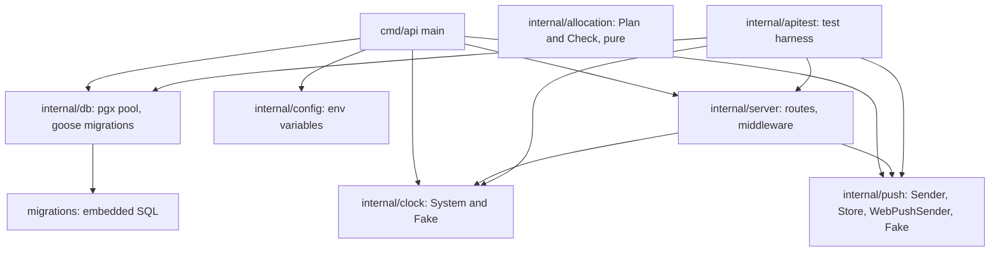
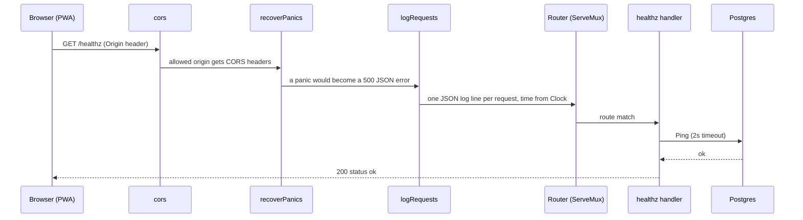
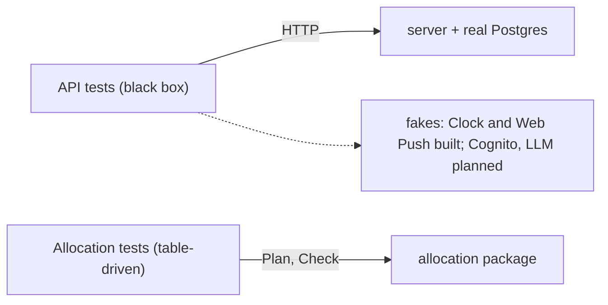

# The Go backend

Related: [ADR 0004](../adr/0004-ai-allocates-behind-a-deterministic-referee.md), [ADR 0002](../adr/0002-mirror-the-work-stack.md). Terms: **Allocation**, **Day Plan** in [CONTEXT.md](../../CONTEXT.md).

The backend is one Go module in `backend/`. In Go, code under `internal/` can only be imported from inside this module, and each folder is a *package*. `cmd/<name>/` holds a program's `main` function, an *entry point*.

## Entry points

| Entry point | Status | What it does |
|---|---|---|
| `cmd/api` | Built | `api` or `api serve` runs the HTTP server; `api migrate` applies database migrations and exits; `api vapid` prints a new VAPID key pair (a one-off human step, needs no database). |
| Allocator job | Planned | Scheduled run that plans every Home whose Allocation time has arrived. |

## Packages

`allocation` has no arrows: it imports nothing from the project and does no I/O (`purity_test.go` enforces that). The API does not use it yet.

| Package | Role |
|---|---|
| `server` | Builds one `http.Handler` (`server.New(Deps)`). `Deps` holds everything outside the system that tests fake: database pool, clock, logger, CORS origins, the Web Push `Sender` and the public VAPID key. |
| `config` | Reads `DATABASE_URL`, `MIGRATE_DATABASE_URL`, `PORT`, `MIGRATE_ON_START`, `DB_MAX_CONNS`, `CORS_ALLOWED_ORIGINS`, and the optional set `VAPID_PUBLIC_KEY`, `VAPID_PRIVATE_KEY`, `VAPID_SUBJECT` (one key without the other is an error; neither means push is off). `VAPID_PRIVATE_KEY` is resolved from SSM through `VAPID_PRIVATE_KEY_SSM_PARAM`, like the database URLs. |
| `push` | `Sender` interface (one `Send` per subscription, returning `ErrGone` when the push service answers 404 or 410), `WebPushSender` (real, on `webpush-go`, VAPID, 24h TTL, 10s HTTP timeout; it strips a leading `mailto:` from `VAPID_SUBJECT` because webpush-go adds one, and includes the push service's response body in non-2xx errors), `Store` (the `push_subscriptions` table: upsert, get, delete, and `Deliver`, which drops a subscription the push service rejected), and `Fake` for tests. |
| `db` | Opens a `pgx` connection pool (retrying about 10s at start) and runs `goose` migrations. |
| `clock` | The only place allowed to read the time. Business code takes a `Clock`; tests use `Fake`. |
| `allocation` | The Allocation module, see [Daily Allocation](allocation.md). |
| `apitest` | Starts the real server against a real Postgres for tests. |

## Request flow

The handler is a plain `http.Handler`, so the planned Lambda adapter can wrap it without changes. Middleware wraps the router from the outside in.

Unknown routes return `404` with `{"error":"not found"}`. Authentication (Cognito tokens) is planned and not in the chain yet.

## Routes

| Route | Behaviour |
|---|---|
| `GET /healthz` | Pings the database; `200 {"status":"ok"}` or `503`. |
| `GET /push/vapid-public-key` | `{"key": "..."}`, the key browsers subscribe with. |
| `PUT /push/subscription` | Body is the browser's `PushSubscription.toJSON()` (`endpoint`, `keys.p256dh`, `keys.auth`, optional `userAgent`). Idempotent upsert on `endpoint`; `204`. `400` for a non-https endpoint, missing or non-base64url keys or bad JSON; `413` over 8 KB. |
| `POST /push/test` | Body `{"endpoint"}`. Sends a small test notification to that one stored subscription only. `204`; `404` unknown; `410` if the push service rejected it (the row is deleted); `502` on any other push error (the row is kept). |

The three `/push/*` routes answer `503 {"error":"push not configured"}` when no VAPID keys are set, so local development and CI need none. They have no authentication yet: subscriptions are per device, not per user, and the test send is limited to the caller's own endpoint. The auth ticket (#8) must protect both write routes.

## The two test seams

A seam is the one place tests are allowed to push on the system.

1. **The API.** `apitest.Start` runs the real server on a database cloned from a migrated template (`TEST_DATABASE_URL`), with a fake clock; `apitest.WithPush(key)` adds the recording fake Web Push sender, exposed as `App.Push`. Tests assert on HTTP responses, never on internals.
2. **Allocation.** Pure-function tests on `Plan` and `Check`.

There is no automated UI test; the web app is type-checked and built in CI.
