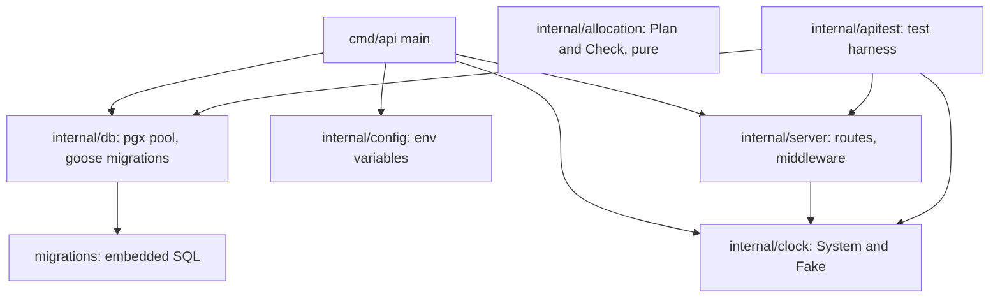
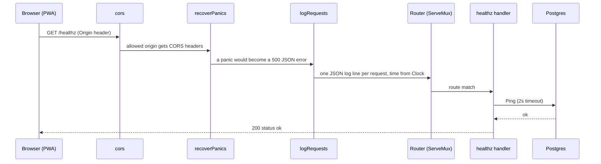
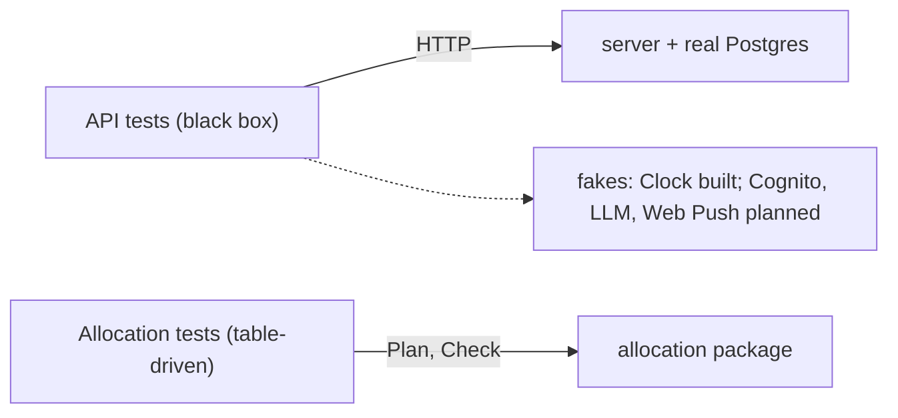

# The Go backend

Related: [ADR 0004](../adr/0004-ai-allocates-behind-a-deterministic-referee.md), [ADR 0002](../adr/0002-mirror-the-work-stack.md). Terms: **Allocation**, **Day Plan** in [CONTEXT.md](../../CONTEXT.md).

The backend is one Go module in `backend/`. In Go, code under `internal/` can only be imported from inside this module, and each folder is a *package*. `cmd/<name>/` holds a program's `main` function, an *entry point*.

## Entry points

| Entry point | Status | What it does |
|---|---|---|
| `cmd/api` | Built | `api` or `api serve` runs the HTTP server; `api migrate` applies database migrations and exits. |
| Allocator job | Planned | Scheduled run that plans every Home whose Allocation time has arrived. |

## Packages

`allocation` has no arrows: it imports nothing from the project and does no I/O (`purity_test.go` enforces that). The API does not use it yet.

| Package | Role |
|---|---|
| `server` | Builds one `http.Handler` (`server.New(Deps)`). `Deps` holds everything outside the system that tests fake: database pool, clock, logger, CORS origins. |
| `config` | Reads `DATABASE_URL`, `MIGRATE_DATABASE_URL`, `PORT`, `MIGRATE_ON_START`, `DB_MAX_CONNS`, `CORS_ALLOWED_ORIGINS`. |
| `db` | Opens a `pgx` connection pool (retrying about 10s at start) and runs `goose` migrations. |
| `clock` | The only place allowed to read the time. Business code takes a `Clock`; tests use `Fake`. |
| `allocation` | The Allocation module, see [Daily Allocation](allocation.md). |
| `apitest` | Starts the real server against a real Postgres for tests. |

## Request flow

The handler is a plain `http.Handler`, so the planned Lambda adapter can wrap it without changes. Middleware wraps the router from the outside in.

Unknown routes return `404` with `{"error":"not found"}`. Authentication (Cognito tokens) is planned and not in the chain yet.

## The two test seams

A seam is the one place tests are allowed to push on the system.

1. **The API.** `apitest.Start` runs the real server on a database cloned from a migrated template (`TEST_DATABASE_URL`), with a fake clock. Tests assert on HTTP responses, never on internals.
2. **Allocation.** Pure-function tests on `Plan` and `Check`.

There is no automated UI test; the web app is type-checked and built in CI.
