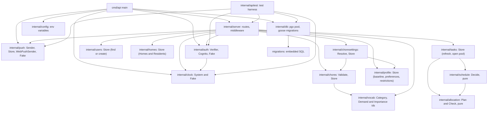
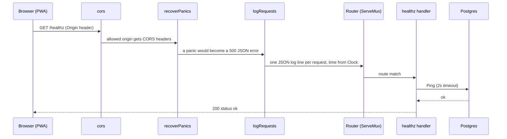
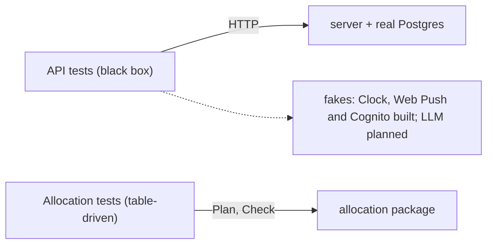

# The Go backend

Related: [ADR 0004](../adr/0004-ai-allocates-behind-a-deterministic-referee.md), [ADR 0002](../adr/0002-mirror-the-work-stack.md). Terms: **Allocation**, **Day Plan** in [CONTEXT.md](../../CONTEXT.md).

The backend is one Go module in `backend/`. In Go, code under `internal/` can only be imported from inside this module, and each folder is a *package*. `cmd/<name>/` holds a program's `main` function, an *entry point*.

## Entry points

| Entry point | Status | What it does |
|---|---|---|
| `cmd/api` | Built | `api` or `api serve` runs the HTTP server; `api migrate` applies database migrations and exits; `api vapid` prints a new VAPID key pair (a one-off human step, needs no database). |
| Allocator job | Planned | Scheduled run that plans every Home whose Allocation time has arrived. |

## Packages

`allocation` has no outgoing arrows: it imports nothing from the project and does no I/O (`purity_test.go` enforces that). `schedule` and `tasks` import it only for its `Date` type; the API does not call `Plan` or `Check` yet.

| Package | Role |
|---|---|
| `server` | Builds one `http.Handler` (`server.New(Deps)`). `Deps` holds everything outside the system that tests fake: database pool, clock, logger, CORS origins, the Web Push `Sender` and the public VAPID key and the token `Verifier` (nil means auth is off). |
| `config` | Reads `DATABASE_URL`, `MIGRATE_DATABASE_URL`, `PORT`, `MIGRATE_ON_START`, `DB_MAX_CONNS`, `CORS_ALLOWED_ORIGINS`, the optional pair `COGNITO_ISSUER` and `COGNITO_CLIENT_ID` (public identifiers, so plain environment variables; one without the other is an error, the issuer must be https, neither means auth is off), and the optional set `VAPID_PUBLIC_KEY`, `VAPID_PRIVATE_KEY`, `VAPID_SUBJECT` (one key without the other is an error; neither means push is off). `VAPID_PRIVATE_KEY` is resolved from SSM through `VAPID_PRIVATE_KEY_SSM_PARAM`, like the database URLs. |
| `push` | `Sender` interface (one `Send` per subscription, returning `ErrGone` when the push service answers 404 or 410), `WebPushSender` (real, on `webpush-go`, VAPID, 24h TTL, 10s HTTP timeout; it strips a leading `mailto:` from `VAPID_SUBJECT` because webpush-go adds one, and includes the push service's response body in non-2xx errors), `Store` (the `push_subscriptions` table: upsert, get, delete, and `Deliver`, which drops a subscription the push service rejected), and `Fake` for tests. |
| `auth` | `Verifier` interface: a raw bearer token in, `Claims{Subject, Email}` out, or an error wrapping `ErrInvalidToken`. `Cognito` is the real one: RS256 only, signature from the pool's JWKS (fetched lazily on the first authenticated request, cached in memory for an hour, one refetch at most a minute for an unknown key id, old keys kept if a refresh fails, fail closed when none are known), `iss` equal to the issuer, `aud` equal to the app client, `token_use` equal to `id`, `exp` required, `email_verified` true, subject and email present. Time comes from the injected `Clock`. `Fake` mints tokens for tests and never touches the network. |
| `users` | `Store.FindOrCreate(sub, email, now)`: the single upsert behind the first-request-creates-the-User rule. |
| `homes` | `Membership{ResidentID, Home}` is a User's place in a Home: their own `residents` row and the plain `Home`. `Store.Create(userID, timezone, allocationTime, now)` inserts the Home and the first Resident in one transaction and maps the unique violation on `residents.user_id` to `ErrAlreadyResident`; `ForUser` returns the caller's `Membership` or `ErrNoHome`; `UpdateSettings` replaces the timezone and Allocation time. |
| `profile` | `Store` for the User's profile: `Load`, `SetBaseline` (set some days, clear others, one transaction), `SetPreference` (neutral deletes the row), `AddRestriction`, `RemoveRestriction`. Writes are idempotent. `MaxBaseline` (20) is the named upper bound of a Baseline. |
| `chores` | `Validate(Input)` is pure: it trims the name, de-duplicates and sorts Demands and weekdays, and returns a stable code per invalid field, all at once (`Input` is decoded straight from the JSON body; numbers arrive as `any`, so a string or 2.5 is a field code, not a bad request; the first code recorded for a field wins). `Store` has `List`, `Create`, `Update`, `Delete`; every query that takes an id also filters on `home_id`, and a miss is `ErrNotFound`, and the handlers answer 404 for an id that fails `ValidID` without asking the Store. Imports `vocab` for Categories, Demands and Importances. `Chore` carries the JSON tags and is written to the response as is. |
| `choresettings` | A Resident's Preference and Restriction on one specific Chore. `Resolve(Chore, General, Specific)` is pure and holds the rule: a specific Preference (neutral included) beats the general one for the Chore's Category, else neutral (source `specific`, `general` or `default`); Restrictions only add, so the reasons are the Chore's Demands that are in the User's general Restrictions plus the specific Restriction, listed apart. `Store` has `SetPreference`, `ClearPreference`, `AddRestriction`, `RemoveRestriction` (idempotent; the two sets prove in the same statement that the Chore is in the Resident's Home, the two deletes ask only when they removed nothing; `ErrNotFound` otherwise, the same for a missing Chore) and `Effective(homeID)`, which reads the Home's Chores, Residents, all their general profiles (`profile.LoadMany`, one `ANY($1)` query per profile table) and the specific rows in one read-only repeatable-read transaction, a fixed number of queries however many Residents there are. It has no HTTP types, so the Allocation job can reuse it; `allocation` is untouched. |
| `schedule` | `Decide(Chore, latest *Task, today)` is pure (stdlib and `allocation.Date` only; `purity_test.go` enforces it) and returns one decision: `Open` a Task with a window and Effort, `SetEffort` on the open Task, or `Nothing`. Rules (ADR 0001): a recurring Chore has windows of N consecutive days, the first starting on the day it was created in the Home's zone; `WindowStart` and `WindowEnd` are inclusive dates. With allowed weekdays, the window starts on the first allowed day on or after the scheduled start and N is rounded up to whole weeks, so a Task only opens on an allowed day. A one-off Chore gets one Task, ever (a day, or a week when weekdays are limited). A window is missed when today is past `WindowEnd` and the Task is still open; the same Task stays open and keeps its window. Missed windows are derived (`floor((today - WindowStart) / length)`), never counted, so repeated or skipped runs agree; a recurring build-up Chore's current Effort is `min(5, base + missed)`, other Chores stay at base (`buildsUp` is ignored on a one-off). After a Task is done, the next window of a recurring Chore starts N days after `closed_on` at base Effort (an assumption until a Completion ticket defines it). |
| `tasks` | `Store.Refresh(homeID, now)` brings a Home's Tasks up to date: in one transaction (`statement_timeout` 5s) it converts `now` to a date in the Home's IANA zone (an unloadable zone is an error, never UTC), locks each Chore row `FOR UPDATE`, loads its latest Task, applies `schedule.Decide` and writes. Idempotent and safe in parallel; the partial unique index on open Tasks is the final guard and the insert is `ON CONFLICT DO NOTHING`. `Store.ListOpen(homeID)` returns the open pool, never nil. The daily Allocation job (#13) must call `Refresh` before it builds `allocation.State`. |
| `vocab` | The fixed, ordered Category, Demand and Importance ids (snake_case, stored and sent as-is) with `IsCategory`, `IsDemand` and `IsImportance`. `allocation` never imports it; its `Demand` and `Importance` values equal these ids. |
| `db` | Opens a `pgx` connection pool (retrying about 10s at start) and runs `goose` migrations. |
| `clock` | The only place allowed to read the time. Business code takes a `Clock`; tests use `Fake`. |
| `allocation` | The Allocation module, see [Daily Allocation](allocation.md). |
| `apitest` | Starts the real server against a real Postgres for tests. |

## Request flow

The handler is a plain `http.Handler`, so the planned Lambda adapter can wrap it without changes. Middleware wraps the router from the outside in.

Unknown routes return `404` with `{"error":"not found"}`.

Authentication is not in that chain: `requireUser` wraps individual routes (like `requirePush`), so `/healthz`, the VAPID key, CORS preflights and the 404 fallback stay open. It reads `Authorization: Bearer <token>` and asks the `Verifier`. A missing header, wrong scheme, malformed value or any verification failure gives the same `401 {"error":"unauthorized"}` with `WWW-Authenticate: Bearer`. With no Verifier it answers `503 {"error":"auth not configured"}` (fail closed). Otherwise it finds or creates the User, puts it in the request context under a private key type, and calls the handler. The token is never logged.

`requireResident` wraps `requireUser` for routes on a Home's data. It loads the caller's Home, puts it in the context under a private key, and answers `404 {"error":"no home"}` when the User lives in none, so a new User never gets a 500 and nobody can reach another Home's data. Every Home-scoped route goes behind it.

`decodeBody` (in `http.go`) reads a JSON body with a caller-chosen size cap and an option to reject unknown fields. `cmd/api` imports `time/tzdata`, so `time.LoadLocation` works on Lambda and in distroless images.

## Routes

| Route | Behaviour |
|---|---|
| `GET /healthz` | Pings the database; `200 {"status":"ok"}` or `503`. |
| `GET /me` | Needs a token. `200 {"id","email"}` for the signed-in User, created by the first authenticated request. |
| `POST /home` | Needs a token. Body `{"timezone","allocationTime"}` (`"HH:MM"`, 24h). `201 {"id","timezone","allocationTime"}`; the caller becomes the first Resident. `409 {"error":"already a resident"}` if they already live in a Home (decided by the unique constraint, so concurrent creates make one Home). `400` for bad JSON or unknown fields, `413` over 4 KB. |
| `GET /home` | Needs a token and a Home. `200` with `id`, `timezone`, `allocationTime`; `404 {"error":"no home"}` otherwise. |
| `PUT /home` | Same body as `POST`, a full replace of the settings, by any Resident. `200` with the Home; `404` with no Home. |
| `GET /home/chores` | Needs a token and a Home. `200 {"chores":[...]}`, oldest first. A Chore is `id`, `name`, `category`, `demands`, `baseEffort` (1 to 5), `importance` (`essential`, `normal`, `nice_to_have`), `people` (1 or 2), `intervalDays` (1 to 365, or `null` for one-off), `allowedWeekdays` (0 = Sunday to 6; empty means any day), `buildsUp`. |
| `POST /home/chores` | Same body without `id`. `201` with the Chore. `400 {"error":"invalid chore","fields":{"baseEffort":"out_of_range"}}` with a code per field (`required`, `too_long`, `unknown`, `invalid`, `out_of_range`) and nothing stored; unknown JSON fields are `400`, over 8 KB is `413`. `buildsUp` is accepted on a one-off Chore and ignored by Scheduling. |
| `PUT /home/chores/{id}` | Full replace, same validation. `200`; `404` for an unknown, malformed or other Home's id. |
| `DELETE /home/chores/{id}` | `204`, hard delete; `404` as above. |
| `GET /home/chores/settings` | Needs a token and a Home. `200 {"residents":[{"id","you","chores":{"<choreId>":{"preference","source","restricted","restrictedBy","restrictedByChore"}}}]}`: every Resident of the Home (joining order; `you` marks the caller; no names yet) and, per Chore, the effective `preference` (`like`, `neutral`, `dislike`), its `source` (`specific`, `general`, `default`), `restricted`, the Demands causing it (`restrictedBy`) and whether a specific Restriction does (`restrictedByChore`). Empty maps, never `null`. |
| `PUT /home/chores/{id}/preference` | Body `{"preference": "like" or "neutral" or "dislike"}`, set on the caller's own Resident (never one named in the request). `204`; `400` for a bad value or unknown field; `404` for a malformed, unknown or other Home's Chore id, all with the same body. |
| `DELETE /home/chores/{id}/preference` | Clears it, so the general Preference applies again. `204`, idempotent; same `404`. |
| `PUT /home/chores/{id}/restriction`, `DELETE /home/chores/{id}/restriction` | No body. Add and remove the caller's specific Restriction on the Chore. `204`, idempotent; same `404`. |
| `GET /home/tasks` | Needs a token and a Home (`404` otherwise, so other Homes are never leaked). First refreshes the Home's Tasks for today in its zone (a lazy refresh, so no scheduled job is needed yet), then answers `200 {"tasks":[...]}`, an empty pool being `[]`, ordered by window start. A Task is `id`, `choreId`, `choreName`, `windowStart` and `windowEnd` (inclusive `YYYY-MM-DD` dates), `currentEffort`, `baseEffort`, `people`, `importance`. An overdue Task keeps its original window. `500` if the Home's timezone cannot be loaded. |
| `GET /categories`, `GET /demands` | Need a token. `{"categories": [...]}` and `{"demands": [...]}`: the fixed ids in display order. Names are localised in the PWA. |
| `GET /me/profile` | Needs a token. `{"baseline": {"sunday": null, "monday": 5, ...}, "preferences": {"kitchen": "like"}, "restrictions": ["heavy_lifting"]}`. Always all seven weekday keys (`null` = unset, 0 is a real value); preferences list only set Categories (neutral is absent); restrictions follow the `GET /demands` order. |
| `PUT /me/baseline` | Needs a token. Body maps weekday names (`sunday` to `saturday`) to an integer 0 to 20, or `null` to clear. Partial: days not named are untouched. `204`; `400` naming the field for an unknown weekday, a non-integer, a value out of range, an empty object or unknown JSON. |
| `PUT /me/preferences/{category}` | Needs a token. Body `{"preference": "like" or "neutral" or "dislike"}`; neutral deletes the row. `204`; `404` for an unknown Category; `400` for a bad value or unknown field. |
| `PUT /me/restrictions/{demand}`, `DELETE /me/restrictions/{demand}` | Need a token. Add and remove a Restriction, both idempotent. `204`; `404` for an unknown Demand. |
| `GET /push/vapid-public-key` | `{"key": "..."}`, the key browsers subscribe with. |
| `PUT /push/subscription` | Needs a token. Body is the browser's `PushSubscription.toJSON()` (`endpoint`, `keys.p256dh`, `keys.auth`, optional `userAgent`). Idempotent upsert on `endpoint`, owned by the caller (a device re-registered by another signed-in User moves to them); `204`. `400` for a non-https endpoint, missing or non-base64url keys or bad JSON; `413` over 8 KB. |
| `POST /push/test` | Needs a token. Body `{"endpoint","delaySeconds"?}`. Sends a small test notification to that one stored subscription only. `204`; `404` unknown, owned by another User or owned by nobody; `410` if the push service rejected it (the row is deleted); `502` on any other push error (the row is kept). |

Invalid Home settings answer `400 {"error":"invalid home","fields":{...}}` with every bad field and a stable code each: `timezone` is `required` or `unknown` (not an IANA zone; `Local` is refused because it means the server's zone), `allocationTime` is `required`, `invalid` (not strictly `HH:MM`) or `not_quarter_hour` (the Allocator job runs every 15 minutes, so only minutes 00, 15, 30, 45). Nothing is stored.
Every profile write answers `204` with no body, and every query uses the signed-in User's id, never one from the URL or body. Request bodies are capped at 4 KB and reject unknown fields (`decodeBody` in `server/http.go` takes the cap and a strict flag; push keeps its 8 KB cap and lenient decoding).

The three `/push/*` routes answer `503 {"error":"push not configured"}` when no VAPID keys are set, so local development and CI need none. The two write routes need a signed-in User; `GET /push/vapid-public-key` stays public. Push configuration is checked first, then the token. Subscriptions carry `user_id`, and a test send reaches only a subscription the caller owns.

## The two test seams

A seam is the one place tests are allowed to push on the system.

1. **The API.** `apitest.Start` runs the real server on a database cloned from a migrated template (`TEST_DATABASE_URL`), with a fake clock; `apitest.WithPush(key)` adds the recording fake Web Push sender, exposed as `App.Push`. `Start` always wires an `auth.Fake`; `App.SignInAs(email)` returns a client whose requests carry that fake's bearer token (the same email is the same User), and `apitest.WithoutAuth()` leaves the Verifier nil for the 503 case. `Client.JoinHome(t, homeID)` inserts a `residents` row for a signed-in User so tests can have several Residents without the Invite flow. Tests assert on HTTP responses, never on internals.
2. **Allocation.** Pure-function tests on `Plan` and `Check`.

There is no automated UI test; the web app is type-checked and built in CI.
