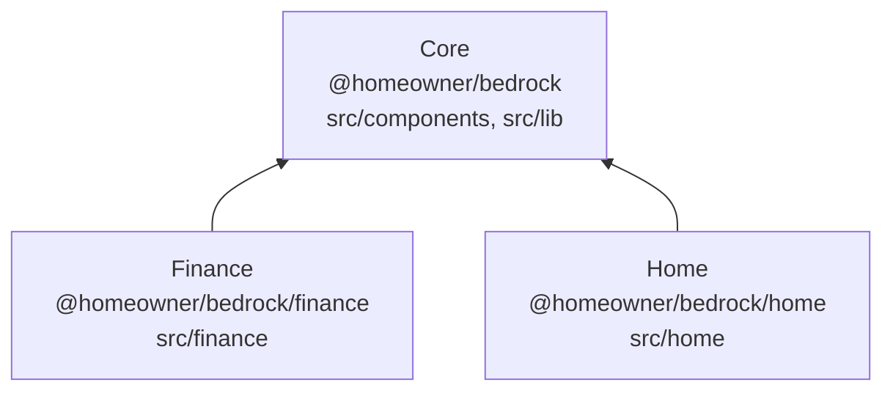
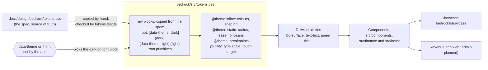

# Bedrock, the shared design system

Related: [ADR 0022](../adr/0022-a-shared-bedrock-design-system-amends-0007-and-0009-for-adopting-apps.md), [ADR 0007](../adr/0007-tailwind-and-radix-for-an-accessible-calm-ui.md), [ADR 0009](../adr/0009-navigate-with-a-bottom-tab-router-and-amend-the-look.md). Spec: [`docs/design/bedrock/`](../design/bedrock/README.md). Adoption guide: [`bedrock/README.md`](../../bedrock/README.md).

Bedrock is built: a package of tokens and React components in `bedrock/`, with a showcase app to see them. [Revenue](revenue.md) and the [PWA](web.md) (`web/`) are built on it: `web/src/index.css` imports `@homeowner/bedrock/tokens.css` and adds `@source` on `bedrock/src`, and screens across `web/src` import from `@homeowner/bedrock` and `@homeowner/bedrock/home` (the PWA's move, epic #882, is still under way, so some `web/` screens keep their own `shared/ui/` pieces). Only `admin/` does not use it yet (planned: its migration epic). Bedrock is a library, not a deployed container: it ships inside each app's build, and its showcase is built only in CI.

## The package

- **`@homeowner/bedrock`**, version 0.1.0, `private`: TypeScript and CSS source with no build step, never published. An app's own Vite build compiles it.
- **One npm workspace.** The root `package.json` lists `bedrock`, `revenue` and `web` in `workspaces`, and the root `package-lock.json` is their lockfile, so Revenue and the PWA import `@homeowner/bedrock` from source. `admin/` keeps its own lockfile and CI, so a Bedrock dependency bump cannot break its install.
- **Peers:** `react`, `react-dom`, `radix-ui`, `vaul` (the phone form of `Sheet`) and `recharts` (charts). The app provides them, so there is one React.
- **Its own dependencies:** `@fontsource/inter`, `class-variance-authority`, `clsx`, `tailwind-merge`, `lucide-react` (icons) and `tw-animate-css`.

## Public interface

Four exports in `bedrock/package.json`, three layers that form a strict tree: Core imports neither Finance nor Home, and Home and Finance import only Core, never each other. `src/layers.test.ts` fails if a file under `src/components/` or `src/lib/` imports a path containing `finance` or `home`, if a file under `src/home/` imports one containing `finance`, or if one under `src/finance/` imports one containing `home`.

| Export | File | Exports |
|---|---|---|
| `@homeowner/bedrock` (Core) | `src/index.ts` | `Input`, `SearchField`, `Select`, `Badge`, `Banner`, `Button`, `Switch`, `Checkbox`, `Stepper` (also exported as `Counter`), `StepIndicator`, `Avatar`, `ChoiceGroup` and `Choice`, `PageHeader`, `SegmentedControl`, `ProgressBar` and `progressTone`, `List` and `Row`, `Card` (with `CardHeader`, `CardLabel`, `CardContent`, `CardFooter`), `DescriptionList` (and the types `DescriptionListItem`, `DescriptionListProps`), `EmptyState`, `Toast` and `ToastProvider`, `Dialog`, `Sheet`, `Skeleton`, `Table` (with `TableCaption`, `TableHeader`, `TableBody`, `TableRow`, `TableHead`, `TableCell`), `ChartContainer` and `ChartTooltipContent`, `Tooltip`, `Menu` (with `menuContentClass`, `menuItemClass`), `Sidebar` and `SidebarBrand`, `BottomBar`, the type `NavItem`, and the components' props types |
| `@homeowner/bedrock/finance` (Finance) | `src/finance/index.ts` | `MoneyInput` and `parseCents`, `CategoryTag`, `CategoryIcon` and the type `SpendingCategoryId`, `Amount` and `formatAmount`, `StatCard`, `ListRow` (with an optional `action`, below), `AlertCard`, `PaceChart`, `DonutChart`, `BarChart`, and the charts' props types |
| `@homeowner/bedrock/home` (Home) | `src/home/index.ts` | What only the Homeowner PWA needs: `ChoreTag` and the bare `ChoreIcon` (with the types `ChoreCategory`, `ChoreSize`, `ChoreTone`), `Effort`, `Energy` and `EnergyBars`, `Streak`, `TaskCard` (with the type `TaskAction`), and their props types. All presentational: every string and Task fact is a prop |
| `@homeowner/bedrock/tokens.css` | `src/tokens.css` | The tokens, the Tailwind theme, the type utilities and `touch-target` |

That is 31 components in Core (`ChoiceGroup` and `Choice`, and `List` and `Row`, counted apart), 9 in Finance and 5 in Home. The spec's Inventory still marks the Home ones `draft`, though the package ships them; Revenue keeps its own page header ([revenue.md](revenue.md)). Every export is named and `"sideEffects": ["*.css"]` is declared, so an app's production bundle drops what it does not import, Recharts included.

**Navigation.** A `NavItem` is `{href, label, icon, current?, badge?}`. `badge` is `{count, label}`: `Sidebar` and `BottomBar` show the count (capped at "9+", nothing at 0 or less), and `label` is its screen-reader wording, so the link reads "Contas a pagar, 3 contas em aberto". `Sidebar` also takes `brand` (a node above the groups; `SidebarBrand` is the mark and the app name, the name dropping out of the icon-only rail) and `note` (a line above the footer, shown only in the wide layout, such as Revenue's "Atualizado há"). `BottomBar` takes four tabs whose labels never truncate (no ellipsis; each tab is an equal column). The Revenue Shell is the one user of all three (#707).

**Rows and labels.** `List` and `Row` (Core, `src/components/list.tsx`) are the spec's `hm-list` card and `hm-item` row. `List` is a `<ul>` card (surface, border, rounded, rows split by a border). `Row` is its `<li>`, valid only inside a `List`: an optional `leading` (a tile, an `Avatar` or an icon), a `title`, an optional `caption` and an optional `trailing`, in a grid with 16px side and 8px block padding. A Row with `leading` is at least 64px tall, one without at least 56px. The title and the caption each stay on one line and truncate with an ellipsis. With `asChild` the single child (an `<a>`, a router `Link` or a `<button type="button">`, passed empty) becomes the row's grid, so the whole row is the tap target and gets the hover and focus styles; the `<li>` only holds it. The PWA's Chores rows are the first user ([web.md](web.md#chores)). Finance's `ListRow` stayed separate rather than being rebuilt on `Row`, because their sizes differ: `.br-listrow` is 8px padding on every side with a -8px side margin and no minimum height, while `.hm-item` is 8px by 16px and at least 64px tall.

`DescriptionList` (Core) is a `<dl>` of `{label, value, total?}` items: plain-text labels on the left, values on the right, a `total` row in strong text over a border. A value is any node, so Finance's `Amount` slots in without Core importing it; an empty list renders nothing. `ListRow`'s `action` (`{label, name?, icon, onClick, loading?, disabled?, variant?}`) is the one action a list exists for: a sibling of the row, never inside its link, drawn as a text `Button` `sm` from `bp-tablet` (768px) up and a 48px round icon button below it, with `name` as the accessible name when the visible verb is too short.

**Phone controls.** Below `bp-tablet` and on coarse pointers, the fields (`Input`, `SearchField`, `Select`, through `fieldClass` in `src/components/field.tsx`, with 16px text so iOS does not zoom) and `Button` `sm` and `md` are 48px tall (`control-lg`). `SegmentedControl` is 48px overall below `bp-tablet` only. `MoneyInput` is 48px at every width. From `bp-tablet` up on a fine pointer, the desktop sizes are unchanged.

**The `data-slot` contract** ([ADR 0030](../adr/0030-measure-design-pairs-by-element-box-matched-through-bedrocks-data-slot.md)). Thirteen Core components put `data-slot="<name>"` on their root element: `List` (`list`), `Row` (`row`), `PageHeader` (`page-header`), `Sheet` (`sheet`), `Dialog` (`dialog`), `SearchField` (`search-field`), the `Field` wrapper in `field.tsx` that `Input` and `Select` render (`field`), `SegmentedControl` (`segmented-control`), `Toast` (`toast`), `BottomBar` (`bottom-bar`), `ChoiceGroup` (`choice-group`), `StepIndicator` (`step-indicator`) and `Card` (`card`). Finance's `ListRow` carries `list-row`. The design check's measurement finds an app's elements only through these attributes (`ROLES` in `.github/scripts/artboards.mjs`; see [revenue.md](revenue.md#design-check) and [web.md](web.md#design-check)), never by class or name, so the attribute is part of Bedrock's public markup: renaming or removing one is a breaking change. `src/components/data-slot.test.tsx` renders each of the thirteen and fails when its `data-slot` is missing; `src/finance/list-row.test.tsx` checks `list-row`.

## Token flow

- **Two tiers of colour.** Primitives (`--green-73`) hold raw values; semantic tokens (`--surface`) point to one primitive per theme. Only semantic colours become utilities: `@theme inline` resets `--color-*` and maps each semantic token, so a utility reads the variable at run time and follows the theme.
- **The theme switch.** Dark is on `:root`, light under `[data-theme="light"]`, which comes later in the file so it wins when both match. Bedrock has no `prefers-color-scheme` query: the app sets `data-theme`. `web/`'s CSS does the reverse (light on `:root`), but its theme script always sets `data-theme` to `light` or `dark`, so it works with Bedrock unchanged.
- **The copy is checked.** `src/tokens.test.ts` fails when the spec declares a custom property `src/tokens.css` lacks, or when the dark, light or primitive blocks differ from the spec's values (radius, ease and `font-sans`, moved to `@theme static`, excepted).
- **Name collision.** Bedrock's Tailwind names (`--color-surface`, `--color-text`...) are the same as `web/src/tokens.css`'s. An app loads one set or the other, never both.

## The showcase

`bedrock/showcase/` is a small Vite app, the package's only build (`vite.config.ts`: dev server on port 5175, output in `bedrock/dist-showcase/`). It renders one section per file in `showcase/sections/`, found with `import.meta.glob` so parallel tickets never edited a shared list. There are 41 sections; `ChartContainer` and `MoneyInput` have none of their own: `MoneyInput` is shown in the Input section, and `ChartContainer` inside PaceChart, DonutChart and BarChart, which are built on it. A theme and a language switch, mirrored in `?theme=` and `?locale=`, pick one of four combinations. Its stylesheet, `showcase/showcase.css`, is the CSS an app adds: Tailwind, the tokens, and `@source` on `src/`. It is not deployed.

## Tests

Vitest on jsdom (`vitest.config.ts`), over `src/` and `showcase/`:

- **Contrast from the tokens** (`src/tokens.test.ts`): every text, control, focus, chart and category pair reaches its WCAG ratio (4.5:1 or 3:1) in both themes. One known spec defect, light `border-strong` on `surface-sunken`, is an `it.fails` that turns red once the spec is fixed and copied.
- **Behaviour:** MoneyInput parsing (`parseCents`), Amount formatting, Sheet switching between the side panel and the vaul drawer at the tablet breakpoint, Toast timing, Donut grouping into "Other", and the props and keyboard of the other components.
- **Rows:** `src/components/list.test.tsx` checks a Row's sizes, padding and truncation through its classes (jsdom has no layout; the PWA's `chores.spec.ts` checks the real 64px row and the one-line cut in a browser).
- **`data-slot`:** `src/components/data-slot.test.tsx`, above.
- **Layers:** `src/layers.test.ts`, above.
- **Accessibility** (`showcase/showcase.test.tsx`): axe-core over the whole showcase in all four combinations, then with each overlay opened in turn, on a wide and a narrow screen. Axe's `color-contrast` rule is off because jsdom has no layout or computed colour; contrast is checked from the tokens instead.

## CI and pipeline

- **`bedrock-check`** (`.github/workflows/bedrock-check.yml`) runs its job on pull requests that change `bedrock/**`, the root `package.json`, `package-lock.json`, or any workflow or script under `.github/` (and is skipped otherwise): `npm ci`, typecheck, tests and the showcase build, on the Node version in `bedrock/.nvmrc`.
- **`ui-screenshots`** counts `bedrock/src/` and `bedrock/showcase/` as UI (test files excepted). When those are the only UI files changed and the description lacks screenshots, it builds the showcase, screenshots the changed sections (or the whole page for a shared file) in pt-BR and English on a light phone viewport (`.github/scripts/bedrock-screenshots.mjs`), and writes them into the description.
- **Artboards in CI** ([ADR 0028](../adr/0028-render-design-artboards-in-ci-with-a-stand-in-for-the-canvas-runtime.md)): `.github/scripts/dc-runtime.js`, the stand-in for the canvas runtime, and `.github/scripts/artboards.mjs` know nothing about Revenue. `shootArtboard` takes the artboard directory, file and viewport (and serves `ds/bedrock/*` from `docs/design/bedrock/`), and `pairsMarkdown` takes the images. Both apps use them: Revenue through `.github/scripts/revenue-screenshots.mjs` ([Design check](revenue.md#design-check)) and `web/` through `web/e2e/pairs/pairs.capture.ts` and `.github/scripts/web-screenshots.mjs` ([Design check](web.md#design-check)). The same file holds the shared guards and the measurement: the height guard (`HEIGHT_EXEMPT`), `ROLES`, `measureBoxes` and `compareBoxes`.
- **`pr-risk.sh`** gives the root `package.json` and `package-lock.json` a `medium` floor, like every other package and lock file.
- **`merge-by-risk.yml`** wakes on a finished `bedrock-check`, which is in `required_checks` of `merge-by-risk.sh`. It runs on every pull request through a `bedrock-check-changes` job and shows as skipped when `bedrock/` and the root package files did not change; a skipped required check counts as passed.
