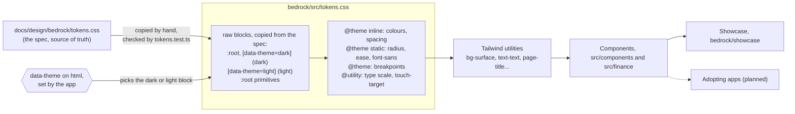

# Bedrock, the shared design system

Related: [ADR 0022](../adr/0022-a-shared-bedrock-design-system-amends-0007-and-0009-for-adopting-apps.md), [ADR 0007](../adr/0007-tailwind-and-radix-for-an-accessible-calm-ui.md), [ADR 0009](../adr/0009-navigate-with-a-bottom-tab-router-and-amend-the-look.md). Spec: [`docs/design/bedrock/`](../design/bedrock/README.md). Adoption guide: [`bedrock/README.md`](../../bedrock/README.md).

Bedrock is built: a package of tokens and React components in `bedrock/`, with a showcase app to see them. No app adopts it yet (planned: the migration epics of `web/` and `admin/`, and Revenue). Until one does, nothing changes for a Resident, the backend, the database, Terraform or the cost: Bedrock is a library, not a deployed container, and its showcase is built only in CI.

## The package

- **`@homeowner/bedrock`**, version 0.1.0, `private`: TypeScript and CSS source with no build step, never published. An app's own Vite build compiles it.
- **One npm workspace.** The root `package.json` lists only `bedrock` in `workspaces`, and the root `package-lock.json` is its lockfile. `web/` and `admin/` keep their own lockfiles and CI, so a Bedrock dependency bump cannot break their installs.
- **Peers:** `react`, `react-dom`, `radix-ui`, `vaul` (the phone form of `Sheet`) and `recharts` (charts). The app provides them, so there is one React.
- **Its own dependencies:** `@fontsource/inter`, `class-variance-authority`, `clsx`, `tailwind-merge`, `lucide-react` (icons) and `tw-animate-css`.

## Public interface

Three exports in `bedrock/package.json`, two layers. Core never imports Finance: `src/layers.test.ts` fails if a file under `src/components/` or `src/lib/` imports a path containing `finance`.

| Export | File | Exports |
|---|---|---|
| `@homeowner/bedrock` (Core) | `src/index.ts` | `Input`, `SearchField`, `Select`, `Badge`, `Banner`, `Button`, `Switch`, `SegmentedControl`, `ProgressBar` and `progressTone`, `Card` (with `CardHeader`, `CardLabel`, `CardContent`, `CardFooter`), `EmptyState`, `Toast` and `ToastProvider`, `Dialog`, `Sheet`, `Skeleton`, `Table` (with `TableCaption`, `TableHeader`, `TableBody`, `TableRow`, `TableHead`, `TableCell`), `ChartContainer` and `ChartTooltipContent`, `Tooltip`, `Menu` (with `menuContentClass`, `menuItemClass`), `Sidebar`, `BottomBar`, the type `NavItem`, and the components' props types |
| `@homeowner/bedrock/finance` (Finance) | `src/finance/index.ts` | `MoneyInput` and `parseCents`, `CategoryTag`, `CategoryIcon` and the type `SpendingCategoryId`, `Amount` and `formatAmount`, `StatCard`, `ListRow`, `AlertCard`, `PaceChart`, `DonutChart`, `BarChart`, and the charts' props types |
| `@homeowner/bedrock/tokens.css` | `src/tokens.css` | The tokens, the Tailwind theme, the type utilities and `touch-target` |

That is the 30 components of the spec's Inventory: 21 in Core, 9 in Finance. Every export is named and `"sideEffects": ["*.css"]` is declared, so an app's production bundle drops what it does not import, Recharts included.

## Token flow

- **Two tiers of colour.** Primitives (`--green-73`) hold raw values; semantic tokens (`--surface`) point to one primitive per theme. Only semantic colours become utilities: `@theme inline` resets `--color-*` and maps each semantic token, so a utility reads the variable at run time and follows the theme.
- **The theme switch.** Dark is on `:root`, light under `[data-theme="light"]`, which comes later in the file so it wins when both match. Bedrock has no `prefers-color-scheme` query: the app sets `data-theme`. `web/` does the reverse today (light by default, `[data-theme="dark"]`), so an app that adopts Bedrock flips its theme script in the same pull request.
- **The copy is checked.** `src/tokens.test.ts` fails when the spec declares a custom property `src/tokens.css` lacks, or when the dark, light or primitive blocks differ from the spec's values (radius, ease and `font-sans`, moved to `@theme static`, excepted).
- **Name collision.** Bedrock's Tailwind names (`--color-surface`, `--color-text`...) are the same as `web/src/tokens.css`'s. An app loads one set or the other, never both.

## The showcase

`bedrock/showcase/` is a small Vite app, the package's only build (`vite.config.ts`: dev server on port 5175, output in `bedrock/dist-showcase/`). It renders one section per file in `showcase/sections/`, found with `import.meta.glob` so parallel tickets never edited a shared list. There are 28 sections; `ChartContainer` and `MoneyInput` have none of their own: `MoneyInput` is shown in the Input section, and `ChartContainer` inside PaceChart, DonutChart and BarChart, which are built on it. A theme and a language switch, mirrored in `?theme=` and `?locale=`, pick one of four combinations. Its stylesheet, `showcase/showcase.css`, is the CSS an app adds: Tailwind, the tokens, and `@source` on `src/`. It is not deployed.

## Tests

Vitest on jsdom (`vitest.config.ts`), over `src/` and `showcase/`:

- **Contrast from the tokens** (`src/tokens.test.ts`): every text, control, focus, chart and category pair reaches its WCAG ratio (4.5:1 or 3:1) in both themes. One known spec defect, light `border-strong` on `surface-sunken`, is an `it.fails` that turns red once the spec is fixed and copied.
- **Behaviour:** MoneyInput parsing (`parseCents`), Amount formatting, Sheet switching between the side panel and the vaul drawer at the tablet breakpoint, Toast timing, Donut grouping into "Other", and the props and keyboard of the other components.
- **Layers:** `src/layers.test.ts`, above.
- **Accessibility** (`showcase/showcase.test.tsx`): axe-core over the whole showcase in all four combinations, then with each overlay opened in turn, on a wide and a narrow screen. Axe's `color-contrast` rule is off because jsdom has no layout or computed colour; contrast is checked from the tokens instead.

## CI and pipeline

- **`bedrock-check`** (`.github/workflows/bedrock-check.yml`) runs on pull requests touching `bedrock/**`, the root `package.json`, `package-lock.json` or the workflow itself: `npm ci`, typecheck, tests and the showcase build, on the Node version in `bedrock/.nvmrc`.
- **`ui-screenshots`** counts `bedrock/src/` and `bedrock/showcase/` as UI (test files excepted). When those are the only UI files changed and the description lacks screenshots, it builds the showcase, screenshots the changed sections (or the whole page for a shared file) in pt-BR and English on a light phone viewport (`.github/scripts/bedrock-screenshots.mjs`), and writes them into the description.
- **`pr-risk.sh`** gives the root `package.json` and `package-lock.json` a `medium` floor, like every other package and lock file.
- **`merge-by-risk.yml`** wakes on a finished `bedrock-check`. It is not in `required_checks` of `merge-by-risk.sh`, because it is path-filtered and absent from most pull requests; when it does run, it must pass, like every check that ran.
