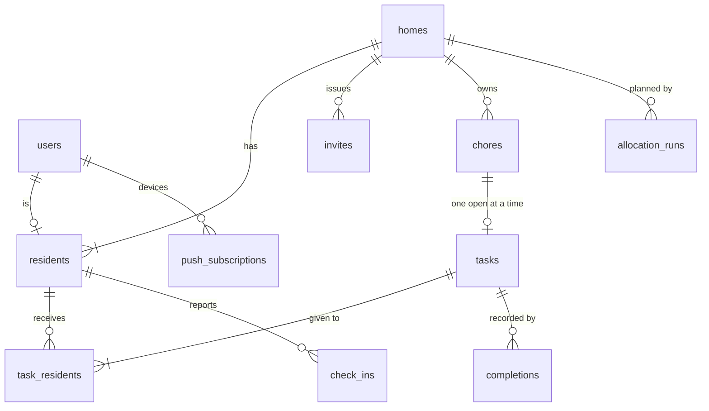

# Data model

Related: [ADR 0001](../adr/0001-chores-come-due-in-flexible-windows.md), [ADR 0003](../adr/0003-only-broken-commitments-break-a-streak.md). Terms: **User**, **Home**, **Resident**, **Invite**, **Chore**, **Task**, **Completion**, **Check-in**, **Preference**, **Restriction**, **Day Plan** in [CONTEXT.md](../../CONTEXT.md).

## What is built

Migrations live in `backend/migrations/` as `NNNN_description.sql` files, applied with `goose` (`api migrate`, or on start in Docker Compose only). They are embedded into the binary.

| Migration | Contents |
|---|---|
| `0001_init.sql` | No tables. It only proves the migration pipeline works. |
| `0002_push_subscriptions.sql` | `push_subscriptions`: `id` (uuid), `endpoint` (unique), `p256dh`, `auth`, `user_agent`, `created_at`, `updated_at`. One row per device. There is **no `user_id` yet**: the auth ticket adds it in its own migration. Timestamps come from the injected clock. |

`push_subscriptions` is the only table built. Everything else below is the planned schema from issue #1.

## Planned tables

| Table | Holds |
|---|---|
| `users`, `homes`, `residents`, `invites` | Accounts, Homes, membership (a User is a Resident of at most one Home), single-use 7-day Invites |
| `chores` | Category, Demands, base Effort, Importance, people needed, build-up flag, interval in days, allowed weekdays |
| `tasks`, `task_residents` | Open window, current Effort, status; who a Task is given to and whether they Committed |
| `completions` | The Task, the people who did it, the time (the Streak is computed from these, [ADR 0003](../adr/0003-only-broken-commitments-break-a-streak.md)) |
| `check_ins` | Resident, date, level, day-only Restrictions |
| Preferences and Restrictions | General on users, specific on residents |
| `allocation_runs` | Home, date, which allocator, fallback reason, recorded reasons |
| `push_subscriptions` | One per device. Built without the link to `users` shown above; that link arrives with auth. |
