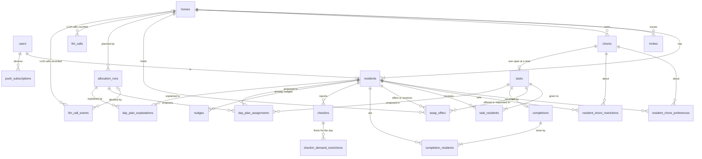

# Data model

Related: [ADR 0001](../adr/0001-chores-come-due-in-flexible-windows.md), [ADR 0003](../adr/0003-only-broken-commitments-break-a-streak.md), [ADR 0014](../adr/0014-a-day-with-any-completion-keeps-the-streak.md). Terms: **User**, **Home**, **Resident**, **Invite**, **Chore**, **Task**, **Completion**, **Check-in**, **Preference**, **Restriction**, **Day Plan** in [CONTEXT.md](../../CONTEXT.md).

## What is built

Migrations live in `backend/migrations/` as `NNNN_description.sql` files, applied with `goose` (`api migrate`, or on start in Docker Compose only). They are embedded into the binary.

| Migration | Contents |
|---|---|
| `0001_init.sql` | No tables. It only proves the migration pipeline works. |
| `0002_push_subscriptions.sql` | `push_subscriptions`: `id` (uuid), `endpoint` (unique), `p256dh`, `auth`, `user_agent`, `created_at`, `updated_at`. One row per device. Timestamps come from the injected clock. |
| `0003_users.sql` | `users`: `id` (uuid), `cognito_sub` (unique, the identity), `email` (not unique: it can change in Cognito, and the API refreshes it on every request), `created_at`, `updated_at` (from the injected clock). Adds `push_subscriptions.user_id`, a nullable foreign key to `users` with `ON DELETE CASCADE`. It is nullable so the previous release, which does not set it, keeps working during a deploy (expand, then contract); rows saved before sign-in existed stay `NULL` and nobody can send to them. |
| `0004_user_profile.sql` | The User's profile, keyed to the User (not the Resident) so it survives leaving a Home. `user_baselines` (`user_id`, `weekday` 0 to 6 with 0 = Sunday, `points` 0 to 20; a row exists only for a set day, so unset reads as `null`, not 0). `user_category_preferences` (`user_id`, `category`, `preference` `like` or `dislike`; neutral is the absence of a row). `user_demand_restrictions` (`user_id`, `demand`). All cascade on user delete. There is no SQL check on `category` or `demand`: the lists live in `internal/vocab` and are validated in Go, so adding one needs no migration. |
| `0005_homes_residents.sql` | `homes`: `id` (uuid), `timezone` (an IANA zone name), `allocation_time` (`time`, the local wall-clock time in that zone, no seconds; never a UTC instant, so daylight saving needs no handling), `created_at`, `updated_at` (from the injected clock). `residents`: `id` (uuid), `user_id` (`NOT NULL UNIQUE`, references `users`, `ON DELETE CASCADE`), `home_id` (references `homes`, `ON DELETE CASCADE`, indexed), `created_at`. The unique `user_id` is what enforces "a User is a Resident of at most one Home", so two simultaneous creates cannot both succeed. |
| `0006_chores.sql` | `chores`: `id` (uuid), `home_id` (references `homes`, `ON DELETE CASCADE`, indexed), `name`, `category`, `demands` (`text[]`), `base_effort` (1 to 5), `importance`, `people` (1 or 2), `interval_days` (NULL means one-off; otherwise at least 1), `allowed_weekdays` (`smallint[]`, 0 = Sunday to 6; empty means any day), `builds_up`, `created_at`, `updated_at`. CHECKs cover only numeric ranges; Category, Demand and Importance ids are validated in Go. `tasks.chore_id` must be `ON DELETE CASCADE`, because any Chore can be deleted. |
| `0007_tasks.sql` | `tasks`: `id` (uuid), `chore_id` (references `chores`, `ON DELETE CASCADE`), `status` (`open` or `done`), `window_start` and `window_end` (inclusive `date`s in the Home's zone, `window_end >= window_start`), `current_effort` (1 to 5; derived from the Chore and the date and rewritten by each refresh), `created_at` (from the injected clock), `closed_on` (`date`, null while open; a CHECK requires it exactly when `status` is `done`). A partial unique index on `(chore_id) WHERE status = 'open'` is what enforces "a Chore has at most one open Task". A one-off Chore's single Task is enforced in code instead: the refresh locks the Chore row and opens a Task only if none of any status exists. Index on `(chore_id, window_start)` for the latest-Task lookup. `task_residents` and `completions` came with `0014`. |
| `0008_resident_chore_settings.sql` | A Resident's Preference and Restriction on one specific Chore, which beat the User's general ones. `resident_chore_preferences` (`resident_id`, `chore_id`, `preference` `like`, `neutral` or `dislike`; primary key `(resident_id, chore_id)`). `resident_chore_restrictions` (`resident_id`, `chore_id`; same key). Both reference `residents` and `chores` with `ON DELETE CASCADE` and have an index on `chore_id`. Unlike the general Preference, neutral is stored, because a specific neutral must beat a general dislike; clearing deletes the row. They hang on the Resident, so leaving a Home (deleting the `residents` row) clears them. SQL cannot tie the Chore's Home to the Resident's Home, so every insert in `choresettings.Store` proves it in the same statement. |
| `0009_day_plans.sql` | The Day Plan and the record of each Allocation. `allocation_runs`: `id` (uuid), `home_id` (references `homes`, `ON DELETE CASCADE`), `plan_date` (`date`, the Home's local date at the run), `allocator` (who produced the stored plan: `baseline` or `llm`), `outcome` (`planned` or `rejected`), `fallback_reason` (nullable; since #26 the stable id of why the LLM's plan was not used: `llm_error`, `llm_timeout`, `llm_invalid_response`, `llm_rejected_by_checker`, `llm_daily_cap_reached`; `NULL` when the LLM was not asked or its plan was used), `reasons` (`jsonb`: `pool` (task, reason), each Resident's `energy`, and for a rejected run the checker's `violations` and `error`; new runs do not store the assignments, `day_plan_assignments` is their only record. Runs stored before that may still carry an `assigned` array: it is ignored on read and disappears the next time the run's reasons are rewritten. No migration), `created_at` (from the injected clock). `UNIQUE (home_id, plan_date)` is the last guard for "once per day"; a rejected run takes the day too, so it is not retried until tomorrow. `day_plan_assignments`: `run_id`, `task_id`, `resident_id`, `reason`; primary key `(run_id, task_id)` until `0016` widens it to `(run_id, task_id, resident_id)`; all three reference their tables with `ON DELETE CASCADE`. It is not `task_residents`: that table holds the Commitments (`0014`), and a Task stays Proposed in this table until its Resident accepts it. A refusal has no column: the Task leaves this table and the run's `reasons.pool` gets a `refused` entry. The pool reasons are stored because Energy and Restrictions change and they cannot be recomputed. Yesterday's rows stay: a Day Plan is keyed by date, and today's pool is the open Tasks not assigned in today's run. |
| `0010_invites.sql` | `invites`: `id` (uuid), `home_id` (references `homes`, `ON DELETE CASCADE`, indexed, so deleting a Home removes its Invites), `token_hash` (`bytea`, unique: the SHA-256 of the 32-byte token; the token itself is never stored), `created_by` (nullable, references `residents`, `ON DELETE SET NULL`: the creator may leave and the Invite stays valid), `created_at`, `expires_at` (`created_at` plus seven days, computed in Go), `used_at` and `used_by` (nullable, `used_by` references `users`, `ON DELETE SET NULL`). All timestamps come from the injected clock. An Invite is valid while `used_at IS NULL AND now < expires_at`. |
| `0011_onboarding.sql` | `users.onboarding_step` (nullable `text`): the last onboarding step the User completed or skipped, or `done`; `NULL` means not started. Expand only. There is no `CHECK`: the ordered step list lives in `internal/onboarding` and is validated there, as with `vocab`. The migration backfills every existing User to `done`, so nobody already using the app is pushed into onboarding. Down drops the column. |
| `0012_checkins.sql` | The Check-in. `checkins`: `id` (uuid), `resident_id` (references `residents`, `ON DELETE CASCADE`, so leaving a Home removes it), `checkin_date` (`date`, the Home's local date, never UTC), `level` (`drained`, `low`, `normal` or `energized`, enforced by a `CHECK`), `created_at` and `updated_at` (from the injected clock); `UNIQUE (resident_id, checkin_date)`, so a second Check-in the same day replaces the first. `checkin_demand_restrictions`: `checkin_id` (references `checkins`, `ON DELETE CASCADE`), `demand`; primary key `(checkin_id, demand)`. Demand ids are validated in Go, as for `user_demand_restrictions`. Expand only: two new tables. Nothing is cleaned up the next day: rows are keyed by date, so yesterday's Check-in and day Restrictions are simply not read; old rows are history and pruning is out of scope. |
| `0013_nudges.sql` | The ledger of push nudges sent. `nudges`: `resident_id` (references `residents`, `ON DELETE CASCADE`, so leaving a Home clears it), `kind` (`checkin_reminder` or `day_plan_ready`, enforced by a `CHECK`), `local_date` (`date`, the Home's local date), `sent_at` (from the injected clock); primary key `(resident_id, kind, local_date)`. A row is claimed before the send (`ON CONFLICT DO NOTHING`), so a nudge goes out at most once and a failed send is not retried (best effort, ADR 0005). Expand only: one new table. |
| `0014_commitments_completions.sql` | Commitments and Completions. `task_residents`: `task_id` and `resident_id` (both `ON DELETE CASCADE`), `committed_on` (`date`, the Home's local date), `committed_at` (from the injected clock); primary key `(task_id, resident_id, committed_on)`, so accepting twice the same day is one row; index on `resident_id`. A Task is Committed today when its Resident has a row dated today; yesterday's rows are history that the Streak reads ([ADR 0003](../adr/0003-only-broken-commitments-break-a-streak.md), [ADR 0014](../adr/0014-a-day-with-any-completion-keeps-the-streak.md)) and are never deleted, except that an accepted Swap (`0015`) replaces the old holders' rows of the two Tasks. `completions`: `id`, `task_id` (`UNIQUE`, `ON DELETE CASCADE`), `completed_at` (from the injected clock), `completed_on` (`date`, the Home's local date). `completion_residents`: `completion_id` and `resident_id` (both `ON DELETE CASCADE`), primary key of both, index on `resident_id`; it is a second table so a two-person Task adds a second row with no schema change (Complete writes one row for every Resident the Task was given to). Expand only: three new tables, no existing table changes. Leaving a Home cascades the Resident's rows, as for `checkins` and `nudges`. The Streak adds no table: it is computed on read from these tables and `checkins`. |
| `0015_swap_offers.sql` | Swap offers. `swap_offers`: `id`, `home_id`, `offered_task_id`, `requested_task_id` and the two Resident ids (all `ON DELETE CASCADE`), `plan_date` (`date`, the Home's local date), `status` (`pending`, `accepted`, `declined` or `cancelled`), `created_at` (from the injected clock) and `answered_at` (null exactly when pending, by CHECK). CHECKs: the two Tasks differ and the two Residents differ. Index on `(home_id, plan_date)`; a partial unique index on `(offered_task_id, requested_task_id) WHERE status = 'pending'`. Expand only: one new table. |
| `0016_two_person_assignments.sql` | Two-person Tasks. The primary key of `day_plan_assignments` changes from `(run_id, task_id)` to `(run_id, task_id, resident_id)`, so a two-person Task has **one row per Resident** in a run (a one-person Task still has one; the Allocation checker, not the key, guarantees the count). Nothing else changes: `task_residents` and `completion_residents` already hold one row per Resident. Expand-compatible, since a key is loosened; the Down fails if a two-person Task is already planned, so delete those rows first. |
| `0017_llm_calls.sql` | `llm_calls`: `home_id` (references `homes`, `ON DELETE CASCADE`), `call_date` (`date`, the Home's local date), `calls` (`integer`); primary key `(home_id, call_date)`. The per-Home daily cap on LLM allocator calls. A call is reserved before it is made, outside the planning transaction, with one `INSERT ... ON CONFLICT DO UPDATE SET calls = calls + 1 WHERE calls < cap`, so failed, timed-out and rolled-back calls still count and concurrent ticks never pass the cap. Expand only; Down drops it. Old rows are not cleaned up. |
| `0018_day_plan_explanations.sql` | `day_plan_explanations`: `run_id` (references `allocation_runs`, `ON DELETE CASCADE`), `resident_id` (references `residents`, `ON DELETE CASCADE`), `text_en`, `text_pt` (`text`), `fingerprint` (`text`), `created_at` (`timestamptz`); primary key `(run_id, resident_id)`. The LLM-written explanation of a Resident's Day Plan in both locales, written after planning with `ON CONFLICT DO NOTHING`. The fingerprint is a hash of the Resident's `(task_id, reason)` assignments and Energy when the text was written; the Day Plan view shows the text only while it still matches, otherwise the template computed from the reasons. Only accepted LLM text is stored, never a template. The cascades remove a Resident's row when they leave. Expand only; Down drops it. |
| `0019_day_plan_explanation_headlines.sql` | Adds `headline_en`, `headline_pt` (`text`, nullable, no default, no backfill) to `day_plan_explanations`, with a check that a row has both or neither. `text_en` and `text_pt` now hold the **detail**. A row written before this migration has NULL headlines and is treated as absent: the Day Plan view shows the template for that day and nothing is rewritten. Expand only, so it is safe to deploy before the code that uses it (the old binary's `INSERT` names its columns and its `SELECT` reads only `text_*` and `fingerprint`); Down drops the check and both columns. |
| `0020_user_identity.sql` | `users.display_name` (nullable `text`, no default, no backfill; not unique, and it travels with the User between Homes) with `CHECK (char_length(display_name) BETWEEN 1 AND 40 AND display_name = btrim(display_name))`, and `users.photo_key` (nullable `text`, always null until the photo tickets land) with `CHECK (photo_key ~ '^avatars/[A-Za-z0-9_-]{22,}\.(webp\|jpg)$')`. Expand only. Go (`users.NormalizeName`) is the real validator: it trims Unicode whitespace and rejects control characters; the CHECKs are the last guard (`char_length` counts code points in a UTF-8 database, as Go does; `btrim` strips only ASCII spaces). The name shown for a User without a display name (the part of the email before the last `@`) is computed on read and never stored, so it follows email changes. Down drops both constraints and columns. |
| `0021_nudge_outcome.sql` | What the push service answered for a nudge. `nudges.outcome`: nullable `text` with a `CHECK` in `delivered`, `failed`, `gone`, no default. A Resident's devices combine into one value: `delivered` if any device was accepted, else `failed` if any failed, else `gone` (every device answered gone and was pruned). `delivered` means the push service accepted the message (2xx), not that the phone showed it. Null means a row from before the migration, a crash between the claim and the send, or a claim whose send was dropped when the tick's nudge deadline ran out. The row goes when the Resident leaves the Home (`ON DELETE CASCADE`), so push history of former Residents disappears. Expand only: one nullable column. |
| `0022_llm_call_events.sql` | `llm_call_events`: one row each time the Planner would ask the allocator model (the explainer adds its rows later). `id`, `created_at`, `local_date`, `home_id` and `run_id` (both nullable, `ON DELETE SET NULL`, so history outlives a deleted Home or a run `ReplanHome` deletes), `service` (`allocator` or `explainer`), `model`, `outcome` (`accepted`, `rejected_by_referee`, `invalid_response`, `timeout`, `error`, `skipped_cap`, `skipped_budget`; both columns CHECKed), `violation_kinds` (`text[]`), `latency_ms`, `input_tokens`, `output_tokens`, `est_cost_micros` (all nullable). Ids, numbers and fixed vocabulary only: never prompts, output, names or titles. Indexes on `(created_at)` and `(service, local_date)`. Best effort: written after the planning transaction commits, so a crash can lose a row; `llm_calls` stays the authoritative cap. About 2 rows per Home per day; pruning is deferred. Expand only; Down drops it. |
| `0023_llm_call_event_items.sql` | `llm_call_events.items_sent` and `items_accepted` (nullable integers): for an explainer row, the Residents asked about and the summaries kept; null on allocator rows, and `items_accepted` is null when no call was made. Numbers only. Expand only; Down drops the columns. |

A Home is created by one transaction that inserts the `homes` row and the creator's `residents` row; if the `residents` insert hits the unique violation the transaction rolls back and no Home is left behind.

A User is created by the first authenticated request, with one `INSERT ... ON CONFLICT (cognito_sub) DO UPDATE ... RETURNING` statement, so two simultaneous first requests create one row. `users`, `push_subscriptions`, the three profile tables, `homes`, `residents`, `chores`, `tasks`, the two specific-setting tables, `allocation_runs`, `day_plan_assignments`, `invites`, `checkins`, `checkin_demand_restrictions`, `nudges`, `task_residents`, `completions`, `completion_residents` and `swap_offers` are the tables built. Everything else below is the planned schema from issue #1.

## Planned tables

| Table | Holds |
|---|---|
| `users`, `homes`, `residents`, `invites` (built) | Accounts, Homes, membership (a User is a Resident of at most one Home), single-use 7-day Invites (claimed with one conditional `UPDATE`, so two simultaneous accepts have one winner) |
| `chores` (built) | Category, Demands, base Effort, Importance, people needed, build-up flag, interval in days, allowed weekdays |
| (no table) | The Catalog of common Chores is Go code in `internal/catalog`. A Chore made from it is an ordinary `chores` row with no `catalog_id`, so adding an entry twice gives two Chores. |
| `tasks` (built) | Window, current Effort, status and `closed_on`; at most one open per Chore |
| `task_residents` (built) | A Resident's Commitment to a Task on a local day: `committed_on`, `committed_at`. Rows are history for the Streak and never deleted, with one exception: an accepted Swap deletes the old holders' rows for that Task and day and inserts the new holders' (`swap_offers` is the record) |
| `swap_offers` (built) | A Swap offer: Home, local `plan_date`, the offered and the requested Task, who offers (`from_resident_id`) and who receives (`to_resident_id`), `status` (`pending`, `accepted`, `declined`, `cancelled`) and `answered_at` (null exactly while pending). A partial unique index on the pair of Tasks where pending stops a double tap making two live offers. Whether an offer is live is read from `day_plan_assignments` and `tasks`, not stored; yesterday's offers are never read, so there is no cleanup |
| `completions`, `completion_residents` (built) | The Task, the time and the Home's local date; the people who did it, one row each (the Streak is computed from these, [ADR 0003](../adr/0003-only-broken-commitments-break-a-streak.md)) |
| `checkins`, `checkin_demand_restrictions` (built) | A Resident's Check-in for one local day: level, and the Restrictions that hold for that day only (never written to `user_demand_restrictions`) |
| `user_baselines`, `user_category_preferences`, `user_demand_restrictions` (built) | General Baseline, Preferences and Restrictions, on the User |
| `resident_chore_preferences`, `resident_chore_restrictions` (built) | A Resident's specific Preference and Restriction on one Chore; they beat the general ones (a specific Restriction only adds) |
| `allocation_runs` (built) | Home, local date, which allocator, outcome, fallback reason, recorded reasons; unique per Home and date |
| `day_plan_assignments` (built) | The Tasks a run proposed to each Resident, with the reason; a two-person Task has one row per Resident. A proposal, not `task_residents` (Committed) |
| `llm_calls` (built) | How many LLM calls (allocator and explanation) a Home made on a local date; the daily cap |
| `llm_call_events` (built) | One row per LLM allocator or explainer attempt (accepted, rejected, invalid, timed out, errored, skipped by cap or budget) with model, latency, tokens and estimated cost, and for the explainer the Residents asked and kept; no text. Best effort, outside the planning transaction |
| `day_plan_explanations` (built) | A Resident's LLM-written Day Plan summary in `en-US` and `pt-BR` (a headline in `headline_*` and a detail in `text_*`) with the fingerprint of the plan, Energy and Check-in level it describes; absent, or without a headline, means the view computes the template |
| `nudges` (built) | Which push nudge (Check-in reminder, Day Plan ready) a Resident already got on a local date, and the push service's answer (`outcome`); the claim that keeps the 15-minute tick from repeating it |
| `push_subscriptions` | One per device, owned by the User who last registered it. Built. |
