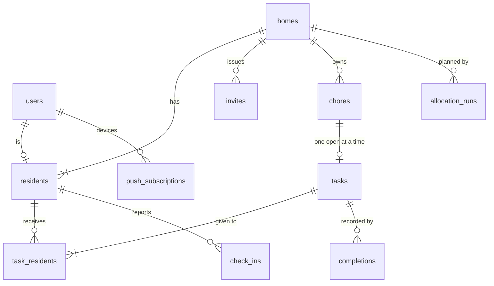

# Data model

Related: [ADR 0001](../adr/0001-chores-come-due-in-flexible-windows.md), [ADR 0003](../adr/0003-only-broken-commitments-break-a-streak.md). Terms: **User**, **Home**, **Resident**, **Invite**, **Chore**, **Task**, **Completion**, **Check-in**, **Preference**, **Restriction**, **Day Plan** in [CONTEXT.md](../../CONTEXT.md).

## What is built

Migrations live in `backend/migrations/` as `NNNN_description.sql` files, applied with `goose` (`api migrate`, or on start in Docker Compose only). They are embedded into the binary.

| Migration | Contents |
|---|---|
| `0001_init.sql` | No tables. It only proves the migration pipeline works. |
| `0002_push_subscriptions.sql` | `push_subscriptions`: `id` (uuid), `endpoint` (unique), `p256dh`, `auth`, `user_agent`, `created_at`, `updated_at`. One row per device. Timestamps come from the injected clock. |
| `0003_users.sql` | `users`: `id` (uuid), `cognito_sub` (unique, the identity), `email` (not unique: it can change in Cognito, and the API refreshes it on every request), `created_at`, `updated_at` (from the injected clock). Adds `push_subscriptions.user_id`, a nullable foreign key to `users` with `ON DELETE CASCADE`. It is nullable so the previous release, which does not set it, keeps working during a deploy (expand, then contract); rows saved before sign-in existed stay `NULL` and nobody can send to them. |
| `0004_user_profile.sql` | The User's profile, keyed to the User (not the Resident) so it survives leaving a Home. `user_baselines` (`user_id`, `weekday` 0 to 6 with 0 = Sunday, `points` 0 to 20; a row exists only for a set day, so unset reads as `null`, not 0). `user_category_preferences` (`user_id`, `category`, `preference` `like` or `dislike`; neutral is the absence of a row). `user_demand_restrictions` (`user_id`, `demand`). All cascade on user delete. There is no SQL check on `category` or `demand`: the lists live in `internal/vocab` and are validated in Go, so adding one needs no migration. |

A User is created by the first authenticated request, with one `INSERT ... ON CONFLICT (cognito_sub) DO UPDATE ... RETURNING` statement, so two simultaneous first requests create one row. `users`, `push_subscriptions` and the three profile tables are the only tables built. Everything else below is the planned schema from issue #1.

## Planned tables

| Table | Holds |
|---|---|
| `users` (built), `homes`, `residents`, `invites` | Accounts, Homes, membership (a User is a Resident of at most one Home), single-use 7-day Invites |
| `chores` | Category, Demands, base Effort, Importance, people needed, build-up flag, interval in days, allowed weekdays |
| `tasks`, `task_residents` | Open window, current Effort, status; who a Task is given to and whether they Committed |
| `completions` | The Task, the people who did it, the time (the Streak is computed from these, [ADR 0003](../adr/0003-only-broken-commitments-break-a-streak.md)) |
| `check_ins` | Resident, date, level, day-only Restrictions |
| `user_baselines`, `user_category_preferences`, `user_demand_restrictions` (built) | General Baseline, Preferences and Restrictions, on the User. The specific Restrictions on a Resident are still planned |
| `allocation_runs` | Home, date, which allocator, fallback reason, recorded reasons |
| `push_subscriptions` | One per device, owned by the User who last registered it. Built. |
