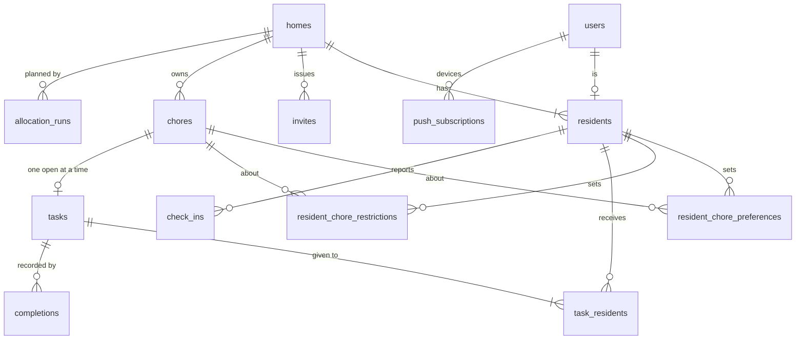

# Data model

Related: [ADR 0001](../adr/0001-chores-come-due-in-flexible-windows.md), [ADR 0003](../adr/0003-only-broken-commitments-break-a-streak.md). Terms: **User**, **Home**, **Resident**, **Invite**, **Chore**, **Task**, **Completion**, **Check-in**, **Preference**, **Restriction**, **Day Plan** in [CONTEXT.md](../../CONTEXT.md).

## What is built

Migrations live in `backend/migrations/` as `NNNN_description.sql` files, applied with `goose` (`api migrate`, or on start in Docker Compose only). They are embedded into the binary.

| Migration | Contents |
|---|---|
| `0001_init.sql` | No tables. It only proves the migration pipeline works. |
| `0002_push_subscriptions.sql` | `push_subscriptions`: `id` (uuid), `endpoint` (unique), `p256dh`, `auth`, `user_agent`, `created_at`, `updated_at`. One row per device. Timestamps come from the injected clock. |
| `0003_users.sql` | `users`: `id` (uuid), `cognito_sub` (unique, the identity), `email` (not unique: it can change in Cognito, and the API refreshes it on every request), `created_at`, `updated_at` (from the injected clock). Adds `push_subscriptions.user_id`, a nullable foreign key to `users` with `ON DELETE CASCADE`. It is nullable so the previous release, which does not set it, keeps working during a deploy (expand, then contract); rows saved before sign-in existed stay `NULL` and nobody can send to them. |
| `0004_user_profile.sql` | The User's profile, keyed to the User (not the Resident) so it survives leaving a Home. `user_baselines` (`user_id`, `weekday` 0 to 6 with 0 = Sunday, `points` 0 to 20; a row exists only for a set day, so unset reads as `null`, not 0). `user_category_preferences` (`user_id`, `category`, `preference` `like` or `dislike`; neutral is the absence of a row). `user_demand_restrictions` (`user_id`, `demand`). All cascade on user delete. There is no SQL check on `category` or `demand`: the lists live in `internal/vocab` and are validated in Go, so adding one needs no migration. |
| `0005_homes_residents.sql` | `homes`: `id` (uuid), `timezone` (an IANA zone name), `allocation_time` (`time`, the local wall-clock time in that zone, no seconds; never a UTC instant, so daylight saving needs no handling), `created_at`, `updated_at` (from the injected clock). `residents`: `id` (uuid), `user_id` (`NOT NULL UNIQUE`, references `users`, `ON DELETE CASCADE`), `home_id` (references `homes`, `ON DELETE CASCADE`, indexed), `created_at`. The unique `user_id` is what enforces "a User is a Resident of at most one Home", so two simultaneous creates cannot both succeed. |
| `0006_chores.sql` | `chores`: `id` (uuid), `home_id` (references `homes`, `ON DELETE CASCADE`, indexed), `name`, `category`, `demands` (`text[]`), `base_effort` (1 to 5), `importance`, `people` (1 or 2), `interval_days` (NULL means one-off; otherwise at least 1), `allowed_weekdays` (`smallint[]`, 0 = Sunday to 6; empty means any day), `builds_up`, `created_at`, `updated_at`. CHECKs cover only numeric ranges; Category, Demand and Importance ids are validated in Go. `tasks.chore_id` must be `ON DELETE CASCADE`, because any Chore can be deleted. |
| `0007_tasks.sql` | `tasks`: `id` (uuid), `chore_id` (references `chores`, `ON DELETE CASCADE`), `status` (`open` or `done`), `window_start` and `window_end` (inclusive `date`s in the Home's zone, `window_end >= window_start`), `current_effort` (1 to 5; derived from the Chore and the date and rewritten by each refresh), `created_at` (from the injected clock), `closed_on` (`date`, null while open; a CHECK requires it exactly when `status` is `done`). A partial unique index on `(chore_id) WHERE status = 'open'` is what enforces "a Chore has at most one open Task". A one-off Chore's single Task is enforced in code instead: the refresh locks the Chore row and opens a Task only if none of any status exists. Index on `(chore_id, window_start)` for the latest-Task lookup. `task_residents` and `completions` are not built yet. |
| `0008_resident_chore_settings.sql` | A Resident's Preference and Restriction on one specific Chore, which beat the User's general ones. `resident_chore_preferences` (`resident_id`, `chore_id`, `preference` `like`, `neutral` or `dislike`; primary key `(resident_id, chore_id)`). `resident_chore_restrictions` (`resident_id`, `chore_id`; same key). Both reference `residents` and `chores` with `ON DELETE CASCADE` and have an index on `chore_id`. Unlike the general Preference, neutral is stored, because a specific neutral must beat a general dislike; clearing deletes the row. They hang on the Resident, so leaving a Home (deleting the `residents` row) clears them. SQL cannot tie the Chore's Home to the Resident's Home, so every insert in `choresettings.Store` proves it in the same statement. |

A Home is created by one transaction that inserts the `homes` row and the creator's `residents` row; if the `residents` insert hits the unique violation the transaction rolls back and no Home is left behind.

A User is created by the first authenticated request, with one `INSERT ... ON CONFLICT (cognito_sub) DO UPDATE ... RETURNING` statement, so two simultaneous first requests create one row. `users`, `push_subscriptions`, the three profile tables, `homes`, `residents`, `chores`, `tasks` and the two specific-setting tables are the tables built. Everything else below is the planned schema from issue #1.

## Planned tables

| Table | Holds |
|---|---|
| `users`, `homes`, `residents` (built), `invites` | Accounts, Homes, membership (a User is a Resident of at most one Home), single-use 7-day Invites |
| `chores` (built) | Category, Demands, base Effort, Importance, people needed, build-up flag, interval in days, allowed weekdays |
| `tasks` (built) | Window, current Effort, status and `closed_on`; at most one open per Chore |
| `task_residents` | Who a Task is given to and whether they Committed |
| `completions` | The Task, the people who did it, the time (the Streak is computed from these, [ADR 0003](../adr/0003-only-broken-commitments-break-a-streak.md)) |
| `check_ins` | Resident, date, level, day-only Restrictions |
| `user_baselines`, `user_category_preferences`, `user_demand_restrictions` (built) | General Baseline, Preferences and Restrictions, on the User |
| `resident_chore_preferences`, `resident_chore_restrictions` (built) | A Resident's specific Preference and Restriction on one Chore; they beat the general ones (a specific Restriction only adds) |
| `allocation_runs` | Home, date, which allocator, fallback reason, recorded reasons |
| `push_subscriptions` | One per device, owned by the User who last registered it. Built. |
