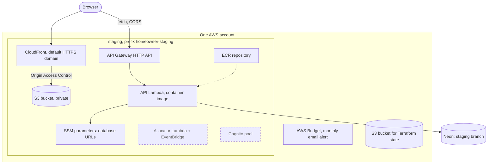
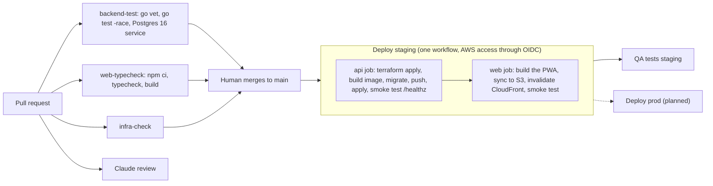

# Infrastructure and delivery

Related: [ADR 0002](../adr/0002-mirror-the-work-stack.md), [ADR 0005](../adr/0005-ship-a-react-pwa-not-a-native-app.md). Terms: **Allocation** in [CONTEXT.md](../../CONTEXT.md).

## What is built

Built: the local stack, pull request checks, a staging environment on AWS defined in Terraform under `infra/`, and a deploy pipeline that runs on every merge to `main`. Staging has the API (Lambda behind API Gateway), a Neon database branch, an account-wide budget alert, and the web app (S3 behind CloudFront). Planned: the Allocator Lambda, EventBridge schedule, Cognito, push, and the prod environment.

## Local (built)

`docker compose up` starts Postgres 16 and the API (built from `backend/Dockerfile`: a Go build stage, then a minimal distroless image). The API migrates on start (`MIGRATE_ON_START=true`, Compose only). The web app runs with `npm run dev` on port 5173.

## Staging (built, except where dashed)

- **Lambda** runs code on demand and bills per use; the Go code is packaged as a container image in ECR. **Neon** is hosted Postgres reached over the normal Postgres protocol, so there is no VPC or NAT Gateway.
- **Web hosting** (module `infra/modules/web`): a private S3 bucket holds the built PWA. CloudFront is the only reader, through Origin Access Control (CloudFront signs its requests to S3, so the bucket has no public access). The distribution uses CloudFront's default domain and certificate, and redirects HTTP to HTTPS. Because the PWA does its own routing in the browser, a request for a path such as `/home` finds no file in S3; CloudFront maps those 403 and 404 responses to `/index.html` with status 200 so the app can load and handle the route.
- The API allows the CloudFront origin through `CORS_ALLOWED_ORIGINS`.
- **Terraform layout**: `infra/bootstrap` is applied once by a human with local state (state bucket, GitHub OIDC provider, deploy role). Shared modules are in `infra/modules`: `lambda-container`, `http-api`, `neon-branch`, `budget` and `web`. `infra/staging` is a thin folder that wires them together, with state in S3 with native locking. Planned modules: `allocator`, `auth`, `push`. A `production` folder would be another thin folder over the same modules. Details are in `infra/README.md`.
- No custom domain in v1; the PWA uses CloudFront's default HTTPS domain.

## CI/CD

Built: `backend-test.yml`, `web-typecheck.yml` and `infra-check.yml` on pull requests. `deploy-staging.yml`, named exactly `Deploy staging`, runs on every push to `main`. Its `api` job applies Terraform, builds the image, runs migrations before the new code goes live, and smoke tests `/healthz`. The `web` job runs after `api` (`needs: api`), so it can read the API URL and the bucket and distribution from Terraform. It is a second job in the same workflow, not a second workflow, so the QA stage (`agent-qa.yml`), which starts after a successful run of `Deploy staging`, runs once per deploy. QA reads the repository variables `STAGING_API_URL` and `STAGING_WEB_URL`, which a human sets after the first deploy because `GITHUB_TOKEN` cannot write variables. The `agent-*.yml`, `claude*.yml`, `project-sync.yml` and `notify-ready-to-merge.yml` workflows run the team pipeline described in `CLAUDE.md`. The prod deploy is planned.

## Cost against $20 a month (estimate)

| Item | Expected | Why |
|---|---|---|
| Lambda, API Gateway, EventBridge (planned) | cents | Pay per request; nothing bills while idle |
| S3 and CloudFront | cents | Small static app |
| Cognito | free tier | Few users |
| Neon | free tier | Hosted Postgres with no always-on server for us to pay for |
| SSM Parameter Store | free | Standard parameters |
| Anthropic API | a few dollars at most | Capped by a per-Home daily call limit (planned) and a monthly spend limit |

Rejected because they bill while idle: ECS Fargate with a load balancer, and a NAT Gateway (about $33 a month). An AWS Budget alert is built (module `budget`). Figures are estimates, not measurements.
