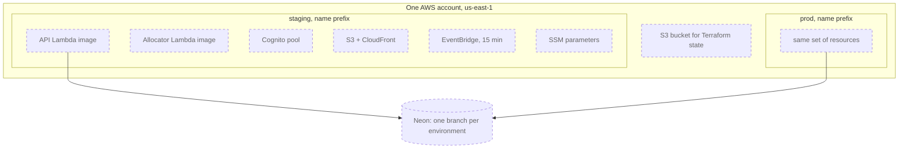
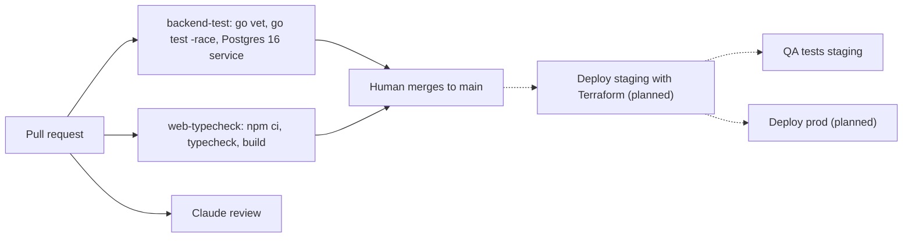

# Infrastructure and delivery

Related: [ADR 0002](../adr/0002-mirror-the-work-stack.md), [ADR 0005](../adr/0005-ship-a-react-pwa-not-a-native-app.md). Terms: **Allocation** in [CONTEXT.md](../../CONTEXT.md).

## What is built

There is **no AWS infrastructure, no Terraform and no deploy pipeline yet**: the repo has no `infra/` folder. What exists is the local stack and pull request checks. Everything about AWS below is the plan from issue #1 and ADR 0002.

## Local (built)

`docker compose up` starts Postgres 16 and the API (built from `backend/Dockerfile`: a Go build stage, then a minimal distroless image). The API migrates on start (`MIGRATE_ON_START=true`, Compose only). The web app runs with `npm run dev` on port 5173.

## Environments (planned)

- **Lambda** runs code on demand and bills per use; the Go code is packaged as a container image. **Neon** is hosted Postgres reached over the normal Postgres protocol, so there is no VPC or NAT Gateway.
- **Terraform** (planned layout): shared modules `api`, `allocator`, `auth`, `web`, `push`, with a thin folder per environment. State in S3 with native locking.
- No custom domain in v1; the PWA uses CloudFront's default HTTPS domain.

## CI/CD

Built: `backend-test.yml` and `web-typecheck.yml` on every pull request. The `agent-*.yml`, `claude*.yml`, `project-sync.yml` and `notify-ready-to-merge.yml` workflows run the team pipeline described in `CLAUDE.md`. The deploy to staging and prod on merge is planned; the QA stage runs after it.

## Cost against $20 a month (planned estimate)

| Item | Expected | Why |
|---|---|---|
| Lambda, EventBridge, API calls | cents | Pay per request; nothing bills while idle |
| S3 and CloudFront | cents | Small static app |
| Cognito | free tier | Few users |
| Neon | free tier | Hosted Postgres with no always-on server for us to pay for |
| SSM Parameter Store | free | Standard parameters |
| Anthropic API | a few dollars at most | Capped by a per-Home daily call limit (planned) and a monthly spend limit |

Rejected because they bill while idle: ECS Fargate with a load balancer, and a NAT Gateway (about $33 a month). An AWS Budget alert is planned. Figures are estimates, not measurements.
