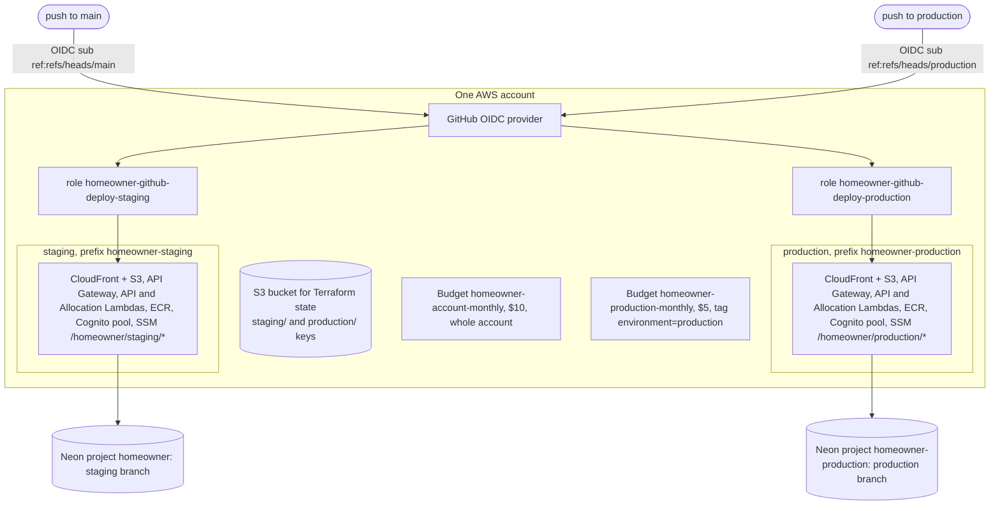
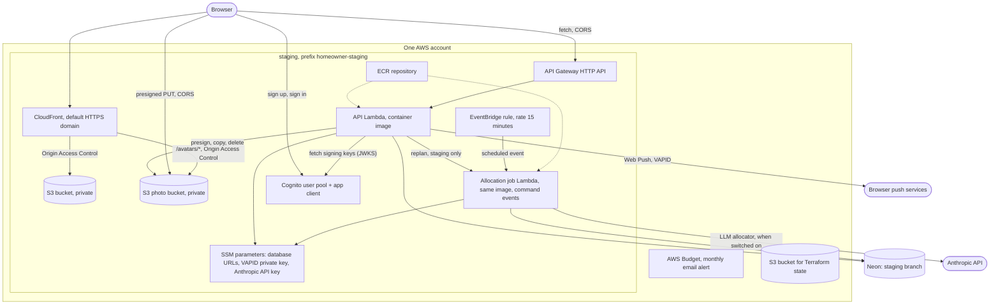
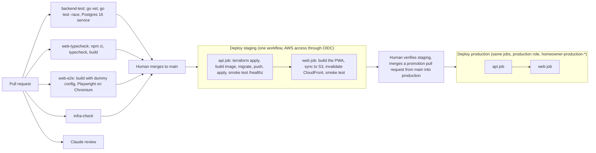

# Infrastructure and delivery

Related: [ADR 0002](../adr/0002-mirror-the-work-stack.md), [ADR 0005](../adr/0005-ship-a-react-pwa-not-a-native-app.md). Terms: **Allocation** in [CONTEXT.md](../../CONTEXT.md).

## What is built

Built: the local stack, pull request checks, staging and production environments on AWS defined in Terraform under `infra/`, a deploy pipeline that runs on every merge to `main`, and a production deploy that runs when `main` is promoted to the `production` branch. Staging has the API (Lambda behind API Gateway), a Neon database branch, an account-wide budget alert, and the web app (S3 behind CloudFront). Web Push sending is built in the API and in the Allocation job (both need the VAPID keys above). Sign-in is built: a Cognito user pool per environment, verified by the API. The daily Allocation job is built: an EventBridge rule every 15 minutes invokes a second Lambda from the API image ([ADR 0008](../adr/0008-scheduled-jobs-run-as-a-second-lambda-from-the-api-image.md)).

## Local (built)

`docker compose up` starts Postgres 16 and the API (built from `backend/Dockerfile`: a Go build stage, then a minimal distroless image). The API migrates on start (`MIGRATE_ON_START=true`, Compose only). The web app runs with `npm run dev` on port 5173.

## Staging and production (built)

Production is a second copy of staging in the same AWS account, built from the same modules by `infra/production`. Only names, IAM and its own Neon project separate them:



Each environment is laid out as below (staging shown):



- **Lambda** runs code on demand and bills per use; the Go code is packaged as a container image in ECR. **Neon** is hosted Postgres reached over the normal Postgres protocol, so there is no VPC or NAT Gateway.
- **Web hosting** (module `infra/modules/web`): a private S3 bucket holds the built PWA. CloudFront is the only reader, through Origin Access Control (CloudFront signs its requests to S3, so the bucket has no public access). The distribution uses CloudFront's default domain and certificate, and redirects HTTP to HTTPS. Because the PWA does its own routing in the browser, a request for a path such as `/home` finds no file in S3; CloudFront maps those 403 and 404 responses to `/index.html` with status 200 so the app can load and handle the route.
- The API allows the CloudFront origin through `CORS_ALLOWED_ORIGINS`.
  - **The deploy keeps old hashed files.** The web job's "Delete stale objects" step runs `aws s3 sync dist s3://<bucket> --delete --size-only --exclude "assets/*"`, and `sync` never deletes an excluded key, so files under `assets/` from earlier builds stay. The PWA loads Chores, Home, Me and the other screens as separate hashed files on demand; a tab still running the previous version asks for its old names, and a deleted file would come back as `index.html` with status 200 (the mapping above), failing the import. The service worker does not cover this: with `autoUpdate` a new worker takes over an open page and drops the old precache. The cost is that old files pile up, small and cheap to store. A lifecycle rule by age is not the answer, because an unchanged file keeps its original upload date and would be deleted while the current build still uses it; if the pile ever matters, prune by what the current build lists instead. Everything outside `assets/` (including `sw.js` and `index.html`) is still pruned.
- **Resident photos** (module `infra/modules/photos`, [ADR 0012](../adr/0012-serve-resident-photos-from-a-private-bucket-through-the-web-cloudfront.md)): a private bucket `homeowner-<environment>-photos-<account id>` (public access blocked, SSE-S3). Two prefixes: `pending/<userId>/<random>` for uploads not yet confirmed, which a lifecycle rule expires after one day, and `avatars/<random>.<webp|jpg>` for served photos. The browser PUTs to a presigned URL, so the bucket's CORS allows `PUT` with the `content-type` header from the web origin only. The web distribution gains a second origin (`photos`, its own Origin Access Control) and an ordered behaviour `/avatars/*` (GET and HEAD, the same `Managed-CachingOptimized` and security-header policies, HTTP redirected to HTTPS). The path is forwarded whole, so `/avatars/x.webp` reads the key `avatars/x.webp`, on the web origin, so images need no CORS. The bucket policy lets only that distribution `s3:GetObject`, and only on `avatars/*`; nothing under `pending/` is served. The module's `photos_origin_domain` input on `web` is optional (empty adds no origin, behaviour or control), and `infra/staging` and `infra/production` wire it identically. The photos module needs the distribution's ARN and the distribution the bucket's domain; this is not a cycle because Terraform orders individual values. The API role (`lambda-container` input `photos_bucket_arn`, empty adds nothing) gets `PhotosPending` (put, get, delete on `pending/*`) and `PhotosAvatars` (put, delete on `avatars/*`), and `PhotosList` (`s3:ListBucket` on the bucket itself), so a HEAD on a missing key answers 404, not 403. The Allocation job role gets nothing. The API receives `PHOTOS_BUCKET` and `PHOTOS_BASE_URL` (`https://<web domain>/avatars`) as plain environment variables, and reads both or neither. The deploy role can create these buckets only after a human re-applies `infra/bootstrap` (#228).
  - **Gotcha: a missing avatar answers 200 with HTML.** The distribution's 403 and 404 to `/index.html` with status 200 (the SPA fallback) applies to every behaviour. CloudFront's own role (the bucket policy) has no `ListBucket`, so S3 answers 403 to it for a missing key, and CloudFront serves `index.html` as `text/html` with status 200. An `` cannot decode it and fires `onerror`; the Avatar must fall back on `onerror`, not on the status. Scoping the mapping to one behaviour needs Lambda@Edge or a CloudFront Function, which is not worth the cost.
  - Removal is eventually consistent: a deleted photo can be served from cache for up to a day (no invalidations).
- **Web Push keys**: the VAPID key pair is generated once by a human (`api vapid`). The private key is a `SecureString` at `/homeowner/staging/vapid-private-key`, created with `aws ssm put-parameter` so it never enters Terraform state; the Lambda reads it at start through `VAPID_PRIVATE_KEY_SSM_PARAM` (its role already reads `/homeowner/staging/*`). The public key and the contact `VAPID_SUBJECT` are the Terraform variables `vapid_public_key` and `vapid_subject`, fed from repository variables in `deploy-staging.yml`. Without the public key the Lambda gets no VAPID settings and push stays off. The Lambda calls browser push services over the internet (no VPC, so no NAT needed).
- **Sign-in** (module `infra/modules/auth`): a Cognito user pool where people sign up with their email and confirm it with a code, and one app client for the PWA (no client secret, because a browser cannot keep one; `USER_PASSWORD_AUTH` and refresh-token flows; ID and access tokens last 60 minutes, refresh tokens 30 days). There is no hosted UI, no domain and no identity pool: the PWA calls the Cognito public API with its own forms. The pool uses Cognito's default email sender (free, about 50 emails a day, may land in spam) and has deletion protection on, because changing the sign-in attribute replaces the pool and deletes its users. The API gets `COGNITO_ISSUER` and `COGNITO_CLIENT_ID` as plain Lambda environment variables (they are public identifiers). Without them auth is off and `/me` and the push write routes answer 503. The deploy copies the `cognito_client_id` and `cognito_region` outputs into the web build as `VITE_COGNITO_CLIENT_ID` and `VITE_COGNITO_REGION`. The password rules (minimum length, and whether lowercase, uppercase, numbers and symbols are required) are written only in the pool's `password_policy` block. The module outputs them as one JSON value, `password_policy`; `infra/staging` re-exports it as `cognito_password_policy`, and the deploy copies it into the web build as `VITE_PASSWORD_POLICY`, so the sign-up screen can show exactly the rules the server enforces. The web job prints the value and fails unless it is JSON with the five keys. There is no runtime fetch. The deploy role has `cognito-idp:*` on user pools of the account and region, which a human must apply in `infra/bootstrap` before the deploy that creates the pool.

  ```mermaid
  flowchart LR
      pool["user pool<br/>password_policy block"] --> mod["module.auth output<br/>password_policy"]
      mod --> stg["infra/staging output<br/>cognito_password_policy"]
      stg --> api["deploy-staging.yml<br/>api job output"]
      api --> env["web job build env<br/>VITE_PASSWORD_POLICY"]
      env -.-> bundle["web bundle<br/>(planned, read by #65)"]
  ```

- **Allocation job** (module `infra/modules/scheduled-job`, wired in `infra/staging`): an EventBridge rule `rate(15 minutes)` (Allocation times are quarter hours, which is why 15 works) targets a second Lambda function, `homeowner-staging-allocate`, built from the API's image and repository with `image_config.command = ["events"]`, so the deploy still builds and pushes one image. In that mode the binary serves only `POST /events` and `GET /healthz`; Lambda Web Adapter forwards the scheduled event to `/events`. The function has no URL and is not behind the HTTP API, and the only `aws_lambda_permission` lets `events.amazonaws.com` invoke it from that rule, so no job route is on the internet. It has its own role (logs, and SSM read under `/homeowner/staging/*`), a 90s timeout (set in `infra/staging` and `infra/production`, over the module's 60s default), 256 MB, `DB_MAX_CONNS=2`, `DATABASE_URL_SSM_PARAM` and, when `vapid_public_key` is set, the same VAPID settings as the API (`VAPID_PUBLIC_KEY`, `VAPID_SUBJECT`, `VAPID_PRIVATE_KEY_SSM_PARAM`; its SSM read policy already covers the key) so the tick can send the Check-in reminder and "Day Plan ready" pushes (it does not get Cognito or CORS settings). Without the VAPID settings the job logs one warning at start and only plans, so check the function's environment after the deploy. When the Terraform variable `llm_allocator_enabled` is true (repository variable `LLM_ALLOCATOR_ENABLED`, default false), the job alone also gets `LLM_ALLOCATOR_ENABLED=true` and `ANTHROPIC_API_KEY_SSM_PARAM`, pointing at the `SecureString` `/homeowner/staging/anthropic-api-key` a human creates (never in Terraform state); it then calls the Anthropic API over the internet. Its allocator calls share a 20 second budget per tick, the Day Plan explanation calls (one more call per planned Home, same key and cap) a 15 second budget of their own, and the nudges a 30 second deadline, so the worst tick is 65 seconds and stays inside the 90 second timeout. The timeout was raised from 60 because of the explanation step; a timed-out invocation is billed in full and is not retried. The nudges run in this one function rather than a second one ([Daily Allocation](allocation.md)); the Lambda calls browser push services over the internet, still with no VPC or NAT. Staging only, the dev replan route (`POST /dev/replan`) lets the API invoke this function with a replan event: `infra/staging` sets `REPLAN_ENABLED=true` on the job (hard-coded, with no Terraform or repository variable, because staging is the only place it is ever on), sets `REPLAN_ALLOCATE_FUNCTION_NAME` on the API to the job's function name, and passes the job's ARN to the `lambda-container` module's optional `invoke_function_arns` input (default empty). That adds one statement to the API role's `runtime` policy, `InvokeFunctions`: `lambda:InvokeFunction` on exactly the allocation function's ARN and nothing broader. Production passes none of these, so its plan is unchanged. An `aws_lambda_function_event_invoke_config` in `infra/staging` sets `maximum_retry_attempts = 0` on the job so a failed asynchronous replan is not retried and does not replan a Home twice. The target does not retry: the job plans a Home at or after its Allocation time, and two overlapping invocations are safe because each Home is claimed under a lock. An EventBridge rule and an idle Lambda function bill nothing, there is no VPC, and the cost is about 2,900 short invocations a month. The deploy role needs `events:*` on `rule/homeowner-staging-*`, added in `infra/bootstrap`, which a human must re-apply before the deploy that creates the rule.
- `sw.js`, `index.html`, `registerSW.js` and the manifest are uploaded with `Cache-Control: no-cache`, so a new service worker is picked up after a deploy despite CloudFront's caching.
- **Terraform layout**: `infra/bootstrap` is applied once by a human with local state (state bucket, GitHub OIDC provider, one deploy role per environment). Shared modules are in `infra/modules`: `lambda-container`, `scheduled-job`, `http-api`, `neon-branch`, `budget`, `web`, `photos` and `auth`. `infra/staging` and `infra/production` are thin folders that wire them together, each with its own state key in S3 with native locking. Planned module: `push`. Details are in `infra/README.md`.
- No custom domain in v1; the PWA uses CloudFront's default HTTPS domain.

## CI/CD



Built: `backend-test.yml`, `web-typecheck.yml`, `web-e2e.yml` and `infra-check.yml` on pull requests. `web-e2e` has no path filter, needs no secrets (it builds with the public dummy values in `web/.env.e2e`), caches the Chromium download, and uploads the Playwright report only when it fails. `deploy-staging.yml`, named exactly `Deploy staging`, runs on every push to `main`. Its `api` job applies Terraform, builds the image, runs migrations before the new code goes live, and smoke tests `/healthz`. The `web` job runs after `api` (`needs: api`), so it can read the API URL and the bucket and distribution from Terraform. The `agent-*.yml`, `claude*.yml`, `project-sync.yml`, `notify-ready-to-merge.yml`, `pr-risk.yml`, `merge-by-risk.yml` and `scripts-test.yml` workflows run the team pipeline described in `CLAUDE.md`; the last two label each pull request into `main` with a risk tier and merge the agents' low-risk ones, and medium-risk ones the maintainer approved ([ADR 0015](../adr/0015-merge-agent-pull-requests-by-risk-tier.md), [risk tiers](../agents/pr-risk.md)). `deploy-production.yml`, named `Deploy production`, runs on every push to the `production` branch with the same two jobs against `infra/production`, under the role only that branch can assume. A ruleset on `production` requires the maintainer's approval, so agents that can deploy staging cannot deploy production.

## Cost against $20 a month (estimate)

Both environments together. Production doubles the storage-type items (ECR images, logs, S3) but adds nothing that bills while idle.

| Item | Expected | Why |
|---|---|---|
| Lambda, API Gateway, EventBridge | cents | Pay per request; nothing bills while idle |
| S3 and CloudFront | cents | Small static app |
| S3 photo bucket | fractions of a cent | A few hundred objects of about 100 KB; requests and transfer fit the free tier; pending uploads expire after a day |
| Cognito | free tier | Few users |
| Neon | free tier | One project per environment, scales to zero |
| SSM Parameter Store | free | Standard parameters |
| Anthropic API | a few dollars at most | Capped by a per-Home daily call limit (3 by default, shared by the allocator and the explanation call) and a monthly spend limit set in the Anthropic Console (the AWS Budget does not see it; see `infra/README.md`) |

Rejected because they bill while idle: ECS Fargate with a load balancer, and a NAT Gateway (about $33 a month). Two AWS Budget alerts are built (module `budget`): $10 for the whole account and $5 for production by its `environment` tag. Figures are estimates, not measurements.
