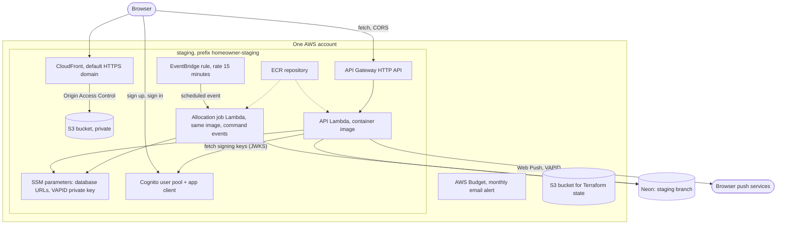
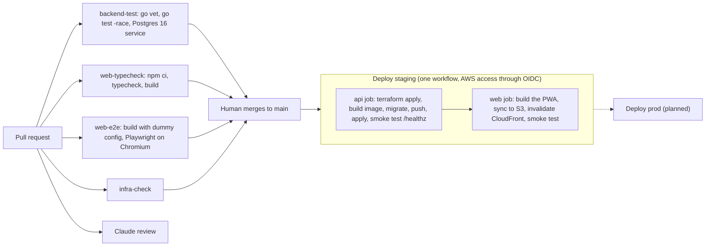

# Infrastructure and delivery

Related: [ADR 0002](../adr/0002-mirror-the-work-stack.md), [ADR 0005](../adr/0005-ship-a-react-pwa-not-a-native-app.md). Terms: **Allocation** in [CONTEXT.md](../../CONTEXT.md).

## What is built

Built: the local stack, pull request checks, a staging environment on AWS defined in Terraform under `infra/`, and a deploy pipeline that runs on every merge to `main`. Staging has the API (Lambda behind API Gateway), a Neon database branch, an account-wide budget alert, and the web app (S3 behind CloudFront). Web Push sending is built in the API and in the Allocation job (both need the VAPID keys above). Sign-in is built: a Cognito user pool per environment, verified by the API. The daily Allocation job is built: an EventBridge rule every 15 minutes invokes a second Lambda from the API image ([ADR 0008](../adr/0008-scheduled-jobs-run-as-a-second-lambda-from-the-api-image.md)). Planned: the prod environment.

## Local (built)

`docker compose up` starts Postgres 16 and the API (built from `backend/Dockerfile`: a Go build stage, then a minimal distroless image). The API migrates on start (`MIGRATE_ON_START=true`, Compose only). The web app runs with `npm run dev` on port 5173.

## Staging (built)



- **Lambda** runs code on demand and bills per use; the Go code is packaged as a container image in ECR. **Neon** is hosted Postgres reached over the normal Postgres protocol, so there is no VPC or NAT Gateway.
- **Web hosting** (module `infra/modules/web`): a private S3 bucket holds the built PWA. CloudFront is the only reader, through Origin Access Control (CloudFront signs its requests to S3, so the bucket has no public access). The distribution uses CloudFront's default domain and certificate, and redirects HTTP to HTTPS. Because the PWA does its own routing in the browser, a request for a path such as `/home` finds no file in S3; CloudFront maps those 403 and 404 responses to `/index.html` with status 200 so the app can load and handle the route.
- The API allows the CloudFront origin through `CORS_ALLOWED_ORIGINS`.
- **Web Push keys**: the VAPID key pair is generated once by a human (`api vapid`). The private key is a `SecureString` at `/homeowner/staging/vapid-private-key`, created with `aws ssm put-parameter` so it never enters Terraform state; the Lambda reads it at start through `VAPID_PRIVATE_KEY_SSM_PARAM` (its role already reads `/homeowner/staging/*`). The public key and the contact `VAPID_SUBJECT` are the Terraform variables `vapid_public_key` and `vapid_subject`, fed from repository variables in `deploy-staging.yml`. Without the public key the Lambda gets no VAPID settings and push stays off. The Lambda calls browser push services over the internet (no VPC, so no NAT needed).
- **Sign-in** (module `infra/modules/auth`): a Cognito user pool where people sign up with their email and confirm it with a code, and one app client for the PWA (no client secret, because a browser cannot keep one; `USER_PASSWORD_AUTH` and refresh-token flows; ID and access tokens last 60 minutes, refresh tokens 30 days). There is no hosted UI, no domain and no identity pool: the PWA calls the Cognito public API with its own forms. The pool uses Cognito's default email sender (free, about 50 emails a day, may land in spam) and has deletion protection on, because changing the sign-in attribute replaces the pool and deletes its users. The API gets `COGNITO_ISSUER` and `COGNITO_CLIENT_ID` as plain Lambda environment variables (they are public identifiers). Without them auth is off and `/me` and the push write routes answer 503. The deploy copies the `cognito_client_id` and `cognito_region` outputs into the web build as `VITE_COGNITO_CLIENT_ID` and `VITE_COGNITO_REGION`. The password rules (minimum length, and whether lowercase, uppercase, numbers and symbols are required) are written only in the pool's `password_policy` block. The module outputs them as one JSON value, `password_policy`; `infra/staging` re-exports it as `cognito_password_policy`, and the deploy copies it into the web build as `VITE_PASSWORD_POLICY`, so the sign-up screen can show exactly the rules the server enforces. The web job prints the value and fails unless it is JSON with the five keys. There is no runtime fetch. The deploy role has `cognito-idp:*` on user pools of the account and region, which a human must apply in `infra/bootstrap` before the deploy that creates the pool.

  ```mermaid
  flowchart LR
      pool["user pool<br/>password_policy block"] --> mod["module.auth output<br/>password_policy"]
      mod --> stg["infra/staging output<br/>cognito_password_policy"]
      stg --> api["deploy-staging.yml<br/>api job output"]
      api --> env["web job build env<br/>VITE_PASSWORD_POLICY"]
      env -.-> bundle["web bundle<br/>(planned, read by #65)"]
  ```

- **Allocation job** (module `infra/modules/scheduled-job`, wired in `infra/staging`): an EventBridge rule `rate(15 minutes)` (Allocation times are quarter hours, which is why 15 works) targets a second Lambda function, `homeowner-staging-allocate`, built from the API's image and repository with `image_config.command = ["events"]`, so the deploy still builds and pushes one image. In that mode the binary serves only `POST /events` and `GET /healthz`; Lambda Web Adapter forwards the scheduled event to `/events`. The function has no URL and is not behind the HTTP API, and the only `aws_lambda_permission` lets `events.amazonaws.com` invoke it from that rule, so no job route is on the internet. It has its own role (logs, and SSM read under `/homeowner/staging/*`), a 60s timeout, 256 MB, `DB_MAX_CONNS=2`, `DATABASE_URL_SSM_PARAM` and, when `vapid_public_key` is set, the same VAPID settings as the API (`VAPID_PUBLIC_KEY`, `VAPID_SUBJECT`, `VAPID_PRIVATE_KEY_SSM_PARAM`; its SSM read policy already covers the key) so the tick can send the Check-in reminder and "Day Plan ready" pushes (it does not get Cognito or CORS settings). Without the VAPID settings the job logs one warning at start and only plans, so check the function's environment after the deploy. The nudges run in this one function rather than a second one ([Daily Allocation](allocation.md)); the Lambda calls browser push services over the internet, still with no VPC or NAT. The target does not retry: the job plans a Home at or after its Allocation time, and two overlapping invocations are safe because each Home is claimed under a lock. An EventBridge rule and an idle Lambda function bill nothing, there is no VPC, and the cost is about 2,900 short invocations a month. The deploy role needs `events:*` on `rule/homeowner-staging-*`, added in `infra/bootstrap`, which a human must re-apply before the deploy that creates the rule.
- `sw.js`, `index.html`, `registerSW.js` and the manifest are uploaded with `Cache-Control: no-cache`, so a new service worker is picked up after a deploy despite CloudFront's caching.
- **Terraform layout**: `infra/bootstrap` is applied once by a human with local state (state bucket, GitHub OIDC provider, deploy role). Shared modules are in `infra/modules`: `lambda-container`, `scheduled-job`, `http-api`, `neon-branch`, `budget`, `web` and `auth`. `infra/staging` is a thin folder that wires them together, with state in S3 with native locking. Planned module: `push`. A `production` folder would be another thin folder over the same modules. Details are in `infra/README.md`.
- No custom domain in v1; the PWA uses CloudFront's default HTTPS domain.

## CI/CD



Built: `backend-test.yml`, `web-typecheck.yml`, `web-e2e.yml` and `infra-check.yml` on pull requests. `web-e2e` has no path filter, needs no secrets (it builds with the public dummy values in `web/.env.e2e`), caches the Chromium download, and uploads the Playwright report only when it fails. `deploy-staging.yml`, named exactly `Deploy staging`, runs on every push to `main`. Its `api` job applies Terraform, builds the image, runs migrations before the new code goes live, and smoke tests `/healthz`. The `web` job runs after `api` (`needs: api`), so it can read the API URL and the bucket and distribution from Terraform. The `agent-*.yml`, `claude*.yml`, `project-sync.yml` and `notify-ready-to-merge.yml` workflows run the team pipeline described in `CLAUDE.md`. The prod deploy is planned.

## Cost against $20 a month (estimate)

| Item | Expected | Why |
|---|---|---|
| Lambda, API Gateway, EventBridge | cents | Pay per request; nothing bills while idle |
| S3 and CloudFront | cents | Small static app |
| Cognito | free tier | Few users |
| Neon | free tier | Hosted Postgres with no always-on server for us to pay for |
| SSM Parameter Store | free | Standard parameters |
| Anthropic API | a few dollars at most | Capped by a per-Home daily call limit (planned) and a monthly spend limit |

Rejected because they bill while idle: ECS Fargate with a load balancer, and a NAT Gateway (about $33 a month). An AWS Budget alert is built (module `budget`). Figures are estimates, not measurements.
