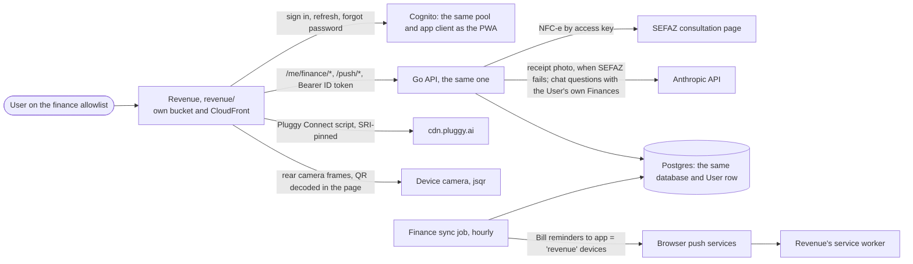
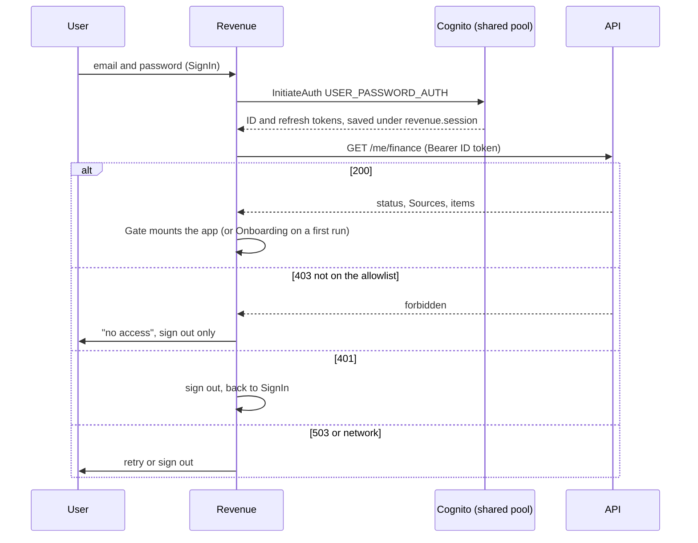
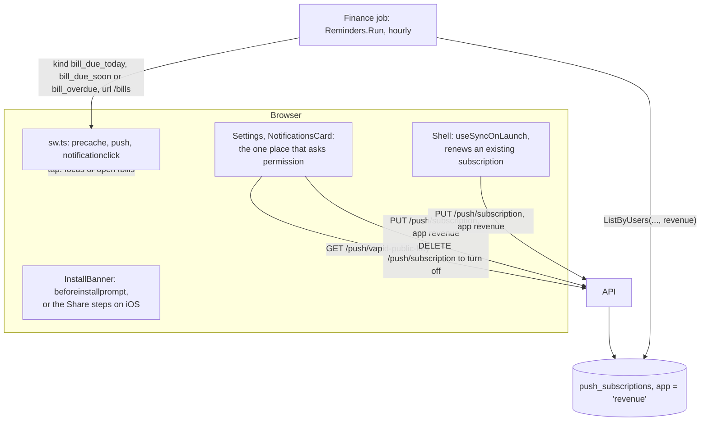
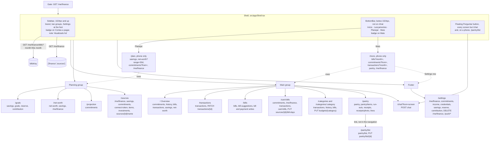
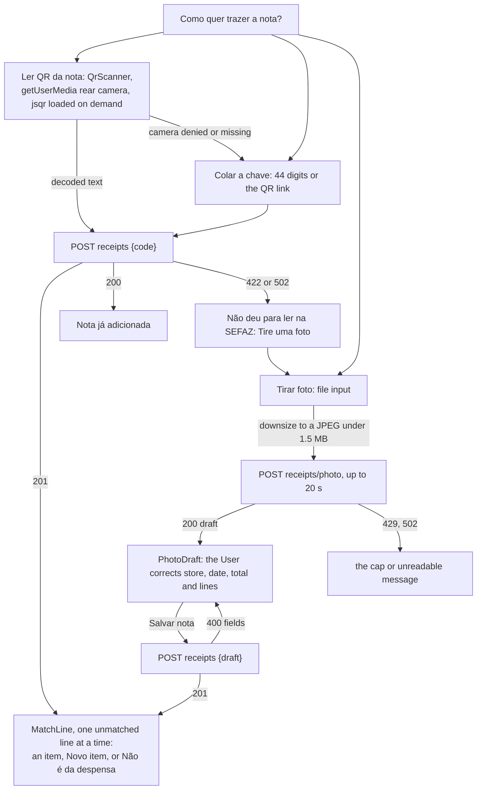

# Revenue, the finance app

Related: [ADR 0023](../adr/0023-move-finances-into-a-second-installable-app-named-revenue.md) (why Finances moves into its own app), [ADR 0022](../adr/0022-a-shared-bedrock-design-system-amends-0007-and-0009-for-adopting-apps.md) (Bedrock), [ADR 0019](../adr/0019-take-bank-data-from-pluggy-with-per-user-credentials-encrypted-by-the-app.md) (Pluggy). Design: [`docs/design/revenue/`](../design/revenue/README.md). Rules for changing it: [`revenue/CLAUDE.md`](../../revenue/CLAUDE.md). [ADR 0026](../adr/0026-read-grocery-receipts-from-sefaz-with-an-ai-read-photo-as-a-confirmed-fallback.md) (Pantry receipts). [ADR 0027](../adr/0027-the-finance-chat-sends-a-users-own-finances-to-the-model-through-read-only-tools.md) (the finance chat). Terms: **User**, **Source**, **Bill**, **Goal**, **Investment**, **Pantry**, **Pantry item**, **Fixed item**, **Ran out**, **Shopping list**, **Receipt** ([GLOSSARY.md](../../GLOSSARY.md)).

## What is built

Revenue is a second installable React app in `revenue/`, built on [Bedrock](bedrock.md). It shows a User their own money: Transactions, Bills, card bills, Spending Categories, Goals, Net worth, the Projection and the connected banks, and keeps their Pantry and Shopping list; and it answers questions about that money in a chat ("Perguntar"). It has sixteen screens behind one frame (two of them, Planejar and Mais, only the phone's tabs reach), plus a first-run Onboarding outside it. Finances lives only here: the Homeowner PWA no longer has it ([web.md](web.md)), and the API's `/me/finance` routes are served to Revenue alone.

- **Its own origin and build.** A Vite app with its own `index.html`, manifest and service worker (`src/sw.ts`, push only; it precaches the app shell). In AWS it has its own private bucket and CloudFront distribution per environment (`module "revenue_web"` in `infra/staging` and `infra/production`, the same `infra/modules/web` as the PWA and the admin app), and the API lists its origin in `CORS_ALLOWED_ORIGINS`. It is the second member of the root npm workspace, after `bedrock`.
- **The same API and sign-in.** It calls the one Go API ([backend.md](backend.md)) with a Cognito ID token, signing in against the same user pool as the PWA with its own forms (`src/auth/`).
- **The gate.** After sign-in, `Gate` (`src/app/Gate.tsx`) calls `GET /me/finance` and mounts the app only on `200`. A `403` (not on the finance allowlist) shows "no access" with sign-out, a `401` signs out, and a `503` or network failure offers a retry. The gate only saves an outsider a screen of failing requests: the API's `403` on every `/me/finance` route is the control.
- **Its own notifications.** Settings subscribes the device with `PUT /push/subscription` and `app: "revenue"`, stored in `push_subscriptions.app` ([data model](data-model.md)), so Bill reminders reach Revenue's subscriptions, not the PWA's.

## How it is built and deployed

- **A workspace member.** The root `package.json` is an npm workspace of `bedrock` and `revenue` (`@homeowner/revenue`), so `npm ci` at the root links `@homeowner/bedrock` into Revenue from source and one `package-lock.json` covers both. Commands run from the root with `-w @homeowner/revenue` (`docs/development.md`). Revenue uses Bedrock's components and tokens ([ADR 0022](../adr/0022-a-shared-bedrock-design-system-amends-0007-and-0009-for-adopting-apps.md)), not the PWA's `web/src/tokens.css`.
- **Build-time settings** (`src/config.ts`, checked at start and in the build): `VITE_API_URL`, `VITE_COGNITO_REGION`, `VITE_COGNITO_CLIENT_ID` and `VITE_PASSWORD_POLICY`, plus the optional `VITE_ENVIRONMENT` (`staging` or `local` shows a badge naming it; see [CI/CD](infrastructure.md#cicd)). A missing or malformed one fails with its name. Locally they come from `revenue/.env.local`; in AWS from the `outputs` job's Terraform outputs. `npm run dev` serves on port 5175 (`strictPort`, because Compose's `CORS_ALLOWED_ORIGINS` allows only that port).
- **Deploy.** `deploy-revenue.yml`, a reusable workflow that `deploy-staging.yml` and `deploy-production.yml` call after their `outputs` job (only when `revenue/`, `bedrock/`, the root package files or `infra/` changed, or on a manual run), builds Revenue and publishes it to `module "revenue_web"`'s bucket, invalidates the distribution and smoke tests it ([infrastructure](infrastructure.md)).
- **Checks.** `revenue-check`, which runs its job on pull requests changing `revenue/`, `bedrock/` or the root package files and is skipped otherwise (see Tests and checks below).

## Sign-in and the gate

Revenue has no sign-up: a person makes their account in the Homeowner PWA (the same pool), and the allowlist, not the account, decides who gets in.

- **Cognito** (`src/auth/cognito.ts`) is called with `fetch` and the public `X-Amz-Target` API, no SDK, as the PWA does: `InitiateAuth` for sign-in (`USER_PASSWORD_AUTH`) and refresh (`REFRESH_TOKEN_AUTH`), and `ForgotPassword` then `ConfirmForgotPassword` for the "forgot password" screen (`src/auth/ForgotPassword.tsx`: email, then the emailed code and a new password checked against `VITE_PASSWORD_POLICY`, then done). Cognito's own messages are never shown; each failure maps to a kind the screen words.
- **The session** (`src/auth/session.ts`) is the ID token, the refresh token and the expiry in this origin's `localStorage` under `revenue.session`, so Revenue and the PWA never share a session even for the same User. `AuthProvider` clears the query cache when the session ends.
- **The API client** (`src/api/client.ts`, one Axios instance, [ADR 0013](../adr/0013-own-server-state-with-tanstack-query-over-one-axios-client.md)) adds the bearer token, refreshes it a minute before expiry, and on a `401` refreshes and retries once; a refused refresh clears the session, which shows sign-in.
- **The gate** is described above. On `200` it also sends a first-time User to Onboarding (below).

## Onboarding

`/onboarding` (`src/domains/onboarding/`) is a four-step first run in its own frame, outside the Shell and the navigation: Pluggy credentials (`PUT credentials`), connect banks (`POST connect-token`, Pluggy Connect, `POST items`), Monthly income (`PUT income`), done. Each step says why it asks and can be skipped; the same actions live on Sources and Settings. The Gate sends a User there only when they open `/`, `GET /me/finance` reports no Sources, the Monthly income read answers none, and this device has not finished it (`revenue.onboarding.done` in `localStorage`, also kept in memory when storage is refused). A failed income read shows the app instead. `shortcut:` the done flag is per device, so a User who skipped on another device sees it once here.

## Language and theme

- **Language** (`src/shared/i18n/`): two typed catalogs, `pt-BR` and `en`, with pt-BR the default. The stored choice (`revenue.locale`) wins; otherwise English only when the browser's first language is English, else pt-BR. Chosen in Settings (`src/shared/Preferences.tsx`, also on the sign-in and gate cards).
- **Theme** (`src/shared/theme/`): System, Light or Dark, stored as `revenue.theme` (System removes the key). An inline script in `index.html` sets `<html data-theme>` before first paint from the same key, the system appearance, else dark, Bedrock's default; Bedrock swaps its tokens on that attribute.

## Install and notifications

- **Manifest and service worker** (`vite.config.ts`, `vite-plugin-pwa` with `injectManifest`; `src/sw.ts`). The manifest names the app "Revenue" (or "Revenue Staging", with the icons from `staging-icons/`, in the staging build; see [CI/CD](infrastructure.md#cicd)), standalone, with its own icons in `public/`. The worker precaches the built app shell only and serves `index.html` for navigations, so deep links and an offline start work. It has no runtime caching and no fetch handler: API calls (they carry the token) and Cognito calls are never cached. `autoUpdate`, `skipWaiting` and `clients.claim()` move an open page to a new version. `tsconfig.sw.json` type-checks the worker without the DOM.
- **Install.** `InstallBanner` (`src/app/`) offers Chromium's install prompt, or on iPhone and iPad the Share-menu steps; dismissing hides it for the session (`revenue.install-dismissed` in `sessionStorage`).
- **Opting in.** The Notifications card in Settings is off until the User turns it on; only then is the permission asked (`enableReminders` in `src/domains/settings/logic/reminders.ts`). It subscribes with the API's VAPID key (a subscription made with another key is replaced) and saves it with `app: "revenue"`. On iOS in a browser tab it shows the install steps first, because Safari allows push only from the Home Screen app. Turning it off unsubscribes in the browser and calls `DELETE /push/subscription`. On every launch the Shell renews an existing subscription and never prompts or re-subscribes a device that turned notifications off. A Bill reminder reaches a User only when they have a Revenue subscription.
- **Bill reminders.** The finance job sends `bill_due_today`, `bill_due_soon` and `bill_overdue` ([backend](backend.md)) with `url` `/bills`. The worker (`src/sw/payload.ts`) words the three kinds in the device language (English when the device prefers it, else pt-BR; the in-app choice is not readable in a worker), never naming a Bill or an amount. Anything else, including an empty or broken payload, shows a generic "Revenue" notification, because iOS revokes a subscription whose pushes show nothing. A tap focuses an open window and navigates it to the same-origin `url`, or opens one.

## The frame

Every path in the diagram is under `/me/finance` unless it starts with `/push`. `src/app/screens.tsx` is the one list of screens: `NAV_GROUPS` (Main: Overview, Transactions, Bills to pay, Card bills, Spending Categories, Pantry, Perguntar; Planning: Goals, Net worth, Projection, Sources), `NAV_FOOTER` (Settings), so the Sidebar has twelve items; `TABS` (the phone's four tabs: Overview, Transactions, `PLAN` and `MORE`), `PLAN_ROWS` (Goals, Net worth, Projection, Sources: the rows of the `/plan` screen), `MORE_ROWS` (two cards, Bills to pay, Card bills, Spending Categories and Pantry, then Settings: the rows of `/more`; the chat is in neither, so on a phone the floating button is the way into it) and `ROUTES`, which also holds the four routes outside the Sidebar: `/categories/:category`, `/pantry/list` (reached from the Pantry's "Lista de compras" link), `/plan` and `/more`. The two tab screens get their rows as props, so no page imports `screens.tsx`. Paths are English and stable (`/bills` is used by the deploy smoke test and the reminder payload); labels come from the i18n catalogs.

- **Shell** (`src/app/Shell.tsx`). From 1024px wide (`DESKTOP`, a copy of Bedrock's `--bp-desktop`) a sticky Bedrock `Sidebar` with `SidebarBrand`, the two groups and Settings at the foot. Contas a pagar carries a count badge: the Bills of this São Paulo month still to pay, read with `billsKey(thisMonth)`, the same query as the Bills screen, so marking one paid moves the badge at once; no badge while loading or after a failure, never "0". Above the footer, the note "Atualizado há 2 min" comes from `lastSyncedAt` of `GET /me/finance` through `timeAgo` (`src/shared/timeAgo.ts`, `Intl.RelativeTimeFormat`), or "importing" while the first import runs; a one-minute clock keeps it fresh. Below 1024px a sticky `BottomBar` with four tabs, Início, Lançamentos, Planejar and Mais (the Sidebar keeps "Visão geral" for the first); it is hidden on `/chat`, whose input sits at the foot instead. Planejar and Mais are routes (`/plan`, `/more`), not sheets, and their tab stays current on the screens their rows open and those screens' drill-downs (a Spending Category, the Shopping list). On a phone the Bills badge (the same `billsKey(thisMonth)` count) sits on the Mais tab and on the Contas a pagar row of the Mais screen; the Sidebar keeps it on Contas a pagar. The "Atualizado há" note also sits at the foot of Mais. On every screen but `/chat`, and on a phone also not on `/pantry/list` (its dock sits where the button would), the Shell draws the floating "Perguntar" button (a Bedrock `Button` linking to `/chat?from=<screen key>`), fixed 16px above the BottomBar on a phone and 32px from the corner on desktop, and gives `<main>` the bottom padding it needs (`ASK_ROOM`), so no screen reserves room for it itself. The Sidebar's Perguntar item carries the same `from`. The Shell also refreshes the device's push subscription on launch.
- **PageHeader** (`src/shared/PageHeader.tsx`). Every screen starts with it: `title` (the `<h1>`) and `subtitle`, then, in this order, `month` (shows `MonthSelect`), `tools` (secondary actions), `action` (the primary action: `{label, icon, onClick, loading?}`) and `hideValues` (shows `HideValuesToggle`, last). From 1024px it is one row, the tools wrapping to their own row when they do not fit. Below 1024px it is two rows: the title, its subtitle truncated to one line, with the icon buttons at its end (the action a round brand icon button whose label only screen readers read), then the month at full width and 48px tall. Only CSS moves the controls; there is one instance of each.
- **The month** (`src/shared/month/`). `useMonthParam()` reads `?month=YYYY-MM`; a missing, malformed or future value is this month, counted in São Paulo (`saoPauloDay`), never on the device. Choosing this month leaves the URL bare, and other params (`?card=`) survive a change. `MonthSelect` is the header's dropdown of this month and the 11 before (an older month already in the URL is added). Screens with a month: Overview, Transactions, Bills, Card bills, Spending Categories. Goals, Net worth, Projection, Sources, Settings, Planejar, Mais, the Pantry, the Shopping list and the chat have none.
- **The Projection** (`src/domains/projection/`) has two Leftovers per month, "Sobra pelo plano" (`leftoverCents`) and "Sobra no ritmo atual" (`paceLeftoverCents`, the plan being each category's usual spending, the median of the last 3 months). The chart (`ProjectionChart`, bars, no amounts on an axis) shows one series at a time, chosen with a "Pelo plano" / "No ritmo atual" `SegmentedControl`. `MonthDetail` writes the chosen month's sum as a `DescriptionList`: the Monthly income, minus each group (card bills, Bills, Planned spending, spending off the card when the month has it, Put aside), the Leftover by plan, one signed line for the pace gap (the difference of the two Leftovers, so the lines always add up) and the Leftover at the current pace. Then the twelve months: `MonthsTable`, six columns, from 1024px; `MonthsList` below. The chart, the detail and the control are hidden without a Monthly income, which shows an "Informar renda mensal" link to Settings instead. The chosen month and the series are local state, because `useMonthParam` refuses future months.
- **Spending Categories** (`src/domains/categories/`) draws the month day by day: Bedrock's `BarChart` (`DailyChart`) of each day's spending from `transactions?month=` (`logic/daily.ts`, the API's rule: every Expense, refunds offsetting their day, so the days add up to the total), its 7-day trailing average and, with a Spending limit, the limits' daily pace. The chart's axes and tooltip print amounts, so while values are hidden only its table is shown. The donut is gone from this screen; `SpendingDonut` stays in the folder because the Overview's spending card draws it.
- **Hide values** (`src/shared/HideValues.tsx`). One toggle in the header masks money on every screen. It is a device preference in `localStorage` under `revenue.hideValues`, kept across sign-out and never sent to the API. Bedrock's `Amount`, `StatCard` and `ListRow` follow it through `useHiddenProps()`, and so does a `DescriptionList` whose values are `Amount`s; chart axes and tooltips (`BarChart`'s included), `DonutChart`'s centre total and amounts inside plain strings (the Planejar and Mais captions among them) do not, so each screen hides those itself. Input fields being edited (Settings) stay visible.
- **The grid.** A screen body is `grid gap-6 desktop:grid-cols-12` with cells `desktop:col-span-{3,4,5,6,7,8,12}`, one column below 1024px. The convention lives in `revenue/CLAUDE.md`; `docs/design/revenue/revenue.css` is not imported.
- **Side panels** are Bedrock's `Sheet`: a side panel from the tablet breakpoint, a bottom sheet on phones.

## The screens

Each screen is a domain folder under `src/domains/<name>/` with the layers of [ADR 0011](../adr/0011-split-each-domain-into-layer-folders.md): `api.ts` (Axios calls through `src/api/client.ts`), `hooks/` (TanStack Query), `logic/` (pure functions, unit-tested) and `components/`.

| Route | Domain folder | Reads | Writes | Sheets |
|---|---|---|---|---|
| `/` Overview | `overview` | `commitments?from=` (the month), `history?to=&months=2` (result and change against last month), `bills?month=`, `transactions?month=` (spending split), `savings` (Goals card), `net-worth?range=30d` (net worth and its month change) | none | The bills panel (`BillsAlert`) |
| `/transactions` | `transactions` | `transactions?month=` | `PATCH transactions/{id}` | `EditSheet` (detail), the filters sheet (`Toolbar`) |
| `/bills` Bills to pay | `bills` | `bills?month=` for the month and the next, `bill-suggestions` | `POST`/`PUT`/`DELETE bills`, `PUT`/`DELETE bills/{id}/payments/{month}`, `POST bill-suggestions/dismissals` | `BillFormSheet` |
| `/card-bills` Card bills | `card-bills` | `commitments?from=` (the month's card lines, leaving out the `manual` ones: a manual card has no Source, rows or closed bills), `/me/finance` (card Sources, limit), `transactions?month=` (the bill's rows), `card-bills?source=` (closed bills and average) | `PUT sources/{id}/bill-days` | none |
| `/categories`, `/categories/:category` | `categories` | `transactions?month=`, `history?to=&months=2` on the list, 6 on one category, `bills?month=` (fixed Bills) | `PUT budgets/{category}` | `LimitsSheet` (every limit, on the list), the one-category limit sheet (`LimitForm`) |
| `/goals` | `goals` | `savings` | Goals (`POST`, `PUT`, `DELETE`, `PUT goals/order`), `PUT reserve`, `PUT contribution` | Goal and setting forms (`SettingSheet`) |
| `/net-worth` | `net-worth` | `net-worth?range=` (`30d`, `90d`, `1y`), `savings` and `/me/finance` for the row names | none | none |
| `/projection` | `projection` | `commitments?from=` (this month and the ones after) | none | none |
| `/sources` | `sources` | `/me/finance` (Sources, balances, limits, `items[]` with Ok or Reconectar), `savings` (Investments), `commitments?from=` (card totals, manual cards included), `manual-cards` (key `["finance","manual-cards"]`) | `POST connect-token` and `POST items` (Pluggy Connect), `PUT sources/{id}/name`, Investments (`POST`, `PUT`, `DELETE`, `PUT investments/{id}/serves`, `POST investments/{id}/use-bank-value`), manual cards (`POST`, `PUT`, `DELETE manual-cards/{id}`; a write also invalidates `commitments`, `savings` and `transactions`, and `sources` when the Pix recipient changed, because the API restarts the import) | Rename, Investment and manual card forms (the manual card sheet types the bill of this month and the 11 after it; an empty month repeats the one before) |
| `/settings` | `settings` | `/me/finance` (credentials saved), `commitments` (Monthly income), `savings` (reserve and contribution) | `PUT income`, `PUT`/`DELETE credentials`, `PUT reserve`, `PUT contribution`, `DELETE /me/finance`, `/push/*` | `CredentialsCard` |
| `/pantry` Pantry | `pantry` | `pantry` (items with state, last price and average duration), `pantry/items/{id}` (the item sheet: average duration, last price, price history) | `POST pantry/items`, `PATCH`/`DELETE pantry/items/{id}`, `POST pantry/items/{id}/run-outs` ("Acabou", optimistic, with "Desfazer" calling `DELETE .../run-outs/latest`), `POST pantry/receipts`, `POST pantry/receipts/photo`, `PUT pantry/receipts/{id}/lines/{n}` | `ItemSheet` (edit, "Sempre comprar"), `ItemDetailSheet` (Recharts price line), `AddReceiptSheet` ("Adicionar nota", below) |
| `/plan` Planejar (phone tab) | `plan` | `savings` (Goals progress), `net-worth?range=30d`, `commitments?from=` (the first short month), `/me/finance` (a bank to reconnect); each under its screen's query key, so a row costs no request of its own | none | none |
| `/more` Mais (phone tab) | `more` | `bills?month=` (`billsKey`), `commitments?from=` (open card bills), `transactions?month=` (uncategorised count), `pantry` (ran-out count), `/me/finance` (the "Atualizado há" note) | none | none |
| `/chat` Perguntar | `chat` | none (it reads the cached `savingsKey` for a Goal name, never fetches) | `POST chat` | none |
| `/pantry/list` Shopping list | `pantry` | `pantry/list` (rows, expected total, what is left of the groceries limit) | `PUT pantry/list/{id}` (a quantity, or removed after a confirm) | none |

Built differently from the artboards, on purpose: no notifications bell, no "Atualizar agora" (the API has no on-demand sync) and no "Reconectar" button on Sources (`POST connect-token` takes no Item id; the screen shows the badge and an explanation). The Card bills chart and average count closed bills only; Net worth offers no 7-day or "all" range and shows no card-bill change for the month (past bills are not stored). Spending Categories has no 7, 30, 90-day or 1-year toggle: the API serves one month of transactions, so the chart shows the chosen month. The month is Bedrock's `Select`, with no calendar icon. The Goals row on Planejar shows a percentage the artboard does not define: total saved over total target of all Goals, the reserve left out. Each screen's pull request lists the rest under "Differs from the design".

## The Pantry

The Pantry (`src/domains/pantry/`, [backend](backend.md#the-pantry)) lists the User's items in two groups, "Acabaram" and "Na despensa". One tap on "Acabou" moves an item at once (an optimistic write to the `["finance","pantry"]` cache, rolled back on failure) and offers "Desfazer" in a toast. The item sheet shows the average duration, the last price and a price chart once there are two purchases; the forecast is a placeholder ("em breve").

**Adding a receipt** ("Adicionar nota", `AddReceiptSheet` and `useAddReceipt`) offers three ways in, all ending at `POST /me/finance/pantry/receipts`:

- **The QR code** is read in the page: `QrScanner` opens the rear camera (`facingMode: "environment"`), draws frames at most 640 pixels wide to a canvas and decodes them with `jsqr`, a dependency imported only when the scanner opens. No frame leaves the device; only the decoded text is sent, and the API keeps only the key in it. Every camera track stops when the scanner closes.
- **The photo** is downsized in the browser (`logic/downsize.ts`: long side 2400 then 1600 pixels, JPEG quality 0.85 to 0.55) until it is under 1.5 MB, and sent as the raw body. Closing the sheet on a draft asks first, because the read cost a model call. The draft is validated in the browser as well (`logic/photoDraft.ts`), and again by the API.
- **Line matching** writes each answer at once (`PUT .../lines/{n}`), so closing the sheet loses nothing; lines the User answered on an earlier receipt arrive already matched.

**The Shopping list** (`/pantry/list`, `ShoppingListPage`) shows the list rows with quantity steppers and a remove button (both saved to the API), the expected total, and what is left of the month's groceries Spending limit with a bar, or a "Definir" link to set one. Ticking a row off in the store is device-only: the ticked item ids live in `localStorage` under `revenue.pantry.checked` (`logic/checked.ts`), are pruned when their item leaves the list, and are cleared when a new receipt is saved on this device. They never reach the API and never change the Pantry or the expected total, so a second device, or a partner shopping on their own phone, does not see them.

## The chat

"Perguntar" (`src/domains/chat/`, [backend](backend.md#the-finance-chat)) answers a question about the User's own money. It opens at `/chat?from=<screen key>`, from the floating button or the Sidebar item, so the API knows which screen the question came from.

- **Screen keys** (`logic/screenKeys.ts`). `screenKeyOf(pathname)` maps `/` to `overview` and the first path segment to one of the other keys the API accepts (`transactions`, `bills`, `card_bills`, `categories`, `goals`, `net_worth`, `projection`, `sources`, `settings`), anything else (the Pantry included) to `other`; `parseFrom` turns a missing or unknown `from` into `other`, and the back link on a phone returns to that screen.
- **Suggestions** (`logic/suggestions.ts`). Before the first question the page offers two or three questions for the screen key, as i18n keys. On Goals the first names the first Goal when the savings are already in the query cache; the chat never fetches them.
- **The conversation lives in component state**, never in the query cache: `useAsk` is a TanStack mutation with `gcTime: 0`, and the turns are `useState` in `ChatPage`, keyed by `from`, so leaving the route or opening the chat from another screen starts again. Each question sends the newest turns, at most 11 before it, dropping the oldest question and answer together so the first is a question (`requestMessages`), because the API takes at most 12 and the server keeps nothing.
- **Answers are plain text.** Each turn is a `
` with `whitespace-pre-wrap`: no Markdown, no link and no image, so nothing in an answer is fetched or run.
- **Limits and failures.** A question is at most 500 code points, counted as the server counts them; the counter shows from 450. After an answer the page shows the questions left today. A `429 chat_daily_limit` shows the limit notice and drops the unanswered question; any other failure (`ask` never throws) shows a retry banner, and a retried or replaced question keeps the turns alternating.

## Where state lives

- **Server state** is TanStack Query ([ADR 0013](../adr/0013-own-server-state-with-tanstack-query-over-one-axios-client.md)). Keys start with `"finance"`. Two are shared on purpose:
  - `billsKey(month)`, `["finance","bills",month,"rows"]` (`domains/bills/hooks/useBills.ts`): the Bills screen, the Sidebar and Mais badges, the Mais row, the Overview and the Spending Categories' fixed Bills read the same cache, so a payment shows everywhere at once.
  - `savingsKey`, `["finance","savings"]` (`domains/goals/hooks/useSavings.ts`): Goals, Sources (Investments), Settings (reserve and contribution), the Overview's Goals card, Planejar's Goals row and the Net worth row names. A write on any of them updates the others.
  - The Pantry: `["finance","pantry"]` (the items; the receipt sheet's item picker reads it too), `["finance","pantry","item",id]` (the item sheet) and `["finance","pantry","list"]` (the Shopping list). A saved receipt invalidates the whole `["finance","pantry"]` prefix, the list included.
  - `GET /me/finance` is read under four keys, each for its own part: `["finance","me"]` (the Gate), `["finance","sources"]` (Sidebar and Mais note, Planejar's Sources row, Sources, Net worth names; polled every 5 seconds while importing), `["finance","status","card-sources"]` (Card bills) and `["finance","status","credentials"]` (Settings).
- **The chat's conversation** is component state only (above): not in the query cache, not in storage.
- **URL state**: `?month=` (shared, above), `?from=` on the chat, `?card=<sourceId>` on Card bills (the first card when absent) and `?range=` on Net worth (`30d` when absent).
- **Device state** in `localStorage`, never shared with Homeowner: `revenue.session`, `revenue.locale`, `revenue.theme`, `revenue.hideValues`, `revenue.onboarding.done` and `revenue.pantry.checked` (the Shopping list's ticks); and `revenue.install-dismissed` in `sessionStorage` ([development.md](../development.md)).

## Tests and checks

Vitest on jsdom with axe in `revenue/`: page tests per screen against a mocked API, unit tests of each `logic/` folder, the frame's tests (`Shell.test.tsx`, `ShellFrame.test.tsx`, `ShellAsk.test.tsx` for the floating button, `Gate.test.tsx`, `InstallBanner.test.tsx`), the tab screens' `PlanPage.test.tsx` and `MorePage.test.tsx`, the sign-in tests in `src/auth/`, the Onboarding page and the worker's `sw/payload.test.ts`. The `revenue-check` workflow runs typecheck, tests and the build on pull requests changing `revenue/`, `bedrock/` or the root package files. The `ui-screenshots` check screenshots a `revenue/` change in pt-BR and dark mode at phone (375px) and desktop (1440px) width against `.github/scripts/revenue-fake-api.mjs`, which must serve every field a screen reads (`.github/scripts/revenue-screenshots.mjs`). It shoots the screens whose domain folder changed; a change under `src/app/` also shoots `/`, `/plan` and `/more`. At 375px it fails when `document.documentElement.scrollWidth` exceeds the viewport, naming the widest element (`overflowOf`). `OVERFLOW_EXEMPT` lists the routes that only warn; it holds `/goals` today and only shrinks.
