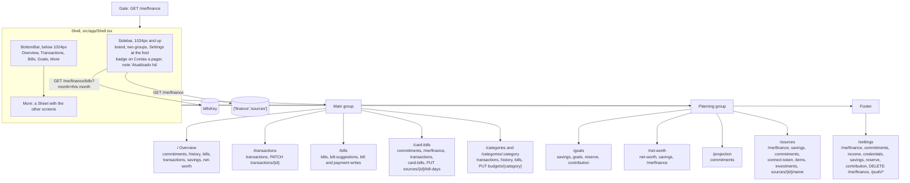

# Revenue, the finance app

Related: [ADR 0023](../adr/0023-move-finances-into-a-second-installable-app-named-revenue.md) (why Finances moves into its own app), [ADR 0022](../adr/0022-a-shared-bedrock-design-system-amends-0007-and-0009-for-adopting-apps.md) (Bedrock), [ADR 0019](../adr/0019-take-bank-data-from-pluggy-with-per-user-credentials-encrypted-by-the-app.md) (Pluggy). Design: [`docs/design/revenue/`](../design/revenue/README.md). Rules for changing it: [`revenue/CLAUDE.md`](../../revenue/CLAUDE.md). Terms: **User**, **Source**, **Bill**, **Goal**, **Investment** ([GLOSSARY.md](../../GLOSSARY.md)).

## What is built

Revenue is a second installable React app in `revenue/`, built on [Bedrock](bedrock.md). It shows a User their own money: Transactions, Bills, card bills, Spending Categories, Goals, Net worth, the Projection and the connected banks. It has eleven screens behind one frame; the Onboarding route is still a placeholder (planned: #647). Finances also still lives in the Homeowner PWA ([web.md](web.md)) until #649 removes it.

- **Its own origin and build.** A Vite app with its own `index.html`, manifest and service worker (`src/sw.ts`, push only; it precaches the app shell). In AWS it has its own private bucket and CloudFront distribution per environment (`module "revenue_web"` in `infra/staging` and `infra/production`, the same `infra/modules/web` as the PWA and the admin app), and the API lists its origin in `CORS_ALLOWED_ORIGINS`. It is the second member of the root npm workspace, after `bedrock`.
- **The same API and sign-in.** It calls the one Go API ([backend.md](backend.md)) with a Cognito ID token, signing in against the same user pool as the PWA with its own forms (`src/auth/`).
- **The gate.** After sign-in, `Gate` (`src/app/Gate.tsx`) calls `GET /me/finance` and mounts the app only on `200`. A `403` (not on the finance allowlist) shows "no access" with sign-out, a `401` signs out, and a `503` or network failure offers a retry. The gate only saves an outsider a screen of failing requests: the API's `403` on every `/me/finance` route is the control.
- **Its own notifications.** Settings subscribes the device with `PUT /push/subscription` and `app: "revenue"`, stored in `push_subscriptions.app` ([data model](data-model.md)), so Bill reminders reach Revenue's subscriptions, not the PWA's.

## The frame

Every path in the diagram is under `/me/finance` unless it starts with `/push`. `src/app/screens.tsx` is the one list of screens: `NAV_GROUPS` (Main: Overview, Transactions, Bills to pay, Card bills, Spending Categories; Planning: Goals, Net worth, Projection, Sources), `NAV_FOOTER` (Settings), `TABS` (the phone's four tabs) and `MORE` (the rest). Paths are English and stable (`/bills` is used by the deploy smoke test and the reminder payload); labels come from the i18n catalogs.

- **Shell** (`src/app/Shell.tsx`). From 1024px wide (`DESKTOP`, a copy of Bedrock's `--bp-desktop`) a sticky Bedrock `Sidebar` with `SidebarBrand`, the two groups and Settings at the foot. Contas a pagar carries a count badge: the Bills of this São Paulo month still to pay, read with `billsKey(thisMonth)`, the same query as the Bills screen, so marking one paid moves the badge at once; no badge while loading or after a failure, never "0". Above the footer, the note "Atualizado há 2 min" comes from `lastSyncedAt` of `GET /me/finance` through `timeAgo` (`src/shared/timeAgo.ts`, `Intl.RelativeTimeFormat`), or "importing" while the first import runs; a one-minute clock keeps it fresh. Below 1024px a sticky `BottomBar` with four tabs and "More", which opens a `Sheet` listing the other screens. The Shell also refreshes the device's push subscription on launch.
- **PageHeader** (`src/shared/PageHeader.tsx`). Every screen starts with it: the `<h1>` and a subtitle on the left, a `tools` slot on the right for `MonthSelect` and `HideValuesToggle`. Below 1024px it is the phone's one-line top bar.
- **The month** (`src/shared/month/`). `useMonthParam()` reads `?month=YYYY-MM`; a missing, malformed or future value is this month, counted in São Paulo (`saoPauloDay`), never on the device. Choosing this month leaves the URL bare, and other params (`?card=`) survive a change. `MonthSelect` is the header's dropdown of this month and the 11 before (an older month already in the URL is added). Screens with a month: Overview, Transactions, Bills, Card bills, Spending Categories. Goals, Net worth, Projection, Sources and Settings have none; Projection keeps its chosen month in local state, because `useMonthParam` refuses future months.
- **Hide values** (`src/shared/HideValues.tsx`). One toggle in the header masks money on every screen. It is a device preference in `localStorage` under `revenue.hideValues`, kept across sign-out and never sent to the API. Bedrock's `Amount`, `StatCard` and `ListRow` follow it through `useHiddenProps()`; chart axes, tooltips, `DonutChart`'s centre total and amounts inside plain strings do not, so each screen hides those itself. Input fields being edited (Settings) stay visible.
- **The grid.** A screen body is `grid gap-6 desktop:grid-cols-12` with cells `desktop:col-span-{3,4,5,6,7,8,12}`, one column below 1024px. The convention lives in `revenue/CLAUDE.md`; `docs/design/revenue/revenue.css` is not imported.
- **Side panels** are Bedrock's `Sheet`: a side panel from the tablet breakpoint, a bottom sheet on phones.

## The screens

Each screen is a domain folder under `src/domains/<name>/` with the layers of [ADR 0011](../adr/0011-split-each-domain-into-layer-folders.md): `api.ts` (Axios calls through `src/api/client.ts`), `hooks/` (TanStack Query), `logic/` (pure functions, unit-tested) and `components/`.

| Route | Domain folder | Reads | Writes | Sheets |
|---|---|---|---|---|
| `/` Overview | `overview` | `commitments?from=` (the month), `history?to=&months=2` (result and change against last month), `bills?month=`, `transactions?month=` (spending split), `savings` (Goals card), `net-worth?range=30d` (net worth and its month change) | none | The bills panel (`BillsAlert`) |
| `/transactions` | `transactions` | `transactions?month=` | `PATCH transactions/{id}` | `EditSheet` (detail), the filters sheet (`Toolbar`) |
| `/bills` Bills to pay | `bills` | `bills?month=` for the month and the next, `bill-suggestions` | `POST`/`PUT`/`DELETE bills`, `PUT`/`DELETE bills/{id}/payments/{month}`, `POST bill-suggestions/dismissals` | `BillFormSheet` |
| `/card-bills` Card bills | `card-bills` | `commitments?from=` (the month's card lines), `/me/finance` (card Sources, limit), `transactions?month=` (the bill's rows), `card-bills?source=` (closed bills and average) | `PUT sources/{id}/bill-days` | none |
| `/categories`, `/categories/:category` | `categories` | `transactions?month=`, `history?to=&months=2` on the list, 6 on one category, `bills?month=` (fixed Bills) | `PUT budgets/{category}` | `LimitsSheet` (every limit, on the list), the one-category limit sheet (`LimitForm`) |
| `/goals` | `goals` | `savings` | Goals (`POST`, `PUT`, `DELETE`, `PUT goals/order`), `PUT reserve`, `PUT contribution` | Goal and setting forms (`SettingSheet`) |
| `/net-worth` | `net-worth` | `net-worth?range=` (`30d`, `90d`, `1y`), `savings` and `/me/finance` for the row names | none | none |
| `/projection` | `projection` | `commitments?from=` (this month and the ones after) | none | none |
| `/sources` | `sources` | `/me/finance` (Sources, balances, limits, `items[]` with Ok or Reconectar), `savings` (Investments), `commitments?from=` (card totals) | `POST connect-token` and `POST items` (Pluggy Connect), `PUT sources/{id}/name`, Investments (`POST`, `PUT`, `DELETE`, `PUT investments/{id}/serves`, `POST investments/{id}/use-bank-value`) | Rename and Investment forms |
| `/settings` | `settings` | `/me/finance` (credentials saved), `commitments` (Monthly income), `savings` (reserve and contribution) | `PUT income`, `PUT`/`DELETE credentials`, `PUT reserve`, `PUT contribution`, `DELETE /me/finance`, `/push/*` | `CredentialsCard` |

Built differently from the artboards, on purpose: no notifications bell, no "Atualizar agora" (the API has no on-demand sync) and no "Reconectar" button on Sources (`POST connect-token` takes no Item id; the screen shows the badge and an explanation). The Card bills chart and average count closed bills only; Net worth offers no 7-day or "all" range and shows no card-bill change for the month (past bills are not stored). The bottom bar keeps five slots, Bills among them. Each screen's pull request lists the rest under "Differs from the design".

## Where state lives

- **Server state** is TanStack Query ([ADR 0013](../adr/0013-own-server-state-with-tanstack-query-over-one-axios-client.md)). Keys start with `"finance"`. Two are shared on purpose:
  - `billsKey(month)`, `["finance","bills",month,"rows"]` (`domains/bills/hooks/useBills.ts`): the Bills screen, the Sidebar badge, the Overview and the Spending Categories' fixed Bills read the same cache, so a payment shows everywhere at once.
  - `savingsKey`, `["finance","savings"]` (`domains/goals/hooks/useSavings.ts`): Goals, Sources (Investments), Settings (reserve and contribution), the Overview's Goals card and the Net worth row names. A write on any of them updates the others.
  - `GET /me/finance` is read under four keys, each for its own part: `["finance","me"]` (the Gate), `["finance","sources"]` (Sidebar note, Sources, Net worth names; polled every 5 seconds while importing), `["finance","status","card-sources"]` (Card bills) and `["finance","status","credentials"]` (Settings).
- **URL state**: `?month=` (shared, above), `?card=<sourceId>` on Card bills (the first card when absent) and `?range=` on Net worth (`30d` when absent).
- **Device state** in `localStorage`, never shared with Homeowner: `revenue.session`, `revenue.locale`, `revenue.theme` and `revenue.hideValues` ([development.md](../development.md)).

## Tests and checks

Vitest on jsdom with axe in `revenue/`: page tests per screen against a mocked API, unit tests of each `logic/` folder, and the frame's tests (`Shell.test.tsx`, `ShellFrame.test.tsx`, `Gate.test.tsx`). The `revenue-check` workflow runs typecheck, tests and the build on pull requests touching `revenue/` or `bedrock/`. The `ui-screenshots` check screenshots a `revenue/` change in pt-BR and dark mode at phone and desktop width against `.github/scripts/revenue-fake-api.mjs`, which must serve every field a screen reads.
