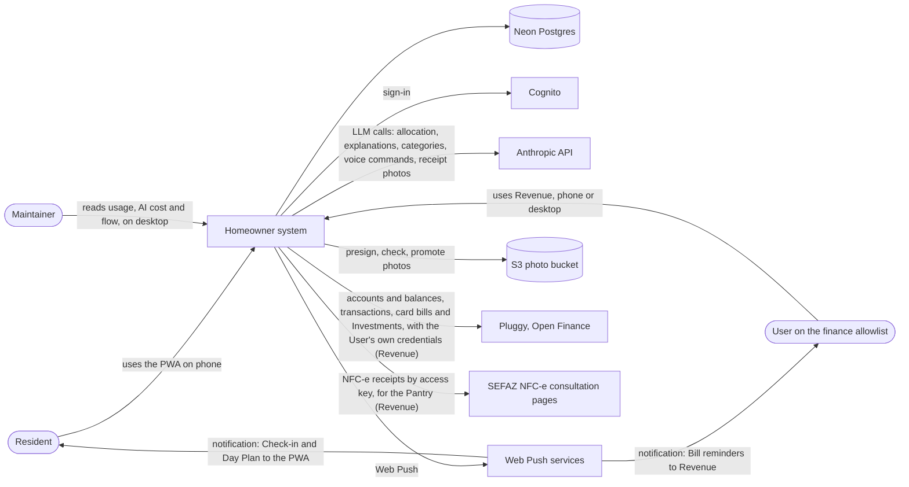
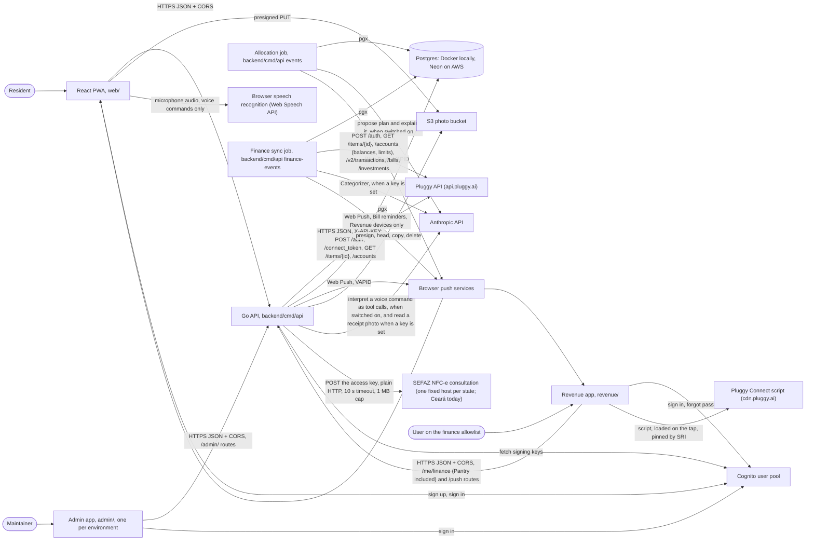

# System context and containers

Related: [ADR 0002](../adr/0002-mirror-the-work-stack.md), [ADR 0004](../adr/0004-ai-allocates-behind-a-deterministic-referee.md), [ADR 0005](../adr/0005-ship-a-react-pwa-not-a-native-app.md), [ADR 0023](../adr/0023-move-finances-into-a-second-installable-app-named-revenue.md). Terms: **Resident**, **Home**, **Allocation**, **Day Plan**, **Check-in** in [GLOSSARY.md](../../GLOSSARY.md).

## Context

There are three front ends. Residents use the Homeowner PWA for the housework. A User on the finance allowlist also uses Revenue, a second installable app, for their own money and their Pantry. The maintainer uses the admin dashboard to see how the system is doing. All three talk to the same backend (one API, one Cognito user pool and app client, one Postgres database), which depends on a few outside services. Dashed lines are planned.

## Containers

A container here is a separately running piece. The PWA, the admin app, the Revenue app, the API, the Allocation job, the finance sync job and Postgres run today; Cognito is an AWS-managed service. [Bedrock](bedrock.md), in `bedrock/`, is a shared component library that Revenue is built on, not a container: nothing runs or is deployed from it on its own.

| Container | Status | Notes |
|---|---|---|
| React PWA | Built (skeleton) | See [The React PWA](web.md). It is shown in en-US or pt-BR, chosen from the Language setting, kept on the device, or from the browser language until one is chosen. It is styled with Tailwind over light and dark colour tokens, and a Settings section (on the Me tab, and on the sign-in and onboarding screens) holds the appearance choice (System, Light or Dark), kept on the device. It uses `react-router` for four bottom tabs (Today, Chores, Home, Me), full-screen sign-in and onboarding routes, and a route guard (see [The React PWA](web.md#navigation)). The code is organised by domain module, with domain-free code in `web/src/shared/` ([ADR 0010](../adr/0010-organise-the-pwa-by-domain-module.md)); `domains/auth/components/PasswordField` is the password input with a Show password toggle, used on sign-in and sign-up. Vite + `vite-plugin-pwa`. It has a manifest (standalone display) and a precaching service worker. A slim banner shows the API's `/healthz` status only when it is unavailable or unreachable. Its screens cover sign-up, email confirmation and sign-in, and, once signed in, the email from `GET /me`, a Sign out button and the reminders controls. It reads `VITE_API_BASE_URL`, `VITE_COGNITO_REGION` and `VITE_COGNITO_CLIENT_ID` at build time, plus `VITE_PASSWORD_POLICY` (the pool's password rules as JSON). The pure module `domains/auth/logic/passwordPolicy.ts` parses that value and evaluates a password against it; `config.ts` fails the build and the app at startup if it is missing or malformed, and the sign-up password rules checklist (`domains/auth/components/PasswordRules`, announced through a debounced polite live region), its minimum length and the refused-password text are all derived from it. Sign-in never applies the policy, and Cognito stays the authority. The password policy comes from Terraform (the user pool is the one place the rules are written) through the deploy into the build, with no runtime fetch; see [Infrastructure](infrastructure.md). The `domains/auth/` folder calls the Cognito public API with `fetch` (no SDK) and keeps the ID and refresh tokens in `localStorage`; the one Axios client, `authedRequest` in `domains/auth/api/client.ts` ([ADR 0013](../adr/0013-own-server-state-with-tanstack-query-over-one-axios-client.md); server state is cached with TanStack Query, see [Data layer](web.md#data-layer)), adds the ID token as a bearer header, refreshes it shortly before it expires, and on a 401 refreshes and retries once, signing the person out only when Cognito rejects the refresh token or a fresh token is still refused. The service worker has no runtime caching, so it never sees tokens or passwords. |
| Admin app | Built | The maintainer's own React app in `admin/`, one build and one CloudFront distribution per environment ([ADR 0017](../adr/0017-operate-through-a-separate-admin-app-per-environment.md)): desktop-first, English only, no service worker, manifest or push. It signs in against the same Cognito pool and app client as the PWA, calls only the API's `/admin/` routes (`GET /admin/me` first, and the server's 403 for anyone outside the `super-admin` Cognito group is the real control), and shows the environment on every page, with a link to switch to the other one. It shares only the design tokens (`web/src/tokens.css`) with the PWA. Three pages: Overview, AI usage and Flow. See [The admin dashboard](admin.md). |
| Go API | Built (skeleton) | One HTTP server: `GET /healthz`, `GET /me`, `PUT /me/name`, the Home, `GET /home/residents`, Chores, Tasks and profile routes, `GET /home/day-plan` and the `/push/*` routes and the `/me/photo` routes (`POST /me/photo/uploads`, `PUT /me/photo`, `DELETE /me/photo`), the `/me/finance` route group (only for Users on the finance allowlist, 403 for everyone else; it calls Pluggy, the external Open Finance aggregator, through `internal/pluggy` with the User's own credentials, opened in memory only. The base URL is `PLUGGY_BASE_URL`; tests replay a sandbox capture and never call Pluggy), the Pantry's `/me/finance/pantry` routes inside that group, behind the same allowlist (items, ran out, the Shopping list, and receipts read from SEFAZ through `internal/nfce` or from a photo through the Anthropic API; see [the Pantry](backend.md#the-pantry)), `POST /home/voice/interpret` (turns a spoken command's transcript into proposed actions, each a request to an existing route that the PWA sends once the Resident confirms; `503` while `VOICE_ENABLED` is off, see [Voice commands](backend.md#voice-commands)), and the read-only `/admin/` routes for the admin app (`/admin/me`, `/admin/overview`, `/admin/ai`, `/admin/flow`), which need a token in the `super-admin` Cognito group. Routes other than `/healthz` and the VAPID key need a Cognito ID token. Runs in Docker locally and on Lambda behind API Gateway in staging and production (see [Infrastructure](infrastructure.md)). |
| Revenue app | Built | The finance app in `revenue/`, on [Bedrock](bedrock.md), with its own build, CloudFront distribution, manifest and service worker, installable on its own ([ADR 0023](../adr/0023-move-finances-into-a-second-installable-app-named-revenue.md)). Finances lives only here: the PWA no longer has it. It uses the same API, the same Cognito user pool and app client (sign-in and forgot password with its own forms) and so the same Postgres database and User row as the PWA. It mounts only after `GET /me/finance` answers 200, calls the `/me/finance` routes (the Pantry's `/me/finance/pantry` routes included) and the `/push` routes, loads the Pluggy Connect script to connect banks, opens the rear camera to scan a receipt's QR code (decoded in the page by `jsqr`; no frame leaves the device) and posts a downsized receipt photo for the photo fallback, and registers its devices with `app: "revenue"` so Bill reminders reach it. See [Revenue](revenue.md). |
| Postgres | Built | Postgres 16 in Docker Compose locally; a Neon branch per environment in staging and production. |
| Allocation job | Built | The same binary run as `api events` in a second Lambda, started every 15 minutes by EventBridge; it plans each due Home once a day, asking the LLM allocator first when it is switched on and falling back to the baseline allocator. After planning, the same tick has the LLM write each planned Home's Day Plan explanations (one call per Home, best effort), then sends the Check-in reminder (an hour before the Allocation time, to Residents who have not checked in) and the Day Plan ready push, best effort. On staging, a manual GitHub workflow (`replan-staging.yml`) invokes it to replan one Home; the API does not. See [Daily Allocation](allocation.md) and [ADR 0008](../adr/0008-scheduled-jobs-run-as-a-second-lambda-from-the-api-image.md). |
| Cognito | Built | Sign-up, email confirmation and sign-in. One user pool and one app client serve all three front ends, each calling Cognito directly: the PWA (sign-up, sign-in, forgot password), the admin app (sign-in only) and Revenue (sign-in and forgot password). The API verifies the ID token's signature against the pool's public keys; it never sees a password. |
| Finance sync job | Built | The same binary run as `api finance-events` in a third Lambda, started every hour by EventBridge; it imports an allowlisted User's last 12 months of Transactions from Pluggy in resumable monthly windows, then refreshes each User once a day. For each Item it also stores the bank connection status, each account's balance for the day (the history Net worth reads), each card's credit limit, every card's bills from Pluggy `GET /bills`, so a closed bill takes the bank's total ([ADR 0021](../adr/0021-a-closed-card-bill-takes-the-banks-total.md); a connector without `/bills` is logged and skipped, and that card keeps the computed bill), and the Item's Investments from `GET /investments`. After the sync, the same run sends the Bill reminders to the User's Revenue devices. See [the Transaction sync](backend.md) and [ADR 0008](../adr/0008-scheduled-jobs-run-as-a-second-lambda-from-the-api-image.md). |
| Pluggy Connect script | Built | A third-party script Revenue adds to the page only when a User taps Connect banks (on Sources or in Onboarding), from the exact URL and with the `integrity` hash of [ADR 0019](../adr/0019-take-bank-data-from-pluggy-with-per-user-credentials-encrypted-by-the-app.md), `crossorigin="anonymous"` (`revenue/src/domains/sources/logic/pluggyConnect.ts`). It runs in Revenue's origin, so the pin is the guard. The widget it opens talks to Pluggy and hands Revenue an item id, which Revenue registers with the API. See [Revenue](revenue.md). |
| Anthropic API | Built (allocator, explanations, Categorizer, voice commands, receipt photos) | Called from the Allocation job, the finance sync job and, for voice commands and receipt photos, the API. The LLM allocator: one Messages API call per Home per day from the Allocation job, Claude Haiku 5.5 through the official Go SDK with structured output, off unless switched on per environment, key in SSM. The Day Plan explanations are a second call per Home, after planning, through the same client and key, sharing the per-Home daily cap (so 2 of the default 3 calls on a normal day). Only opaque ids, numbers and fixed vocabulary are sent, never names or Chore titles. The finance sync also uses it as the Categorizer: batches of up to 100 normalised bank merchant keys (letters only; never an amount, date, account or id; never keys starting PIX, TED, DOC or TRANSF), answered as an index and one of 13 category ids, at most 10 calls per User per day. Voice commands are the first exception to "no titles or user text" ([ADR 0020](../adr/0020-voice-commands-send-chore-titles-and-the-residents-words-behind-a-confirmation.md)): the API Lambda sends the transcript, the caller's own Home's Chore titles and today's open Tasks by their relation to the caller, with six tools and a forced tool call, at most 20 calls per Resident per day, through the same client, model and key; never Energy, Restrictions, names or another Home. Nothing changes until the Resident confirms in the PWA. Switched on per environment by `VOICE_ENABLED` (staging only for now). Receipt photos are the second ([ADR 0026](../adr/0026-read-grocery-receipts-from-sefaz-with-an-ai-read-photo-as-a-confirmed-fallback.md), which counts them as the third exception to the models' blindness, after the Categorizer and voice): when SEFAZ cannot be read, a User may send a photo of a grocery receipt, which the API Lambda passes as one JPEG of at most 1.5 MB, with a strict JSON Schema (store, CNPJ, optional access key, date, total and lines; no field for the consumer's CPF), at most 10 calls per User per day (São Paulo date, `finance_pantry_photo_calls`) and a 20 second limit per call, through the same client, model and key. The photo is never stored or logged; the answer is validated in Go and nothing is saved until the User confirms the draft in Revenue. On whenever the API has an Anthropic key, not behind `VOICE_ENABLED`. |
| SEFAZ NFC-e consultation | Built (Ceará only) | The state tax authorities' public pages that show an NFC-e (a consumer receipt) by its 44-digit access key, free and unauthenticated ([ADR 0026](../adr/0026-read-grocery-receipts-from-sefaz-with-an-ai-read-photo-as-a-confirmed-fallback.md)). Only the API Lambda calls it, through `internal/nfce`, when a User adds a receipt to the Pantry. The host comes from a fixed table in Go keyed by the state code in the key's first two digits (`nfce.Hosts`; today only Ceará, `23`, over plain HTTP because Go does not trust its ICP-Brasil certificate chain), so a URL the User types or scans is never fetched as given; a redirect to another host is refused. A state not in the table answers `422 unsupported_state`, and an unreachable or changed page `502 sefaz_unavailable`, after which Revenue offers the photo. Tests run the real adapter against a fake server replaying a captured page (`nfcetest`) and never call SEFAZ. |
| Browser speech recognition | Built (voice commands) | The browser's own Web Speech API (`SpeechRecognition`, or `webkitSpeechRecognition` in Safari), in the app's locale. The audio goes only to the browser's own speech service; only the transcript reaches our API, and it is neither stored nor logged. Where the browser has none (Firefox) the microphone button is not shown. See [Voice commands](web.md#voice-commands). |
| S3 photo bucket | Built (API side; the bucket is [#230](https://github.com/AbnerWillclefy/Homeowner/issues/230)) | A private bucket for User photos, reached through the API's `photos.ObjectStore` adapter (`PHOTOS_BUCKET`, `PHOTOS_BASE_URL`; both or neither, and the photo routes answer 503 when off). The API signs a 5-minute presigned PUT that binds the type (WebP or JPEG) and exact size (up to 512 KB) to a `pending/<user id>/...` key; the browser uploads straight to the bucket; the API then checks the object (size, type, magic bytes), copies it to a public `avatars/...` key and stores that key on the User. The role that signs must itself hold `s3:PutObject`; the API role holds `s3:ListBucket` on the bucket, so S3 answers 404 (not 403) for a missing key and only a 404 is treated as not found. |
| Web Push | Built | Standard Web Push sent from Go with VAPID keys (private key in SSM), best-effort ([ADR 0005](../adr/0005-ship-a-react-pwa-not-a-native-app.md)). The API stores one subscription per device, owned by a signed-in User, and can send a test notification. Each subscription records the app it was made in (`push_subscriptions.app`, `homeowner` or `revenue`). The Allocation job sends the Check-in reminder and the Day Plan ready notification to every PWA device of the Resident's User, and the finance sync job sends Bill reminders to the User's Revenue devices only, each with a `kind` that app's service worker words in the device language; sends are at most once and a failure never affects Allocation or the sync. |

CORS (cross-origin resource sharing) is how the API tells the browser that the PWA's origin, and its own environment's admin and Revenue origins, may call it. The allowed origins come from `CORS_ALLOWED_ORIGINS`. CORS is not access control: the admin routes are protected by the `super-admin` check and the finance routes by the finance allowlist, not by the origin list.
