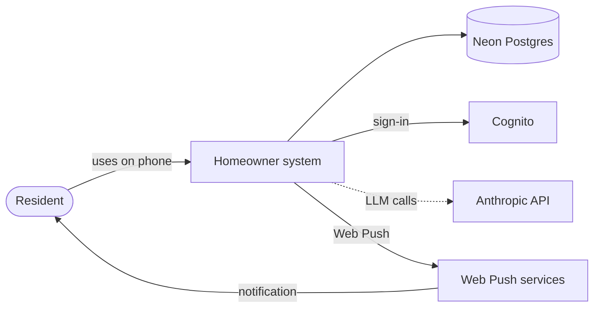
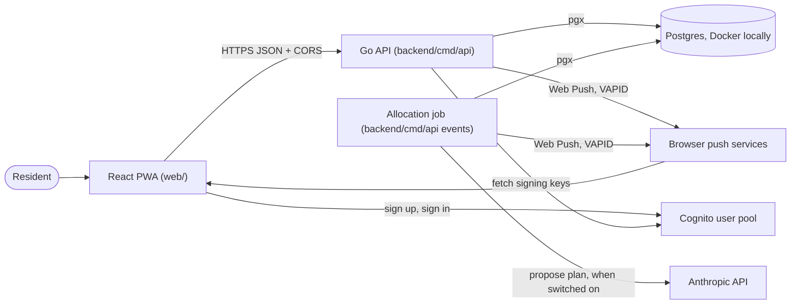

# System context and containers

Related: [ADR 0002](../adr/0002-mirror-the-work-stack.md), [ADR 0004](../adr/0004-ai-allocates-behind-a-deterministic-referee.md), [ADR 0005](../adr/0005-ship-a-react-pwa-not-a-native-app.md). Terms: **Resident**, **Home**, **Allocation**, **Day Plan**, **Check-in** in [CONTEXT.md](../../CONTEXT.md).

## Context

Residents use one app. It talks to our own backend, which depends on a few outside services. Dashed lines are planned.

## Containers

A container here is a separately running piece. The PWA, the API and Postgres run today; Cognito is an AWS-managed service.

| Container | Status | Notes |
|---|---|---|
| React PWA | Built (skeleton) | See [The React PWA](web.md). It is shown in en-US or pt-BR, chosen from the Language setting, kept on the device, or from the browser language until one is chosen. It is styled with Tailwind over light and dark colour tokens, and a Settings section (on the Me tab, and on the sign-in and onboarding screens) holds the appearance choice (System, Light or Dark), kept on the device. It uses `react-router` for four bottom tabs (Today, Chores, Home, Me), full-screen sign-in and onboarding routes, and a route guard (see [The React PWA](web.md#navigation)). The code is organised by domain module, with domain-free code in `web/src/shared/` ([ADR 0010](../adr/0010-organise-the-pwa-by-domain-module.md)); `domains/auth/components/PasswordField` is the password input with a Show password toggle, used on sign-in and sign-up. Vite + `vite-plugin-pwa`. It has a manifest (standalone display) and a precaching service worker. A slim banner shows the API's `/healthz` status only when it is unavailable or unreachable. Its screens cover sign-up, email confirmation and sign-in, and, once signed in, the email from `GET /me`, a Sign out button and the reminders controls. It reads `VITE_API_BASE_URL`, `VITE_COGNITO_REGION` and `VITE_COGNITO_CLIENT_ID` at build time, plus `VITE_PASSWORD_POLICY` (the pool's password rules as JSON). The pure module `domains/auth/logic/passwordPolicy.ts` parses that value and evaluates a password against it; `config.ts` fails the build and the app at startup if it is missing or malformed, and the sign-up password rules checklist (`domains/auth/components/PasswordRules`, announced through a debounced polite live region), its minimum length and the refused-password text are all derived from it. Sign-in never applies the policy, and Cognito stays the authority. The password policy comes from Terraform (the user pool is the one place the rules are written) through the deploy into the build, with no runtime fetch; see [Infrastructure](infrastructure.md). The `domains/auth/` folder calls the Cognito public API with `fetch` (no SDK) and keeps the ID and refresh tokens in `localStorage`; `domains/auth/api/request.ts` (`authedFetch`) adds the ID token as a bearer header, refreshes it shortly before it expires, and on a 401 refreshes and retries once, signing the person out only when Cognito rejects the refresh token or a fresh token is still refused. The service worker has no runtime caching, so it never sees tokens or passwords. |
| Go API | Built (skeleton) | One HTTP server: `GET /healthz`, `GET /me`, the Home, Chores, Tasks and profile routes, `GET /home/day-plan` and the `/push/*` routes. Routes other than `/healthz` and the VAPID key need a Cognito ID token. Runs in Docker today; the Lambda wrapper is planned. |
| Postgres | Built locally | Postgres 16 in Docker Compose. Neon in staging and production is planned. |
| Allocation job | Built | The same binary run as `api events` in a second Lambda, started every 15 minutes by EventBridge; it plans each due Home once a day, asking the LLM allocator first when it is switched on and falling back to the baseline allocator. After planning, the same tick sends the Check-in reminder (an hour before the Allocation time, to Residents who have not checked in) and the Day Plan ready push, best effort. See [Daily Allocation](allocation.md) and [ADR 0008](../adr/0008-scheduled-jobs-run-as-a-second-lambda-from-the-api-image.md). |
| Cognito | Built | Sign-up, email confirmation and sign-in (the PWA calls Cognito directly). The API verifies the ID token's signature against the pool's public keys; it never sees a password. |
| Anthropic API | Built (allocator) | The LLM allocator: one Messages API call per Home per day from the Allocation job, Claude Haiku 5.5 through the official Go SDK with structured output, off unless switched on per environment, key in SSM. Only opaque ids, numbers and fixed vocabulary are sent, never names or Chore titles. Day Plan explanations are planned. |
| Web Push | Built | Standard Web Push sent from Go with VAPID keys (private key in SSM), best-effort ([ADR 0005](../adr/0005-ship-a-react-pwa-not-a-native-app.md)). The API stores one subscription per device, owned by a signed-in User, and can send a test notification. The Allocation job sends the Check-in reminder and the Day Plan ready notification to every device of the Resident's User, with a `kind` the service worker words in the device language; sends are at most once and a failure never affects Allocation. |

CORS (cross-origin resource sharing) is how the API tells the browser that the PWA's origin may call it. The allowed origins come from `CORS_ALLOWED_ORIGINS`.
