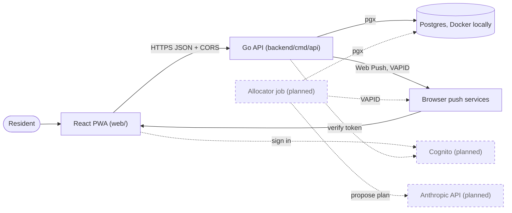

# System context and containers

Related: [ADR 0002](../adr/0002-mirror-the-work-stack.md), [ADR 0004](../adr/0004-ai-allocates-behind-a-deterministic-referee.md), [ADR 0005](../adr/0005-ship-a-react-pwa-not-a-native-app.md). Terms: **Resident**, **Home**, **Allocation**, **Day Plan**, **Check-in** in [CONTEXT.md](../../CONTEXT.md).

## Context

Residents use one app. It talks to our own backend, which depends on a few outside services. Dashed lines are planned.

## Containers

A container here is a separately running piece. Only three exist today: the PWA, the API and Postgres.

| Container | Status | Notes |
|---|---|---|
| React PWA | Built (skeleton) | Vite + `vite-plugin-pwa`. It has a manifest (standalone display) and a precaching service worker, and its only screen shows the API's `/healthz` status. It reads the API URL from `VITE_API_BASE_URL` at build time. |
| Go API | Built (skeleton) | One HTTP server: `GET /healthz` and the `/push/*` routes. Runs in Docker today; the Lambda wrapper is planned. |
| Postgres | Built locally | Postgres 16 in Docker Compose. Neon in staging and production is planned. |
| Allocator job | Planned | Second entry point, run on a schedule. See [Daily Allocation](allocation.md). |
| Cognito | Planned | Sign-in; the API will verify its tokens. |
| Anthropic API | Planned | The LLM allocator and Day Plan explanations. |
| Web Push | Built (test send) | Standard Web Push sent from Go with VAPID keys (private key in SSM), best-effort ([ADR 0005](../adr/0005-ship-a-react-pwa-not-a-native-app.md)). The API stores one subscription per device and can send a test notification; scheduled nudges from the Allocator job are planned. |

CORS (cross-origin resource sharing) is how the API tells the browser that the PWA's origin may call it. The allowed origins come from `CORS_ALLOWED_ORIGINS`.
