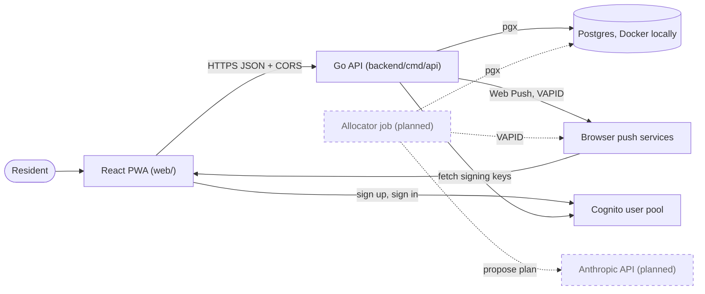

# System context and containers

Related: [ADR 0002](../adr/0002-mirror-the-work-stack.md), [ADR 0004](../adr/0004-ai-allocates-behind-a-deterministic-referee.md), [ADR 0005](../adr/0005-ship-a-react-pwa-not-a-native-app.md). Terms: **Resident**, **Home**, **Allocation**, **Day Plan**, **Check-in** in [CONTEXT.md](../../CONTEXT.md).

## Context

Residents use one app. It talks to our own backend, which depends on a few outside services. Dashed lines are planned.

## Containers

A container here is a separately running piece. The PWA, the API and Postgres run today; Cognito is an AWS-managed service.

| Container | Status | Notes |
|---|---|---|
| React PWA | Built (skeleton) | See [The React PWA](web.md). It is shown in en-US or pt-BR, chosen from the browser language (the sign-in screens are still English). It is styled with Tailwind over light and dark colour tokens, and a Settings section at the bottom of the home screen holds the appearance choice (System, Light or Dark), kept on the device. Vite + `vite-plugin-pwa`. It has a manifest (standalone display) and a precaching service worker. Its screens show the API's `/healthz` status, sign-up, email confirmation and sign-in, and, once signed in, the email from `GET /me`, a Sign out button and the reminders controls. It reads `VITE_API_BASE_URL`, `VITE_COGNITO_REGION` and `VITE_COGNITO_CLIENT_ID` at build time. The deploy also delivers `VITE_PASSWORD_POLICY`, but the app reads it only once #65 lands. The password policy comes from Terraform (the user pool is the one place the rules are written) through the deploy into the build, with no runtime fetch; see [Infrastructure](infrastructure.md). The `auth/` folder calls the Cognito public API with `fetch` (no SDK) and keeps the ID and refresh tokens in `localStorage`; `api/request.ts` (`authedFetch`) adds the ID token as a bearer header, refreshes it shortly before it expires, and on a 401 refreshes and retries once, signing the person out only when Cognito rejects the refresh token or a fresh token is still refused. The service worker has no runtime caching, so it never sees tokens or passwords. |
| Go API | Built (skeleton) | One HTTP server: `GET /healthz`, `GET /me` and the `/push/*` routes. Routes other than `/healthz` and the VAPID key need a Cognito ID token. Runs in Docker today; the Lambda wrapper is planned. |
| Postgres | Built locally | Postgres 16 in Docker Compose. Neon in staging and production is planned. |
| Allocator job | Planned | Second entry point, run on a schedule. See [Daily Allocation](allocation.md). |
| Cognito | Built | Sign-up, email confirmation and sign-in (the PWA calls Cognito directly). The API verifies the ID token's signature against the pool's public keys; it never sees a password. |
| Anthropic API | Planned | The LLM allocator and Day Plan explanations. |
| Web Push | Built (test send) | Standard Web Push sent from Go with VAPID keys (private key in SSM), best-effort ([ADR 0005](../adr/0005-ship-a-react-pwa-not-a-native-app.md)). The API stores one subscription per device, owned by a signed-in User, and can send a test notification; scheduled nudges from the Allocator job are planned. |

CORS (cross-origin resource sharing) is how the API tells the browser that the PWA's origin may call it. The allowed origins come from `CORS_ALLOWED_ORIGINS`.
