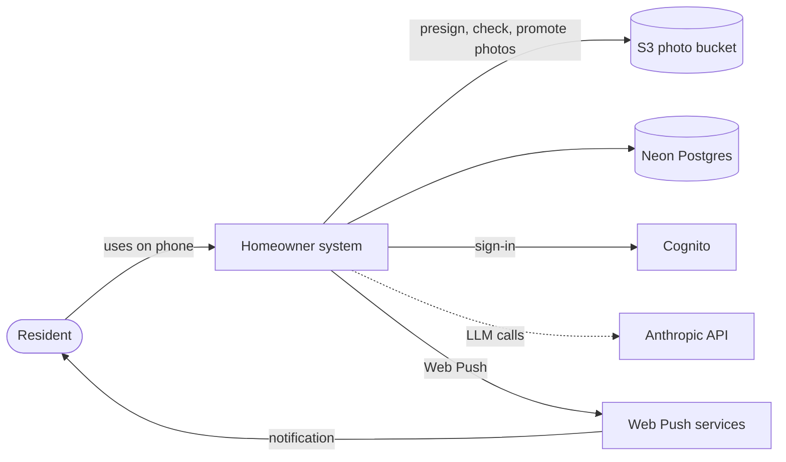
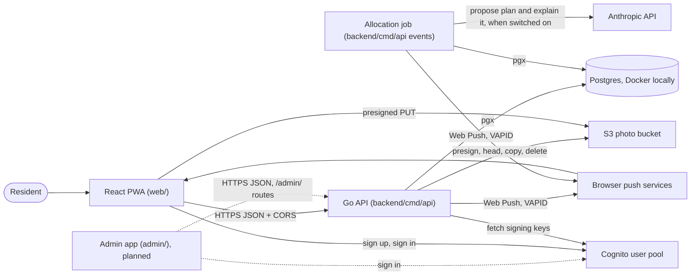

# System context and containers

Related: [ADR 0002](../adr/0002-mirror-the-work-stack.md), [ADR 0004](../adr/0004-ai-allocates-behind-a-deterministic-referee.md), [ADR 0005](../adr/0005-ship-a-react-pwa-not-a-native-app.md). Terms: **Resident**, **Home**, **Allocation**, **Day Plan**, **Check-in** in [CONTEXT.md](../../CONTEXT.md).

## Context

Residents use one app. It talks to our own backend, which depends on a few outside services. Dashed lines are planned.

## Containers

A container here is a separately running piece. The PWA, the API and Postgres run today; Cognito is an AWS-managed service.

| Container | Status | Notes |
|---|---|---|
| React PWA | Built (skeleton) | See [The React PWA](web.md). It is shown in en-US or pt-BR, chosen from the Language setting, kept on the device, or from the browser language until one is chosen. It is styled with Tailwind over light and dark colour tokens, and a Settings section (on the Me tab, and on the sign-in and onboarding screens) holds the appearance choice (System, Light or Dark), kept on the device. It uses `react-router` for four bottom tabs (Today, Chores, Home, Me), full-screen sign-in and onboarding routes, and a route guard (see [The React PWA](web.md#navigation)). The code is organised by domain module, with domain-free code in `web/src/shared/` ([ADR 0010](../adr/0010-organise-the-pwa-by-domain-module.md)); `domains/auth/components/PasswordField` is the password input with a Show password toggle, used on sign-in and sign-up. Vite + `vite-plugin-pwa`. It has a manifest (standalone display) and a precaching service worker. A slim banner shows the API's `/healthz` status only when it is unavailable or unreachable. Its screens cover sign-up, email confirmation and sign-in, and, once signed in, the email from `GET /me`, a Sign out button and the reminders controls. It reads `VITE_API_BASE_URL`, `VITE_COGNITO_REGION` and `VITE_COGNITO_CLIENT_ID` at build time, plus `VITE_PASSWORD_POLICY` (the pool's password rules as JSON), and the optional `VITE_REPLAN_ENABLED` (`true` shows the staging-only "Replan now" button on the Day Plan; unset means off, see [The React PWA](web.md#today-the-day-plan)). The pure module `domains/auth/logic/passwordPolicy.ts` parses that value and evaluates a password against it; `config.ts` fails the build and the app at startup if it is missing or malformed, and the sign-up password rules checklist (`domains/auth/components/PasswordRules`, announced through a debounced polite live region), its minimum length and the refused-password text are all derived from it. Sign-in never applies the policy, and Cognito stays the authority. The password policy comes from Terraform (the user pool is the one place the rules are written) through the deploy into the build, with no runtime fetch; see [Infrastructure](infrastructure.md). The `domains/auth/` folder calls the Cognito public API with `fetch` (no SDK) and keeps the ID and refresh tokens in `localStorage`; the one Axios client, `authedRequest` in `domains/auth/api/client.ts` ([ADR 0013](../adr/0013-own-server-state-with-tanstack-query-over-one-axios-client.md); server state is cached with TanStack Query, see [Data layer](web.md#data-layer)), adds the ID token as a bearer header, refreshes it shortly before it expires, and on a 401 refreshes and retries once, signing the person out only when Cognito rejects the refresh token or a fresh token is still refused. The service worker has no runtime caching, so it never sees tokens or passwords. |
| Admin app | Planned (shell built in `admin/`, [#323](https://github.com/AbnerWillclefy/Homeowner/issues/323)) | The maintainer's own React app, one per environment ([ADR 0017](../adr/0017-operate-through-a-separate-admin-app-per-environment.md)): desktop-first, English only, no service worker, manifest or push. It signs in against the same Cognito pool and app client as the PWA, calls only the API's `/admin/` routes (`GET /admin/me` first, and the server's 403 is the real control), and shows the environment on every page. It shares only the design tokens (`web/src/tokens.css`) with the PWA. Deployment is [#329](https://github.com/AbnerWillclefy/Homeowner/issues/329); `admin.md` is written by [#332](https://github.com/AbnerWillclefy/Homeowner/issues/332). |
| Go API | Built (skeleton) | One HTTP server: `GET /healthz`, `GET /me`, `PUT /me/name`, the Home, `GET /home/residents`, Chores, Tasks and profile routes, `GET /home/day-plan` and the `/push/*` routes and the `/me/photo` routes (`POST /me/photo/uploads`, `PUT /me/photo`, `DELETE /me/photo`). Routes other than `/healthz` and the VAPID key need a Cognito ID token. Runs in Docker today; the Lambda wrapper is planned. |
| Postgres | Built locally | Postgres 16 in Docker Compose. Neon in staging and production is planned. |
| Allocation job | Built | The same binary run as `api events` in a second Lambda, started every 15 minutes by EventBridge; it plans each due Home once a day, asking the LLM allocator first when it is switched on and falling back to the baseline allocator. After planning, the same tick has the LLM write each planned Home's Day Plan explanations (one call per Home, best effort), then sends the Check-in reminder (an hour before the Allocation time, to Residents who have not checked in) and the Day Plan ready push, best effort. See [Daily Allocation](allocation.md) and [ADR 0008](../adr/0008-scheduled-jobs-run-as-a-second-lambda-from-the-api-image.md). |
| Cognito | Built | Sign-up, email confirmation and sign-in (the PWA calls Cognito directly). The API verifies the ID token's signature against the pool's public keys; it never sees a password. |
| Anthropic API | Built (allocator and explanations) | The LLM allocator: one Messages API call per Home per day from the Allocation job, Claude Haiku 5.5 through the official Go SDK with structured output, off unless switched on per environment, key in SSM. The Day Plan explanations are a second call per Home, after planning, through the same client and key, sharing the per-Home daily cap (so 2 of the default 3 calls on a normal day). Only opaque ids, numbers and fixed vocabulary are sent, never names or Chore titles. |
| S3 photo bucket | Built (API side; the bucket is [#230](https://github.com/AbnerWillclefy/Homeowner/issues/230)) | A private bucket for User photos, reached through the API's `photos.ObjectStore` adapter (`PHOTOS_BUCKET`, `PHOTOS_BASE_URL`; both or neither, and the photo routes answer 503 when off). The API signs a 5-minute presigned PUT that binds the type (WebP or JPEG) and exact size (up to 512 KB) to a `pending/<user id>/...` key; the browser uploads straight to the bucket; the API then checks the object (size, type, magic bytes), copies it to a public `avatars/...` key and stores that key on the User. The role that signs must itself hold `s3:PutObject`; the API role holds `s3:ListBucket` on the bucket, so S3 answers 404 (not 403) for a missing key and only a 404 is treated as not found. |
| Web Push | Built | Standard Web Push sent from Go with VAPID keys (private key in SSM), best-effort ([ADR 0005](../adr/0005-ship-a-react-pwa-not-a-native-app.md)). The API stores one subscription per device, owned by a signed-in User, and can send a test notification. The Allocation job sends the Check-in reminder and the Day Plan ready notification to every device of the Resident's User, with a `kind` the service worker words in the device language; sends are at most once and a failure never affects Allocation. |

CORS (cross-origin resource sharing) is how the API tells the browser that the PWA's origin may call it. The allowed origins come from `CORS_ALLOWED_ORIGINS`.
