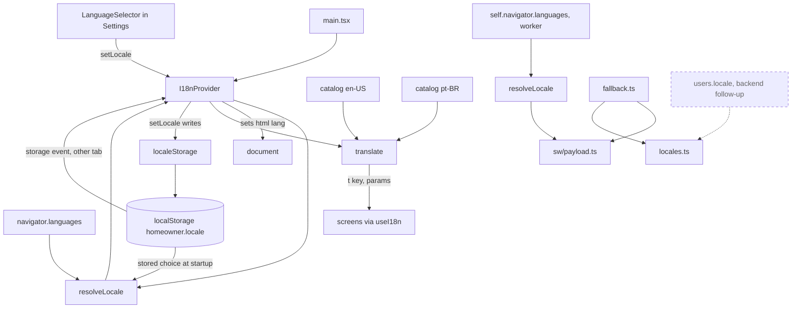
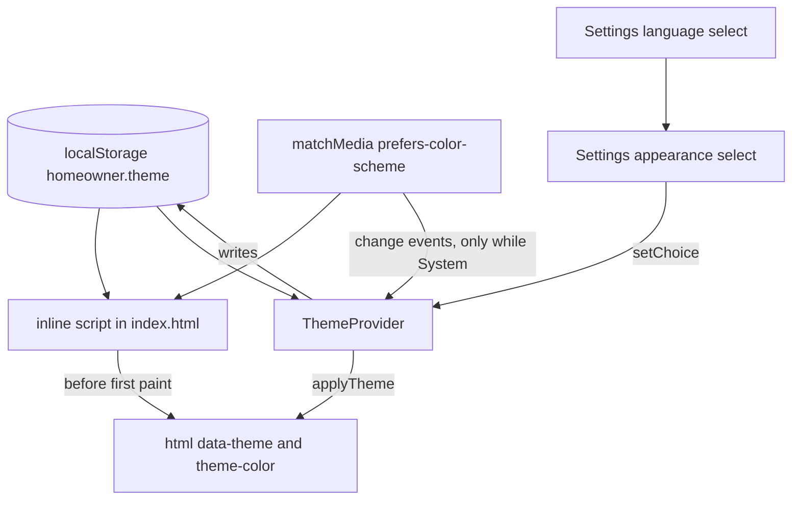
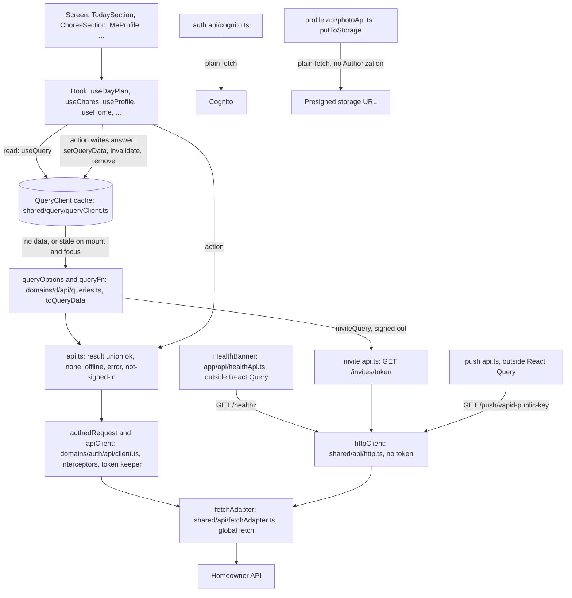
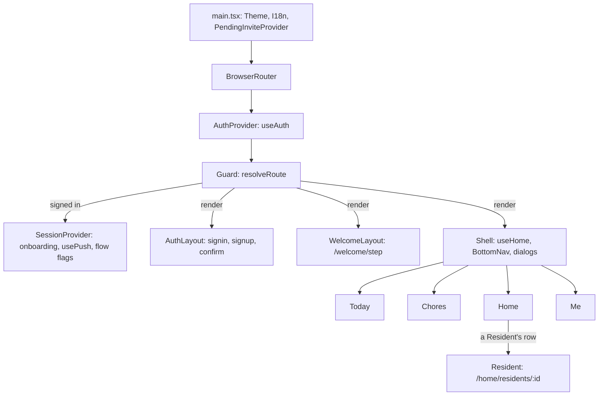
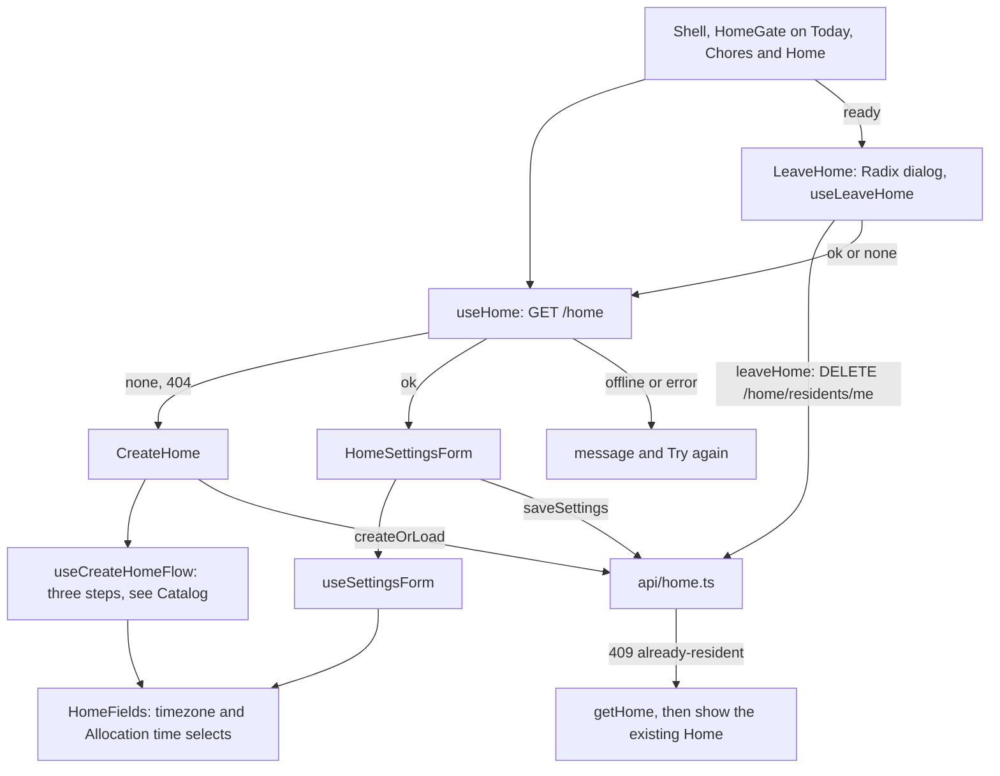
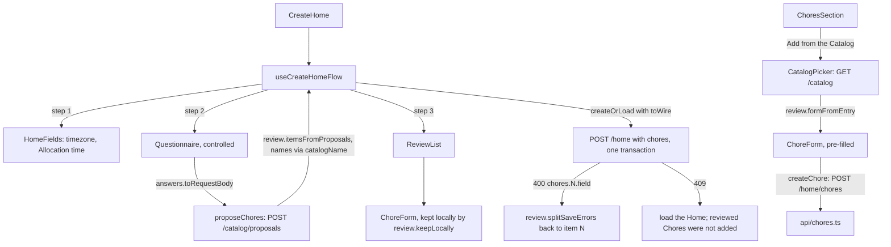
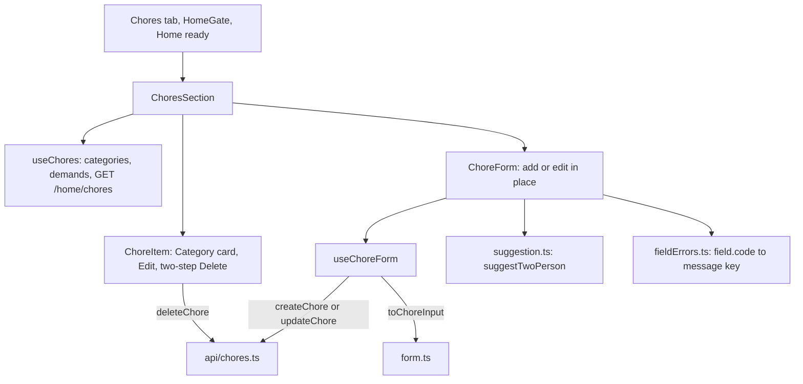
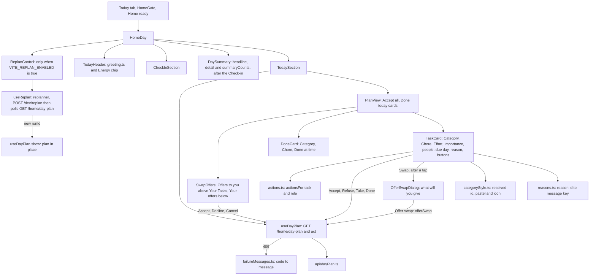
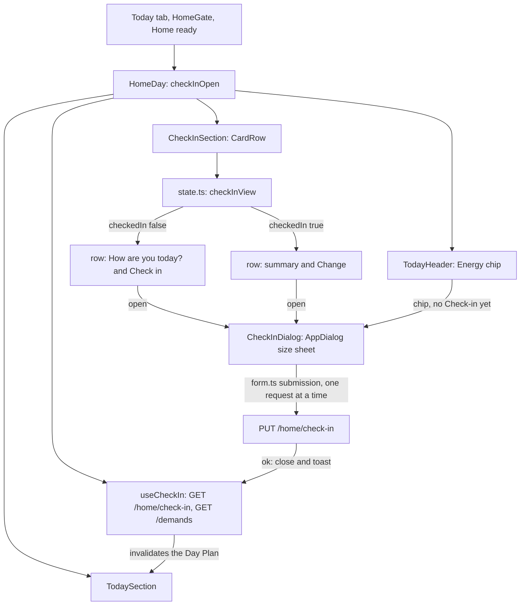
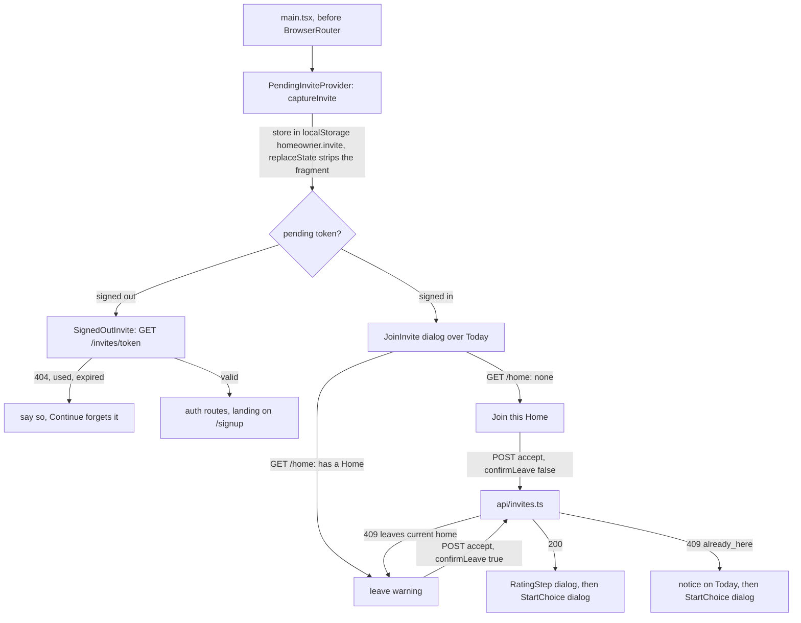

# The React PWA

Related: [ADR 0005](../adr/0005-ship-a-react-pwa-not-a-native-app.md), [ADR 0006](../adr/0006-localize-with-a-small-typed-module.md), [ADR 0007](../adr/0007-tailwind-and-radix-for-an-accessible-calm-ui.md). Terms: **Resident**, **Home** in [CONTEXT.md](../../CONTEXT.md).

The PWA is one Vite app in `web/`, installed to the Home Screen. It has a precaching service worker and no runtime caching. A *PWA* (progressive web app) is a website that can be installed and work offline.

## Modules

| Folder | Status | What it does |
|---|---|---|
| `src/shared/` | Built | Code that belongs to no domain ([ADR 0010](../adr/0010-organise-the-pwa-by-domain-module.md), [ADR 0011](../adr/0011-split-each-domain-into-layer-folders.md)). Nothing in it imports a domain module. |
| `src/shared/i18n/` | Built | Language: which locale to show and every user-facing string for it. Detailed below. |
| `src/shared/theme/` | Built | Appearance: System, Light or Dark, and applying it. Detailed under UI layer. |
| `src/shared/ui/` | Built | Generic pieces on semantic tokens: `Button`, `ButtonRow`, `Card`, `CardRow`, `StatTile`, `AppDialog`, `FormError`, and the foundations `ToastProvider`/`useToast`, `useSubmitOnce` and `useStableHandlers`. Detailed under Type, layout and components. |
| `src/app/` | Built | Navigation: the routes, the route guard (`resolveRoute`), the shell with the bottom nav and the dialogs over Today, the signed-in session state, and the health banner with its `/healthz` client. Detailed under Navigation below. |
| `src/domains/settings/` | Built | The Appearance and Language controls. On the Me tab each is its own titled card; the welcome screens show both under one Settings heading, and the sign-in, sign-up and confirm screens show them side by side in one compact card at the bottom of `AuthLayout`. |
| `src/domains/auth/` | Built | Sign-up, confirmation, sign-in and token handling against Cognito, `GET /me` (`meApi.ts`, read through `meQuery` in `api/queries.ts`; see Data layer), the Axios client (`api/client.ts`, [ADR 0013](../adr/0013-own-server-state-with-tanstack-query-over-one-axios-client.md): `createApiClient` and `authedRequest`, which add the bearer token, refresh it, and retry once on a 401; every authenticated API call goes through it; absolute URLs are refused; it runs over `shared/api/fetchAdapter.ts`, which calls the global `fetch(url, init)`; the unauthenticated calls use the plain `httpClient` in `shared/api/http.ts`, and the presigned photo PUT and the Cognito calls stay on `fetch`), the pure token keeper (`logic/tokenKeeper.ts`: the refresh margin, one shared in-flight refresh and the replaced-token check; `api/browserKeeper.ts` is the one instance the Axios client uses), a synchronous `errorCode(AxiosResponse)` in `client.ts` (the `error` code of an API error body, shared by the invite, profile and Day Plan clients), and `PasswordField` and `PasswordRules`. The three screens are `Card`s with `Button` submits; a failure is worded by the pure `failureText.ts` (every message says what to do next, and `failureField` names the field it is about) and announced in a `FormError` live region above the submit button, with `aria-describedby` and `aria-invalid` on the field it concerns. |
| `src/domains/home/` | Built | The Home section: create form and settings form for the Home's timezone and Allocation time. Detailed below. |
| `src/domains/chores/` | Built | The Chores section inside the Home section: list, add and edit form with every field, inline two-step delete, and the non-blocking two-person suggestion. Effort shows as five named levels (`effortLevels.ts`) and the repeat interval as presets (`intervalPresets.ts`: Daily 1, Weekly 7, Every 2 weeks 14, Monthly 30 days, or Custom), both pure mappings over the unchanged wire numbers. Detailed below. |
| `src/domains/catalog/` | Built | The Catalog on the PWA: the questionnaire about a Home, the review of suggested Chores, the picker for adding a Catalog Chore later, and the pure logic behind them. Detailed under Catalog below. |
| `src/domains/dayplan/` | Built | The Today tab's greeting and Energy chip (`TodayHeader`) and today's Day Plan as Category-coloured `TaskCard`s (your Tasks, other Residents' Tasks, the pool and its reasons), with the buttons to accept, refuse, take and complete a Task and neutral Done today cards (`DoneCard`). Detailed below. |
| `src/domains/checkin/` | Built | Today's Check-in: a compact row on Today (prompt or summary, with Check in or Change) that opens the form in a near-full-height dialog, and the pure state and form logic, including the Energy chip's `energyNote`. Detailed under Check-in below. |
| `src/domains/streak/` | Built | The Resident's current Streak on Today: `getStreak` over `GET /home/streak`, a reload hook and a calm card. Detailed under Streak below. |
| `src/domains/residents/` | Built | The Home's Residents and how to show one: `getResidents` over `GET /home/residents`, `useResidents`, the shared `Avatar` and the Home tab's `ResidentsCard` (rows, skeleton rows, inline error) and the Resident page (`getResident`, `useResident`, `ResidentPage`, the pure `dayHeading`). Detailed under Residents below. |
| `src/domains/invite/` | Built | Joining a Home from an Invite link (signed out and signed in, with the leave warning), the rating step after joining, and sharing an Invite from the Home section. Detailed below. |
| `src/domains/onboarding/` | Built | The walk a new User takes before the dashboard: install, reminders, Baseline, Restrictions, Preferences, then the Home, each step a short heading and its fields. Detailed under Onboarding below. |
| `src/domains/profile/` | Built | The Me tab's Baseline, Preferences and Restrictions cards (the folder keeps its name; no text says "Profile"): Baseline per weekday as Low, Normal or High (a radio group per day, saved on pick; see Baseline levels below), Preference per Category and Restrictions on Demands. Each control saves on its own, optimistically, and is undone with a visible message if the API refuses. The Category and Demand lists come from the API; an id with no translation shows as the id. Logic is in pure modules (`baselineLevels`, `changes`, `labels`, `weekdays`); `useProfile` holds the state. `ProfileSections` holds the three parts (Baseline, Preferences, Restrictions) and the save status as heading-less components, so `MeProfile` (three titled cards sharing one `useProfile()` call and one status live region, with the rest of the Me tab passed as children so it still shows when the load fails) and each onboarding step compose the same code. `PreferenceFields` hides Other (`preferenceCategories`, UI only): a stored Preference on it stays in the profile and Allocation still uses it, but it cannot be changed, and Chores still offer Other because nothing filters it. Each Preference row is tinted with its Category's pastel and icon (`categoryStyle`), with the name as text. |
| `src/domains/push/` | Built | Web Push subscription, used by onboarding only: `usePush`, `InstallSteps` and `EnableReminders`. The Me tab has no reminders control, so reminders cannot be turned on or off after onboarding; the launch re-subscribe still runs. |
| `src/sw.ts`, `src/sw/` | Built | The service worker: precache and push handling. |

Each domain module (and `src/app/`) splits into the same four layer folders ([ADR 0011](../adr/0011-split-each-domain-into-layer-folders.md)): `components/` (every `.tsx`), `hooks/` (`use*`), `api/` (its API client `api.ts` and any other HTTP client) and `logic/` (pure functions, labels and failure messages). A test sits next to the file it covers. Folders a domain does not need are absent. Tests are vitest in a Node environment, on pure modules (API clients, token logic, formatting, `i18n`, the `queries.ts` files and cache writers over a real `QueryClient`) plus `shared/ui/Button`, rendered to static markup with `react-dom/server`. Vitest runs `src/**/*.test.ts` and `src/**/*.test.tsx`. Tests that mount React run under jsdom (`// @vitest-environment jsdom` at the top of the file): `shared/ui/PageLoading.test.tsx`, `FetchingIndicator.test.ts` and `PageHeader.test.ts`, `app/components/AuthProvider.test.tsx`, `shared/query/useCachedData.test.tsx`, `domains/home/api/homeJoined.observers.test.tsx` and the hooks' `*.cache.test.tsx` files (`useDayPlan`, `useCheckIn`, `useStreak`, `useChores`, `useResident`, `useRightAway`), which check what a hook shows across cache writes. They render with `react-dom` directly (no Testing Library), and `shared/query/testing.ts` mounts an element or hook under a fresh `QueryClient` per test. Playwright (Chromium only) covers the main flows against the built PWA, with the server mocked in the browser (`page.route`), the service worker blocked, and no backend, AWS account or secrets; accessibility is still checked by hand ([ADR 0007](../adr/0007-tailwind-and-radix-for-an-accessible-calm-ui.md)). See End-to-end tests below.

## End-to-end tests

The `web-e2e` workflow builds the app with `npm run build:e2e` (a production build in `dist-e2e` using the public dummy values in `web/.env.e2e`), serves it with `vite preview`, and runs `npm run e2e`. Playwright does not build, so rebuild after changing `src/`; a stale `dist-e2e` is the one local pitfall. Config is `web/playwright.config.ts` (no retries, a trace kept on failure, `en-US`, service worker blocked, fixed timezone); `web/tsconfig.e2e.json` puts `e2e/` under `npm run typecheck`.

| Folder | What it holds |
|---|---|
| `e2e/mocks/` | Everything that fakes the server: the router (answers every non-app request from the registered fakes, adds CORS headers, and records any request nothing covers), the stateful fake API, ID token and session seeding. |
| `e2e/mocks/handlers/` | Groups of fake API handlers a spec opts into with `fakeApi.use(...)`; anything not registered stays unmocked and fails the test. `onboarding.ts` (Profile writes and reads, Categories, Demands), `home.ts` (`POST /home` with its validation), `catalog.ts` (`POST /catalog/proposals`, computed from the answers) and `today.ts` (Check-in, Day Plan and Streak for a Home with nothing planned), `chores.ts` (`GET /home/chores`, and `POST`, `PUT` and `DELETE` that validate with the same rules as `POST /home` and change `state.chores`) and `residents.ts` (`GET /home/residents` from `state.residents`: names, avatar fallback, Streak and done-today count, never an email; only the caller when unset; and `GET /home/residents/{id}` with the Resident's Completions grouped by the Home's local day, or `404 resident not found`). `swaps.ts` (`swapsHandlers`: `POST /home/swaps` makes an offer: the offered Task must be in `mine` (else `409 not_yours`) and the requested one in some `others[].tasks` (else `409 not_held_by_other`), and the new offer, without `reason`, `committed` and `with`, is appended to `swaps.outgoing` and the plan answered; restrictions, Drained and a pending offer are forced with `fakeApi.override`. `POST /home/swaps/{id}/accept|decline|cancel`, stateful against `state.dayPlan`; accept moves the two Tasks between you and the offerer, marks both `swapped` and Committed, and drops every other offer naming either Task, as `AcceptSwap` does; an id not on the right list is `404 swap_not_found`; not in `signedInHandlers`, a spec opts in with `fakeApi.use(swapsHandlers)`, and `sampleHome.ts` has `withIncomingOffer` and `withOutgoingOffer` to seed one offer with `resident-2`). `signedIn.ts` composes onboarding, home, chores and today: everything a signed-in Resident's app reads. `fakeApi.override(key, reply, { once })` swaps one handler for a failure. |
| `e2e/mocks/sampleHome.ts` | Seeds a whole state for a Resident with a Home, three Chores and a planned day, typed with the app's own types. |
| `e2e/pages/` | Page actions and locators only (`launchApp(page, baseURL)`, `visit`, one file per screen). They import only `@playwright/test` and other `pages/` files, so a later run against a real deployment can reuse them unchanged. |
| `e2e/fixtures.ts` | The `test` every spec imports. Its `router` fixture fails a test that leaves an unmocked request behind; `fakeApi` gives each test a fresh state, and `fakeCognito` (`mocks/cognito.ts`) answers the Cognito sign-up, confirmation and password sign-in calls with no AWS access. |
| `e2e/mocks/photoStorage.ts` | The fake presigned-URL host (`photos.test`): records each PUT with its headers, answers 200 or a status set by `failNext`. `handlers/photos.ts` fakes the three photo routes. |
| `e2e/fixtures/` | Small images for the photo spec: `landscape.jpg`, `portrait-exif6.jpg` (stored sideways with EXIF orientation 6) and `not-an-image.jpg` (text). Not to be confused with `e2e/fixtures.ts`, the `test` object. |
| `e2e/specs/` | The specs. |

## Localization

The supported languages are the closed set `en-US` and `pt-BR`. Components import only from `src/shared/i18n/index.ts` and never from a catalog.



- `locales.ts`, `resolveLocale.ts` and `translate.ts` are pure: no React, no DOM, no catalog imports. The service worker build can share them.
- `resolveLocale` picks a valid stored choice, else the first `navigator.languages` entry that is Portuguese (`pt-BR`) or English (`en-US`), else `en-US`.
- `translate` looks a key up in the locale's catalog, falls back per key to `en-US`, fills `{name}` placeholders and picks plural forms with `Intl.PluralRules`.
- The catalogs are typed objects. `en-US` defines the keys; `pt-BR` must match them or the type check fails. A test checks matching placeholders and no empty values.
- Both catalogs are bundled in the main chunk, which is precached, so both languages work offline.
- `I18nProvider` keeps the locale in React context, exposes `setLocale`, and sets `<html lang>` to it.
- The onboarding reminders step and the iPhone install steps read from the catalogs. The sign-up, confirm, sign-in and signed-in screens read from the catalogs too, including the failure messages and the password rules. Screens keep a failure kind or a message key in state and translate at render, so a language switch re-words them. The Settings section's labels are in both catalogs.

### Language choice

The Language row in Settings is a native `<select>` with one `<option lang="...">` per supported language, named in itself ("English", "Português") from `languageNames.ts`. Those names are not in the catalogs, so they stay readable whichever language is active. Choosing one calls `setLocale`, which updates state first (the whole app and `<html lang>` switch with no reload) and then writes the choice through `localeStorage.ts`.

- The key is `homeowner.locale` and the value is the bare tag, `en-US` or `pt-BR`. It is written only on an explicit choice, so with no choice the browser language decides. The provider reads it once in the first render (no flash of the wrong language) and passes it to `resolveLocale({ stored })`, which ignores anything that is not a supported tag.
- Reading and writing never throw. If storage is blocked, full or absent, the switch still works for the session and nothing persists.
- The provider also listens for `storage` events, so a second tab or window follows a change. It only sets state from them and never writes back.
- The service worker does not read the key. It works offline, since the catalogs are precached and `localStorage` is local.
- On iOS, Safari and the installed Home Screen app do not share `localStorage`, so a choice made in one does not appear in the other, and Safari may evict script-writable storage for a site unused for about seven days (installed apps are exempt). That is a reason to sync a per-User preference through the backend later (`users.locale`, same two tags).

## UI layer

Styling is Tailwind CSS v4, added through `@tailwindcss/vite` (no `tailwind.config.js`, no PostCSS). Decisions are in [ADR 0007](../adr/0007-tailwind-and-radix-for-an-accessible-calm-ui.md).

### Tokens

Colours are semantic tokens declared in `@theme` in `src/index.css`, with the light value there and the dark value in a plain `[data-theme="dark"]` override. Components use `bg-surface text-text`; there are no `dark:` variants. The default palette is removed (`--color-*: initial`), so a raw palette class compiles to nothing, and `src/shared/theme/semanticClasses.test.ts` fails on one or on any `dark:` variant.

| Token | Used for |
|---|---|
| `surface`, `surface-raised` | Page background, and fields and buttons |
| `text`, `muted` | Body text, and secondary text such as hints |
| `accent`, `accent-contrast` | Primary buttons and links, and the label on an accent fill |
| `danger` | Reserved for problems: error alerts and field errors on the Home forms |
| `focus` | The 2px focus ring |
| `border` | Field and button edges (3:1 against the surface) |
| `cat-peach`, `cat-mint`, `cat-lavender`, `cat-blue`, `cat-yellow`, `cat-salmon` | The six Category pastel fills ([ADR 0009](../adr/0009-navigate-with-a-bottom-tab-router-and-amend-the-look.md)); muted and desaturated in dark |
| `cat-*-ink` | Text and icons drawn on the matching pastel fill |
| `welcome-from`, `welcome-to` | The two stops of onboarding's soft top-to-bottom gradient (`bg-linear-to-b from-welcome-from to-welcome-to`); static, never animated |

"Other" has no pastel: it is `surface-raised` with `text`. The `cat-` prefix is deliberate: a token named `blue` would make `bg-blue` trip the raw-palette check in `semanticClasses.test.ts`. Radii are tokens too: `rounded-control` (0.75rem, fields), `rounded-card` (1.25rem) and `rounded-pill`.

Measured contrast (WCAG ratios, computed from the hex values):

| Pair | Light | Dark |
|---|---|---|
| `text` on `surface` / `surface-raised` | 14.88 / 15.86 | 15.28 / 13.65 |
| `muted` on `surface` / `surface-raised` | 6.78 / 7.23 | 8.48 / 7.58 |
| `accent` on `surface` / `surface-raised` | 5.62 / 5.99 | 9.51 / 8.49 |
| `accent-contrast` on `accent` | 5.99 | 9.48 |
| `danger` on `surface` / `surface-raised` | 6.13 / 6.54 | 7.88 / 7.03 |
| `focus` on `surface` / `surface-raised` | 5.90 / 6.29 | 8.53 / 7.62 |
| `border` on `surface` / `surface-raised` | 4.23 / 4.51 | 5.19 / 4.63 |

Category pairs (each of the six pastels; the lowest and highest shown). `src/shared/theme/contrast.test.ts` reads the hex values from `index.css` and fails the build if any pair drops below its bar, naming the pair:

| Pair | Bar | Light | Dark |
|---|---|---|---|
| `cat-*-ink` on its fill (text, and icons drawn in ink) | 4.5 | 8.21 to 9.69 | 7.33 to 8.59 |
| `border` on each fill | 3 | 3.34 to 3.94 | 3.12 to 3.41 |
| `focus` on each fill | 3 | 4.66 to 5.50 | 5.13 to 5.61 |
| `text` / `muted` on `surface-raised` (the neutral card) | 4.5 | 15.86 / 7.23 | 13.65 / 7.58 |

Onboarding text sits straight on the gradient, so `contrast.test.ts` also checks `text`, `muted` and `danger` (4.5) and `border` and `focus` (3) against both `welcome-from` and `welcome-to`, in both themes.

Text needs 4.5, the focus ring and control edges need 3.

### Theme



- The stored value is `light` or `dark`; System is the absence of the key. Anything else stored is ignored and treated as System, and is left in place until the person chooses.
- The applied value is always a concrete `light` or `dark` on `<html data-theme>`, so the CSS has two states. `color-scheme` follows it, so native controls and autofill match.
- `theme.ts` (pure) holds `resolveTheme`. The inline script in `index.html` repeats that rule because it cannot import; `inlineScript.test.ts` runs the real script against fakes and checks it agrees. It never throws (private mode and blocked storage are caught).
- The script is a plain, synchronous `<script>` in `<head>`, so there is no flash of the wrong theme. The CloudFront response headers policy sets no Content-Security-Policy today. If one is added, this script needs a hash.
- `browserTheme.ts` is the only code touching `localStorage`, `document` and the status bar meta tag; `ThemeProvider` re-resolves on `matchMedia` changes while the choice is System, and on `storage` events from another tab. Switching theme changes an attribute only, so no screen remounts.
- `theme-color` follows the theme at runtime. The manifest's `theme_color` and `background_color` are static (the light surface), so launching in dark mode shows a brief light splash on Android.

### Settings

`src/domains/settings/components/Settings.tsx` exports two layout-neutral controls, `AppearanceSetting` and `LanguageSetting` (ids `settings-appearance` and `settings-language`), plus `Settings`, which composes both under one heading for the welcome screens. `AuthLayout` (the signed-out routes) places the two controls itself in a compact card, below the screen, so signed-out people can still change appearance and language; it is a `min-h-dvh` centred column showing the app name, so the page scrolls at the largest text size and with the soft keyboard open. The controls call the same `setLocale` and `setChoice`, so the choice persists under the same keys and is what Me shows after sign-in. The form inputs are uncontrolled and sit outside these controls, so changing language does not clear what was typed. `SignedOutInvite` renders the Invite notice as a `Card` banner above the form. The Me tab uses `AppearanceCard` and `LanguageCard`: each a `CardRow` region: the name (an `h2` holding the control's `label`) on the left and the native control on the right. Appearance is the first row, a native `<select>` showing the choice (never the applied value). Language is the second row, the same pattern with its own storage (see Language choice above).

### Me tab cards

The Me tab shows Baseline, Preferences and Restrictions (`MeProfile`) as `CollapsibleCard`s (`shared/ui/CollapsibleCard.tsx`), closed by default. It looks like `SectionCard` (same `Card`, `IconTile` tones, title and hint) but the head row is one full-width native `<button type="button" aria-expanded aria-controls>` inside the `h3`, so the whole row toggles it and Enter and Space work without code (the WAI-ARIA disclosure pattern; ADR 0007, native first, so no Radix Collapsible). The button is named by the title (`aria-labelledby`) and described by the hint (`aria-describedby`); the chevron rotates behind `motion-safe:`. The body is a region (`id` = `${id}-body`) that stays mounted and is only `hidden` when closed, so a pending Baseline blur save is not lost and no effect re-runs. The open state is `useState` in each card, never stored, so leaving the tab and returning shows all three closed. `defaultOpen` exists for other screens; the component imports nothing from a domain, so the Home settings card can use it unchanged. `SectionCard` stays for cards that do not fold (Settings, Sign out). `e2e/specs/me-cards.spec.ts` covers both locales.

### Type, layout and components

- Nunito is the app font, self-hosted through `@fontsource/nunito` (static package): `main.tsx` imports only the latin 400, 600 and 700 files, never the bare package, which pulls every subset. The system stack stays as the fallback. The built `.woff2` files are in the precache (`woff2` is in `injectManifest.globPatterns`), so text still renders in Nunito offline.
- `html` uses `font: -apple-system-body` so `rem` follows iOS Dynamic Type, with a plain `font-size` and `font-family` for other browsers. All sizes are `rem`; tappable elements use a `2.75rem` minimum (44px at the default size) that grows with text. `h1` and `h2` use `overflow-wrap: anywhere`, so a long word breaks instead of forcing horizontal scroll at the largest text size.
- One column of `32rem`, with the safe-area insets kept on all four sides (the `page` utility).
- Every button is `shared/ui/Button` (primary, secondary, danger, ghost, link; `icon` for a square icon-only button; `asChild` through Radix Slot so a router `Link` can wear it; `2.75rem` minimum target on every variant). Pill variants keep a border so they stay visible in forced-colors mode, a disabled pill is dashed as well as muted, and danger also has a thick border so it is not colour alone. Links and fields are native elements styled by base rules in `index.css`.
- **`Button` `pending` and `leadingIcon`.** `pending` means "running" (`disabled` still means "not available"): while true the button is disabled, carries `aria-busy="true"` and shows a `LoaderCircle` spinner (`aria-hidden`, 1rem, `currentColor` so it stays visible in forced-colors mode) in the leading slot; the label never changes and no hidden "loading" text is added, so the accessible name stays the same. A button that is *passed* `pending` (true or false) always renders the 1rem leading slot, empty while idle, so its width does not change between idle and pending; a button that never passes it renders as before. `leadingIcon` fills the same slot and the spinner replaces it. The spin is `motion-safe:animate-spin`, so reduced motion shows the same icon static; it is the one continuous animation the 200ms motion rule allows, because it carries state. Both props are ignored with `asChild`. Callers should not hand-write `disabled` and `aria-busy` together.
- **`ButtonRow` `start` and `end`.** `start` holds deliberate actions (left) and `end` the expected action (right, primary last). The row is `w-full` and a container (`@container`). On one line the groups sit at the two edges (the end group has `ms-auto`, no spacer element); when they do not fit, the end group drops to its own line, still right-aligned; when even it does not fit (container under `14rem`, which grows with the text size, so 200% text at 320px triggers it), both groups stack and every button is full width, the primary last. With `stretch` both groups always stack full width, the primary last, for a short dialog (`DESIGN.md`, Short dialogs stack). A row with only `end` sits at the right; a row with only `start` is allowed and sits on the left, for a lone deliberate action. `children` and `stretch` still work until the remaining callers migrate. `CheckInDialog` was the first user: Cancel in `start`, Save in `end` with `pending` while saving (the label stays "Save"; the `checkin.saving` string is gone), and `useSubmitOnce` still guards a repeated Enter. The Chores and Home screens use it too, and none swaps its label while a request runs (their "...ing" strings are gone): the Chores review step in `CreateHome` (Back in `start`, Create in `end`, Back disabled while saving) and the remove confirmation in `ReviewList` (Keep, Remove); `ChoreForm` in its dialog footer and inline (Cancel, Save or Create); `HomeForm` for the Home settings (Save alone in `end`); `LeaveHome` (the opener alone in `start`; in the dialog Cancel in `start` and the danger Leave in `end`); the delete confirmation in `ChoreItem` (Keep, Delete); the `CatalogPicker` footer (Close alone in `start`); and `InviteShare` (Share alone in `end`). Inside a confirmation the confirming button is the expected action even when it is `danger`, so it goes in `end`; `start` holds the button that opens a destructive flow, not the one that confirms it.
- **Sign-in, join and onboarding screens on the row.** The auth forms (`SignIn`, `SignUp`, `Confirm`) keep their full-width submit and pass `pending`; on `Confirm` the pure `createConfirmSubmitter` reports which action runs (`onRunning`: `"submit"` or `"resend"`), so only the pressed button spins and the other is just disabled. `JoinInvite` puts "Not now" or Cancel in `start` and "Join this Home" or "Leave and join" in `end` (Retry and the dead Invite's Continue are alone in `end`), with `pending` on the join, both rows stacked with `stretch`; `RatingStep`'s Done or Skip is in `end`. `CreateHome`'s settings step has Next in `end`; its questions step has Back and Skip in `start` and Continue in `end` with `pending`, and the regenerate confirmation has Cancel in `start` and the confirm in `end`. `StartChoice` has "Tomorrow" in `start` and "Plan now" in `end` with `pending`, stacked with `stretch` so the primary is last. Onboarding's `NextButton` stays full width in the sticky action area with `pending` while saving, and `EnableReminders` uses `pending`; the onboarding Back stays an icon button in the top bar (top left, the standard navigation spot), not in the row. `SignedOutInvite`, the link-style buttons under the auth cards and `SignedIn`'s Sign out are not rows and are unchanged.
- Generic pieces in `shared/ui/`, built on semantic tokens only: `Card` (a rounded surface, neutral or a Category pastel) and `StatTile` (a static value over its label). The Category pieces live in `domains/chores/`: `Chip` (icon plus the Category name as text; interactive only with `asChild`), `CategoryGlyph` and `categoryStyle.ts`. Labels wrap and never truncate; transitions are behind `motion-safe:`. `domains/chores/logic/categoryStyle.ts` is the single Category-to-pastel-and-icon map; an unknown or missing id is neutral, and a test fails if a Category in `domains/profile/logic/labels.ts` has no style.
- Shared foundations in `shared/ui/` (dependency: `@radix-ui/react-toast`, added next to dialog and slot):
  - **Toast.** `ToastProvider` is mounted once in `main.tsx`, inside `I18nProvider` and above the router, so a toast survives navigation; `useToast().show({ messageKey, params?, tone })` takes catalog keys so a language switch re-words it, and throws outside the provider. The queue is the pure reducer `toastQueue.ts` (add, dismiss, cap of 3, an identical message replaces the earlier one), unit tested. Toasts are Radix `type="background"`, so the viewport is the one polite live region; a toast never takes focus, hovering pauses its timer, and it dismisses itself after 6 s (error 10 s) or with a tap, an upward swipe, or its close button (`toast.dismiss`). The viewport sits at the top, below the top safe-area inset; the fade is behind `motion-safe:`.
  - **Submit guard.** `useSubmitOnce(action)` wraps the pure `guardOnce`, which ignores a call while one is in flight using a plain flag, not React state, so a repeated Enter in the same tick is also ignored; it resets in `finally`. It returns `{ run, pending }`; `pending` goes on the control as `disabled` and `aria-busy`.
  - **`CategoryGlyph`** (the Category icon in a circle, `aria-hidden`, not focusable, no button styling; used by `TaskCard`) and **`CardRow`** (a `Card` with a leading glyph, content that grows, and actions on the right that wrap under the content only when the width is tight; it forwards `as` and aria props to `Card`). It is the layout for every card or row that has actions: Chore, Check-in, signed-in, Invite, Appearance and Language, the Catalog and review rows, and the rating rows.
- **Loading skeletons** (`shared/ui/`). The first load of a page's data shows muted shapes of what is coming, not text and never a full-screen spinner (`DESIGN.md`, Loading).
  - **Parts.** `Skeleton.tsx` has `SkeletonBar`, `SkeletonTile` (an `IconTile` stand-in), `SkeletonPill` (a button at 2.75rem) and `SkeletonCard` (a `Card` outline holding them). Fills are `bg-muted/20` (a semantic token at low opacity), pulse with `motion-safe:animate-pulse` only (one shared `PULSE_FILL`; bars and pills are `rounded-pill`, tiles `rounded-control`), and only the outermost element of each skeleton is `aria-hidden="true"` (`SkeletonCard`, or the wrapper of `DayPlanSkeleton`, `ChoresSkeleton`, `HomeSkeleton` and the page skeletons); the parts inside carry no attribute of their own. In forced-colors mode the fills vanish and the card borders stay, which is acceptable. `SkeletonHeader` is the shape of a `PageHeader`. Each domain draws its own shape beside the real component, sized to it so nothing jumps: `DayPlanSkeleton`, `CheckInSkeleton`, `StreakSkeleton`, `ChoresSkeleton`, `ProfileSkeleton`, and `TodaySkeleton`, `ChoresPageSkeleton`, `HomeSkeleton` in `domains/home/components/HomeSkeleton.tsx` for the whole page while the Home loads.
  - **Delay.** A skeleton appears only after the load has run for 300ms (`SKELETON_DELAY_MS`), so fast loads show nothing extra. The pure `delayedFlag(delayMs, onChange)` (`set(active)`, `dispose()`) turns true once `active` has stayed true for the delay, turns false at once, and restarts the wait if re-activated; it is unit tested with fake timers. `useDelayedFlag(active)` is the thin hook over it. A load that ends at 310ms can still flash; there is no minimum display time.
  - **One status per page.** `PageLoading` (`PageLoading.tsx`) wraps a page (`TodayPage`, `ChoresPage`, `HomePage`, `MePage` in `app/components/pages.tsx`) with a single always-mounted, visually hidden `role="status"` region. Its text is the page's message (the existing `dayplan.loading`, `chores.loading`, `home.loading`, `profile.loading` keys) while any section has been loading for over 300ms, and empty otherwise. Sections call `useReportFirstLoad(loading)`, which reports to the provider (`withReport`, a pure set update in `loadingReports.ts`) and returns whether to draw the skeleton: the page has waited over 300ms and this section is still loading. The region never unmounts, so on Today (Home, then Check-in, Day Plan and Streak load one after another) the text just stays, and the page is announced once. `useReportFirstLoad` throws outside a `PageLoading`, like `useToast` outside its provider, and its cleanup reports false so a section that unmounts stops holding the page loading. A section that fails shows its alert and Retry, never a skeleton; `ProfileStatus` renders only that failure and Retry, with no loading text of its own (Onboarding adds its own loading line). `PageLoading.test.tsx` runs under jsdom (`// @vitest-environment jsdom`) with fake timers; `useStreak`'s state step is the pure `streakStateOf` in `domains/streak/logic/streakState.ts`.
  - **Loading, not fetching.** A skeleton is for *loading*: the query has no data yet (the first load, or a Retry after a failure). A read over data already on screen is *fetching*, and never brings a skeleton back: the section keeps its content and reports `useReportFetching(refreshing)`, and the page header's `FetchingIndicator` (in the fixed 1rem `PageFetchingSlot` beside the title, so the title never moves) appears after the same 300ms delay. One indicator stands for every section on the page; it has an accessible name and no live region, so a refresh is not announced. Both states come from the pure `viewOf` in `shared/query/view.ts` (see Data layer). The callers: `HomeGate` (the Home), `HomeDay` (Day Plan, Check-in and Streak together), `ChoresSection`, `ResidentsCard`, `MeProfile` and `MeHeader`; `ResidentPage` has its own slot in `ResidentHeader`. Writers put their answer straight into the cache (see Data layer), so an action, a Check-in save, the start choice or a join never shows a skeleton: after a join the Home is invalidated, not removed, so it stays on screen with the indicator while it is read again. `useProfile` takes its value from `useCachedData` (`shared/query/useCachedData.ts`) through `useOptimisticView`, which re-renders in the same call as the cache write, because a query observer notifies a tick late and React would put a controlled checkbox or radio back to its old state first. `useStreak` returns `{ streak, loading, refreshing }` through the pure `streakStateOf`; `loading` ends on the first answer of any kind, so a failed Streak collapses instead of staying a skeleton. `HomeGate` takes a `skeleton` prop for its loading case; onboarding keeps its own plain loading text.
- Radix Dialog backs `shared/ui/AppDialog` (and `LeaveHome`), and `lucide-react` supplies the bottom nav icons, each imported by name. Everything else is native elements.
- The service worker precaches the built CSS, and the theme is local only, so appearance works offline.

## Data layer

Everything the app reads from the API lives in one TanStack Query cache, and every call to the API goes through one Axios client ([ADR 0013](../adr/0013-own-server-state-with-tanstack-query-over-one-axios-client.md)). A *query* is a cached read, named by a *query key* (an array such as `["home","day-plan"]`); a hook subscribes to it, and the screen renders what the cache holds instead of keeping its own copy. `main.tsx` creates the one client at module level (`createQueryClient` in `shared/query/queryClient.ts`) and wraps the app in `QueryClientProvider` next to `ToastProvider`.



- **Layers.** A screen calls a hook; the hook reads a query built by `queryOptions` in its domain's `api/queries.ts`. The `queryFn` calls the domain's `api.ts`, which returns the usual result union, and `toQueryData` (`shared/query/ApiFailure.ts`) turns it into data: the `ok` result, `null` for `none`, or a thrown `ApiFailure` with the kind (`offline`, `error`, `not-signed-in`) for the screen to word. `api.ts` sends through `authedRequest` (`domains/auth/api/client.ts`): its interceptors refuse absolute URLs, add the bearer token from the token keeper (refreshing first when it is near expiry) and on a 401 refresh once and retry once. Both Axios clients run over `fetchAdapter`, which calls the global `fetch(url, init)`.
- **Outside the authenticated client.** `/healthz` (`HealthBanner`), the Invite lookup `GET /invites/{token}` and `GET /push/vapid-public-key` carry no session and use the plain Axios `httpClient` (`shared/api/http.ts`), which keeps the absolute-URL guard. `/healthz` and the VAPID key stay out of React Query: the health check runs with its own timeout and Retry, signed in or out, and neither answer is data a screen shares or that a sign-out should clear. The Invite lookup is a query (`["invites",token]`). Cognito (`domains/auth/api/cognito.ts`) and the presigned photo upload (`putToStorage` in `domains/profile/api/photoApi.ts`) use plain `fetch`: Cognito takes no bearer token, and an `Authorization` header would break the presigned signature and leak the token to S3.
- **Loading and fetching.** `viewOf` (`shared/query/view.ts`, pure) turns a query into one view: data present is `ready` (a failed refetch keeps it, with no alert), and `refreshing` is true while a read runs over it; no data while a read runs is `loading`; no data, an error and nothing running is `failed`. Loading shows a skeleton and fetching the header's indicator (see Loading skeletons above).

### Defaults

`createQueryClient` sets, for every query: `staleTime: 0` (stale at once), `refetchOnMount: true` and `refetchOnWindowFocus: true` (opening a screen or bringing the PWA back reads the server again; this is also how "today" moves on, since no key carries a date), and `retry: false` (a failure shows the Resident's Retry at once). Queries and mutations use `networkMode: "always"`: with TanStack's default `"online"`, a `queryFn` does not run while `navigator.onLine` is false and the query sits paused with the skeleton up forever; with `"always"` the request runs, fails, and the client reports `offline`, so the offline alert shows. `gcTime` stays at the default 5 minutes. Nothing is persisted: the cache lives in memory and is emptied when a signed-in session ends. One query overrides a default, named in ADR 0013: `meQuery` sets `refetchOnMount` to read again only when the entry is not a success, because sign-in already filled it with `fetchQuery(meQuery)` (`useAuth`) just before the Shell's `useMe` mounts.

### Query keys

Keys are defined next to their query, never typed inline. The *scope* says what empties an entry: every entry is emptied by `clear()` when a signed-in session ends; a Home-scoped entry (under `["home"]` and longer than one element) is also removed when the Resident leaves and reset when they join.

| Key | Endpoint | Defined in | Scope | Override or note |
|---|---|---|---|---|
| `["me"]` | `GET /me` | `domains/auth/api/queries.ts` (`meQuery`) | Me | `refetchOnMount` only when not a success; filled at sign-in by `fetchQuery` |
| `["me","profile"]` | `GET /me/profile` | `domains/profile/api/queries.ts` | Me | Read with `useOptimisticView`; a write to `["me"]` leaves it alone |
| `["me","onboarding"]` | `GET /me/onboarding` | `domains/onboarding/api/queries.ts` | Me | |
| `["home"]` | `GET /home` | `domains/home/api/queries.ts` | Home root | Kept by `forgetHomeScope`; `null` means no Home |
| `["home","day-plan"]` | `GET /home/day-plan` | `domains/dayplan/api/queries.ts` | Home | No date in the key |
| `["home","check-in"]` | `GET /home/check-in` | `domains/checkin/api/queries.ts` | Home | No date in the key |
| `["home","streak"]` | `GET /home/streak` | `domains/streak/api/queries.ts` | Home | |
| `["home","chores"]` | `GET /home/chores` | `domains/chores/api/queries.ts` | Home | Prefix of the settings key, so its writes use `exact` |
| `["home","chores","settings"]` | `GET /home/chores/settings` | `domains/profile/api/queries.ts` | Home | The caller's own row; read with `useOptimisticView` |
| `["home","residents"]` | `GET /home/residents` | `domains/residents/api/queries.ts` | Home | `enabled` only while there is a Home; prefix of the pages' keys |
| `["home","residents",id]` | `GET /home/residents/{id}` | `domains/residents/api/queries.ts` | Home | One entry per Resident |
| `["categories"]` | `GET /categories` | `domains/profile/api/queries.ts` | Global | Shared by Chores, Check-in and Profile |
| `["demands"]` | `GET /demands` | `domains/profile/api/queries.ts` | Global | Shared by Chores, Check-in and Profile |
| `["catalog"]` | `GET /catalog` | `domains/catalog/api/queries.ts` | Global | `POST /catalog/proposals` builds a proposal and stays out of the cache |
| `["invites",token]` | `GET /invites/{token}` | `domains/invite/api/queries.ts` | Global, signed out | Through `httpClient`; dead Invites are data, only `offline` and `error` fail |

To add a screen: define its key and `queryOptions` in the domain's `api/queries.ts`, put it under `["home", ...]` if it belongs to one Home, read it with `useQuery` and `viewOf`, and add a row here.

### Writes

Most API writes answer with the new state, so the writer puts that answer in the cache instead of asking again. Before writing it cancels any read of the same key in flight, so an older answer cannot land after the newer one. `invalidateQueries` marks an entry stale and reads it again if a screen shows it; `removeQueries` drops it; `resetQueries` empties it and reads again the ones on screen.

| Action | Writer | Cache update |
|---|---|---|
| Task actions (accept, refuse, take, complete, accept all) and Swap actions (offer, accept, decline, cancel) | `useDayPlan.act`, `domains/dayplan/logic/planCache.ts` | `writeAcceptedAnswer`: `cancelQueries` then `setQueryData(["home","day-plan"], plan)`, then invalidate `["home","streak"]` (a Completion, a Take or a Swap can change it). After a 409 the plan read again is written with `writeActionAnswer` (no Streak) |
| "Replan now" arrival (staging) | `useDayPlan.show` | `writeActionAnswer` |
| Check-in save | `useCheckIn.save` | Cancel and `setQueryData(["home","check-in"])`, then invalidate `["home","day-plan"]` (not awaited; the API plans the Resident again) |
| "Plan now" (start choice) | `useRightAway` | `writeAcceptedAnswer` with the plan it gets back |
| Chore create, edit and delete | `domains/chores/logic/choreCache.ts` | Cancel and `setQueryData(["home","chores"])` (exact) with the upserted or trimmed list, a delete after its 204; a list never loaded is invalidated instead |
| Home create and Home settings | `useHome.setHome` (`HomeGate`, the Home tab) | Cancel and `setQueryData(["home"], home)` (exact); also the Home found after a 409 on create |
| Leave the Home | `useHome.clearHome`, `homeLeft` | Cancel `["home"]`, cancel and remove the Home scope (`forgetHomeScope`), then `setQueryData(["home"], null)` |
| Join a Home | `Shell.finishJoin`, `homeJoined` | Reset the Home scope, then invalidate `["home"]` (exact) |
| Name, photo and photo removal | `saveMe` and `savePhoto`, `domains/profile/api/cacheWrites.ts` | Cancel and `setQueryData(["me"])` (exact, from the newest cached `Me`), then invalidate `["home","residents"]` without `exact`, so the list and every Resident page read again |
| Baseline, Preferences and Restrictions | `useProfile`, `updateCached` (`shared/query/cacheUpdate.ts`) | Optimistic on `["me","profile"]`; the write answers 204, so a failure reverts only the field it touched |
| Chore ratings and Restrictions (rating step) | `useRatingStep`, `updateCached` | Optimistic on `["home","chores","settings"]` with the same per-field revert |
| Onboarding step (`PUT /me/onboarding`) and the Home step's finish | `useOnboarding.setPosition` | Cancel and `setQueryData(["me","onboarding"], position)` |
| Residents Retry | `useResidents.reload` | Invalidate `["home","residents"]` (exact), so the list stays on screen |
| Sign-out, or the client's forced sign-out after a surviving 401 | `AuthProvider`, pure `nextCacheClear` (`app/logic/cacheClear.ts`) | `queryClient.clear()`; the first launch going from loading to signed out does not clear, so the Invite preview survives |

A join resets the Home's children rather than only marking them stale (the old Home's Chores would show while the new ones load) or removing them (an observer left on a removed query has nothing to make it read). The cache writes are plain functions over a `QueryClient` with no React, unit-tested over a real client (`planCache`, `choreCache`, `cacheWrites`, `forgetHomeScope`, `cacheUpdate`).

## Navigation

`react-router` (v7, declarative: `BrowserRouter`, `Routes`, `Route`, `Outlet`, `NavLink`, `Navigate`; no data routers or loaders) gives the app real routes. Every route sits under one `Guard`.

| Route | Screen | Nav |
|---|---|---|
| `/` | Today: Check-in, Streak and Day Plan, with the dialogs | tab |
| `/chores` | Chores: list, add, edit | tab |
| `/home` | Home: Residents, Invite, Home settings (collapsed), Leave | tab |
| `/home/residents/:id` | A housemate's page: Avatar, name, Streak, Tasks done in 7 days and their Completions by day (see Residents) | none; the Home tab stays current |
| `/me` | Me: the header (Avatar, name, email, Streak), Baseline, Preferences, Restrictions, Appearance, Language, then the account card with sign out | tab |
| `/me/edit` | Edit the display name (see Me) | none; the Me tab stays highlighted |
| `/signin`, `/signup`, `/confirm` | Full-screen auth screens | none |
| `/welcome/<step>` | Onboarding steps | none |



- **The guard** is the pure `app/logic/resolveRoute.ts`: `{ auth, onboarding, pathname, wanted, hasPendingInvite, steps }` in, `wait`, `retry`, `render` or `redirect` out. In order: auth loading waits. Signed out reaches only the auth routes, everything else goes to `/signin` (`/signup` with a pending Invite), and `Guard` keeps the wanted path in router state as `from`. Signed in on an auth route is decided for the wanted place (or Today) in one hop. A pending Invite sends every path except Today to Today, before onboarding is read. Onboarding loading waits and a failed read shows "Try again", never a guess. Unfinished goes to the saved step (an unknown step, one that does not apply on this device, or one ahead of the saved step all go there; earlier steps may be revisited, and the saved step is never lowered). Done sends auth, `/welcome/*` and unknown paths to Today, but renders a shell path: the four tabs and the screens under a tab listed in `SHELL_SUBPATHS` (today only `/me/edit`; see Me) and any path `residentIdFromPath` accepts, which is exactly `/home/residents/<one segment>` (so `/home/residents` and `/home/residents/a/b` still go to Today). That is what lets a deep link, a reload and an offline start reach a Resident's page: offline the guard cannot read onboarding and shows "Try again" without redirecting, and after Retry the page renders its own offline message. `safeWantedPath` keeps the path, so the link survives sign-in. `resolveRoute.test.ts` is a table of cases and also proves that no redirect target redirects again, over every path, state and device.
- **Routes, pure** (`app/logic/routes.ts`): the path constants, `stepPath` and `stepFromPath`, `normalizePath`, `safeWantedPath` (a same-origin path that is not an auth or welcome path, so router state is never an open redirect), `authState` (forwards `from` through the several sign-up hops) and `confirmNeedsEmail`. `from` lives in router state only, not `localStorage`; signing out on purpose does not record it, session expiry does.
- **State placement.** `AuthProvider` shares one `useAuth`. `SessionProvider` is mounted by the guard only while signed in (so nothing calls a protected route signed out, and signing out unmounts it): `useOnboarding`, the one `usePush` (shared by onboarding and the launch re-subscribe), the `steps` for this device, and the flow flags `after`, `choosing` and `recovered`, which must survive the move from `/welcome/home` to Today. `Shell` mounts `useHome`, `useResidents` and `useMe` and shares them through `ShellContext`; the data itself lives in the query cache (see Data layer). `useHome` is mounted in `Shell` only: hoisting it above the welcome routes would fetch the Home during onboarding.
- **The shell** (`Shell`, `BottomNav`): the tab in a single centred column, and a `<nav aria-label>` of four `NavLink`s, each an icon plus a label (`nav.*` keys), with `aria-current="page"` on the current tab (Today uses `end`). The nav is sticky at the bottom of the viewport after the content, so it never covers it, keeps the bottom safe-area inset, has targets of at least 2.75rem and lets labels wrap. On a tab change focus moves to the new page's first heading, because declarative routing does not announce it. `navItems.ts` holds the tabs as data.
- **Dialogs over Today.** `JoinInvite`, `RatingStep` and `StartChoice` are Radix dialogs (`shared/ui/AppDialog`: focus trap, Escape, focus returns to where it was or to the page). `AppDialog` has a default centered size and a `size="sheet"` (near full height, scrolling body, pinned `footer`) that the Check-in uses; the Check-in dialog is not among the ones `dialogToShow` picks, because `HomeDay` opens it on the Resident's tap. Each state has a title. Escape and a tap outside do what the screen's own dismiss button does, except while a request is in flight. `app/logic/dialogToShow.ts` (pure, tested) picks the one dialog: Invite, then rating, then start choice. They show only on Today.
- **Health.** `HealthBanner` (with `bannerFor`) shows a slim banner with Retry only when the API is unavailable or unreachable; nothing is shown when it is healthy. It is part of the page frame, so it shows on every screen.
- **Offline.** The service worker serves the precached shell for any deep link. Whether the person is done with onboarding is read from the API (never guessed), so an offline start shows the shell and "Try again".
- The decision of why the router and the tabs were chosen, and the visual foundation they sit on, belongs to the UI ADRs ([ADR 0007](../adr/0007-tailwind-and-radix-for-an-accessible-calm-ui.md) and the visual foundation ADR from #123).

## Onboarding

A new User is walked through install, reminders, Baseline, Restrictions, Preferences and the Home before they see the dashboard. The walk is a set of full-screen routes, `/welcome/<step>`, with no bottom nav (see Navigation); the guard keeps the address on a step the User may be on.

Progress lives on the server (`users.onboarding_step`, see the backend docs), because on iOS the install step ends with the User leaving Safari for the Home Screen app, which has its own `localStorage`. `src/domains/onboarding/api/api.ts` has `getOnboarding` (`GET /me/onboarding`: the step to show, or `done`) and `putOnboardingStep` (`PUT /me/onboarding`: records a step as completed or skipped and returns the next step). It returns the usual result union (`ok`, `not-signed-in`, `offline`, `error`). `home` is never sent: `POST /home` completes it on the server.

`useOnboarding` reads the position from `onboardingQuery` (`src/domains/onboarding/api/queries.ts`, key `["me","onboarding"]`). The pure `onboardingStateOf` (`logic/onboardingState.ts`) maps the query view to the guard's `loading`, `problem` or `ready`: a position that was read stays `ready` through a refetch, failed or not, so a refocus mid-walk never makes the guard wait or retry (tested through `viewOf` and `resolveRoute`). `setPosition` is the cache write: it cancels a read in flight, then `setQueryData`s the position the `PUT` answered; every `putOnboardingStep` `ok` (in `useWalk`) and the Home step's finish go through it. A read cannot run ahead of the walk, since the server stores only what a `PUT` sent. Onboarding has no header slot, so it shows no refresh indicator, keeps its plain loading line and prefetches nothing: its pace is unchanged.

```mermaid
flowchart TD
    SES[SessionProvider: useOnboarding GET /me/onboarding] --> GUARD[Guard: resolveRoute]
    GUARD -->|loading or failed| MSG[message and Try again, never a guess]
    GUARD -->|done| SHELL[Shell: Today, Chores, Home, Me]
    GUARD -->|any other step| ONB[/welcome/step: Onboarding]
    ONB --> PUSH[session usePush, shared]
    ONB --> PROF[useProfile, once]
    ONB --> WALK[useWalk: Next calls PUT then navigates, Back navigates]
    ONB -->|home step| CH[CreateHome]
    CH -->|onSaved or onRecovered 409: position done| GUARD
```

- `steps.ts` (pure): the ordered ids, which apply on this device (`install` only for iOS in a browser tab, from `reminderAvailability`), next and previous, and "step n of m". Tested.
- `baselineComplete.ts` (pure): all seven Baseline days must have a value (any saved number counts) before Next on the Baseline step. Restrictions and Preferences are always passable, since none and neutral are real answers. Tested.
- `useOnboarding` holds the server's step, in the session provider. `useWalk` reads which step is on screen from the address: Next moves on only after the server answers 200 (it raises the stored step first, then navigates, in the same tick, so the guard never sees an address ahead of the stored step) and otherwise stays with an alert; Back navigates to the previous step's path (never `navigate(-1)`, which a deep link cannot use) and never lowers the stored step; nothing is queued offline. `pathAfterAdvance` in `steps.ts` is the pure "where next". Tested.
- `Onboarding` owns the single `useProfile` of the flow and shares the session's `usePush`, so the launch re-subscribe runs once and the lists are fetched once. Notification permission is requested only from the Enable button.
- **The look.** `WelcomeLayout` renders `Onboarding` with no page chrome (no app name, tagline or nav). `domains/onboarding/components/OnboardingLayout.tsx` is the one presentational layout for every step: a full-bleed, static gradient (`min-h-dvh`, safe-area padding), the health banner on top, a top bar, a centred scrolling body, and an action area stuck to the bottom (`sticky bottom-0`) so the buttons stay reachable at the largest text size. The top bar has Back (hidden where `canGoBack` is false, which includes the Home step) and, only on a step that already has a skip, a close button that runs that skip; no step gained a skip. The body shows a quiet "Step n of m", the question as the page `h1` (focused on every step change, including arriving by browser back), the step's fields (no explanatory paragraph: copy is short labels and messages), and a collapsed Settings disclosure so appearance and language stay reachable. Continue and skip are `Button`s of equal size (skip is the secondary variant), so skipping is as prominent as continuing. A failed save shows its message in a `role="alert"` block with a Try again button that repeats the step's own Next. `CreateHome` stays mounted for as long as the Home step is on screen. Nothing animates except colour changes behind `motion-safe:`.
- Reminders is skippable ("Not now") and the install step has its own "done" button; the profile steps and the Home are not skippable.
- A pending Invite wins: the guard decides it before it reads onboarding, so every path redirects to Today, where `JoinInvite` is a dialog. A failed onboarding read cannot block joining. Settings is on the welcome screens (in the disclosure), so language and appearance work in every state.
- When creating the Home finds one already made (409), onboarding finishes and the Home tab shows the same "already existed" notice, including the "chores dropped" variant. The notice and the start choice flag live in the session provider because they must survive the move from `/welcome/home` to Today.

### Baseline levels

The Baseline is chosen as Low, Normal or High per weekday (the same `BaselineFields` on Me and in onboarding) and saved as points. The API, schema and 0 to 20 range are unchanged; `src/domains/profile/logic/baselineLevels.ts` maps both ways and holds the reasoning as a doc comment.

| Level | Points | Why |
|---|---|---|
| Low | 4 | Above 0 (0 gives no Tasks) and fits a mid-Effort Chore, since the allocator places a Task when Energy left is at least its Effort (1 to 5). A Low Check-in scales it to 4 x 50 / 100 = 2, still enough for an Effort 1 or 2 Chore; a Low of 3 would scale to 1. |
| Normal | 8 | Near the middle of the 0 to 20 range. |
| High | 14 | Does not fit everything in one day, and Energized (130%) gives 14 x 130 / 100 = 18, under the cap of 20. |

- Nothing is selected for an unset day and nothing is saved until a level is picked.
- Any saved value from 0 to 20 shows as its nearest level by absolute distance, never as invalid. Ties (6 and 11) go to the lower level so an old value never promises more Energy. The old number is replaced only when the person picks a different level (a click on the checked radio fires no change).
- A day can no longer be cleared or set to 0 ("nothing that day"); a legacy 0 shows as Low. Adding a clear action or an "Off" level is a product decision.

## Home

The Home is loaded by `useHome` inside the Shell (so only once onboarding is done, and fresh when it ends). `HomeGate` (`src/home/`) is the one wrapper used by the Today, Chores and Home tabs: loading (the tab's `skeleton`, see Loading skeletons), a failure with Retry, the create form when there is no Home, otherwise the tab's content (the pure `homeView` chooses; while an Invite is pending a missing Home reads as loading). The Home tab holds, in order, the `ResidentsCard` (see Residents below), the Invite share, the Home settings form inside a closed-by-default `CollapsibleCard` (the same card the Me tab uses; `HomeForm` renders only its hint and fields, so there is no second card around it) and Leave, which sits at the start (left). None of the sections after the Residents card waits for the Residents request; the Chores section (see Chores below) is the Chores tab. It talks to the API through `src/domains/home/api/api.ts` (`getHome`, `createHome`, `updateHome`, `leaveHome`), which sends through `authedRequest` like `meApi.ts` and returns a result union: `ok`, `not-signed-in`, `offline` (a thrown fetch), `error`, plus `none` (404; for `leaveHome` it means there is no Home to leave), `already-resident` (409 on create) and `invalid` carrying the API's field codes.



- Both forms share `HomeFields`: two native `<select>`s with a visible `<label>`, a hint and a field error linked by `aria-describedby`. The timezone list is `Intl.supportedValuesOf("timeZone")` (`browserTimezones.ts`), defaulting to the browser's zone when listed (`timezones.ts`). The Allocation time list is every 15 minutes (`allocationTimes.ts`), because the Allocator job runs every 15 minutes and the API accepts only :00, :15, :30 and :45. Times are shown in the language's own style but sent as `"HH:MM"`.
- `createOrLoad` turns a 409 into "load the Home that already exists" and says so (`recovered`). `saveSettings` is the edit equivalent.
- `useSettingsForm` keeps the typed values in state and never resets them on a failure, so retrying sends what was typed. `offline`, `error` and `not-signed-in` show a `role="alert"` message in the `danger` colour; `invalid` shows a summary plus one message per field.
- `fieldErrors.ts` maps the API's stable field codes (`timezone`: `required`, `unknown`; `allocationTime`: `required`, `invalid`, `not_quarter_hour`) to message keys in both catalogs. A code it does not know gets a generic message.
- `LeaveHome` is the last part of the Home tab once the Home exists: a `SectionCard` with the "Leave this Home" heading and a start-only `ButtonRow` holding the opener button, which opens a Radix `Dialog` (ADR 0007; native HTML cannot make a modal accessible). The dialog says that the Resident's Home-specific Preferences and Restrictions and Day Plan places are removed, that their Baseline and general Preferences and Restrictions stay, and that if they are the last Resident the Home and its Chores are deleted. The API does not say how many Residents there are, so one text covers both cases. Focus starts on Cancel, in the dialog's `ButtonRow` `start`, with the danger Leave in `end` showing the `pending` spinner in place of its `LogOut` icon while the request runs. The steps live in `leaveFlow.ts` (`createLeaveFlow`: closed, confirming, leaving; nothing is sent before confirm, one request at a time) and `useLeaveHome` binds it to React with `useSyncExternalStore`. On `ok` or `none` the flow calls `onLeft`, which sets the Home state to `none` through `useHome`'s `clearHome`: `HomeGate` then renders `CreateHome` on the Today, Chores and Home tabs, so the Home's settings, Today, Chores and Invite sections unmount and no stale data shows. On `offline`, `error` or `not-signed-in` the dialog stays open with a `role="alert"` message (`LEAVE_FAILURE_KEY`) and the same button retries.
- Pure modules with vitest tests: `domains/home/api/api.ts`, `leaveFlow.ts`, `createOrLoad.ts`, `fieldErrors.ts`, `allocationTimes.ts`, `timezones.ts`. The components and hooks are checked by hand.

## Catalog

The Catalog and its rules are Go code (see [backend.md](backend.md)); the PWA only asks for them. `src/domains/catalog/api/api.ts` has `getCatalog` (`GET /catalog`) and `proposeChores` (`POST /catalog/proposals`, which writes nothing; a POST that builds a proposal, so it stays out of the cache). `useCatalog` reads `catalogQuery` (`api/queries.ts`, key `["catalog"]`, the same defaults as every read: stale at once, read again on mount and focus), so reopening the picker shows the list at once with no loading line, with the usual result union (`ok`, `not-signed-in`, `offline`, `error`, and `invalid` with the field codes for the proposals call). `createHome` in `domains/home/api/api.ts` takes an optional list of Chores, sent as `chores` on `POST /home` only when there are some.



- Create Home is three steps in one component, driven by `useCreateHomeFlow`: settings, questionnaire, review. `Questionnaire` and `ReviewList` are controlled and own no flow logic, so the onboarding flow can mount them. Going back keeps what was typed.
- Proposals are advice, not state. The proposals are turned into a local list; edits and removals stay local until the final request. Continuing from the questionnaire with the same answers keeps the reviewed list. Changed answers regenerate it, and ask first if that would discard edits (`afterQuestions`). A failed proposals call keeps the answers and shows a retry message.
- A Chore's name is stored text and the API does not know the language, so the API sends a stable `catalogId` and the PWA builds the name from `catalog.<id>` in its own catalogs (`catalogName`, with the instance number appended for a second bathroom). An id the PWA does not know yet keeps the API's English name.
- The review reuses `ChoreForm` (and its `form.ts`, `fieldErrors.ts`, `suggestion.ts`). `ChoreForm` takes the starting values, a mode (create or edit) and an id key, so it serves an existing Chore, a Catalog entry and a suggestion. In review, "saving" an edit is `keepLocally`; every other check is the API's, at creation. The API's keys `chores.N.field` are mapped back to the Nth item sent (`splitSaveErrors`), shown on that item, and the form opens with them.
- A 409 on create loads the existing Home and says the reviewed Chores were not added.
- "Add from the Catalog" in `ChoresSection` shows `CatalogPicker`, then the normal create form pre-filled and editable, saved through `createChore`. A per-room entry can be picked again for another room. There is no link back to the Catalog: adding the same entry twice gives two Chores.
- Pure modules with vitest tests: `domains/catalog/api/api.ts`, `domains/catalog/logic/answers.ts` (answers to request body, bounds), `domains/catalog/logic/name.ts`, `domains/catalog/logic/review.ts`, `domains/chores/logic/facts.ts`, `domains/chores/logic/effortLevels.ts`, `domains/chores/logic/intervalPresets.ts`, `domains/dayplan/logic/taskEffort.ts`. The components and hooks are checked by hand.

## Chores

`ChoresSection` (`src/chores/`) is the Chores tab, inside `HomeGate`, so it exists only while the signed-in User has a Home. It talks to the API through `src/domains/chores/api/api.ts` (`listChores`, `createChore`, `updateChore`, `deleteChore` over `/home/chores`), which sends through `authedRequest` and returns the same kind of result union as `home.ts`: `ok`, `not-signed-in`, `offline`, `error`, plus `invalid` carrying the API's field codes (400) and `none` (404, the Chore is already gone). The Category and Demand lists reuse `getCategories` and `getDemands` from `domains/profile/api/api.ts`.

`useChores` reads three queries from the cache: `categoriesQuery` and `demandsQuery` (`domains/profile/api/queries.ts`, shared with the Check-in and Profile) and `choresQuery` (`domains/chores/api/queries.ts`, key `["home","chores"]`). The pure `choresStateOf` (`logic/choresState.ts`) derives one `ChoresState`: loading while any is loading, else the first failure in the order categories, demands, chores, else ready. `useChoreLists` (used by the onboarding review) is the same over the two lists (`choreListsStateOf`). A cached list shows at once and a refetch behind it spins the page header's `FetchingIndicator` (`useReportFetching` in `ChoresSection`); a failed refetch keeps the lists on screen with no alert. `upsert` and `remove` write what the server answered with `setQueryData` through `logic/choreCache.ts`, after `cancelQueries` on the exact key so an older read cannot bring the old list back; the list rules are the pure `upsertChore` and `removeChore` in `logic/choreList.ts`. A delete writes after its 204; nothing is optimistic, and a create, edit or delete sends no new `GET /home/chores`. `["home","chores"]` is a prefix of any key under it (the Chore settings), which is why the writes use `exact`.



- The form holds every field of a Chore: name, Category (select), Demands (checkbox group), base Effort (1 to 5 radios), Importance (radios), people (1 or 2 radios), repeat (a text field in days; blank means one-off), weekday limits (checkbox group, shown Monday first, sent as 0 to 6 with 0 = Sunday) and builds-up. Groups are `fieldset`/`legend`; each control has a visible `label`, a hint, and its field error, linked by `aria-describedby`.
- `form.ts` maps form state to the request body (`toChoreInput`: blank interval to `null`, weekdays sorted and de-duplicated, a non-numeric interval sent as typed so the API's `invalid` code is about what the person wrote). The form does not re-validate: the API's field errors are the only source, shown next to their controls under a `role="alert"` summary in the `danger` colour. Editing a field clears only its own error. Typed values live in `useChoreForm` and a failure never resets them.
- `suggestion.ts` holds `TWO_PERSON_EFFORT_THRESHOLD` (4) and `suggestTwoPerson(effort, people)`. The form shows a hint and a "make it two-person" button while it is true. It never blocks saving and the API does not know about it.
- Delete is two steps inline in `ChoreItem` (no `window.confirm`): Delete swaps the buttons for a prompt with "Keep it" (focused) and "Yes, delete". A failed delete keeps the prompt and shows a retry message; a 404 counts as deleted.
- `fieldErrors.ts` maps every code `backend/internal/chores` can return (`name`: `required`, `too_long`; `category` and `importance`: `required`, `unknown`; `demands`: `unknown`; `baseEffort`, `people`, `intervalDays`: `required`, `invalid`, `out_of_range`; `allowedWeekdays`: `invalid`, `out_of_range`) to message keys in both catalogs. Category, Demand and Importance names come from `domains/profile/logic/labels.ts`; an id with no translation shows as the id.
- Each Chore is a `Card` tinted by its Category, with the Category's icon (decorative), the Category name as text, the Chore name as a heading and the schedule facts (`choreScheduleFacts`: Effort, Importance, people, repeat, weekdays, builds-up). The colour and icon come only from `categoryStyle`; an unknown Category gets the neutral card and the name "Other". Edit and Delete are `Button`s (the confirming Delete is the `danger` variant). The add and edit form stays inline, in a neutral `Card`, and its field errors are `role="alert"` so they are announced.
- Pure modules with vitest tests: `domains/chores/api/api.ts`, `api/queries.ts`, `form.ts`, `suggestion.ts`, `fieldErrors.ts`, `facts.ts`, `choreList.ts`, `choreCache.ts`, `choresState.ts`. The components and hooks are checked by hand.

## Today (the Day Plan)

`TodayHeader` and `TodaySection` (`src/dayplan/`) are on the Today tab, above and below the Check-in, inside `HomeGate`, so they exist only while the signed-in User has a Home. A Day Plan is a proposal: the Resident accepts, refuses, takes or completes Tasks. The module talks to the API through `src/domains/dayplan/api/api.ts`, which sends through `authedRequest` and returns `ok`, `not-signed-in`, `offline`, `error`, `none` (404, no Home or no such Task) and `conflict` (409, with the API's `error` code, or `unknown` when the body is unreadable). `getDayPlan` reads `GET /home/day-plan`; `planMyDay`, `acceptTask`, `refuseTask`, `takeTask`, `completeTask` and `acceptAll` are bodiless POSTs (`/home/day-plan/me`, `/home/tasks/{id}/accept|refuse|take|complete`, `/home/day-plan/accept-all`) that answer with the same plan. Only the action calls return `conflict`. A list the API sends as `null` is read as empty (also `doneToday`); any malformed Task, a `committed` that is not a boolean, a malformed `doneToday` entry, or an `energy` that is neither a number nor `null` is an `error`. A Task's `suggestTwoPerson` (true only when the Chore reached its Effort cap) and `with` (the other Residents' ids on a two-person Task) are read leniently and left out when absent or odd, so an older API reads as false and no partner. When `suggestTwoPerson` is true and the Task is not already two-person, `TaskCard` (on your Tasks and the pool) shows a calm, non-blocking line, "This keeps growing. Make it two-person?", with a link to `/chores?edit=<choreId>`; `ChoresSection` reads the `edit` query parameter on arrival and opens that Chore's existing edit form (saved with `updateChore`; no new write endpoint) and clears the parameter when the dialog closes. `TaskCard` shows `with` as a "With {name}" line with a small `Avatar` (see Residents below). A `doneToday` entry's `with` (the other Residents on the Completion) and `category` are read leniently too: `with` is kept only when it is an array of strings and is `[]` when absent (an older API), `null` or odd, so a done card then reads as a one-person card and the plan never becomes an `error`; `id`, `choreName` and `completedAt` stay strict. A Task's `category` is read leniently: a string is kept, anything else (absent from an older API, `null`, a number) is left out, so it can never turn the whole plan into an `error`.

Offering a Swap. You start from the Task you want, then pick what you give. `PlanView` holds one `offerFor: PlanTask | null` and mounts `OfferSwapDialog` only while it is set, the way `CheckInSection` mounts `CheckInDialog`: a tap on Swap sets it, so the dialog starts fresh each time and is never opened by the system (it is not in `dialogToShow`). The dialog is an `AppDialog` with no trigger and a title "What will you give?"; its body names the wanted Task and its holder (`ResidentLabel`), then a `fieldset` of radios over `offerableTasks(plan)`, each row showing the Chore and its Category (full-width, `min-h-14`, hidden radio, filled when checked, like the Check-in levels). `preselectedOffer(options)` (`logic/swaps.ts`) selects the only option, else none; submitting with none shows an inline `role="alert"` inside the dialog. The footer `ButtonRow` has Cancel in `start` and "Offer swap" in `end`, which alone shows `pending` while sending; Cancel is disabled, the dialog is not dismissible while sending, and `useSubmitOnce` guards a double Enter. Submit awaits `day.offerSwap(offered, requested)` and then closes on every settled result, refusals, `offline` and `error` included: with the dialog open the page behind is inert, so the section's `role="status"` (a conflict, after the plan reloads in place) or `role="alert"` would not be announced. Nothing is optimistic: the new offer appears under "Your offers" from the server's answer, and `canOfferFor` then hides Swap on that Task. Focus: after Cancel or a refusal `AppDialog` returns it to the Swap button; after an offer that button is gone, so focus lands on the section heading (the focus effect on `changed`) or `main`, never on `body`.

Swap offers. `SwapOffers.tsx` renders them as two groups, one `OfferGroup` with a `direction` and a `DIRECTIONS` table for what differs, that `PlanView` shows only on a planned day and only when the list is not empty: `incoming` ("Offers to you", above "Your Tasks", because it waits on the Resident) and `outgoing` ("Your offers", below "Your Tasks" and above other Residents' Tasks, because it waits on someone else). Each offer is a neutral `Card` in a `<li>` with the other Resident from `ResidentLabel` (so the loading, failed and unknown-id placeholder is the same as elsewhere), then two labelled sides, each a `CategoryTile`, the Category name and the Chore name, wrapping and never truncated. `offered` is what the offerer gives and `requested` what they ask for, so an incoming card reads "Gives / Wants" and an outgoing one, from the caller's side, "You give / You get". An incoming card has Decline (secondary) in the `ButtonRow` `start` and Accept (primary) in `end`; an outgoing card has Cancel alone in `start` and a hint that the received Task becomes the Resident's, already accepted, and counts towards their Streak. Every button is disabled while any action runs and only the pressed one spins (`pendingSwap(acting, offer.id)`); its accessible name starts with the visible label and names both Chores ("Accept swap: {give} for {want}"). Decline and Cancel succeed silently: `outcome` returns no notice, so nothing is said and nothing is in danger colours. A conflict, or a 404 `swap_not_found`, reloads the plan and shows the Swap-table message in the page's `role="status"` line, never an alert. There is no polling: a new offer, or the removal of an answered one, shows on the next read of the Day Plan (opening Today, Retry or any action). After an accepted Swap both Tasks read "Why: It came from a Swap." and the received Task is Committed. The client and logic: `DayPlan.swaps` is `{ incoming, outgoing }`, each a list of `SwapOffer { id, residentId, offered, requested }`, where `residentId` is the other Resident and both Tasks are read by `parseTask`. It is required on the type, so consumers never null-check it. Reading is the opposite of the Task lists: `parseSwaps` never fails the plan. An absent, `null` or non-object `swaps` is two empty lists, a missing or non-array list is `[]`, and an entry without a non-empty `id`, a string `residentId`, or `offered` and `requested` that pass `parseTask` with a non-empty `id` is dropped while its siblings stay. Four calls answer with the Day Plan through the same `send` as the Task actions: `offerSwap(offeredTaskId, requestedTaskId)` (`POST /home/swaps`, a JSON body with `Content-Type`, the first body on a Day Plan action) and the bodiless `acceptSwap`, `declineSwap` and `cancelSwap` (`POST /home/swaps/{id}/accept|decline|cancel`). Nothing is optimistic. `send` now reads the body of a 404: `swap_not_found` is a `conflict` with that code (the offer was answered or vanished, so the screen is stale, like a 409), and every other 404 is still `none`. `failureMessages.ts` keeps a second table for them: `SWAP_CONFLICT_KEYS` (the 11 codes, each mapped to a message key; a test checks the keys against the backend list) under `dayplan.swap.conflict.*`. `conflictMessageKey(code, family = "task" | "swap")` picks the table, and an unknown Swap code is the generic message. `useDayPlan` derives the family from the running action (`isSwapAction` in `logic/actions.ts`, an exhaustive table), passes it to `outcome`, and exposes `offerSwap(offered, requested)` and `answerSwap(action, swapId)`, both returning the `act` promise (`OfferSwapDialog` calls `offerSwap`; `TodaySection` passes `answerSwap` to `SwapOffers`, so the Swap answers run through the same single in-flight lock as the Task actions). `Acting` also carries the four Swap actions with no `taskId`, so `pendingAction` (Task actions only) never makes a Task card spin, and `pendingSwap(acting, swapId)` is for the offer's own buttons. `logic/swaps.ts` holds the pure eligibility rules: `offerableTasks(plan)` (the caller's one-person Tasks) and `canOfferFor(plan, task)` (both share one `isOnePerson` rule; false for a two-person Task or one with a partner, an unplanned day, a rejected run, a caller with nothing to offer, the caller's own Task, or a Task that already has an outgoing offer). The Residents' restrictions and Drained state are not known to the app, so the server decides those (`restricted`, `recipient_drained`). `swapped` is a known assignment reason (`dayplan.assigned.reason.swapped`).

Today also shows a summary card for the Day Plan. `GET /home/day-plan` carries `explanation`: `null`, or `{ source: "llm" | "template", headline: { "en-US", "pt-BR" }, detail: { "en-US", "pt-BR" }, text }` (null before the plan and for a rejected run). `api.ts` reads it leniently like `category` but strictly on shape: it needs a known `source` and a non-blank (after `trim()`) string in both languages for `headline` and `detail`. Anything else, including a response from an older server with only `text` (which the type no longer carries), is left out of the plan, so no card renders and it can never make the plan an `error`. `DaySummary` (`src/domains/dayplan/components/`, takes the `DayPlan` and computes its own counts), rendered by `HomeDay` right after `CheckInSection` and before `StreakCard`, is a neutral `Card as="section"` labelled (`aria-labelledby`) by an `h3` holding `headline[locale]`, then a paragraph with `detail[locale]`, then the counts. The headline and detail are server data in both languages, so they are picked by Locale from `useI18n` and never go through the message catalogs; only the counts' wording does (`dayplan.summary.*`, plural-aware). The counts come from `summaryCounts(plan)` (`logic/summaryCounts.ts`): `mine` (the caller's Tasks), `others` (distinct Task ids across the other Residents, minus the caller's own, because a two-person Task appears under each holder) and `pool` ("still to do"). They render with `FactList`, a real list with an `aria-hidden` icon and the words; a count of zero is left out and with all three at zero there is no list. The card never uses a warning tone, even on a Drained day, and is not a live region. `source` is not shown. `DaySummary.test.ts` renders it to static markup in both Locales, `summaryCounts.test.ts` covers the counting and `api.test.ts` the parsing.

Staging builds also show a "Replan now" test button above the plan. It is behind the build variable `VITE_REPLAN_ENABLED`: `config.replanEnabled` is true only for the literal string `true`, and the variable is optional, so a production build (unset) shows nothing and `ReplanControl` returns before any replan code or timer runs. It is not in `web/.env.e2e` or the vitest env, so the e2e build has it off (`signed-in-tabs.spec.ts` checks the button is absent). Staging turns it on with `VITE_REPLAN_ENABLED: "true"` in the web job's build env in `deploy-staging.yml`; `deploy-production.yml` does not set it. `getDayPlan` now also reads `runId` (which allocation run made the plan; absent before the day is planned) and `fallbackReason` (why the baseline planned instead of the AI), both leniently like `category`. `replanHome` sends a bodiless `POST /dev/replan`: 202 is `ok`, 404 is `none` (the route does not exist outside staging), other answers reuse `offline`, `error` and `not-signed-in`. The API plans in the background, so the screen then polls: `logic/replan.ts` is the pure state machine (`idle`, `sending`, `waiting` holding the run shown at the press, `done`, `timedOut`, `failed`) and `logic/replanner.ts` runs it with a `setTimeout` chain (3 seconds between reads, never overlapping) and a limit of 90 seconds measured from the clock, not from a tick count. A read counts as the new plan when it is planned or rejected and its `runId` differs from the one before the press; a read with no run (the gap between the delete and the new commit), a failed read and the same run all keep waiting. On arrival `useDayPlan.show` puts the plan on screen without the loading state. `useReplan` creates one replanner per mount and disposes it on unmount, which stops the timers and drops any answer still on its way. `ReplanButton` is presentational: a disabled secondary `Button` while waiting, a polite `role="status"` line (replanning; the plan may still arrive; who made the plan, with one message per fallback reason, for example "the daily AI limit was reached") and a `FormError` alert for a failed request. Nothing asks the Resident to accept anything.



- Header: `TodayHeader` shows a greeting from the device's local hour (`greeting.ts`: before 12 morning, 12 to 17 afternoon, 18 on evening; `greetingKey(hour, hasName)` picks the "Good morning, {name}" variant once `useMe` has the Resident's name, and the plain greeting while it loads or failed, so Today never waits on it; a long name wraps) as the first `h2` (the app name above is the page's `h1`, and focus lands on the first `h2` when the tab opens), and an Energy `Chip`. The chip's text comes from `energyNote(energy, checkIn)` in `src/domains/checkin/logic/state.ts`, which returns `unset` (no Check-in: a button that opens the Check-in dialog), `drained` (gentle, no Tasks), `energy` (points), `no-baseline` (a link to the Me tab, never "0") or `pending` (checked in, plan not ready: "Checked in", never "not set"). Its accessible name is one string, "Energy today: ...". No chip is shown while the Check-in itself is loading or failed.
- Where the data lives: `HomeDay` owns both `useCheckIn`, so the Check-in stays mounted (its "saved" announcement is kept), and `useDayPlan()`. Both read the query cache, and whatever changes the plan writes or invalidates its entry there (see "Writing answers into the cache" below). It computes the Energy note once and passes it, with the plan, to `TodayHeader` and `TodaySection`.
- Cards: `TaskCard` replaces the old `TaskItem`. Each is a `Card` in the pastel of the Task's Category, with a large decorative icon, the Category name as text, the Chore name as the heading, the current Effort, and the facts and reason as before. `categoryStyle` returns the resolved id and turns a missing or unknown Category id into `other`, so the card is neutral and says "Other", never the raw id. The pool uses the same card.
- States: not planned yet (`planned` and `rejected` both false) shows the Home's Allocation time and the open pool; `rejected` says no Tasks were given today and still lists the pool; planned shows "Your Tasks", other Residents' Tasks (only Residents who have some, each group headed by the Resident's `Avatar` and name from `ResidentLabel`, joined on `residentId` against the Shell's `useResidents` list, with a neutral Avatar and "A housemate" while the list loads or failed) and the pool (or "no other open Tasks"). An empty "Your Tasks" always says why, from `noTasksReason(energyNote(...))`, the same note as the chip: Drained (rest), no Baseline (with a link to the Me tab) or nothing due.
- Reasons are stable ids localised in both catalogs: pool `no_energy_left`, `restricted_for_all`, `weekday_not_allowed`, `two_person_deferred`, `invalid_effort`, `added_after_plan`, `refused`; assignment `deadline_today`, `importance`, `lateness`, `fits_energy`, `taken`, `liked`, `spared_dislike`, `turn_taking` and `swapped` ("It came from a Swap."). An id with no translation shows as the id; no reason (before the day is planned) shows nothing.
- Nothing relies on colour: Effort, Importance, people and reason are all text. A grown Effort reads "Effort 3 (usually 2)". Failures use `role="alert"` with a retry button; loading and the not-planned and rejected notes use `role="status"`.
- Actions follow the Right Thumb Rule: `actionsFor(task, role)` (`actions.ts`) returns slots, `{ start, end, committed }`, and `TaskCard` renders them in a `ButtonRow` (`start` on the left, `end` on the right). The action that needs a moment of thought goes at the start, the one most likely taken at the end. In "Your Tasks" a Proposed Task has Refuse at the start and Accept at the end, and no Done (accept it first); a Committed one has the "Committed" mark (icon and text, first in the start group) at the start and Done at the end; a pool Task has Take at the end (hidden for a two-person Task); other Residents' Tasks have none, except Swap, alone in the `start` slot as a secondary, deliberate action. `actionsFor(task, role, { canSwap })` only adds `"swap"` for `role === "other"`; `PlanView` computes `canSwap` with `canOfferFor(plan, task)`, because the card has no plan context, and the client hides the control (nothing disabled in its place) when it knows a Swap cannot work. `"swap"` belongs to `CardAction = TaskAction | "swap"`, not to `TaskAction`, because it opens a dialog and is no API call; `TaskCard` takes a separate `onSwap(task)`, disables Swap while any action runs and never gives it the spinner, and its accessible name is "Swap {task}" ("Trocar {task}"). A two-person Task of your own gets the same slots as a one-person one. The variant follows the slot, not the action (`variantFor`: `end` is primary, `start` is secondary), so a new action only needs a slot. Each button's visible label is short and its accessible name adds the Chore ("Accept {task}"). "Accept all" sits above "Your Tasks" while any Task there is Proposed. `useDayPlan.act` runs one action at a time for the whole section (an `inFlight` ref) and `acting` says which one: `{ taskId, action }`, `{ taskId: null, action: "acceptAll" }` or `null`. Every button in the section is disabled while `acting` is set, but only the pressed one shows the `Button` `pending` spinner: `pendingAction(acting, taskId)` (`actions.ts`) gives each card its own in-flight action, and "Accept all" is pending when `acting.action` is `"acceptAll"`. Every action button is given `pending`, so its width is reserved and the card does not jump. Nothing is optimistic: on success the plan is replaced by the one the server returned, written into the cache (no `loading` state, so the lists and focus stay, and no new `GET /home/day-plan`). On a 409 the screen was stale: the plan is read once more, in place, and a `role="status"` message says what happened (`failureMessages.ts` maps each known code, with a generic fallback); on `offline`, `error`, `none` or `not-signed-in` the plan on screen stays and a `role="alert"` message is shown. A Retry is ignored while an action runs. When an action finishes and focus is not inside the section (the acted Task left its list), focus moves to the section heading; `useDayPlan` returns a `changed` counter that bumps on each action that changed the plan, and only `TodaySection`'s focus effect reads it.

Writing answers into the cache. `dayplan/logic/planCache.ts` holds the writes over a `QueryClient`, with no React, so they are unit-tested over a real client. `writeActionAnswer(client, plan)` calls `cancelQueries` on the Day Plan and then `setQueryData`: a read that started before the answer (window focus) is dropped, so its older plan cannot land after the newer one. The cancel runs right before the write, so it also drops a read that started during the API call. The `api.ts` functions do not take React Query's abort signal, so a cancelled request still finishes; the query drops its result. `writeAcceptedAnswer(client, plan)` is `writeActionAnswer` followed by `invalidateStreak`, for a plan the server answered to an accepted action (a Completion changes the Streak, and the Streak also reads who holds today's Tasks, so a Take, a Swap or "Plan now" can too); Today reads the Streak again because the card is mounted. After a 409 `act` uses plain `writeActionAnswer` for the plan it read again. Other writers: a saved Check-in writes the Check-in answer and invalidates the Day Plan (the API plans the Resident again), the start choice "Plan now" calls `writeAcceptedAnswer` with the plan it gets back, and a join resets the Day Plan with every other query under the Home (`homeJoined` in `Shell.finishJoin`). The full list is the Writes table under Data layer.
- Done today: one `DoneCard` per Task the Resident completed today (only their own; the API filters), shown whenever there are any, even if the plan is later unplanned. It is a neutral `Card` (never the Category pastel, so it reads quieter than a `TaskCard`) in the same `<ul>` structure, with the `CategoryTile` and Category name above the Chore name, then one muted line with a decorative `CircleCheck` and "Done at {time}" (`formatTime`, the active Locale's time format; pt-BR "Concluída às {time}"). A Completion with another Resident on it says "Done at {time}, together" (pt-BR "..., em dupla"); when Resident names exist only that string and its argument change. There are no facts, no Effort and no buttons. A missing or unknown Category is the neutral "Other".
- Pure modules with vitest tests: `domains/dayplan/api/api.ts`, `greeting.ts`, `reasons.ts`, `format.ts` (`formatDay`, `formatTime`), `actions.ts`, `swaps.ts`, `failureMessages.ts`, and `categoryStyle.ts`. The components and hook are checked by hand.

## Residents

`src/domains/residents/` shows who a Resident is. Swap offers name the other Resident through its `ResidentLabel` (see Today).

- **Data.** `getResidents` (`api/api.ts`) reads `GET /home/residents` into `Resident { residentId, userId, name, photoUrl, me }` and returns `ok`, `none` (404), `not-signed-in`, `offline` or `error`. A row that is not usable is dropped, a missing or blank `photoUrl` is `null`, and a body that is not an array is an `error`. The list never carries an email. `useResidents(hasHome)` and `useMe` (`domains/profile/hooks/useMe.ts`) are both mounted in `Shell` and exposed through `ShellContext` next to `home`. `useMe` returns `{ state, refreshing, reload }`: `state` is `loading`, `ready` with the `Me`, or `failed`, read from `meQuery` (`["me"]`), which sign-in already filled, so mounting does not read `GET /me` a second time (see Data layer, Defaults); `reload()` refetches it. A saved name or photo is written by `saveMe` and `savePhoto` (`domains/profile/api/cacheWrites.ts`): cancel the `me` read, `setQueryData(["me"])`, then `invalidateQueries` on `["home","residents"]` without `exact`, so the list and every Resident's page that may show the name read again. `useResidents` returns `{ state, refreshing, byResidentId, reload }` over `residentsQuery` (`api/queries.ts`, key `["home","residents"]`), enabled only while there is a Home (a disabled query is `loading` with no read, as before). A cached list shows at once and a refetch behind it spins the header indicator (`useReportFetching` in `ResidentsCard`); a leave removes the list and a join resets it with the rest of the Home scope, so the next Home reads its own. `byResidentId(id)` is `undefined` while loading, after a failure and for an unknown id; `reload()` is `invalidateQueries` on the exact key, so the list stays on screen meanwhile. `getMe` also reads `displayName`, `name` and `photoUrl`, falling back to the email's local part for an older API. The greeting reads its name from `useMe`, not from the residents list, because Me must work without a Home and the greeting should not wait for a second call.
- **Join.** The Day Plan names Residents by `residentId` only. `ResidentLabel` (`residentId`, optional `withLine`) looks that id up in the shared list and draws a small `Avatar` and the name, or the "With ..." line from `withLine(t, resident)` on a Task card. While the list loads or failed it draws the neutral Avatar and a placeholder name in the same box, so there is no layout jump and Today still works. A `with` id that belongs to the caller reads "With you".
- **Avatar** (`components/Avatar.tsx`, one prop `resident: { name, userId, photoUrl } | null`, one fixed 2.75rem box; `null` draws the neutral placeholder). It is decorative (`aria-hidden`, `alt=""`) because the name is always written beside it. `avatarView(resident | null, failedUrl)` (pure) returns the whole presentation: the photo while there is a URL that has not failed; otherwise `initials` with its `letters` and `tone` (from `avatarTone(userId)`); otherwise a neutral `UserRound` icon when there is no Resident or the name gives no letters. The component only maps that view to markup. `initials(name)` splits on whitespace and `.`, `_`, `-`, `+`, takes the first grapheme (`Intl.Segmenter`, so an emoji or accented letter is not cut) of the first and last word, or of the only word, upper-cased. `avatarTone(userId)` is the FNV-1a 32-bit hash of the id modulo the six Category pastels (`PASTEL_TONES` in `chores/logic/categoryStyle.ts`, derived from `TONES` without neutral; the component reads classes from `TONES[tone]`), so the same person always has the same colours; the test pins known ids.
- **Why `onError`.** A missing avatar comes back from CloudFront as 200 `text/html`, so the status says nothing: only the image failing to decode tells us. `onError` stores the failed URL and the Avatar falls back to the initials; because the state holds the failed URL, a new `photoUrl` is tried again with no reset. The image has `loading="lazy"`, `decoding="async"` and a fixed box.
- **Home tab card.** `ResidentsCard` (`components/`) is the first card on `/home`, a `section` labelled by a visually hidden "Residents" `h3`, reading the Shell's shared list (`useShell().residents`), so there is no second request or hook. Each `ResidentRow` is one link, the whole row at least 2.75rem: `Avatar`, the name (wraps, never cut) with a "You" tag on the caller's own row, then a Streak and a done-today count (plural keys `home.residents.*`; the pt-BR strings are the longer ones, and the meta line wraps). `rowTarget` (`logic/`, tested) gives the link: Me for the caller, `residentPath(id)` (`/home/residents/:id`, in `app/logic/routes.ts`) for anyone else. The route is the Resident page (below). Rows keep the API's order: no sort, ranking or "best" styling, and a Home of one shows only the caller's row with no nudge. While the list loads the card holds two `ResidentRowSkeleton` rows (the real row's height, from shared padding and line-height constants) that are `invisible` for the first 300ms and then pulse, so the card does not change height in either case; `useReportFirstLoad` makes the page's one status speak for the wait. If the list fails the card shows a `role="alert"` message and a Retry that calls the shared `reload`; the other cards are unaffected.
- **Resident page.** `/home/residents/:id`, nested under the Home tab (the `Shell` route renders `ResidentRoute` in `app/components/pages.tsx`; the Home `NavLink` has no `end`, so the tab stays current). `ResidentRoute` renders the back link ("Your Home", `BackToHome`) first, outside `HomeGate`, so it is there in every state, then `HomeGate` hands the Home's time zone to `ResidentPage`. `getResident(id)` (`api/api.ts`) reads `GET /home/residents/{id}` strictly (a malformed day, Completion, `with` entry, `completedAt` or count is an `error`) and returns `ok`, `not-found` (404 `resident not found`), `none` (404 `no home`, told apart by `errorCode`), `not-signed-in`, `offline` or `error`. `useResident(id)` reads `residentQuery(id)` (key `["home","residents",id]`, one entry per Resident; the data is `ResidentDetail | null`, null for both `not-found` and `none`) and exposes `{ state, refreshing, retry }`. A page visited before shows at once and a refetch behind it spins the same fixed slot in the header (`ResidentHeader` has its own slot, as it does not use `PageHeader`); a new id has no data, so the page is `loading` and never shows the old person under the new name; a failed refetch keeps the page with no alert. The page shows: `ResidentHeader` (large `Avatar`, the name as the page's `h2`, two `StatTile`s, "day Streak" and "Tasks done in 7 days"), then "Done lately" with one group per day, newest day first, headed by an `h4` and holding `CompletionCard`s in the API's order (oldest first within the day). A card has the Category tile, the Chore name and "Category · time" plus ", with <name>" for a two-person Completion; it has no buttons or menus. It never shows Energy, Baseline, Check-in, Preferences or Restrictions, and no comparison. States: loading is `ResidentPageSkeleton` (header and two day groups at the loaded sizes, `invisible` for the first 300ms like the Residents card), not found is a neutral line (no redirect, so no loop), a failed load is a `role="alert"` message with Retry, the empty week is a neutral "Nothing completed in the last 7 days." with the name and the zeros still shown, and a response with `you: true` is `<Navigate to="/me" replace />`. When the name appears it takes focus from the Shell's content container (the Shell moved focus there on navigation, before the data was in) unless the person has focused something else.
- **Day headings** (`logic/dayHeading.ts`, pure). `dayHeading(day, today)` gives `today`, `yesterday` or a weekday from two `YYYY-MM-DD` strings; `today` is the API's `date`, the Home's own, never the device clock. The arithmetic is on `Date.UTC` midnights, so the device zone cannot shift a label, and the window is 7 days so a weekday never repeats. `dayHeadingText` writes the weekday with `Intl.DateTimeFormat(locale, { weekday: "long", timeZone: "UTC" })`, not from the catalogs. A Completion's time is `formatTime(completedAt, locale, home.timezone)`, so 02:30Z reads 23:30 in São Paulo. Vitest `dayHeading.test.ts` (month, year and leap-day boundaries, several process zones) and `api.test.ts` (`getResident`).
- **Resident page tests.** Playwright `resident-page.spec.ts` in both locales against `e2e/mocks/handlers/residents.ts` (`GET /home/residents/{id}` from `FakeResident.completions`, grouped by the Home's local day): the page with Today, Yesterday and weekday groups and a "with" line, no buttons, the empty week, not found, an error with Retry, the held skeleton, a deep link and reload with the Home tab current, your own id going to Me, Back to `/home`, and `/home/residents` still going to Today. Vitest `routes.test.ts` and `resolveRoute.test.ts` cover `residentIdFromPath` and the guard rows.
- **Tests.** Playwright `home-residents.spec.ts` in both locales: section order, the "You" row opening Me, the other row's `href`, a Home of one, the skeleton while the request is held (with no shift in the card or the cards below), the error with Retry and Home settings closed by default; Vitest `rowTarget` and `residentPath`. Earlier: Vitest `initials`, `avatarTone`, `avatarView`, the residents parser and the greeting; the catalogs no longer hold `dayplan.others.resident`. Playwright `today-names.spec.ts` in both locales: greeting, another Resident's group, the "with" line, an HTML-answering photo, a failed residents call and a 40-character name.

## Me

`src/domains/profile/` also owns the top of the Me tab and the screen that edits the name.

- **Header** (`components/MeHeader.tsx`, rendered first by `MePage`). It reads `useShell().me` and shows an `Avatar size="lg"` (5rem; `Avatar` takes `size` `md` or `lg`), the shown name, the email and the current Streak. The name is the visible title, and the tab's `h2` (`me.heading`) stays as a visually hidden heading, so focus after navigation and the landmark still work. The Streak comes from `useStreak()` (the same `["home","streak"]` entry as Today), mounted only when `useShell().home` is `ready` (a Streak is the Home's), and only a Streak above 0 is drawn, as the flame and the existing `streak.days` string, with no ranking and no comparison. Its line is reserved at its own height whenever there is a Home, so it never makes the header jump; with no Home nothing is reserved. When no display name and no photo are set it shows the link "Add your name and photo"; otherwise a pencil `Link` (an icon button, 2.75rem, named "Edit name and photo") sits on the Avatar. Both are `Link`s to `/me/edit`, never buttons that open a dialog.
- **States.** While `GET /me` loads, a skeleton of the same shape and heights (circle and three lines) shows after the usual 300ms, through `useReportFirstLoad`, and a same-size empty box shows before that. If it fails, an inline `role="alert"` with Retry calling `me.reload()` replaces the header; the cards below do not depend on it (`MeProfile` has its own `useProfile`), so they keep working.
- **Edit route** (`components/MeEdit.tsx`, route `/me/edit`, a child of `Shell`). A route, not a dialog, and not part of onboarding. Back is a `Link` to `/me` and discards what was typed; there is no unsaved-changes prompt. The form has one text `input` with a visible label, a live `n/40` counter, a hint and Save, plus the photo area above it (next bullets). `maxLength` is deliberately not set, so a paste over the limit shows the message instead of being cut. If `GET /me` has not answered, the screen shows the loading or failed state instead of the form.
- **Name rules** (`logic/nameRules.ts`, pure, tested). `checkName(raw)` trims, counts code points with `Array.from`, as the server's `utf8.RuneCountInString` does (not `.length`, which counts UTF-16 units), and answers `ok` (with the trimmed name), `too_long` (over `NAME_MAX`, 40) or `clear` (blank). The count is shown live and Save is disabled for `too_long`, so a long name is stopped before any request. The server stays the judge: it also refuses control and bidi override characters.
- **Saving** (`hooks/useNameForm.ts`, `api/api.ts`). `setName(name | null)` is `PUT /me/name`: 200 gives the updated `Me` (parsed by the same `parseMe` as `GET /me`), a 400 with `too_long` or `invalid` becomes its own result, and anything else is `offline`, `not-signed-in` or `error`. A trimmed-empty name sends `null`, which clears the name. On success the hook calls `saveMe(queryClient, result.me)` and navigates to `/me`, so the Me header and Today's greeting change from the `me` cache with no refetch of `GET /me`, and the Residents are read again. On failure the screen stays, keeps the typed value and shows the message under the field in `FormError` (`profile.name.tooLong`, `invalid`, `offline`, `error`, `notSignedIn`). The submit goes through `useSubmitOnce`, so a repeated Enter sends one request.
- **Shell sub-routes.** `resolveRoute` sends every path that is not a shell path to Today, and `isShellPath` used to match the four tab paths exactly, so `/me/edit` would have bounced. `routes.ts` now has `ME_EDIT_PATH` and `SHELL_SUBPATHS`, a list of exact paths for screens that live inside the shell under a tab; `isShellPath` accepts both lists. It is exact rather than a prefix because an unknown path under a tab must still reach Today, not render an empty outlet; the Resident page, whose path has an id, is matched by `residentIdFromPath` inside `isShellPath` instead of a list entry. The bottom nav needs nothing: the Me `NavLink` has no `end`, so `/me/edit` keeps it highlighted.
- **Photo** (`components/PhotoPicker.tsx`, `hooks/usePhotoUpload.ts`, `api/photoApi.ts`, `logic/photoImage.ts`, `logic/browserImage.ts`). The area shows the current `Avatar` (large) with "Choose photo" (or "Choose another" when a photo exists) and, only when `me.photoUrl` is set, "Remove photo" (no confirm dialog: `DELETE /me/photo`, then `photoUrl` becomes null and the Avatar falls back to initials). "Choose" is a styled `<label>` around a visually hidden `<input type="file" accept="image/*">`, so on iOS it offers the camera and the library and native keyboard and screen reader behaviour comes for free. There is no crop editor. Bio, badges and best Streak are not part of it.
- **Photo flow: prepare, ask, put, confirm.** `usePhotoUpload` is a small state machine, `idle -> preparing -> previewing -> saving -> idle` on success or `failed`. *Prepare* runs on choosing and sends nothing: `preparePhoto(file)` (`browserImage.ts`) decodes with `createImageBitmap(file, { imageOrientation: "from-image" })`, which applies the EXIF orientation so a portrait phone photo is upright (a rejection is "cannot read this file"), draws the centred square from `cropBox(width, height)` onto a 512x512 canvas (white first, so a transparent PNG does not turn black as JPEG) and encodes it; the bitmap is closed straight after drawing so a 48 MP photo does not stay in memory, and the preview object URL is revoked when it is replaced and on unmount. The preview shows the blob at the large and list `Avatar` sizes with "Choose another" and "Save photo". Nothing leaves the device until Save. *Ask* is `POST /me/photo/uploads { contentType, size }`, which answers `{ key, url, method, headers }`. *Put* sends the blob to `url`. *Confirm* is `PUT /me/photo { key }`, which answers `{ photoUrl }`. Only a 200 from confirm that carries a non-empty `photoUrl` changes anything (a 200 without one is an error, never a silent success): the hook then calls `savePhoto(queryClient, photoUrl)`, which changes the newest cached `me` rather than the one captured when Save started, and marks the Residents stale, so the Me header and the Residents list (Today, Home) show the new photo with no reload. A failure at any step stays on the preview with one retryable message in `FormError` (`profile.photo.error`, `offline`, `notSignedIn`; a 503 from ask or confirm is `profile.photo.off`, "Photos are not available right now") and leaves `me.photoUrl` untouched, so the screen is never half-saved; the pending object left behind expires by itself. The prepared blob stays in state, so Retry restarts from *ask* with no new pick, and always asks again: a presigned URL lasts only five minutes, so an old one is never reused. Save and Remove go through `useSubmitOnce` and the Button `pending` state.
- **The token never goes to S3.** `putToStorage` (`photoApi.ts`) uses plain `fetch`, not the Axios client (`authedRequest`). The bearer ID token must not be sent to a third-party host, and the presigned signature covers the request's headers, so an extra `Authorization` header would also break it. It sends exactly the headers the API returned and the blob as the body; the browser sets `Content-Length` from the blob, which the signature binds. Only ask, confirm and remove use `authedRequest`. `photoApi.test.ts` and the Playwright spec both assert that no `Authorization` header reaches storage.
- **WebP, then JPEG.** The canvas is asked for `image/webp` at 0.85. Safari ignores that request and returns `image/png`, so the type that was asked for says nothing; `browserImage.ts` walks the ordered `ATTEMPTS` (WebP 0.85, JPEG 0.85, JPEG 0.7) and keeps the first blob for which the pure `isUsable(asked, blob)` holds: its type is the one asked for and it fits the limit. The API accepts exactly those two types (`ContentTypeWebP`, `ContentTypeJPEG`), and the type sent to *ask* is the real `blob.type`. The result must be at most `MAX_PHOTO_BYTES` (524288, the same number as `MaxBytes` in `backend/internal/photos`); if it is over (very unlikely at 512px) the next attempt is tried, and if the last is still over the Resident sees "We could not prepare this photo".
- **HEIC.** Safari on iOS hands over HEIC photos converted to JPEG when the input accepts `image/*`, so iPhones work. A browser that hands over a HEIC (for example desktop Chrome on Windows) makes `createImageBitmap` reject; the Resident sees "We could not read this file" and the current photo stays. That is accepted for v1. Any other file that is not an image, or will not decode, gets the same message.
- **Tests.** Vitest: `photoImage.test.ts` (`cropBox` for landscape, portrait, square, odd margins and 1xN; `ATTEMPTS`; `isUsable`; the size limit) and `photoApi.test.ts` (the three calls, 503 to `photos-off`, the put with exact headers). Playwright `e2e/specs/me-photo.spec.ts`, both locales, with the three routes and the storage host faked: a preview at both sizes with nothing sent, Choose another, a landscape and an EXIF-6 photo compared by pixels, Save in order with no `Authorization` to storage and the header updated with no reload, a refused put and a failed confirm each retried from ask, a 503, a file that is not an image, and Remove. The one real upload from an iPhone in Safari is checked by hand on staging after merge.
- **Tests for the name and header.** Vitest: `nameRules.test.ts` (trimming, 40 against 41, accented letters, an emoji per code point, blank clears), `setName` in `profile/api/api.test.ts`, and `/me/edit` in `routes.test.ts` and the `resolveRoute.test.ts` table. Playwright `e2e/specs/me-header.spec.ts`, both locales, with `PUT /me/name` and the Streak handled by the fake API: the header, the add link and the pencil, Back, saving (and Today's greeting with no reload), clearing, the message before and after the request, no Streak without a Home, and a failed `GET /me` with Retry while the Baseline card still opens.

## Streak

`HomeDay` renders `StreakCard` (`src/domains/streak/`) between `CheckInSection` and `TodaySection`. `getStreak` reads `GET /home/streak` and returns `ok` (with `current` and `todayGrew`), `none` (404), `not-signed-in`, `offline` or `error`; a `current` that is not a non-negative integer, or a `todayGrew` that is not a boolean, is an `error`. `useStreak()` reads the Streak query on mount (`loading` is true only until the first answer, and drives the card's skeleton) and again whenever the query is invalidated: `useDayPlan.act` calls `invalidateStreak` after an accepted action, so finishing a Task updates the number without polling. The Streak is secondary: after any failure the card renders nothing, and during a slow first load it shows `StreakSkeleton` (a failed reload keeps the last number), so Today is never blocked. The card is a `CardRow` with a flame icon, "N-day Streak" (a plural key) and, when `todayGrew`, "Today counts". At 0 it says "Finish a Task to start one" in the same calm style: a Streak of 0 is not a failure (ADR 0003), so there is no alarm colour. Pure and tested: `streak/api.ts`. The hook and card are checked by hand.

## Check-in

`HomeDay` (`src/domains/home/components/HomeDay.tsx`) is the content of the Today tab: it owns `useCheckIn` and the local `checkInOpen` flag, and renders `TodayHeader`, then `CheckInSection` (a compact `CardRow`), then `TodaySection`. The flag is local on purpose, not `app/logic/dialogToShow.ts`: that picks the session-wide flows (join, rating, start choice), and the Check-in is the Resident's own choice, opened from the row's button or the Energy chip. It talks to the API through `src/domains/checkin/api/api.ts` (`getCheckIn` over `GET /home/check-in`, `putCheckIn` over `PUT /home/check-in`), which returns `ok`, `not-signed-in`, `offline`, `error`, `none` (404) and, for a save, `invalid` (400). A day with no Check-in is `ok` with `checkedIn: false`; a body with an unknown level, or a level that disagrees with `checkedIn`, is an `error`.



- The row asks "How are you today?" exactly when `checkedIn` is false, on every open: nothing about it being skipped is stored, and the dialog does not open by itself. Once answered it is the summary, "Today's Check-in: Low" with the day's Restrictions, and a Change button. While loading or after a failed load the row shows that state (with a retry), no dialog can open, and the Energy chip is absent until the Check-in is known.
- `CheckInDialog` is an `AppDialog` with `size="sheet"`: near full height (`92dvh`, so the on-screen keyboard and browser chrome do not hide the footer), a scrolling body, and Cancel and Save pinned in a footer inside the dialog (Save on the right, tied to the form with the `form` attribute). It is mounted only while open, so each open starts from the saved Check-in. Focus lands on the title; Radix gives the focus trap and Escape, and focus returns to the opener on close. Escape and an outside tap are ignored while a save is in flight (`dismissible={!saving}`), and `useSubmitOnce` ignores a second submit in the same tick.
- The form is a `fieldset` of four native radios (Drained, Low, Normal, Energized, none selected at first; only Drained has a hint, "No Tasks today") and a `fieldset` of checkboxes for today's Restrictions, labelled with the Demand names. Submitting without a level shows an alert instead of calling the API. A saved Check-in closes the dialog and shows a success toast (`checkin.saved`); a failed save keeps it open with a `role="alert"` message to retry. Meaning never depends on colour.
- A save can change the Day Plan, because the API plans that Resident again. `useCheckIn.save` writes the Check-in answer and invalidates the Day Plan, so the plan reads again without polling (React Query drops an older response for the same query, so it cannot overwrite a newer one); the Energy chip reads "Checked in" while it reloads, and the dialog closes whether or not that reload succeeds, because the invalidation is not awaited. The chip in `TodayHeader` is a button that opens the dialog when there is no Check-in.
- `state.ts` is a reducer (`checkInReducer`) plus `checkInView` (loading, failed, prompt or summary), `energyNote` (the chip's five outcomes, from the plan's Energy and the Check-in) and `noTasksReason` (why an empty list is empty, from the same note); `form.ts` holds the form values and what is sent (Restrictions in the order of `GET /demands`). Both are pure. Pure modules with vitest tests: `domains/checkin/api/api.ts`, `state.ts`, `form.ts`. The components and hook are checked by hand.
- The Check-in reminder arrives as a push with `kind: "checkin_reminder"`; see Service worker below. Opening the app from it shows the prompt row, as on any open.

## Invites

`src/invite/` handles joining a Home from a link and sharing one. The link keeps a fragment, `https://<app>/#invite=<token>`, even though there is now a router: a fragment is never sent to CloudFront, S3 or any log, and it never enters router state, a query string or the "wanted" path. `PendingInviteProvider` captures it before `BrowserRouter` first renders (see Navigation).



- `pendingInvite.ts` is pure and never throws (the `localeStorage.ts` approach). The token goes to `localStorage`, not `sessionStorage`, because the Cognito confirmation email can open a new tab and the token must survive sign-up, the code and sign-in. It is cleared after a join, an `already_here`, or when the person dismisses a dead or declined Invite. Only base64url characters are accepted as a token.
- `domains/invite/api/api.ts` has `createInvite` (`POST /home/invites`; `none` for 404, `too-many` for 429), `lookupInvite` (`GET /invites/{token}`, sent without a session; `valid`, `not-found`, `used`, `expired`) and `acceptInvite` (`would-leave`, `already-here`, the dead kinds, or `ok` with a Home). `parseHome` is shared with `domains/home/api/api.ts`.
- A signed-in person with a pending Invite sees `JoinInvite` as a dialog over Today (every other path redirects to Today until it is dismissed), and `HomeGate` never offers `CreateHome` while an Invite is pending. After a join the Shell resets everything cached under the Home and reads the Home again (`homeJoined`), because it had fetched them behind the dialog and they may belong to another Home. The signed-out preview is a query (`inviteQuery`, key `["invites",token]`): `valid`, `not-found`, `used` and `expired` are data, and only `offline` and `error` fail, which shows the "could not check" note above the sign-up screens. With a pending Invite the signed-out landing is `/signup`; a dead link shows its explanation and Continue forgets it and goes to `/signin`. The leave warning is shown before anything is sent when `GET /home` finds a Home; a 409 from the API shows it too.
- The rating step (`RatingStep`, `useRatingStep`) shows as a dialog after a successful join. `ratingChores.ts` (`selectChoresToRate`, `RATING_CHORE_COUNT` = 8) sorts by base Effort descending, then Importance (essential first), then name. Each Chore gets like, neutral or dislike and a Restriction checkbox, saved on its own and undone on failure, through `domains/profile/api/choreSettingsApi.ts` (`getOwnChoreSettings` keeps only the `you` entry of `GET /home/chores/settings`). `useRatingStep` reads `choresQuery` (the Chores tab's entry) and `choreSettingsQuery` (`["home","chores","settings"]`, removed on a leave and reset on a join with the rest of the Home scope); a change is written to the cache with `updateCached` and the profile's `performChange`, and only its own field is put back on failure (the writes answer 204, so there is no answer to store). It is skippable and closes itself for a Home with no Chores.
- `InviteShare` on the Home tab creates an Invite and calls `navigator.share`, falling back to `navigator.clipboard.writeText`. `share.ts` (`inviteLink`, `shareInvite`) holds that logic.
- Pure modules with vitest tests: `pendingInvite.ts`, `share.ts`, `ratingChores.ts`, `domains/invite/api/api.ts`, `domains/profile/api/choreSettingsApi.ts`. The components and hooks are checked by hand.

## Service worker

The worker shows a fallback notification when a push has no usable title (no payload, malformed JSON, or an empty title). Its text comes from `fallback.ts`, a record keyed by locale that lives outside the catalogs.

- The worker imports only `locales.ts`, `resolveLocale.ts`, `browserLanguages.ts` and `fallback.ts`, by path and never through the `src/shared/i18n/index.ts` barrel, so neither catalog is bundled into `sw.js`. `tsconfig.sw.json` lists these files and uses the `WebWorker` lib with no DOM, so the type check fails if one of them starts to import React, the DOM or a catalog.
- The language is the device language: `self.navigator.languages` is read on every push and resolved by `resolveLocale` (a Portuguese tag gives `pt-BR`, anything else gives `en-US`). If reading it throws, the worker uses `en-US`. A notification is always shown.
- The in-app language choice is not read, because workers have no `localStorage`. A later ticket could mirror the choice into IndexedDB.
- A push whose optional `kind` is `checkin_reminder` or `day_plan_ready` (sent by the allocation job's nudges) is worded by the worker for the device language, from `KIND_TEXT` in `fallback.ts` (en-US and pt-BR, generic text with no names or Task titles). The server's `title` and `body` are English and are ignored for these kinds, so they only matter to an older worker. The `url` still goes through the same-origin check. `isNotificationKind` guards the lookup, so a non-string or unknown kind is not a key.
- A push with a valid title and no known `kind` passes through exactly as sent, in any language. The server's text is never translated.
- Tapping a notification focuses an open window, and then navigates it to the payload's `url` (Today, `/`, for every server sender) when `shouldNavigate` in `sw/payload.ts` says it is on a different path of the same origin. `WindowClient.navigate` is guarded: if it is missing or rejects, the worker stays focus-only. With no open window it opens the `url`. The `NavigationRoute` serves the precached shell for deep links, and CloudFront maps 403 and 404 to `index.html`.
