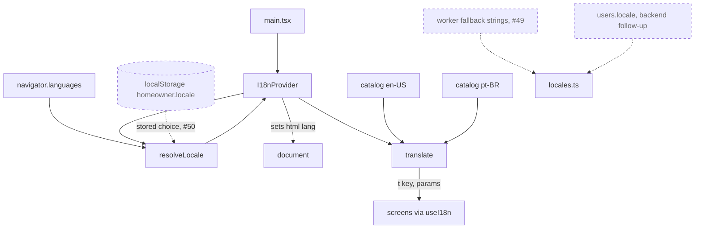

# The React PWA

Related: [ADR 0005](../adr/0005-ship-a-react-pwa-not-a-native-app.md), [ADR 0006](../adr/0006-localize-with-a-small-typed-module.md), [ADR 0007](../adr/0007-tailwind-and-radix-for-an-accessible-calm-ui.md). Terms: **Resident**, **Home** in [CONTEXT.md](../../CONTEXT.md).

The PWA is one Vite app in `web/`, installed to the Home Screen. It has a precaching service worker and no runtime caching. A *PWA* (progressive web app) is a website that can be installed and work offline.

## Modules

| Folder | Status | What it does |
|---|---|---|
| `src/i18n/` | Built | Language: which locale to show and every user-facing string for it. Detailed below. |
| `src/auth/` | Built | Sign-up, confirmation, sign-in and token handling against Cognito. |
| `src/api/` | Built | The API client: `authedFetch` and the typed calls to `/me` and `/push/*`. |
| `src/push/` | Built | The reminders controls and Web Push subscription. |
| `src/sw.ts`, `src/sw/` | Built | The service worker: precache and push handling. |

Tests are vitest in a Node environment, on pure modules only (API client, token logic, formatting, `i18n`). There are no component tests, so screens are checked by hand ([ADR 0007](../adr/0007-tailwind-and-radix-for-an-accessible-calm-ui.md)).

## Localization

The supported languages are the closed set `en-US` and `pt-BR`. Components import only from `src/i18n/index.ts` and never from a catalog.

- `locales.ts`, `resolveLocale.ts` and `translate.ts` are pure: no React, no DOM, no catalog imports. The service worker build can share them.
- `resolveLocale` picks a valid stored choice, else the first `navigator.languages` entry that is Portuguese (`pt-BR`) or English (`en-US`), else `en-US`.
- `translate` looks a key up in the locale's catalog, falls back per key to `en-US`, fills `{name}` placeholders and picks plural forms with `Intl.PluralRules`.
- The catalogs are typed objects. `en-US` defines the keys; `pt-BR` must match them or the type check fails. A test checks matching placeholders and no empty values.
- Both catalogs are bundled in the main chunk, which is precached, so both languages work offline.
- `I18nProvider` keeps the locale in React context and sets `<html lang>` to it.
- The Reminders section and the sign-in screens are still English until later tickets (#48) move their strings into the catalogs.
