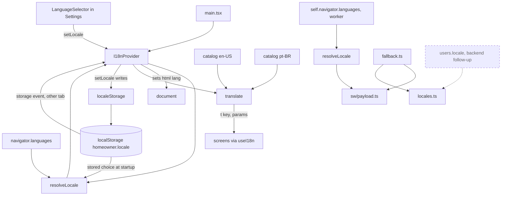
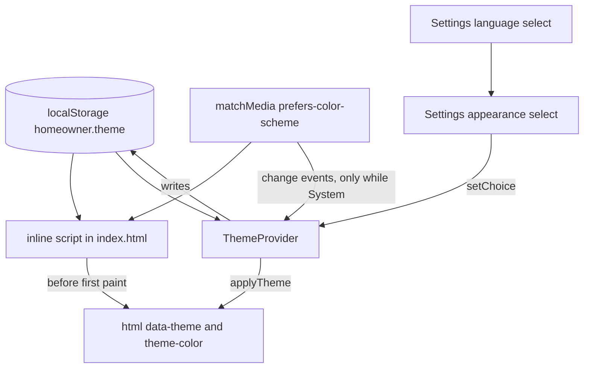
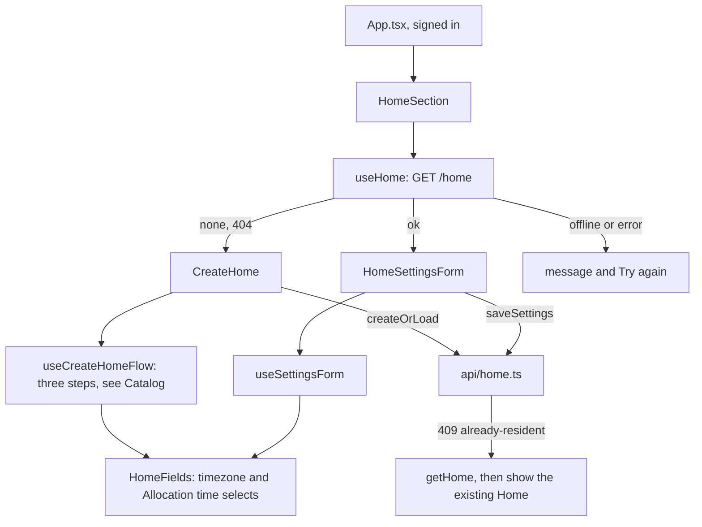
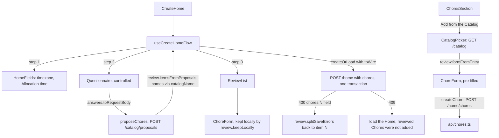
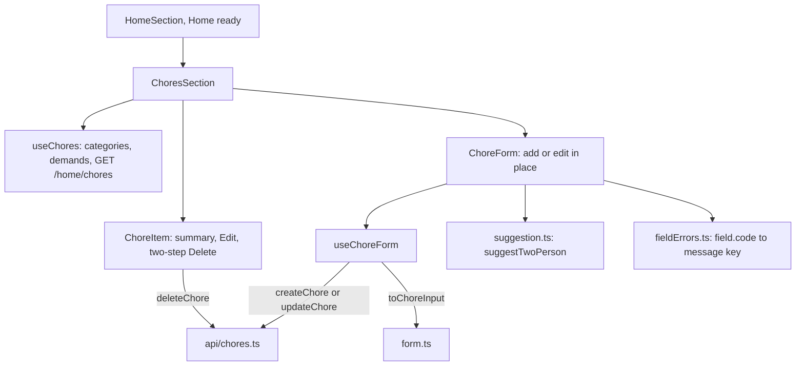
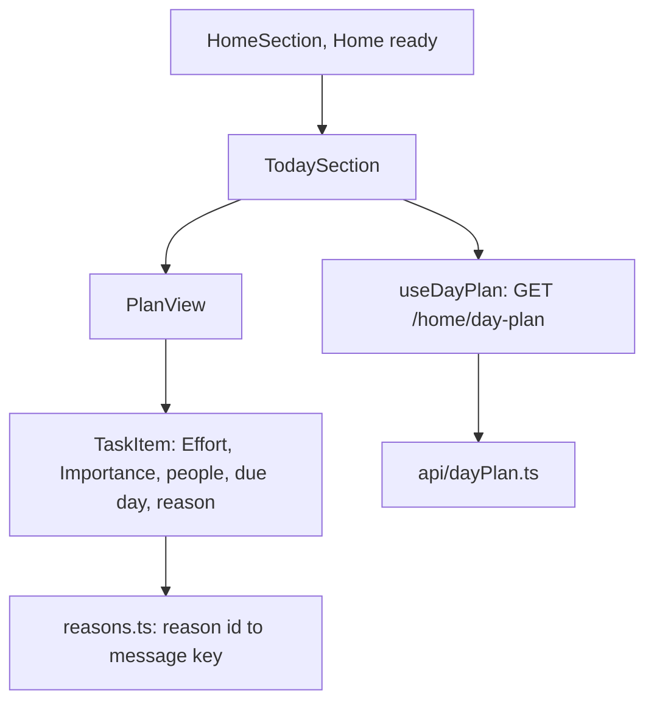
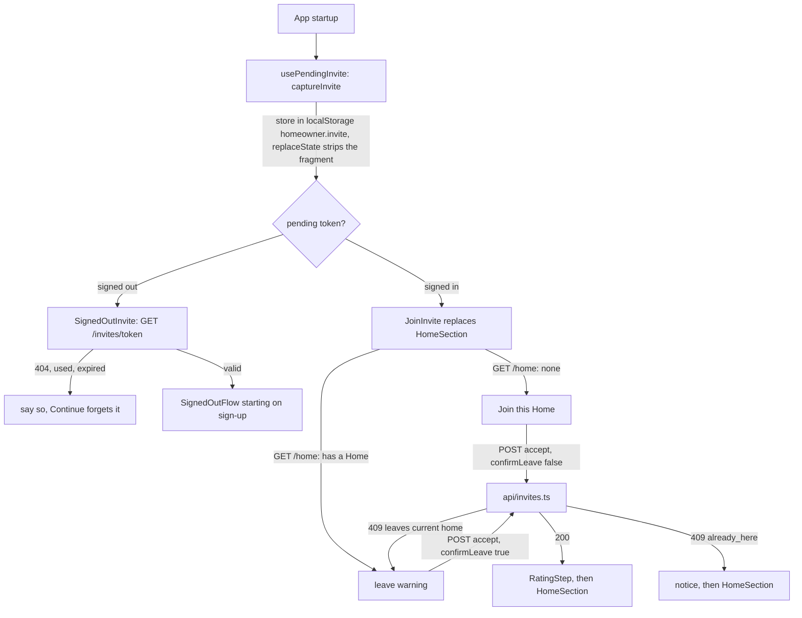

# The React PWA

Related: [ADR 0005](../adr/0005-ship-a-react-pwa-not-a-native-app.md), [ADR 0006](../adr/0006-localize-with-a-small-typed-module.md), [ADR 0007](../adr/0007-tailwind-and-radix-for-an-accessible-calm-ui.md). Terms: **Resident**, **Home** in [CONTEXT.md](../../CONTEXT.md).

The PWA is one Vite app in `web/`, installed to the Home Screen. It has a precaching service worker and no runtime caching. A *PWA* (progressive web app) is a website that can be installed and work offline.

## Modules

| Folder | Status | What it does |
|---|---|---|
| `src/i18n/` | Built | Language: which locale to show and every user-facing string for it. Detailed below. |
| `src/theme/` | Built | Appearance: System, Light or Dark, and applying it. Detailed under UI layer. |
| `src/settings/` | Built | The Settings section at the bottom of the home screen. |
| `src/auth/` | Built | Sign-up, confirmation, sign-in and token handling against Cognito. |
| `src/api/` | Built | The API client: `authedFetch` and the typed calls to `/me`, the profile routes (`/me/profile`, `/categories`, `/demands`), `/push/*`, `/home`, `/home/chores` and `/home/day-plan`. |
| `src/home/` | Built | The Home section: create form and settings form for the Home's timezone and Allocation time. Detailed below. |
| `src/chores/` | Built | The Chores section inside the Home section: list, add and edit form with every field, inline two-step delete, and the non-blocking two-person suggestion. Detailed below. |
| `src/catalog/` | Built | The Catalog on the PWA: the questionnaire about a Home, the review of suggested Chores, the picker for adding a Catalog Chore later, and the pure logic behind them. Detailed under Catalog below. |
| `src/dayplan/` | Built | The Today section inside the Home section: today's Day Plan (your Tasks, other Residents' Tasks, the pool and its reasons), read-only. Detailed below. |
| `src/invite/` | Built | Joining a Home from an Invite link (signed out and signed in, with the leave warning), the rating step after joining, and sharing an Invite from the Home section. Detailed below. |
| `src/profile/` | Built | The Profile section for signed-in Users: Baseline per weekday (saved on blur), Preference per Category and Restrictions on Demands. Each control saves on its own, optimistically, and is undone with a visible message if the API refuses. The Category and Demand lists come from the API; an id with no translation shows as the id. Logic is in pure modules (`baselineInput`, `changes`, `labels`, `weekdays`); `useProfile` holds the state. |
| `src/push/` | Built | The reminders controls and Web Push subscription. |
| `src/sw.ts`, `src/sw/` | Built | The service worker: precache and push handling. |

Tests are vitest in a Node environment, on pure modules only (API client, token logic, formatting, `i18n`). There are no component tests, so screens are checked by hand ([ADR 0007](../adr/0007-tailwind-and-radix-for-an-accessible-calm-ui.md)).

## Localization

The supported languages are the closed set `en-US` and `pt-BR`. Components import only from `src/i18n/index.ts` and never from a catalog.

- `locales.ts`, `resolveLocale.ts` and `translate.ts` are pure: no React, no DOM, no catalog imports. The service worker build can share them.
- `resolveLocale` picks a valid stored choice, else the first `navigator.languages` entry that is Portuguese (`pt-BR`) or English (`en-US`), else `en-US`.
- `translate` looks a key up in the locale's catalog, falls back per key to `en-US`, fills `{name}` placeholders and picks plural forms with `Intl.PluralRules`.
- The catalogs are typed objects. `en-US` defines the keys; `pt-BR` must match them or the type check fails. A test checks matching placeholders and no empty values.
- Both catalogs are bundled in the main chunk, which is precached, so both languages work offline.
- `I18nProvider` keeps the locale in React context, exposes `setLocale`, and sets `<html lang>` to it.
- The Reminders section and the iPhone install steps read from the catalogs. The sign-up, confirm, sign-in and signed-in screens read from the catalogs too, including the failure messages and the password rules. Screens keep a failure kind or a message key in state and translate at render, so a language switch re-words them. The Settings section's labels are in both catalogs.

### Language choice

The Language row in Settings is a native `<select>` with one `<option lang="...">` per supported language, named in itself ("English", "Português") from `languageNames.ts`. Those names are not in the catalogs, so they stay readable whichever language is active. Choosing one calls `setLocale`, which updates state first (the whole app and `<html lang>` switch with no reload) and then writes the choice through `localeStorage.ts`.

- The key is `homeowner.locale` and the value is the bare tag, `en-US` or `pt-BR`. It is written only on an explicit choice, so with no choice the browser language decides. The provider reads it once in the first render (no flash of the wrong language) and passes it to `resolveLocale({ stored })`, which ignores anything that is not a supported tag.
- Reading and writing never throw. If storage is blocked, full or absent, the switch still works for the session and nothing persists.
- The provider also listens for `storage` events, so a second tab or window follows a change. It only sets state from them and never writes back.
- The service worker does not read the key. It works offline, since the catalogs are precached and `localStorage` is local.
- On iOS, Safari and the installed Home Screen app do not share `localStorage`, so a choice made in one does not appear in the other, and Safari may evict script-writable storage for a site unused for about seven days (installed apps are exempt). That is a reason to sync a per-User preference through the backend later (`users.locale`, same two tags).

## UI layer

Styling is Tailwind CSS v4, added through `@tailwindcss/vite` (no `tailwind.config.js`, no PostCSS). Decisions are in [ADR 0007](../adr/0007-tailwind-and-radix-for-an-accessible-calm-ui.md).

### Tokens

Colours are semantic tokens declared in `@theme` in `src/index.css`, with the light value there and the dark value in a plain `[data-theme="dark"]` override. Components use `bg-surface text-text`; there are no `dark:` variants. The default palette is removed (`--color-*: initial`), so a raw palette class compiles to nothing, and `src/theme/semanticClasses.test.ts` fails on one or on any `dark:` variant.

| Token | Used for |
|---|---|
| `surface`, `surface-raised` | Page background, and fields and buttons |
| `text`, `muted` | Body text, and secondary text such as hints |
| `accent`, `accent-contrast` | Primary buttons and links, and the label on an accent fill |
| `danger` | Reserved for problems: error alerts and field errors on the Home forms |
| `focus` | The 2px focus ring |
| `border` | Field and button edges (3:1 against the surface) |

Measured contrast (WCAG ratios, computed from the hex values):

| Pair | Light | Dark |
|---|---|---|
| `text` on `surface` / `surface-raised` | 14.88 / 15.86 | 15.28 / 13.65 |
| `muted` on `surface` / `surface-raised` | 6.78 / 7.23 | 8.48 / 7.58 |
| `accent` on `surface` / `surface-raised` | 5.62 / 5.99 | 9.51 / 8.49 |
| `accent-contrast` on `accent` | 5.99 | 9.48 |
| `danger` on `surface` / `surface-raised` | 6.13 / 6.54 | 7.88 / 7.03 |
| `focus` on `surface` / `surface-raised` | 5.90 / 6.29 | 8.53 / 7.62 |
| `border` on `surface` / `surface-raised` | 4.23 / 4.51 | 5.19 / 4.63 |

Text needs 4.5, the focus ring and control edges need 3.

### Theme

- The stored value is `light` or `dark`; System is the absence of the key. Anything else stored is ignored and treated as System, and is left in place until the person chooses.
- The applied value is always a concrete `light` or `dark` on `<html data-theme>`, so the CSS has two states. `color-scheme` follows it, so native controls and autofill match.
- `theme.ts` (pure) holds `resolveTheme`. The inline script in `index.html` repeats that rule because it cannot import; `inlineScript.test.ts` runs the real script against fakes and checks it agrees. It never throws (private mode and blocked storage are caught).
- The script is a plain, synchronous `<script>` in `<head>`, so there is no flash of the wrong theme. The CloudFront response headers policy sets no Content-Security-Policy today. If one is added, this script needs a hash.
- `browserTheme.ts` is the only code touching `localStorage`, `document` and the status bar meta tag; `ThemeProvider` re-resolves on `matchMedia` changes while the choice is System, and on `storage` events from another tab. Switching theme changes an attribute only, so no screen remounts.
- `theme-color` follows the theme at runtime. The manifest's `theme_color` and `background_color` are static (the light surface), so launching in dark mode shows a brief light splash on Android.

### Settings

`src/settings/Settings.tsx` is the Settings section, the last child of the home screen, shown signed in or out. Each setting is one labelled row with a native control. Appearance is the first row, a native `<select>` showing the choice (never the applied value). Language is the second row, the same pattern with its own storage (see Language choice above).

### Type, layout and components

- System font stack, no web font. `html` uses `font: -apple-system-body` so `rem` follows iOS Dynamic Type, with a plain `font-size` and `font-family` for other browsers. All sizes are `rem`; tappable elements use a `2.75rem` minimum (44px at the default size) that grows with text. `h1` and `h2` use `overflow-wrap: anywhere`, so a long word breaks instead of forcing horizontal scroll at the largest text size.
- One column of `32rem`, with the safe-area insets kept on all four sides (the `page` utility).
- Buttons, links and fields are native elements styled with the `btn`, `btn-primary` and `btn-link` utilities and base rules in `index.css`. Buttons keep a border so they stay visible in forced-colors mode; a disabled button is dashed as well as muted.
- Radix Primitives (`@radix-ui/react-slot`) and `lucide-react` are installed for later screens but not imported yet: native elements cover everything on screen today.
- The service worker precaches the built CSS, and the theme is local only, so appearance works offline.

## Home

`HomeSection` (`src/home/`) is rendered by `App.tsx` only while signed in, below Reminders and above Settings. The Chores section (see Chores below) is rendered inside it once the Home exists. It talks to the API through `src/api/home.ts` (`getHome`, `createHome`, `updateHome`), which wraps `authedFetch` like `me.ts` and returns a result union: `ok`, `not-signed-in`, `offline` (a thrown fetch), `error`, plus `none` (404), `already-resident` (409 on create) and `invalid` carrying the API's field codes.

- Both forms share `HomeFields`: two native `<select>`s with a visible `<label>`, a hint and a field error linked by `aria-describedby`. The timezone list is `Intl.supportedValuesOf("timeZone")` (`browserTimezones.ts`), defaulting to the browser's zone when listed (`timezones.ts`). The Allocation time list is every 15 minutes (`allocationTimes.ts`), because the Allocator job runs every 15 minutes and the API accepts only :00, :15, :30 and :45. Times are shown in the language's own style but sent as `"HH:MM"`.
- `createOrLoad` turns a 409 into "load the Home that already exists" and says so (`recovered`). `saveSettings` is the edit equivalent.
- `useSettingsForm` keeps the typed values in state and never resets them on a failure, so retrying sends what was typed. `offline`, `error` and `not-signed-in` show a `role="alert"` message in the `danger` colour; `invalid` shows a summary plus one message per field.
- `fieldErrors.ts` maps the API's stable field codes (`timezone`: `required`, `unknown`; `allocationTime`: `required`, `invalid`, `not_quarter_hour`) to message keys in both catalogs. A code it does not know gets a generic message.
- Pure modules with vitest tests: `api/home.ts`, `createOrLoad.ts`, `fieldErrors.ts`, `allocationTimes.ts`, `timezones.ts`. The components and hooks are checked by hand.

## Catalog

The Catalog and its rules are Go code (see [backend.md](backend.md)); the PWA only asks for them. `src/api/catalog.ts` has `getCatalog` (`GET /catalog`) and `proposeChores` (`POST /catalog/proposals`, which writes nothing), with the usual result union (`ok`, `not-signed-in`, `offline`, `error`, and `invalid` with the field codes for the proposals call). `createHome` in `api/home.ts` takes an optional list of Chores, sent as `chores` on `POST /home` only when there are some.

- Create Home is three steps in one component, driven by `useCreateHomeFlow`: settings, questionnaire, review. `Questionnaire` and `ReviewList` are controlled and own no flow logic, so the onboarding flow can mount them. Each step says why it asks. Going back keeps what was typed.
- Proposals are advice, not state. The proposals are turned into a local list; edits and removals stay local until the final request. Continuing from the questionnaire with the same answers keeps the reviewed list. Changed answers regenerate it, and ask first if that would discard edits (`afterQuestions`). A failed proposals call keeps the answers and shows a retry message.
- A Chore's name is stored text and the API does not know the language, so the API sends a stable `catalogId` and the PWA builds the name from `catalog.<id>` in its own catalogs (`catalogName`, with the instance number appended for a second bathroom). An id the PWA does not know yet keeps the API's English name.
- The review reuses `ChoreForm` (and its `form.ts`, `fieldErrors.ts`, `suggestion.ts`). `ChoreForm` takes the starting values, a mode (create or edit) and an id key, so it serves an existing Chore, a Catalog entry and a suggestion. In review, "saving" an edit is `keepLocally`; every other check is the API's, at creation. The API's keys `chores.N.field` are mapped back to the Nth item sent (`splitSaveErrors`), shown on that item, and the form opens with them.
- A 409 on create loads the existing Home and says the reviewed Chores were not added.
- "Add from the Catalog" in `ChoresSection` shows `CatalogPicker`, then the normal create form pre-filled and editable, saved through `createChore`. A per-room entry can be picked again for another room. There is no link back to the Catalog: adding the same entry twice gives two Chores.
- Pure modules with vitest tests: `api/catalog.ts`, `catalog/answers.ts` (answers to request body, bounds), `catalog/name.ts`, `catalog/review.ts`, `chores/facts.ts`. The components and hooks are checked by hand.

## Chores

`ChoresSection` (`src/chores/`) is rendered by `HomeSection` below the Home settings form, so it exists only while the signed-in User has a Home. It talks to the API through `src/api/chores.ts` (`listChores`, `createChore`, `updateChore`, `deleteChore` over `/home/chores`), which wraps `authedFetch` and returns the same kind of result union as `home.ts`: `ok`, `not-signed-in`, `offline`, `error`, plus `invalid` carrying the API's field codes (400) and `none` (404, the Chore is already gone). The Category and Demand lists reuse `getCategories` and `getDemands` from `api/profile.ts`.

- The form holds every field of a Chore: name, Category (select), Demands (checkbox group), base Effort (1 to 5 radios), Importance (radios), people (1 or 2 radios), repeat (a text field in days; blank means one-off), weekday limits (checkbox group, shown Monday first, sent as 0 to 6 with 0 = Sunday) and builds-up. Groups are `fieldset`/`legend`; each control has a visible `label`, a hint, and its field error, linked by `aria-describedby`.
- `form.ts` maps form state to the request body (`toChoreInput`: blank interval to `null`, weekdays sorted and de-duplicated, a non-numeric interval sent as typed so the API's `invalid` code is about what the person wrote). The form does not re-validate: the API's field errors are the only source, shown next to their controls under a `role="alert"` summary in the `danger` colour. Editing a field clears only its own error. Typed values live in `useChoreForm` and a failure never resets them.
- `suggestion.ts` holds `TWO_PERSON_EFFORT_THRESHOLD` (4) and `suggestTwoPerson(effort, people)`. The form shows a hint and a "make it two-person" button while it is true. It never blocks saving and the API does not know about it.
- Delete is two steps inline in `ChoreItem` (no `window.confirm`): Delete swaps the buttons for a prompt with "Keep it" (focused) and "Yes, delete". A failed delete keeps the prompt and shows a retry message; a 404 counts as deleted.
- `fieldErrors.ts` maps every code `backend/internal/chores` can return (`name`: `required`, `too_long`; `category` and `importance`: `required`, `unknown`; `demands`: `unknown`; `baseEffort`, `people`, `intervalDays`: `required`, `invalid`, `out_of_range`; `allowedWeekdays`: `invalid`, `out_of_range`) to message keys in both catalogs. Category, Demand and Importance names come from `profile/labels.ts`; an id with no translation shows as the id.
- Pure modules with vitest tests: `api/chores.ts`, `form.ts`, `suggestion.ts`, `fieldErrors.ts`. The components and hooks are checked by hand.

## Today (the Day Plan)

`TodaySection` (`src/dayplan/`) is rendered by `HomeSection` between the Home settings form and the Chores, so it exists only while the signed-in User has a Home. It is read-only: a Day Plan is a proposal, and accepting or refusing it is a later ticket. It talks to the API through `src/api/dayPlan.ts` (`getDayPlan` over `GET /home/day-plan`), which wraps `authedFetch` and returns `ok`, `not-signed-in`, `offline`, `error` and `none` (404, no Home). A list the API sends as `null` is read as empty; any malformed Task or an `energy` that is neither a number nor `null` is an `error`.

- States: not planned yet (`planned` and `rejected` both false) shows the Home's Allocation time and the open pool; `rejected` says no Tasks were given today and still lists the pool; planned shows the caller's Energy, "Your Tasks" (or "Nothing for you today"), other Residents' Tasks (only Residents who have some, labelled "Resident 1", "Resident 2" because the API sends ids, not names) and the pool (or "no other open Tasks"). An `energy` of 0 shows the "no Baseline" message pointing to the Profile.
- Reasons are stable ids localised in both catalogs: pool `no_energy_left`, `restricted_for_all`, `weekday_not_allowed`, `two_person_deferred`, `invalid_effort`, `added_after_plan`; assignment `deadline_today`, `importance`, `lateness`, `fits_energy`. An id with no translation shows as the id; no reason (before the day is planned) shows nothing.
- Nothing relies on colour: Effort, Importance, people and reason are all text. A grown Effort reads "Effort 3 (usually 2)". Failures use `role="alert"` with a retry button; loading and the not-planned and rejected notes use `role="status"`.
- Pure modules with vitest tests: `api/dayPlan.ts`, `reasons.ts`, `format.ts` (`formatDay`). The components and hook are checked by hand.

## Invites

`src/invite/` handles joining a Home from a link and sharing one. The PWA has no router, so the link is `https://<app>/#invite=<token>`: a fragment is never sent to CloudFront, S3 or any log.

- `pendingInvite.ts` is pure and never throws (the `localeStorage.ts` approach). The token goes to `localStorage`, not `sessionStorage`, because the Cognito confirmation email can open a new tab and the token must survive sign-up, the code and sign-in. It is cleared after a join, an `already_here`, or when the person dismisses a dead or declined Invite. Only base64url characters are accepted as a token.
- `api/invites.ts` has `createInvite` (`POST /home/invites`; `none` for 404, `too-many` for 429), `lookupInvite` (`GET /invites/{token}`, sent without a session; `valid`, `not-found`, `used`, `expired`) and `acceptInvite` (`would-leave`, `already-here`, the dead kinds, or `ok` with a Home). `parseHome` is shared with `api/home.ts`.
- A signed-in person with a pending Invite sees `JoinInvite` instead of `HomeSection`, so `CreateHome` is never offered while an Invite is pending. The Profile section stays visible and does not block the join. The leave warning is shown before anything is sent when `GET /home` finds a Home; a 409 from the API shows it too.
- The rating step (`RatingStep`, `useRatingStep`) shows after a successful join. `ratingChores.ts` (`selectChoresToRate`, `RATING_CHORE_COUNT` = 8) sorts by base Effort descending, then Importance (essential first), then name. Each Chore gets like, neutral or dislike and a Restriction checkbox, saved on its own and undone on failure, through `api/choreSettings.ts` (`getOwnChoreSettings` keeps only the `you` entry of `GET /home/chores/settings`). It is skippable and closes itself for a Home with no Chores.
- `InviteShare` in the Home section creates an Invite and calls `navigator.share`, falling back to `navigator.clipboard.writeText`. `share.ts` (`inviteLink`, `shareInvite`) holds that logic.
- Pure modules with vitest tests: `pendingInvite.ts`, `share.ts`, `ratingChores.ts`, `api/invites.ts`, `api/choreSettings.ts`. The components and hooks are checked by hand.

## Service worker

The worker shows a fallback notification when a push has no usable title (no payload, malformed JSON, or an empty title). Its text comes from `fallback.ts`, a record keyed by locale that lives outside the catalogs.

- The worker imports only `locales.ts`, `resolveLocale.ts`, `browserLanguages.ts` and `fallback.ts`, by path and never through the `src/i18n/index.ts` barrel, so neither catalog is bundled into `sw.js`. `tsconfig.sw.json` lists these files and uses the `WebWorker` lib with no DOM, so the type check fails if one of them starts to import React, the DOM or a catalog.
- The language is the device language: `self.navigator.languages` is read on every push and resolved by `resolveLocale` (a Portuguese tag gives `pt-BR`, anything else gives `en-US`). If reading it throws, the worker uses `en-US`. A notification is always shown.
- The in-app language choice is not read, because workers have no `localStorage`. A later ticket could mirror the choice into IndexedDB.
- A push with a valid title passes through exactly as sent, in any language. The server's text is never translated.
