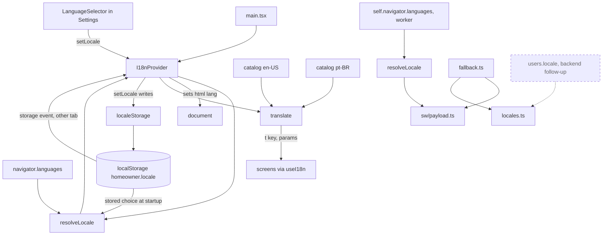
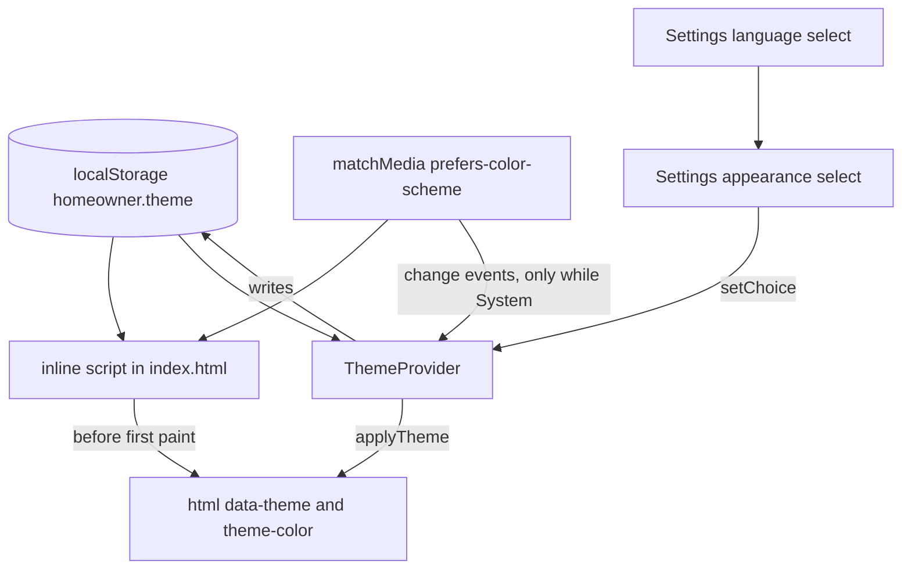
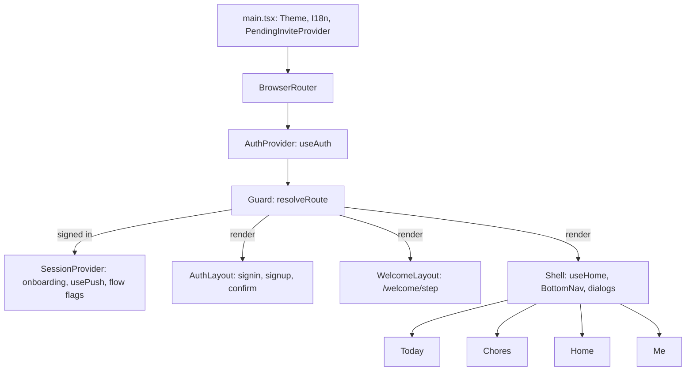
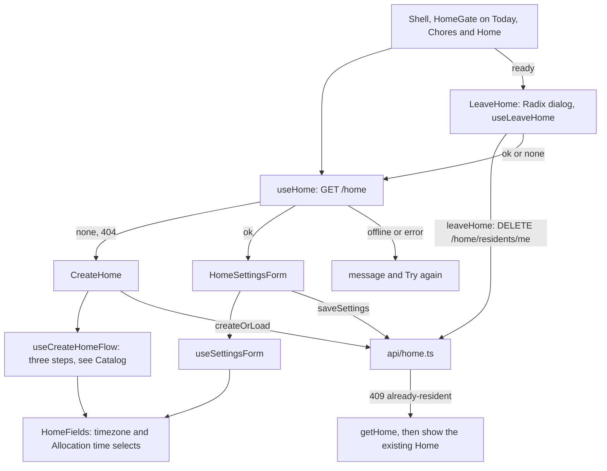
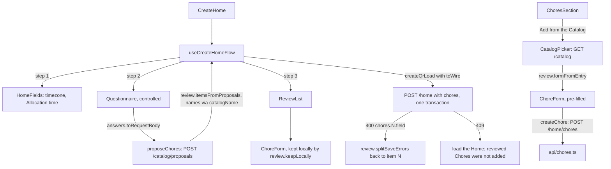
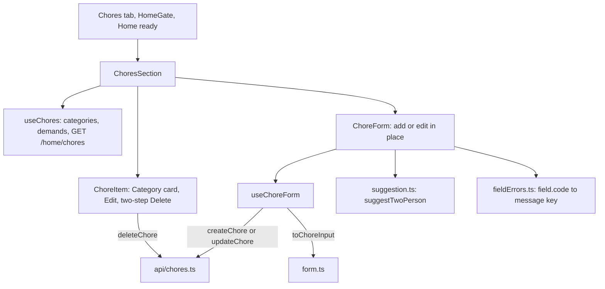
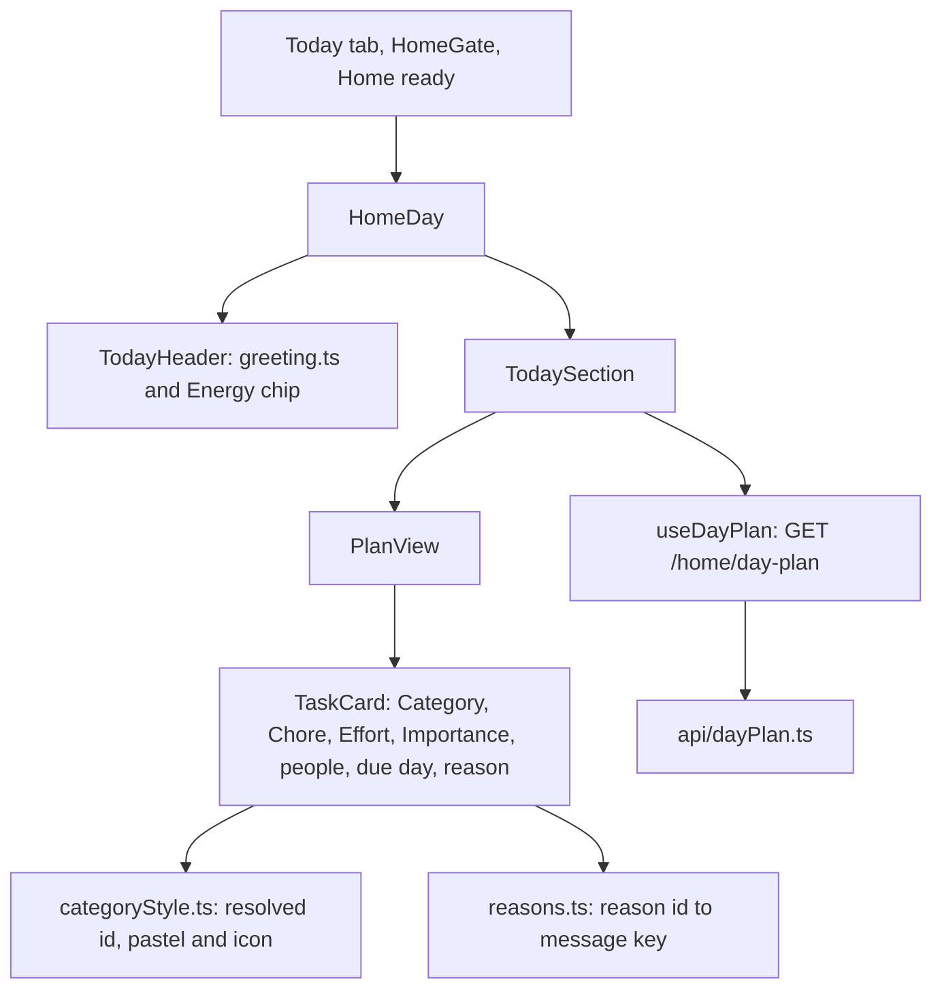
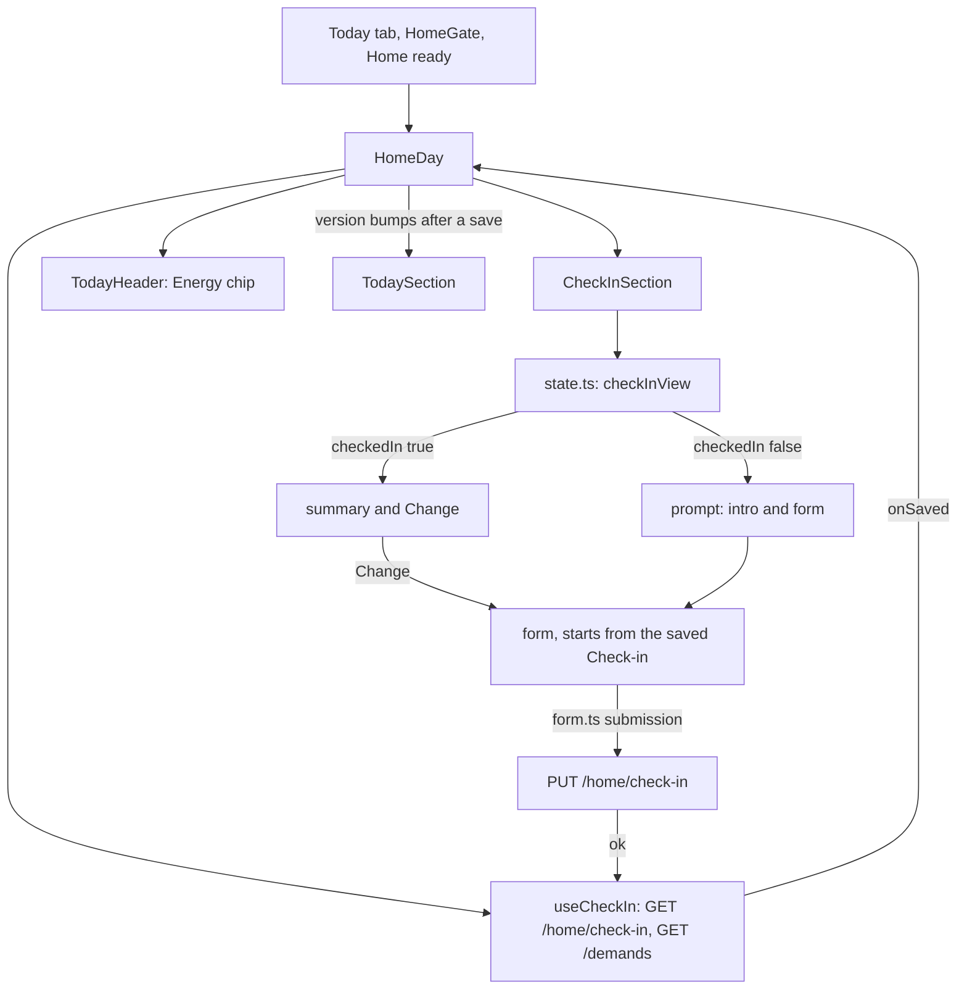
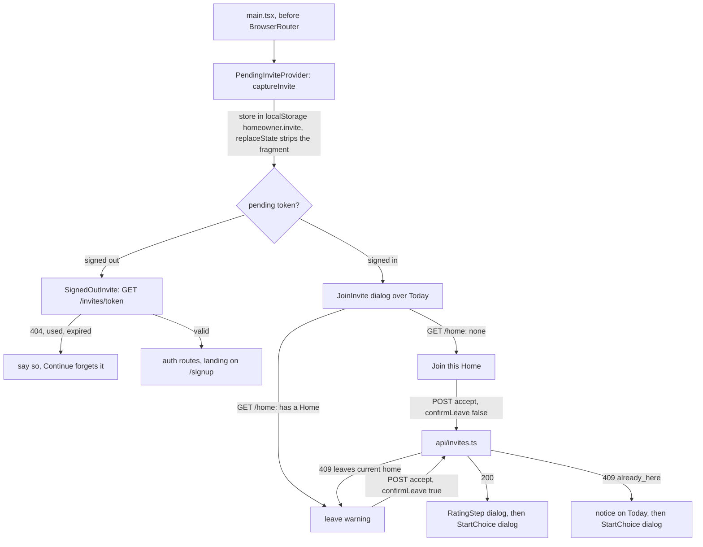

# The React PWA

Related: [ADR 0005](../adr/0005-ship-a-react-pwa-not-a-native-app.md), [ADR 0006](../adr/0006-localize-with-a-small-typed-module.md), [ADR 0007](../adr/0007-tailwind-and-radix-for-an-accessible-calm-ui.md). Terms: **Resident**, **Home** in [CONTEXT.md](../../CONTEXT.md).

The PWA is one Vite app in `web/`, installed to the Home Screen. It has a precaching service worker and no runtime caching. A *PWA* (progressive web app) is a website that can be installed and work offline.

## Modules

| Folder | Status | What it does |
|---|---|---|
| `src/i18n/` | Built | Language: which locale to show and every user-facing string for it. Detailed below. |
| `src/theme/` | Built | Appearance: System, Light or Dark, and applying it. Detailed under UI layer. |
| `src/app/` | Built | Navigation: the routes, the route guard (`resolveRoute`), the shell with the bottom nav and the dialogs over Today, and the signed-in session state. Detailed under Navigation below. |
| `src/components/ui/` | Built | Shared pieces on semantic tokens: `Card`, `PillButton`, `Chip`, `StatTile`, the pure `categoryStyle` map (Category id to pastel and icon), plus `AppDialog`, `PasswordField` and `PasswordRules`, and the shared foundations `ToastProvider`/`useToast`, `useSubmitOnce`, `CategoryGlyph` and `CardRow`. Detailed under Type, layout and components. |
| `src/settings/` | Built | The Appearance and Language controls. On the Me tab each is its own titled card; the welcome screens show both under one Settings heading, and the sign-in, sign-up and confirm screens show them side by side in one compact card at the bottom of `AuthLayout`. |
| `src/auth/` | Built | Sign-up, confirmation, sign-in and token handling against Cognito. The three screens are `Card`s with `PillButton` submits; a failure is worded by the pure `failureText.ts` (every message says what to do next, and `failureField` names the field it is about) and announced in a `FormError` live region above the submit button, with `aria-describedby` and `aria-invalid` on the field it concerns. |
| `src/api/` | Built | The API client: `authedFetch` and the typed calls to `/me`, the profile routes (`/me/profile`, `/categories`, `/demands`), `/me/onboarding`, `/push/*`, `/home`, `/home/chores`, `/home/day-plan` and `/home/check-in`. |
| `src/home/` | Built | The Home section: create form and settings form for the Home's timezone and Allocation time. Detailed below. |
| `src/chores/` | Built | The Chores section inside the Home section: list, add and edit form with every field, inline two-step delete, and the non-blocking two-person suggestion. Detailed below. |
| `src/catalog/` | Built | The Catalog on the PWA: the questionnaire about a Home, the review of suggested Chores, the picker for adding a Catalog Chore later, and the pure logic behind them. Detailed under Catalog below. |
| `src/dayplan/` | Built | The Today tab's greeting and Energy chip (`TodayHeader`) and today's Day Plan as Category-coloured `TaskCard`s (your Tasks, other Residents' Tasks, the pool and its reasons), read-only. Detailed below. |
| `src/checkin/` | Built | Today's Check-in inside the Home section: the inline prompt, the summary with Change, and the pure state and form logic, including the Energy chip's `energyNote`. Detailed under Check-in below. |
| `src/invite/` | Built | Joining a Home from an Invite link (signed out and signed in, with the leave warning), the rating step after joining, and sharing an Invite from the Home section. Detailed below. |
| `src/onboarding/` | Built | The walk a new User takes before the dashboard: install, reminders, Baseline, Restrictions, Preferences, then the Home, each step saying why it matters. Detailed under Onboarding below. |
| `src/profile/` | Built | The Me tab's Baseline, Preferences and Restrictions cards (the folder keeps its name; no text says "Profile"): Baseline per weekday (saved on blur), Preference per Category and Restrictions on Demands. Each control saves on its own, optimistically, and is undone with a visible message if the API refuses. The Category and Demand lists come from the API; an id with no translation shows as the id. Logic is in pure modules (`baselineInput`, `changes`, `labels`, `weekdays`); `useProfile` holds the state. `ProfileSections` holds the three parts (Baseline, Preferences, Restrictions) and the save status as heading-less components, so `MeProfile` (three titled cards sharing one `useProfile()` call and one status live region, with the rest of the Me tab passed as children so it still shows when the load fails) and each onboarding step compose the same code. Each Preference row is tinted with its Category's pastel and icon (`categoryStyle`), with the name as text. |
| `src/push/` | Built | Web Push subscription, used by onboarding only: `usePush`, `InstallSteps` and `EnableReminders`. The Me tab has no reminders control, so reminders cannot be turned on or off after onboarding; the launch re-subscribe still runs. |
| `src/sw.ts`, `src/sw/` | Built | The service worker: precache and push handling. |

Tests are vitest in a Node environment, on pure modules only (API client, token logic, formatting, `i18n`). There are no component tests, so screens are checked by hand ([ADR 0007](../adr/0007-tailwind-and-radix-for-an-accessible-calm-ui.md)).

## Localization

The supported languages are the closed set `en-US` and `pt-BR`. Components import only from `src/i18n/index.ts` and never from a catalog.



- `locales.ts`, `resolveLocale.ts` and `translate.ts` are pure: no React, no DOM, no catalog imports. The service worker build can share them.
- `resolveLocale` picks a valid stored choice, else the first `navigator.languages` entry that is Portuguese (`pt-BR`) or English (`en-US`), else `en-US`.
- `translate` looks a key up in the locale's catalog, falls back per key to `en-US`, fills `{name}` placeholders and picks plural forms with `Intl.PluralRules`.
- The catalogs are typed objects. `en-US` defines the keys; `pt-BR` must match them or the type check fails. A test checks matching placeholders and no empty values.
- Both catalogs are bundled in the main chunk, which is precached, so both languages work offline.
- `I18nProvider` keeps the locale in React context, exposes `setLocale`, and sets `<html lang>` to it.
- The onboarding reminders step and the iPhone install steps read from the catalogs. The sign-up, confirm, sign-in and signed-in screens read from the catalogs too, including the failure messages and the password rules. Screens keep a failure kind or a message key in state and translate at render, so a language switch re-words them. The Settings section's labels are in both catalogs.

### Language choice

The Language row in Settings is a native `<select>` with one `<option lang="...">` per supported language, named in itself ("English", "Português") from `languageNames.ts`. Those names are not in the catalogs, so they stay readable whichever language is active. Choosing one calls `setLocale`, which updates state first (the whole app and `<html lang>` switch with no reload) and then writes the choice through `localeStorage.ts`.

- The key is `homeowner.locale` and the value is the bare tag, `en-US` or `pt-BR`. It is written only on an explicit choice, so with no choice the browser language decides. The provider reads it once in the first render (no flash of the wrong language) and passes it to `resolveLocale({ stored })`, which ignores anything that is not a supported tag.
- Reading and writing never throw. If storage is blocked, full or absent, the switch still works for the session and nothing persists.
- The provider also listens for `storage` events, so a second tab or window follows a change. It only sets state from them and never writes back.
- The service worker does not read the key. It works offline, since the catalogs are precached and `localStorage` is local.
- On iOS, Safari and the installed Home Screen app do not share `localStorage`, so a choice made in one does not appear in the other, and Safari may evict script-writable storage for a site unused for about seven days (installed apps are exempt). That is a reason to sync a per-User preference through the backend later (`users.locale`, same two tags).

## UI layer

Styling is Tailwind CSS v4, added through `@tailwindcss/vite` (no `tailwind.config.js`, no PostCSS). Decisions are in [ADR 0007](../adr/0007-tailwind-and-radix-for-an-accessible-calm-ui.md).

### Tokens

Colours are semantic tokens declared in `@theme` in `src/index.css`, with the light value there and the dark value in a plain `[data-theme="dark"]` override. Components use `bg-surface text-text`; there are no `dark:` variants. The default palette is removed (`--color-*: initial`), so a raw palette class compiles to nothing, and `src/theme/semanticClasses.test.ts` fails on one or on any `dark:` variant.

| Token | Used for |
|---|---|
| `surface`, `surface-raised` | Page background, and fields and buttons |
| `text`, `muted` | Body text, and secondary text such as hints |
| `accent`, `accent-contrast` | Primary buttons and links, and the label on an accent fill |
| `danger` | Reserved for problems: error alerts and field errors on the Home forms |
| `focus` | The 2px focus ring |
| `border` | Field and button edges (3:1 against the surface) |
| `cat-peach`, `cat-mint`, `cat-lavender`, `cat-blue`, `cat-yellow`, `cat-salmon` | The six Category pastel fills ([ADR 0009](../adr/0009-navigate-with-a-bottom-tab-router-and-amend-the-look.md)); muted and desaturated in dark |
| `cat-*-ink` | Text and icons drawn on the matching pastel fill |
| `welcome-from`, `welcome-to` | The two stops of onboarding's soft top-to-bottom gradient (`bg-linear-to-b from-welcome-from to-welcome-to`); static, never animated |

"Other" has no pastel: it is `surface-raised` with `text`. The `cat-` prefix is deliberate: a token named `blue` would make `bg-blue` trip the raw-palette check in `semanticClasses.test.ts`. Radii are tokens too: `rounded-control` (0.75rem, fields), `rounded-card` (1.25rem) and `rounded-pill`.

Measured contrast (WCAG ratios, computed from the hex values):

| Pair | Light | Dark |
|---|---|---|
| `text` on `surface` / `surface-raised` | 14.88 / 15.86 | 15.28 / 13.65 |
| `muted` on `surface` / `surface-raised` | 6.78 / 7.23 | 8.48 / 7.58 |
| `accent` on `surface` / `surface-raised` | 5.62 / 5.99 | 9.51 / 8.49 |
| `accent-contrast` on `accent` | 5.99 | 9.48 |
| `danger` on `surface` / `surface-raised` | 6.13 / 6.54 | 7.88 / 7.03 |
| `focus` on `surface` / `surface-raised` | 5.90 / 6.29 | 8.53 / 7.62 |
| `border` on `surface` / `surface-raised` | 4.23 / 4.51 | 5.19 / 4.63 |

Category pairs (each of the six pastels; the lowest and highest shown). `src/theme/contrast.test.ts` reads the hex values from `index.css` and fails the build if any pair drops below its bar, naming the pair:

| Pair | Bar | Light | Dark |
|---|---|---|---|
| `cat-*-ink` on its fill (text, and icons drawn in ink) | 4.5 | 8.21 to 9.69 | 7.33 to 8.59 |
| `border` on each fill | 3 | 3.34 to 3.94 | 3.12 to 3.41 |
| `focus` on each fill | 3 | 4.66 to 5.50 | 5.13 to 5.61 |
| `text` / `muted` on `surface-raised` (the neutral card) | 4.5 | 15.86 / 7.23 | 13.65 / 7.58 |

Onboarding text sits straight on the gradient, so `contrast.test.ts` also checks `text`, `muted` and `danger` (4.5) and `border` and `focus` (3) against both `welcome-from` and `welcome-to`, in both themes.

Text needs 4.5, the focus ring and control edges need 3.

### Theme



- The stored value is `light` or `dark`; System is the absence of the key. Anything else stored is ignored and treated as System, and is left in place until the person chooses.
- The applied value is always a concrete `light` or `dark` on `<html data-theme>`, so the CSS has two states. `color-scheme` follows it, so native controls and autofill match.
- `theme.ts` (pure) holds `resolveTheme`. The inline script in `index.html` repeats that rule because it cannot import; `inlineScript.test.ts` runs the real script against fakes and checks it agrees. It never throws (private mode and blocked storage are caught).
- The script is a plain, synchronous `<script>` in `<head>`, so there is no flash of the wrong theme. The CloudFront response headers policy sets no Content-Security-Policy today. If one is added, this script needs a hash.
- `browserTheme.ts` is the only code touching `localStorage`, `document` and the status bar meta tag; `ThemeProvider` re-resolves on `matchMedia` changes while the choice is System, and on `storage` events from another tab. Switching theme changes an attribute only, so no screen remounts.
- `theme-color` follows the theme at runtime. The manifest's `theme_color` and `background_color` are static (the light surface), so launching in dark mode shows a brief light splash on Android.

### Settings

`src/settings/Settings.tsx` exports two layout-neutral controls, `AppearanceSetting` and `LanguageSetting` (ids `settings-appearance` and `settings-language`), plus `Settings`, which composes both under one heading for the welcome screens. `AuthLayout` (the signed-out routes) places the two controls itself in a compact card, below the screen, so signed-out people can still change appearance and language; it is a `min-h-dvh` centred column showing the app name, so the page scrolls at the largest text size and with the soft keyboard open. The controls call the same `setLocale` and `setChoice`, so the choice persists under the same keys and is what Me shows after sign-in. The form inputs are uncontrolled and sit outside these controls, so changing language does not clear what was typed. `SignedOutInvite` renders the Invite notice as a `Card` banner above the form. The Me tab uses `AppearanceCard` and `LanguageCard`: each a titled card (`h2`, region) around one control. The card title repeats the visible label on purpose. Each setting is one labelled row with a native control. Appearance is the first row, a native `<select>` showing the choice (never the applied value). Language is the second row, the same pattern with its own storage (see Language choice above).

### Type, layout and components

- Nunito is the app font, self-hosted through `@fontsource/nunito` (static package): `main.tsx` imports only the latin 400, 600 and 700 files, never the bare package, which pulls every subset. The system stack stays as the fallback. The built `.woff2` files are in the precache (`woff2` is in `injectManifest.globPatterns`), so text still renders in Nunito offline.
- `html` uses `font: -apple-system-body` so `rem` follows iOS Dynamic Type, with a plain `font-size` and `font-family` for other browsers. All sizes are `rem`; tappable elements use a `2.75rem` minimum (44px at the default size) that grows with text. `h1` and `h2` use `overflow-wrap: anywhere`, so a long word breaks instead of forcing horizontal scroll at the largest text size.
- One column of `32rem`, with the safe-area insets kept on all four sides (the `page` utility).
- Buttons, links and fields are native elements styled with the `btn`, `btn-primary` and `btn-link` utilities and base rules in `index.css`. Buttons keep a border so they stay visible in forced-colors mode; a disabled button is dashed as well as muted.
- Shared pieces in `components/ui/`, built on semantic tokens only: `Card` (a rounded surface, neutral or a Category pastel), `PillButton` (primary, secondary, danger; `asChild` through Radix Slot so a router `Link` can wear it; `2.75rem` minimum target; danger also has a thick border so it is not colour alone), `Chip` (icon plus the Category name as text; interactive only with `asChild`) and `StatTile` (a static value over its label). Labels wrap and never truncate; transitions are behind `motion-safe:`. `categoryStyle.ts` is the single Category-to-pastel-and-icon map; an unknown or missing id is neutral, and a test fails if a Category in `profile/labels.ts` has no style.
- Shared foundations in `components/ui/` (dependency: `@radix-ui/react-toast`, added next to dialog and slot):
  - **Toast.** `ToastProvider` is mounted once in `main.tsx`, inside `I18nProvider` and above the router, so a toast survives navigation; `useToast().show({ messageKey, params?, tone })` takes catalog keys so a language switch re-words it, and throws outside the provider. The queue is the pure reducer `toastQueue.ts` (add, dismiss, cap of 3, an identical message replaces the earlier one), unit tested. Toasts are Radix `type="background"`, so the viewport is the one polite live region; a toast never takes focus, hovering pauses its timer, and it dismisses itself after 6 s (error 10 s) or with its close button (`toast.dismiss`). The viewport sits above the bottom nav and the bottom safe-area inset; the fade is behind `motion-safe:`.
  - **Submit guard.** `useSubmitOnce(action)` wraps the pure `guardOnce`, which ignores a call while one is in flight using a plain flag, not React state, so a repeated Enter in the same tick is also ignored; it resets in `finally`. It returns `{ run, pending }`; `pending` goes on the control as `disabled` and `aria-busy`.
  - **`CategoryGlyph`** (the Category icon in a circle, `aria-hidden`, not focusable, no button styling; used by `TaskCard`) and **`CardRow`** (a `Card` with a leading glyph, content that grows, and actions on the right that wrap under the content only when the width is tight).
- Radix Dialog backs `components/ui/AppDialog` (and `LeaveHome`), and `lucide-react` supplies the bottom nav icons, each imported by name. Everything else is native elements.
- The service worker precaches the built CSS, and the theme is local only, so appearance works offline.

## Navigation

`react-router` (v7, declarative: `BrowserRouter`, `Routes`, `Route`, `Outlet`, `NavLink`, `Navigate`; no data routers or loaders) gives the app real routes. Every route sits under one `Guard`.

| Route | Screen | Nav |
|---|---|---|
| `/` | Today: Check-in and Day Plan, with the dialogs | tab |
| `/chores` | Chores: list, add, edit | tab |
| `/home` | Home: settings, Invite share, Leave | tab |
| `/me` | Me: Baseline, Preferences, Restrictions, Appearance, Language, then the account card with sign out | tab |
| `/signin`, `/signup`, `/confirm` | Full-screen auth screens | none |
| `/welcome/<step>` | Onboarding steps | none |



- **The guard** is the pure `app/resolveRoute.ts`: `{ auth, onboarding, pathname, wanted, hasPendingInvite, steps }` in, `wait`, `retry`, `render` or `redirect` out. In order: auth loading waits. Signed out reaches only the auth routes, everything else goes to `/signin` (`/signup` with a pending Invite), and `Guard` keeps the wanted path in router state as `from`. Signed in on an auth route is decided for the wanted place (or Today) in one hop. A pending Invite sends every path except Today to Today, before onboarding is read. Onboarding loading waits and a failed read shows "Try again", never a guess. Unfinished goes to the saved step (an unknown step, one that does not apply on this device, or one ahead of the saved step all go there; earlier steps may be revisited, and the saved step is never lowered). Done sends auth, `/welcome/*` and unknown paths to Today. `resolveRoute.test.ts` is a table of cases and also proves that no redirect target redirects again, over every path, state and device.
- **Routes, pure** (`app/routes.ts`): the path constants, `stepPath` and `stepFromPath`, `normalizePath`, `safeWantedPath` (a same-origin path that is not an auth or welcome path, so router state is never an open redirect), `authState` (forwards `from` through the several sign-up hops) and `confirmNeedsEmail`. `from` lives in router state only, not `localStorage`; signing out on purpose does not record it, session expiry does.
- **State placement.** `AuthProvider` shares one `useAuth`. `SessionProvider` is mounted by the guard only while signed in (so nothing calls a protected route signed out, and signing out unmounts it): `useOnboarding`, the one `usePush` (shared by onboarding and the launch re-subscribe), the `steps` for this device, and the flow flags `after`, `choosing` and `recovered`, which must survive the move from `/welcome/home` to Today. `useHome` and the plan version live in `Shell` only: hoisting them above the welcome routes would fetch the Home during onboarding and keep a stale "none" after the Home is created.
- **The shell** (`Shell`, `BottomNav`): the tab in a single centred column, and a `<nav aria-label>` of four `NavLink`s, each an icon plus a label (`nav.*` keys), with `aria-current="page"` on the current tab (Today uses `end`). The nav is sticky at the bottom of the viewport after the content, so it never covers it, keeps the bottom safe-area inset, has targets of at least 2.75rem and lets labels wrap. On a tab change focus moves to the new page's first heading, because declarative routing does not announce it. `navItems.ts` holds the tabs as data.
- **Dialogs over Today.** `JoinInvite`, `RatingStep` and `StartChoice` are Radix dialogs (`components/ui/AppDialog`: focus trap, Escape, focus returns to where it was or to the page). Each state has a title. Escape and a tap outside do what the screen's own dismiss button does, except while a request is in flight. `app/dialogToShow.ts` (pure, tested) picks the one dialog: Invite, then rating, then start choice. They show only on Today.
- **Health.** `HealthBanner` (with `bannerFor`) shows a slim banner with Retry only when the API is unavailable or unreachable; nothing is shown when it is healthy. It is part of the page frame, so it shows on every screen.
- **Offline.** The service worker serves the precached shell for any deep link. Whether the person is done with onboarding is read from the API (never guessed), so an offline start shows the shell and "Try again".
- The decision of why the router and the tabs were chosen, and the visual foundation they sit on, belongs to the UI ADRs ([ADR 0007](../adr/0007-tailwind-and-radix-for-an-accessible-calm-ui.md) and the visual foundation ADR from #123).

## Onboarding

A new User is walked through install, reminders, Baseline, Restrictions, Preferences and the Home before they see the dashboard. The walk is a set of full-screen routes, `/welcome/<step>`, with no bottom nav (see Navigation); the guard keeps the address on a step the User may be on.

Progress lives on the server (`users.onboarding_step`, see the backend docs), because on iOS the install step ends with the User leaving Safari for the Home Screen app, which has its own `localStorage`. `src/api/onboarding.ts` has `getOnboarding` (`GET /me/onboarding`: the step to show, or `done`) and `putOnboardingStep` (`PUT /me/onboarding`: records a step as completed or skipped and returns the next step). It returns the usual result union (`ok`, `not-signed-in`, `offline`, `error`). `home` is never sent: `POST /home` completes it on the server.

```mermaid
flowchart TD
    SES[SessionProvider: useOnboarding GET /me/onboarding] --> GUARD[Guard: resolveRoute]
    GUARD -->|loading or failed| MSG[message and Try again, never a guess]
    GUARD -->|done| SHELL[Shell: Today, Chores, Home, Me]
    GUARD -->|any other step| ONB[/welcome/step: Onboarding]
    ONB --> PUSH[session usePush, shared]
    ONB --> PROF[useProfile, once]
    ONB --> WALK[useWalk: Next calls PUT then navigates, Back navigates]
    ONB -->|home step| CH[CreateHome]
    CH -->|onSaved or onRecovered 409: position done| GUARD
```

- `steps.ts` (pure): the ordered ids, which apply on this device (`install` only for iOS in a browser tab, from `reminderAvailability`), next and previous, and "step n of m". Tested.
- `baselineComplete.ts` (pure): all seven Baseline days must have a value (0 counts) before Next on the Baseline step. Restrictions and Preferences are always passable, since none and neutral are real answers. Tested.
- `useOnboarding` holds the server's step, in the session provider. `useWalk` reads which step is on screen from the address: Next moves on only after the server answers 200 (it raises the stored step first, then navigates, in the same tick, so the guard never sees an address ahead of the stored step) and otherwise stays with an alert; Back navigates to the previous step's path (never `navigate(-1)`, which a deep link cannot use) and never lowers the stored step; nothing is queued offline. `pathAfterAdvance` in `steps.ts` is the pure "where next". Tested.
- `Onboarding` owns the single `useProfile` of the flow and shares the session's `usePush`, so the launch re-subscribe runs once and the lists are fetched once. Notification permission is requested only from the Enable button.
- **The look.** `WelcomeLayout` renders `Onboarding` with no page chrome (no app name, tagline or nav). `onboarding/OnboardingLayout.tsx` is the one presentational layout for every step: a full-bleed, static gradient (`min-h-dvh`, safe-area padding), the health banner on top, a top bar, a centred scrolling body, and an action area stuck to the bottom (`sticky bottom-0`) so the buttons stay reachable at the largest text size. The top bar has Back (hidden where `canGoBack` is false, which includes the Home step) and, only on a step that already has a skip, a close button that runs that skip; no step gained a skip. The body shows a quiet "Step n of m", the question as the page `h1` (focused on every step change, including arriving by browser back), the why paragraph, the step's fields, and a collapsed Settings disclosure so appearance and language stay reachable. Continue and skip are `PillButton`s of equal size (skip is the secondary variant), so skipping is as prominent as continuing. A failed save shows its message in a `role="alert"` block with a Try again button that repeats the step's own Next. `CreateHome` stays mounted for as long as the Home step is on screen. Nothing animates except colour changes behind `motion-safe:`.
- Reminders is skippable ("Not now") and the install step has its own "done" button; the profile steps and the Home are not skippable.
- A pending Invite wins: the guard decides it before it reads onboarding, so every path redirects to Today, where `JoinInvite` is a dialog. A failed onboarding read cannot block joining. Settings is on the welcome screens (in the disclosure), so language and appearance work in every state.
- When creating the Home finds one already made (409), onboarding finishes and the Home tab shows the same "already existed" notice, including the "chores dropped" variant. The notice and the start choice flag live in the session provider because they must survive the move from `/welcome/home` to Today.

## Home

The Home is loaded by `useHome` inside the Shell (so only once onboarding is done, and fresh when it ends). `HomeGate` (`src/home/`) is the one wrapper used by the Today, Chores and Home tabs: loading, a failure with Retry, the create form when there is no Home, otherwise the tab's content (the pure `homeView` chooses; while an Invite is pending a missing Home reads as loading). The Home tab holds the settings form, Invite share and Leave; the Chores section (see Chores below) is the Chores tab. It talks to the API through `src/api/home.ts` (`getHome`, `createHome`, `updateHome`, `leaveHome`), which wraps `authedFetch` like `me.ts` and returns a result union: `ok`, `not-signed-in`, `offline` (a thrown fetch), `error`, plus `none` (404; for `leaveHome` it means there is no Home to leave), `already-resident` (409 on create) and `invalid` carrying the API's field codes.



- Both forms share `HomeFields`: two native `<select>`s with a visible `<label>`, a hint and a field error linked by `aria-describedby`. The timezone list is `Intl.supportedValuesOf("timeZone")` (`browserTimezones.ts`), defaulting to the browser's zone when listed (`timezones.ts`). The Allocation time list is every 15 minutes (`allocationTimes.ts`), because the Allocator job runs every 15 minutes and the API accepts only :00, :15, :30 and :45. Times are shown in the language's own style but sent as `"HH:MM"`.
- `createOrLoad` turns a 409 into "load the Home that already exists" and says so (`recovered`). `saveSettings` is the edit equivalent.
- `useSettingsForm` keeps the typed values in state and never resets them on a failure, so retrying sends what was typed. `offline`, `error` and `not-signed-in` show a `role="alert"` message in the `danger` colour; `invalid` shows a summary plus one message per field.
- `fieldErrors.ts` maps the API's stable field codes (`timezone`: `required`, `unknown`; `allocationTime`: `required`, `invalid`, `not_quarter_hour`) to message keys in both catalogs. A code it does not know gets a generic message.
- `LeaveHome` is the last part of the Home tab once the Home exists: a "Leave this Home" button that opens a Radix `Dialog` (ADR 0007; native HTML cannot make a modal accessible). The dialog says that the Resident's Home-specific Preferences and Restrictions and Day Plan places are removed, that their Baseline and general Preferences and Restrictions stay, and that if they are the last Resident the Home and its Chores are deleted. The API does not say how many Residents there are, so one text covers both cases. Focus starts on Cancel. The steps live in `leaveFlow.ts` (`createLeaveFlow`: closed, confirming, leaving; nothing is sent before confirm, one request at a time) and `useLeaveHome` binds it to React with `useSyncExternalStore`. On `ok` or `none` the flow calls `onLeft`, which sets the Home state to `none` through `useHome`'s `clearHome`: `HomeGate` then renders `CreateHome` on the Today, Chores and Home tabs, so the Home's settings, Today, Chores and Invite sections unmount and no stale data shows. On `offline`, `error` or `not-signed-in` the dialog stays open with a `role="alert"` message (`LEAVE_FAILURE_KEY`) and the same button retries.
- Pure modules with vitest tests: `api/home.ts`, `leaveFlow.ts`, `createOrLoad.ts`, `fieldErrors.ts`, `allocationTimes.ts`, `timezones.ts`. The components and hooks are checked by hand.

## Catalog

The Catalog and its rules are Go code (see [backend.md](backend.md)); the PWA only asks for them. `src/api/catalog.ts` has `getCatalog` (`GET /catalog`) and `proposeChores` (`POST /catalog/proposals`, which writes nothing), with the usual result union (`ok`, `not-signed-in`, `offline`, `error`, and `invalid` with the field codes for the proposals call). `createHome` in `api/home.ts` takes an optional list of Chores, sent as `chores` on `POST /home` only when there are some.



- Create Home is three steps in one component, driven by `useCreateHomeFlow`: settings, questionnaire, review. `Questionnaire` and `ReviewList` are controlled and own no flow logic, so the onboarding flow can mount them. Each step says why it asks. Going back keeps what was typed.
- Proposals are advice, not state. The proposals are turned into a local list; edits and removals stay local until the final request. Continuing from the questionnaire with the same answers keeps the reviewed list. Changed answers regenerate it, and ask first if that would discard edits (`afterQuestions`). A failed proposals call keeps the answers and shows a retry message.
- A Chore's name is stored text and the API does not know the language, so the API sends a stable `catalogId` and the PWA builds the name from `catalog.<id>` in its own catalogs (`catalogName`, with the instance number appended for a second bathroom). An id the PWA does not know yet keeps the API's English name.
- The review reuses `ChoreForm` (and its `form.ts`, `fieldErrors.ts`, `suggestion.ts`). `ChoreForm` takes the starting values, a mode (create or edit) and an id key, so it serves an existing Chore, a Catalog entry and a suggestion. In review, "saving" an edit is `keepLocally`; every other check is the API's, at creation. The API's keys `chores.N.field` are mapped back to the Nth item sent (`splitSaveErrors`), shown on that item, and the form opens with them.
- A 409 on create loads the existing Home and says the reviewed Chores were not added.
- "Add from the Catalog" in `ChoresSection` shows `CatalogPicker`, then the normal create form pre-filled and editable, saved through `createChore`. A per-room entry can be picked again for another room. There is no link back to the Catalog: adding the same entry twice gives two Chores.
- Pure modules with vitest tests: `api/catalog.ts`, `catalog/answers.ts` (answers to request body, bounds), `catalog/name.ts`, `catalog/review.ts`, `chores/facts.ts`. The components and hooks are checked by hand.

## Chores

`ChoresSection` (`src/chores/`) is the Chores tab, inside `HomeGate`, so it exists only while the signed-in User has a Home. It talks to the API through `src/api/chores.ts` (`listChores`, `createChore`, `updateChore`, `deleteChore` over `/home/chores`), which wraps `authedFetch` and returns the same kind of result union as `home.ts`: `ok`, `not-signed-in`, `offline`, `error`, plus `invalid` carrying the API's field codes (400) and `none` (404, the Chore is already gone). The Category and Demand lists reuse `getCategories` and `getDemands` from `api/profile.ts`.



- The form holds every field of a Chore: name, Category (select), Demands (checkbox group), base Effort (1 to 5 radios), Importance (radios), people (1 or 2 radios), repeat (a text field in days; blank means one-off), weekday limits (checkbox group, shown Monday first, sent as 0 to 6 with 0 = Sunday) and builds-up. Groups are `fieldset`/`legend`; each control has a visible `label`, a hint, and its field error, linked by `aria-describedby`.
- `form.ts` maps form state to the request body (`toChoreInput`: blank interval to `null`, weekdays sorted and de-duplicated, a non-numeric interval sent as typed so the API's `invalid` code is about what the person wrote). The form does not re-validate: the API's field errors are the only source, shown next to their controls under a `role="alert"` summary in the `danger` colour. Editing a field clears only its own error. Typed values live in `useChoreForm` and a failure never resets them.
- `suggestion.ts` holds `TWO_PERSON_EFFORT_THRESHOLD` (4) and `suggestTwoPerson(effort, people)`. The form shows a hint and a "make it two-person" button while it is true. It never blocks saving and the API does not know about it.
- Delete is two steps inline in `ChoreItem` (no `window.confirm`): Delete swaps the buttons for a prompt with "Keep it" (focused) and "Yes, delete". A failed delete keeps the prompt and shows a retry message; a 404 counts as deleted.
- `fieldErrors.ts` maps every code `backend/internal/chores` can return (`name`: `required`, `too_long`; `category` and `importance`: `required`, `unknown`; `demands`: `unknown`; `baseEffort`, `people`, `intervalDays`: `required`, `invalid`, `out_of_range`; `allowedWeekdays`: `invalid`, `out_of_range`) to message keys in both catalogs. Category, Demand and Importance names come from `profile/labels.ts`; an id with no translation shows as the id.
- Each Chore is a `Card` tinted by its Category, with the Category's icon (decorative), the Category name as text, the Chore name as a heading and the schedule facts (`choreScheduleFacts`: Effort, Importance, people, repeat, weekdays, builds-up). The colour and icon come only from `categoryStyle`; an unknown Category gets the neutral card and the name "Other". Edit and Delete are `PillButton`s (the confirming Delete is the `danger` variant). The add and edit form stays inline, in a neutral `Card`, and its field errors are `role="alert"` so they are announced.
- Pure modules with vitest tests: `api/chores.ts`, `form.ts`, `suggestion.ts`, `fieldErrors.ts`, `facts.ts`. The components and hooks are checked by hand.

## Today (the Day Plan)

`TodayHeader` and `TodaySection` (`src/dayplan/`) are on the Today tab, above and below the Check-in, inside `HomeGate`, so they exist only while the signed-in User has a Home. The plan is read-only: a Day Plan is a proposal, and accepting or refusing it is a later ticket. It talks to the API through `src/api/dayPlan.ts` (`getDayPlan` over `GET /home/day-plan`), which wraps `authedFetch` and returns `ok`, `not-signed-in`, `offline`, `error` and `none` (404, no Home). A list the API sends as `null` is read as empty; any malformed Task or an `energy` that is neither a number nor `null` is an `error`. A Task's `category` is read leniently: a string is kept, anything else (absent from an older API, `null`, a number) is left out, so it can never turn the whole plan into an `error`.



- Header: `TodayHeader` shows a greeting from the device's local hour (`greeting.ts`: before 12 morning, 12 to 17 afternoon, 18 on evening, no name) as the first `h2` (the app name above is the page's `h1`, and focus lands on the first `h2` when the tab opens), and an Energy `Chip`. The chip's text comes from `energyNote(energy, checkIn)` in `src/checkin/state.ts`, which returns `unset` (no Check-in: a button that scrolls to the Check-in and focuses its heading), `drained` (gentle, no Tasks), `energy` (points), `no-baseline` (a link to the Me tab, never "0") or `pending` (checked in, plan not ready: "Checked in", never "not set"). Its accessible name is one string, "Energy today: ...". No chip is shown while the Check-in itself is loading or failed.
- Where the data lives: `HomeDay` owns both `useCheckIn`, so the Check-in stays mounted (its "saved" announcement is kept), and `useDayPlan(version)`, which reloads when the version changes. It computes the Energy note once and passes it, with the plan, to `TodayHeader` and `TodaySection`.
- Cards: `TaskCard` replaces the old `TaskItem`. Each is a `Card` in the pastel of the Task's Category, with a large decorative icon, the Category name as text, the Chore name as the heading, the current Effort, and the facts and reason as before. `categoryStyle` returns the resolved id and turns a missing or unknown Category id into `other`, so the card is neutral and says "Other", never the raw id. The pool uses the same card.
- States: not planned yet (`planned` and `rejected` both false) shows the Home's Allocation time and the open pool; `rejected` says no Tasks were given today and still lists the pool; planned shows "Your Tasks", other Residents' Tasks (only Residents who have some, labelled "Resident 1", "Resident 2" because the API sends ids, not names) and the pool (or "no other open Tasks"). An empty "Your Tasks" always says why, from `noTasksReason(energyNote(...))`, the same note as the chip: Drained (rest), no Baseline (with a link to the Me tab) or nothing due.
- Reasons are stable ids localised in both catalogs: pool `no_energy_left`, `restricted_for_all`, `weekday_not_allowed`, `two_person_deferred`, `invalid_effort`, `added_after_plan`; assignment `deadline_today`, `importance`, `lateness`, `fits_energy`. An id with no translation shows as the id; no reason (before the day is planned) shows nothing.
- Nothing relies on colour: Effort, Importance, people and reason are all text. A grown Effort reads "Effort 3 (usually 2)". Failures use `role="alert"` with a retry button; loading and the not-planned and rejected notes use `role="status"`.
- Pure modules with vitest tests: `api/dayPlan.ts`, `greeting.ts`, `reasons.ts`, `format.ts` (`formatDay`), and `categoryStyle.ts`. The components and hook are checked by hand.

## Check-in

`HomeDay` (`src/home/HomeDay.tsx`) is the content of the Today tab: it owns `useCheckIn` and renders `TodayHeader`, then `CheckInSection` (a `Card` with `PillButton`s), then `TodaySection`. It talks to the API through `src/api/checkIn.ts` (`getCheckIn` over `GET /home/check-in`, `putCheckIn` over `PUT /home/check-in`), which returns `ok`, `not-signed-in`, `offline`, `error`, `none` (404) and, for a save, `invalid` (400). A day with no Check-in is `ok` with `checkedIn: false`; a body with an unknown level, or a level that disagrees with `checkedIn`, is an `error`.



- The prompt shows exactly when `checkedIn` is false, inline and not a modal, on every open: nothing about it being skipped is stored. Once answered it is one line, "Today's Check-in: Low", with a Change button that reopens the form.
- The form is a `fieldset` of four native radios (Drained, Low, Normal, Energized, each with a one-line explanation and none selected at first) and a `fieldset` of checkboxes for today's Restrictions, labelled with the Demand names. Submitting without a level shows an alert instead of calling the API. Results use `role="status"` and failures `role="alert"`; meaning never depends on colour.
- A save can change the Day Plan, because the API plans that Resident again. `useDayPlan` reloads when the version `HomeDay` receives changes, so it reloads without polling (`latestOnly` drops a response that arrives after a newer request, so an older plan never overwrites a newer one); the Energy chip reads "Checked in" while it reloads. The Today section no longer prints an energy line: the chip in `TodayHeader` replaces it, and the Check-in heading takes focus when the chip is tapped.
- `state.ts` is a reducer (`checkInReducer`) plus `checkInView`, `energyNote` (the chip's five outcomes, from the plan's Energy and the Check-in) and `noTasksReason` (why an empty list is empty, from the same note); `form.ts` holds the form values and what is sent (Restrictions in the order of `GET /demands`). Both are pure. Pure modules with vitest tests: `api/checkIn.ts`, `state.ts`, `form.ts`. The components and hook are checked by hand.
- The Check-in reminder arrives as a push with `kind: "checkin_reminder"`; see Service worker below. Opening the app from it shows the prompt, as on any open.

## Invites

`src/invite/` handles joining a Home from a link and sharing one. The link keeps a fragment, `https://<app>/#invite=<token>`, even though there is now a router: a fragment is never sent to CloudFront, S3 or any log, and it never enters router state, a query string or the "wanted" path. `PendingInviteProvider` captures it before `BrowserRouter` first renders (see Navigation).



- `pendingInvite.ts` is pure and never throws (the `localeStorage.ts` approach). The token goes to `localStorage`, not `sessionStorage`, because the Cognito confirmation email can open a new tab and the token must survive sign-up, the code and sign-in. It is cleared after a join, an `already_here`, or when the person dismisses a dead or declined Invite. Only base64url characters are accepted as a token.
- `api/invites.ts` has `createInvite` (`POST /home/invites`; `none` for 404, `too-many` for 429), `lookupInvite` (`GET /invites/{token}`, sent without a session; `valid`, `not-found`, `used`, `expired`) and `acceptInvite` (`would-leave`, `already-here`, the dead kinds, or `ok` with a Home). `parseHome` is shared with `api/home.ts`.
- A signed-in person with a pending Invite sees `JoinInvite` as a dialog over Today (every other path redirects to Today until it is dismissed), and `HomeGate` never offers `CreateHome` while an Invite is pending. After a join the Shell reloads the Home and the plan, because it had fetched them behind the dialog. With a pending Invite the signed-out landing is `/signup`; a dead link shows its explanation and Continue forgets it and goes to `/signin`. The leave warning is shown before anything is sent when `GET /home` finds a Home; a 409 from the API shows it too.
- The rating step (`RatingStep`, `useRatingStep`) shows as a dialog after a successful join. `ratingChores.ts` (`selectChoresToRate`, `RATING_CHORE_COUNT` = 8) sorts by base Effort descending, then Importance (essential first), then name. Each Chore gets like, neutral or dislike and a Restriction checkbox, saved on its own and undone on failure, through `api/choreSettings.ts` (`getOwnChoreSettings` keeps only the `you` entry of `GET /home/chores/settings`). It is skippable and closes itself for a Home with no Chores.
- `InviteShare` on the Home tab creates an Invite and calls `navigator.share`, falling back to `navigator.clipboard.writeText`. `share.ts` (`inviteLink`, `shareInvite`) holds that logic.
- Pure modules with vitest tests: `pendingInvite.ts`, `share.ts`, `ratingChores.ts`, `api/invites.ts`, `api/choreSettings.ts`. The components and hooks are checked by hand.

## Service worker

The worker shows a fallback notification when a push has no usable title (no payload, malformed JSON, or an empty title). Its text comes from `fallback.ts`, a record keyed by locale that lives outside the catalogs.

- The worker imports only `locales.ts`, `resolveLocale.ts`, `browserLanguages.ts` and `fallback.ts`, by path and never through the `src/i18n/index.ts` barrel, so neither catalog is bundled into `sw.js`. `tsconfig.sw.json` lists these files and uses the `WebWorker` lib with no DOM, so the type check fails if one of them starts to import React, the DOM or a catalog.
- The language is the device language: `self.navigator.languages` is read on every push and resolved by `resolveLocale` (a Portuguese tag gives `pt-BR`, anything else gives `en-US`). If reading it throws, the worker uses `en-US`. A notification is always shown.
- The in-app language choice is not read, because workers have no `localStorage`. A later ticket could mirror the choice into IndexedDB.
- A push whose optional `kind` is `checkin_reminder` or `day_plan_ready` (sent by the allocation job's nudges) is worded by the worker for the device language, from `KIND_TEXT` in `fallback.ts` (en-US and pt-BR, generic text with no names or Task titles). The server's `title` and `body` are English and are ignored for these kinds, so they only matter to an older worker. The `url` still goes through the same-origin check. `isNotificationKind` guards the lookup, so a non-string or unknown kind is not a key.
- A push with a valid title and no known `kind` passes through exactly as sent, in any language. The server's text is never translated.
- Tapping a notification focuses an open window, and then navigates it to the payload's `url` (Today, `/`, for every server sender) when `shouldNavigate` in `sw/payload.ts` says it is on a different path of the same origin. `WindowClient.navigate` is guarded: if it is missing or rejects, the worker stays focus-only. With no open window it opens the `url`. The `NavigationRoute` serves the precached shell for deep links, and CloudFront maps 403 and 404 to `index.html`.
