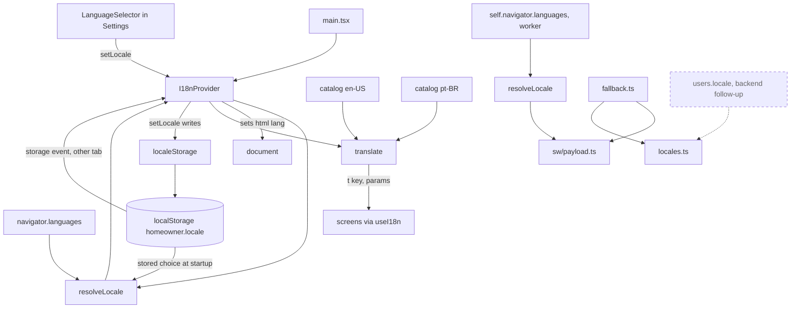
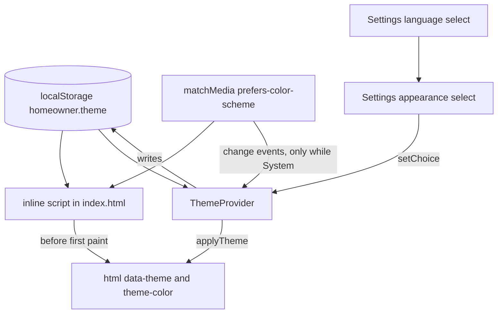
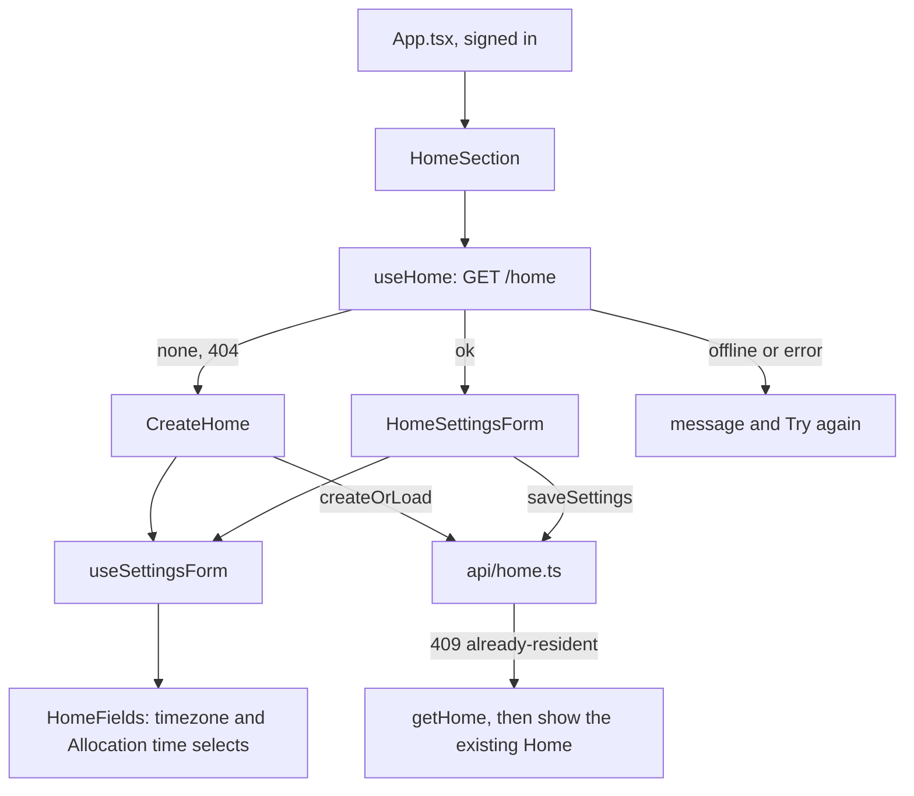

# The React PWA

Related: [ADR 0005](../adr/0005-ship-a-react-pwa-not-a-native-app.md), [ADR 0006](../adr/0006-localize-with-a-small-typed-module.md), [ADR 0007](../adr/0007-tailwind-and-radix-for-an-accessible-calm-ui.md). Terms: **Resident**, **Home** in [CONTEXT.md](../../CONTEXT.md).

The PWA is one Vite app in `web/`, installed to the Home Screen. It has a precaching service worker and no runtime caching. A *PWA* (progressive web app) is a website that can be installed and work offline.

## Modules

| Folder | Status | What it does |
|---|---|---|
| `src/i18n/` | Built | Language: which locale to show and every user-facing string for it. Detailed below. |
| `src/theme/` | Built | Appearance: System, Light or Dark, and applying it. Detailed under UI layer. |
| `src/settings/` | Built | The Settings section at the bottom of the home screen. |
| `src/auth/` | Built | Sign-up, confirmation, sign-in and token handling against Cognito. |
| `src/api/` | Built | The API client: `authedFetch` and the typed calls to `/me`, the profile routes (`/me/profile`, `/categories`, `/demands`), `/push/*` and `/home`. |
| `src/home/` | Built | The Home section: create form and settings form for the Home's timezone and Allocation time. Detailed below. |
| `src/profile/` | Built | The Profile section for signed-in Users: Baseline per weekday (saved on blur), Preference per Category and Restrictions on Demands. Each control saves on its own, optimistically, and is undone with a visible message if the API refuses. The Category and Demand lists come from the API; an id with no translation shows as the id. Logic is in pure modules (`baselineInput`, `changes`, `labels`, `weekdays`); `useProfile` holds the state. |
| `src/push/` | Built | The reminders controls and Web Push subscription. |
| `src/sw.ts`, `src/sw/` | Built | The service worker: precache and push handling. |

Tests are vitest in a Node environment, on pure modules only (API client, token logic, formatting, `i18n`). There are no component tests, so screens are checked by hand ([ADR 0007](../adr/0007-tailwind-and-radix-for-an-accessible-calm-ui.md)).

## Localization

The supported languages are the closed set `en-US` and `pt-BR`. Components import only from `src/i18n/index.ts` and never from a catalog.

- `locales.ts`, `resolveLocale.ts` and `translate.ts` are pure: no React, no DOM, no catalog imports. The service worker build can share them.
- `resolveLocale` picks a valid stored choice, else the first `navigator.languages` entry that is Portuguese (`pt-BR`) or English (`en-US`), else `en-US`.
- `translate` looks a key up in the locale's catalog, falls back per key to `en-US`, fills `{name}` placeholders and picks plural forms with `Intl.PluralRules`.
- The catalogs are typed objects. `en-US` defines the keys; `pt-BR` must match them or the type check fails. A test checks matching placeholders and no empty values.
- Both catalogs are bundled in the main chunk, which is precached, so both languages work offline.
- `I18nProvider` keeps the locale in React context, exposes `setLocale`, and sets `<html lang>` to it.
- The Reminders section and the iPhone install steps read from the catalogs. The sign-in screens are still English until #75 moves their strings into the catalogs. The Settings section's labels are in both catalogs.

### Language choice

The Language row in Settings is a native `<select>` with one `<option lang="...">` per supported language, named in itself ("English", "Português") from `languageNames.ts`. Those names are not in the catalogs, so they stay readable whichever language is active. Choosing one calls `setLocale`, which updates state first (the whole app and `<html lang>` switch with no reload) and then writes the choice through `localeStorage.ts`.

- The key is `homeowner.locale` and the value is the bare tag, `en-US` or `pt-BR`. It is written only on an explicit choice, so with no choice the browser language decides. The provider reads it once in the first render (no flash of the wrong language) and passes it to `resolveLocale({ stored })`, which ignores anything that is not a supported tag.
- Reading and writing never throw. If storage is blocked, full or absent, the switch still works for the session and nothing persists.
- The provider also listens for `storage` events, so a second tab or window follows a change. It only sets state from them and never writes back.
- The service worker does not read the key. It works offline, since the catalogs are precached and `localStorage` is local.
- On iOS, Safari and the installed Home Screen app do not share `localStorage`, so a choice made in one does not appear in the other, and Safari may evict script-writable storage for a site unused for about seven days (installed apps are exempt). That is a reason to sync a per-User preference through the backend later (`users.locale`, same two tags).

## UI layer

Styling is Tailwind CSS v4, added through `@tailwindcss/vite` (no `tailwind.config.js`, no PostCSS). Decisions are in [ADR 0007](../adr/0007-tailwind-and-radix-for-an-accessible-calm-ui.md).

### Tokens

Colours are semantic tokens declared in `@theme` in `src/index.css`, with the light value there and the dark value in a plain `[data-theme="dark"]` override. Components use `bg-surface text-text`; there are no `dark:` variants. The default palette is removed (`--color-*: initial`), so a raw palette class compiles to nothing, and `src/theme/semanticClasses.test.ts` fails on one or on any `dark:` variant.

| Token | Used for |
|---|---|
| `surface`, `surface-raised` | Page background, and fields and buttons |
| `text`, `muted` | Body text, and secondary text such as hints |
| `accent`, `accent-contrast` | Primary buttons and links, and the label on an accent fill |
| `danger` | Reserved for problems: error alerts and field errors on the Home forms |
| `focus` | The 2px focus ring |
| `border` | Field and button edges (3:1 against the surface) |

Measured contrast (WCAG ratios, computed from the hex values):

| Pair | Light | Dark |
|---|---|---|
| `text` on `surface` / `surface-raised` | 14.88 / 15.86 | 15.28 / 13.65 |
| `muted` on `surface` / `surface-raised` | 6.78 / 7.23 | 8.48 / 7.58 |
| `accent` on `surface` / `surface-raised` | 5.62 / 5.99 | 9.51 / 8.49 |
| `accent-contrast` on `accent` | 5.99 | 9.48 |
| `danger` on `surface` / `surface-raised` | 6.13 / 6.54 | 7.88 / 7.03 |
| `focus` on `surface` / `surface-raised` | 5.90 / 6.29 | 8.53 / 7.62 |
| `border` on `surface` / `surface-raised` | 4.23 / 4.51 | 5.19 / 4.63 |

Text needs 4.5, the focus ring and control edges need 3.

### Theme

- The stored value is `light` or `dark`; System is the absence of the key. Anything else stored is ignored and treated as System, and is left in place until the person chooses.
- The applied value is always a concrete `light` or `dark` on `<html data-theme>`, so the CSS has two states. `color-scheme` follows it, so native controls and autofill match.
- `theme.ts` (pure) holds `resolveTheme`. The inline script in `index.html` repeats that rule because it cannot import; `inlineScript.test.ts` runs the real script against fakes and checks it agrees. It never throws (private mode and blocked storage are caught).
- The script is a plain, synchronous `<script>` in `<head>`, so there is no flash of the wrong theme. The CloudFront response headers policy sets no Content-Security-Policy today. If one is added, this script needs a hash.
- `browserTheme.ts` is the only code touching `localStorage`, `document` and the status bar meta tag; `ThemeProvider` re-resolves on `matchMedia` changes while the choice is System, and on `storage` events from another tab. Switching theme changes an attribute only, so no screen remounts.
- `theme-color` follows the theme at runtime. The manifest's `theme_color` and `background_color` are static (the light surface), so launching in dark mode shows a brief light splash on Android.

### Settings

`src/settings/Settings.tsx` is the Settings section, the last child of the home screen, shown signed in or out. Each setting is one labelled row with a native control. Appearance is the first row, a native `<select>` showing the choice (never the applied value). Language is the second row, the same pattern with its own storage (see Language choice above).

### Type, layout and components

- System font stack, no web font. `html` uses `font: -apple-system-body` so `rem` follows iOS Dynamic Type, with a plain `font-size` and `font-family` for other browsers. All sizes are `rem`; tappable elements use a `2.75rem` minimum (44px at the default size) that grows with text. `h1` and `h2` use `overflow-wrap: anywhere`, so a long word breaks instead of forcing horizontal scroll at the largest text size.
- One column of `32rem`, with the safe-area insets kept on all four sides (the `page` utility).
- Buttons, links and fields are native elements styled with the `btn`, `btn-primary` and `btn-link` utilities and base rules in `index.css`. Buttons keep a border so they stay visible in forced-colors mode; a disabled button is dashed as well as muted.
- Radix Primitives (`@radix-ui/react-slot`) and `lucide-react` are installed for later screens but not imported yet: native elements cover everything on screen today.
- The service worker precaches the built CSS, and the theme is local only, so appearance works offline.

## Home

`HomeSection` (`src/home/`) is rendered by `App.tsx` only while signed in, below Reminders and above Settings. The Chores list (#96) goes inside it. It talks to the API through `src/api/home.ts` (`getHome`, `createHome`, `updateHome`), which wraps `authedFetch` like `me.ts` and returns a result union: `ok`, `not-signed-in`, `offline` (a thrown fetch), `error`, plus `none` (404), `already-resident` (409 on create) and `invalid` carrying the API's field codes.

- Both forms share `HomeFields`: two native `<select>`s with a visible `<label>`, a hint and a field error linked by `aria-describedby`. The timezone list is `Intl.supportedValuesOf("timeZone")` (`browserTimezones.ts`), defaulting to the browser's zone when listed (`timezones.ts`). The Allocation time list is every 15 minutes (`allocationTimes.ts`), because the Allocator job runs every 15 minutes and the API accepts only :00, :15, :30 and :45. Times are shown in the language's own style but sent as `"HH:MM"`.
- `createOrLoad` turns a 409 into "load the Home that already exists" and says so (`recovered`). `saveSettings` is the edit equivalent.
- `useSettingsForm` keeps the typed values in state and never resets them on a failure, so retrying sends what was typed. `offline`, `error` and `not-signed-in` show a `role="alert"` message in the `danger` colour; `invalid` shows a summary plus one message per field.
- `fieldErrors.ts` maps the API's stable field codes (`timezone`: `required`, `unknown`; `allocationTime`: `required`, `invalid`, `not_quarter_hour`) to message keys in both catalogs. A code it does not know gets a generic message.
- Pure modules with vitest tests: `api/home.ts`, `createOrLoad.ts`, `fieldErrors.ts`, `allocationTimes.ts`, `timezones.ts`. The components and hooks are checked by hand.

## Service worker

The worker shows a fallback notification when a push has no usable title (no payload, malformed JSON, or an empty title). Its text comes from `fallback.ts`, a record keyed by locale that lives outside the catalogs.

- The worker imports only `locales.ts`, `resolveLocale.ts`, `browserLanguages.ts` and `fallback.ts`, by path and never through the `src/i18n/index.ts` barrel, so neither catalog is bundled into `sw.js`. `tsconfig.sw.json` lists these files and uses the `WebWorker` lib with no DOM, so the type check fails if one of them starts to import React, the DOM or a catalog.
- The language is the device language: `self.navigator.languages` is read on every push and resolved by `resolveLocale` (a Portuguese tag gives `pt-BR`, anything else gives `en-US`). If reading it throws, the worker uses `en-US`. A notification is always shown.
- The in-app language choice is not read, because workers have no `localStorage`. A later ticket could mirror the choice into IndexedDB.
- A push with a valid title passes through exactly as sent, in any language. The server's text is never translated.
