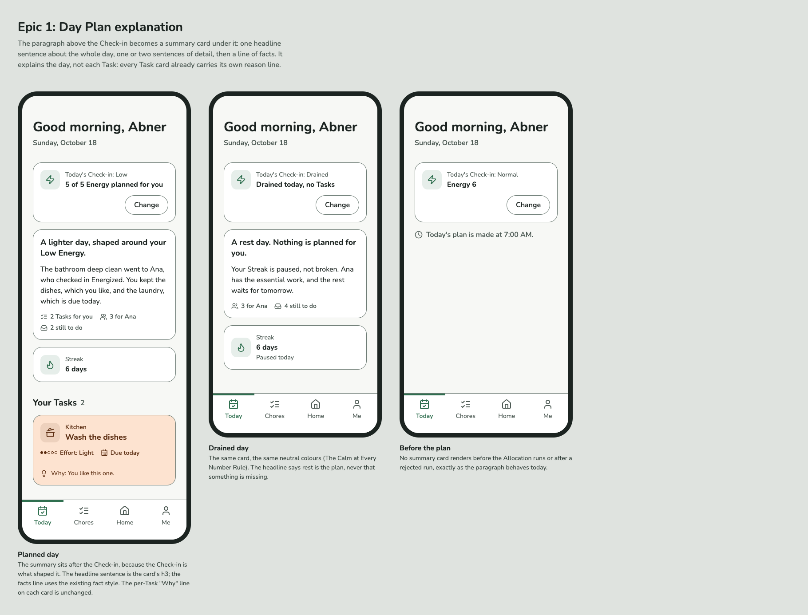
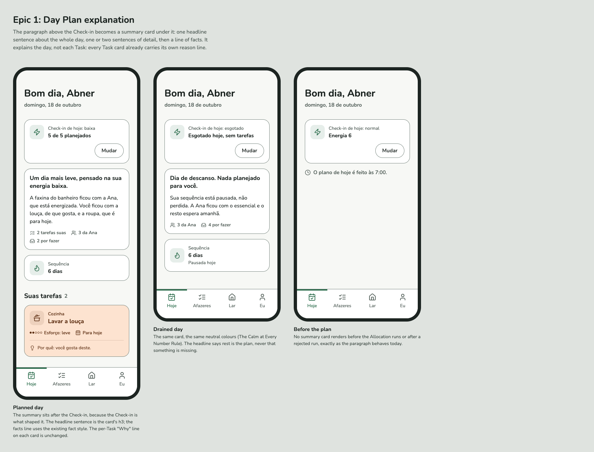
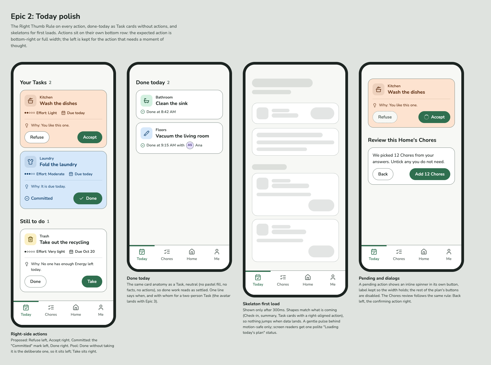
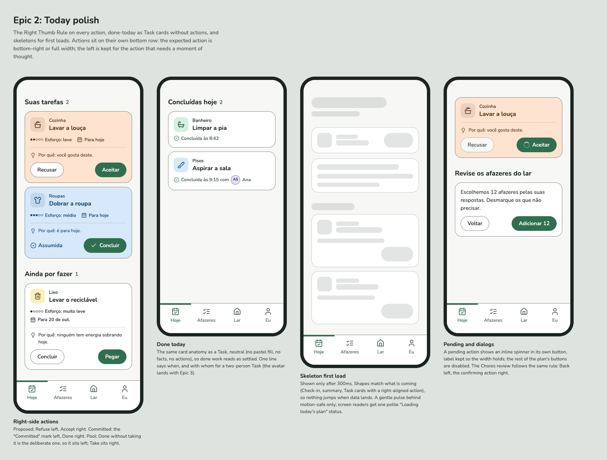
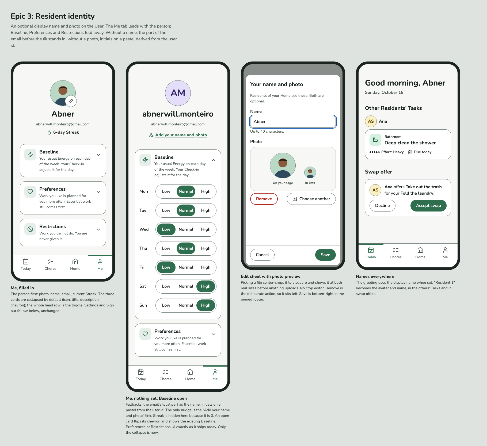
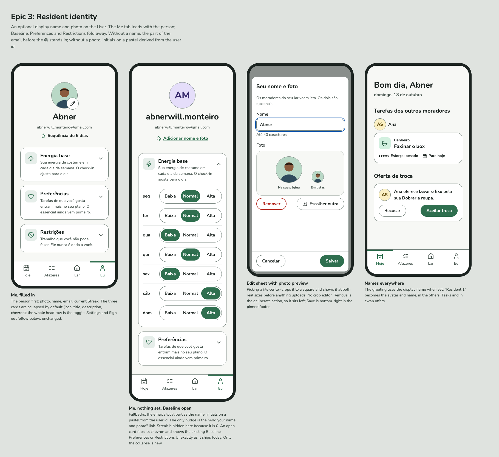
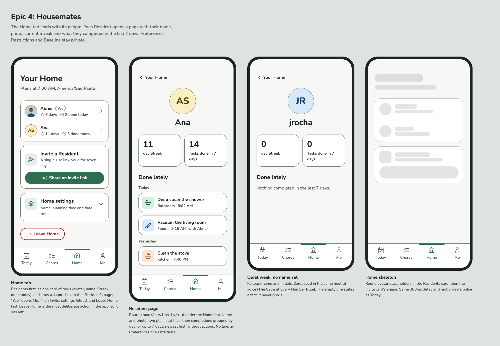
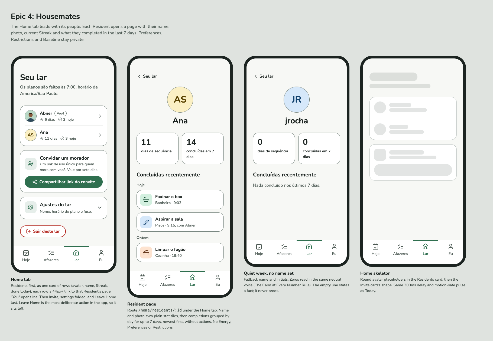
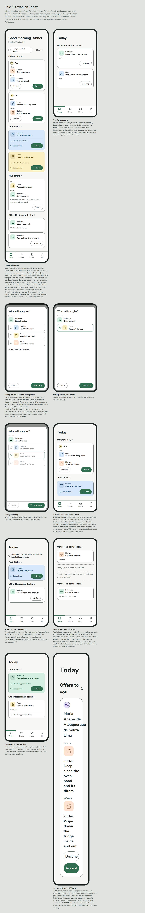
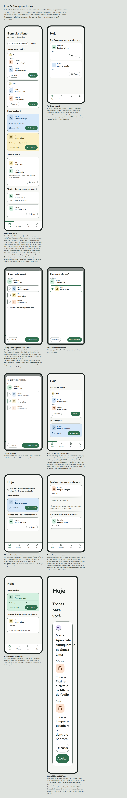

# Design mocks

Mocks for the post-v1 epics, built against [`DESIGN.md`](../../DESIGN.md). Each board is a static HTML page (open it in a browser; add `?lang=pt-BR` for Brazilian Portuguese) with a PNG render per locale for GitHub. `mocks-i18n.js` holds the pt-BR wording, taken from the shipped catalog where it exists. Copy in the mocks is illustrative; the i18n catalogs own the real wording.

| Epic | en-US | pt-BR |
|---|---|---|
| 1. Day Plan explanation | [HTML](epic-1-day-explanation.html) ·  |  |
| 2. Today polish | [HTML](epic-2-today-polish.html) ·  |  |
| 3. Resident identity | [HTML](epic-3-resident-identity.html) ·  |  |
| 4. Housemates | [HTML](epic-4-housemates.html) ·  |  |
| 5. Swap on Today | [HTML](epic-5-swap.html) ·  |  |

`mocks.css` mirrors the tokens in `web/src/index.css`; it is not imported by the app.
